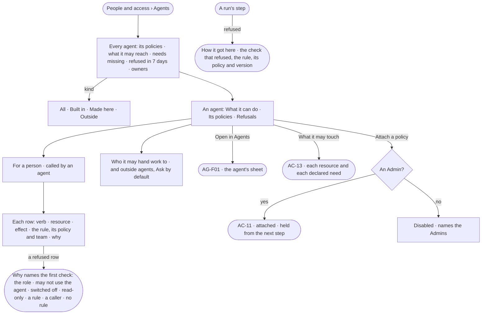

# AC-12 · See why an agent can or cannot

**As** an Admin **I want** every agent's access, read for a person, with why each act is allowed or refused **so that**
I see why an agent can or cannot for that person, and a refusal never surprises anyone in a run.

Tasks: [task.md](task.md) · Feature: [AC-F04](../../feature.md)

## Who can

| Lens | Can | Otherwise sees |
|---|---|---|
| Admin | Read every agent's access for any person; attach a policy to it (AC-11) | — |
| Operator | Read every agent's access for any person, its policies and its refusals | *Attach a policy* disabled — *Needs the Admin role — ask Priya or Lee* |

## Flow

## Acceptance criteria

| # | Given | When | Then |
|---|---|---|---|
| AC-12.1 | The deployment's agents | *Agents* is read | one row per built-in, made-here and outside agent — its policies, how many resources it may reach, needs missing, refused in 7 days, its owners; helpers are counted on their maker, not listed |
| AC-12.2 | The tab | it is read | it says *An agent holds every Read, Write and Run through the Access Policies attached to it. Workers hold none — they only run steps* |
| AC-12.3 | An agent | it is opened | tabs *What it can do · Its policies · Refusals*, and *Open in Agents* |
| AC-12.4 | *What it can do* | the reader picks *For* a person, and optionally *Called by* an agent | each row reads verb · resource · effect · the rule, its policy and the team it holds for · why, for that person and that chain; the reader is the person by default |
| AC-12.5 | Rules that name a team | *For* changes to a person on another team | the effects change to those that hold for that person; a rule for a team they are not on reads *Not for {person} — {team} only* |
| AC-12.6 | A refused row | *Why* is read | it names the first check that refuses — *{person}'s role does not hold {feature}* · *{person} may not use {agent}* · *{database} is switched off by {person}* · *{database} is read-only* · *{rule} on {policy}* · *{caller} may not* · *No rule — denied* |
| AC-12.7 | An agent with no policy attached | *What it can do* is read | every row reads *Denied · holds no policy*, and for an Admin *Attach a policy* leads |
| AC-12.8 | A resource a rule allows that no declared need uses | it is listed | it reads *Nothing it uses needs it* |
| AC-12.9 | A helper an agent made | its access is read | it holds its maker's access, narrowed, and lists no policy of its own |
| AC-12.10 | A run's step | a check refuses it | the step fails *refused* before it runs and nothing is spent, naming the rule, its policy and the agent in the chain that refused; the refusal is in *Refusals* and History (AC-F06) |
| AC-12.11 | *Who it may hand work to* | it is read | each agent it may run, the rule that allows it, and its effect; an outside agent reads *Ask* unless a rule allows it |
| AC-12.12 | A callee run by a caller for a person | its access is read with *Called by* | each row reads the strictest of the callee, every caller and the person's teams, and names which one narrowed it |
| AC-12.13 | An Admin | they attach a policy from here or from the agent's sheet in Agents | it is one attachment (AC-11); it holds from the agent's next step |
| AC-12.14 | An Operator or a Modeller | they open an agent | everything reads; *Attach a policy* is disabled, naming the Admin role and the Admins |
| AC-12.15 | A refused step | the reader opens *How it got here* on its run | it shows the step, the check that refused it, the rule, its policy and version, the team it held for and who saved it, as they were when the step ran |
| AC-12.16 | The list of agents | it fails to load | it says what could not load, with *Try again* |

## Screens

| Surface | Lens | First use | Empty after a filter | Loading | Has data | Failed | Agent working or proposing | No access |
|---|---|---|---|---|---|---|---|---|
| Agents — the list | Admin | settings.access · Built-in agents only | settings.access · Nothing matches | settings.access · Loading | settings.access · Agents | settings.access · Could not load | — | — |
| Agents — the list | Operator | access.locked · Built-in agents only | access.locked · Nothing matches | access.locked · Loading | access.locked · Agents | access.locked · Could not load | — | access.locked · Agents |
| An agent — what it can do | Admin | settings.access · Holds no policy | — | settings.access · Loading | settings.access · What it can do | settings.access · Could not load | — | — |
| An agent — what it can do | Operator | access.locked · Holds no policy | — | access.locked · Loading | access.locked · What it can do | access.locked · Could not load | — | access.locked · What it can do |
| An agent — refusals | Admin | settings.access · No refusals | — | settings.access · Loading | settings.access · Refusals | settings.access · Could not load | — | — |
| An agent — refusals | Operator | access.locked · No refusals | — | access.locked · Loading | access.locked · Refusals | access.locked · Could not load | — | access.locked · Refusals |
| The refused step on its run | Admin | — | — | agents.run · Loading | agents.run · Refused by a rule | agents.run · Failed | — | — |
| The refused step on its run | Operator | — | — | agents.run · Loading | agents.run · Refused by a rule | agents.run · Failed | — | agents.run · Content withheld |
