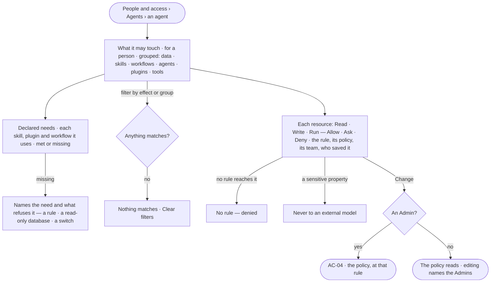

# AC-13 · See what an agent may touch

**As** an agent builder **I want** one read of everything an agent may touch — every graph database and kind,
skill, workflow, agent, plugin and tool — with its effect and the rule that sets it, beside what each skill, plugin
and workflow it uses declares it needs **so that** I know before any run what it will do on its own, what it will
ask about, what it is denied, and what will not work until a rule or a mode changes.

Tasks: [task.md](task.md) · Feature: [AC-F04](../../feature.md)

## Who can

| Lens | Can | Otherwise sees |
|---|---|---|
| Admin | Read every resource and every declared need; *Change* opens the policy at that rule to edit (AC-04) | — |
| Operator | Read every resource and every declared need | *Change* opens the policy read-only; editing is disabled, naming the Admin role and the Admins |

## Flow

## Acceptance criteria

| # | Given | When | Then |
|---|---|---|---|
| AC-13.1 | An agent | *What it may touch* opens | every resource reads, grouped — data by graph database and kind · skills · workflows · agents · plugins · tools — each with Read, Write or Run and its effect for the person chosen |
| AC-13.2 | A resource's effect | it is read | it names the rule that sets it, its policy and version, the team it holds for or *Everyone*, and who saved it |
| AC-13.3 | Rules that disagree | the effect is read | it is the strictest — Deny over Ask over Allow — and the rule that set it is marked |
| AC-13.4 | A resource no rule reaches | it is read | it reads *No rule — denied* |
| AC-13.5 | A kind with a sensitive property | it is read | the property reads *Never to an external model*, linking to Meaning |
| AC-13.6 | Each skill, plugin and workflow the agent uses | *Declared needs* is read | each lists the verbs and resources it needs, each *Met* or *Missing* |
| AC-13.7 | A need the agent's policies do not allow | it is read | it reads *Missing*, naming the rule or *No rule — denied*; a step that uses it is refused before it runs, naming the need |
| AC-13.8 | A Write need on a read-only graph database | it is read | it reads *Missing — {database} is read-only*; a step that uses it is refused before it runs, naming the database |
| AC-13.9 | A need on a graph database or plugin switched off | it is read | it reads *Missing — switched off by {person}*; a step that uses it is refused before any rule is read |
| AC-13.10 | A filter by effect or by group with no match | it is applied | *Nothing matches*, naming the filter, with *Clear filters* |
| AC-13.11 | A resource | an Admin presses *Change* | the policy opens at that rule as a draft; nothing changes here |
| AC-13.12 | An Operator or a Modeller | they press *Change* | the policy opens read-only; editing is disabled, naming the Admin role and the Admins |
| AC-13.13 | A policy saved while a run is going | the run's next step runs | it is held to the saved version, checked when it runs; an open ask on an act it now denies closes refused, naming the rule |
| AC-13.14 | An agent's step | it runs | the engine keeps with it the effect, the rule, its policy and version, the team and who saved it; *How it got here* reads these, never today's policies |
| AC-13.15 | *What it may touch* | it fails to load | it says what could not load, with *Try again* |

## Screens

| Surface | Lens | First use | Empty after a filter | Loading | Has data | Failed | Agent working or proposing | No access |
|---|---|---|---|---|---|---|---|---|
| What it may touch | Admin | settings.access · What it may touch · Holds no policy | settings.access · What it may touch · Nothing matches | settings.access · What it may touch · Loading | settings.access · What it may touch | settings.access · What it may touch · Could not load | — | — |
| What it may touch | Operator | access.locked · What it may touch · Holds no policy | access.locked · What it may touch · Nothing matches | access.locked · What it may touch · Loading | access.locked · What it may touch | access.locked · What it may touch · Could not load | — | access.locked · What it may touch |
| Declared needs | Admin | settings.access · Declared needs · Nothing used yet | — | settings.access · Declared needs · Loading | settings.access · Declared needs | settings.access · Declared needs · Could not load | — | — |
| Declared needs | Operator | access.locked · Declared needs · Nothing used yet | — | access.locked · Declared needs · Loading | access.locked · Declared needs | access.locked · Declared needs · Could not load | — | access.locked · Declared needs |
