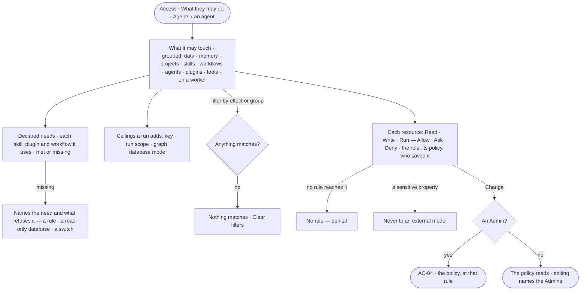

# AC-13 · See what an agent may touch

**As** an agent builder **I want** one read of everything an agent may touch — every graph database and kind,
skill, workflow, agent, plugin and tool — with its effect and the rule that sets it, beside what each skill, plugin
and workflow it uses declares it needs **so that** I know before any run what it will do on its own, what it will
ask about, what it is denied, and what will not work until a rule or a mode changes.

Tasks: [task.md](task.md) · Feature: [AC-F04](../../feature.md)

## Who can

| Access | Can | Otherwise sees |
|---|---|---|
| Admin | Read every resource and every declared need; *Change* opens the policy at that rule to edit (AC-04) | — |
| Operator | Read every resource and every declared need when they hold Read on `access/policies`; without it nothing here | *No access* — *Needs Read on Access — ask Priya or Lee*; with Read, *Change* opens the policy read-only; editing is disabled, naming Edit on Access and who can grant it |

## Flow

## Acceptance criteria

| # | Given | When | Then |
|---|---|---|---|
| AC-13.1 | An agent | *What it may touch* opens | every resource reads, grouped — data by graph database and kind · memory · projects · skills · workflows · agents · plugins · tools · files, programs and hosts on a worker — each with Read, Write or Run and its effect, the same for everyone who may use the agent |
| AC-13.2 | A resource's effect | it is read | it names the rule that sets it, its policy and version, and who saved it |
| AC-13.3 | Rules that disagree | the effect is read | it is the strictest — Deny over Ask over Allow — and the rule that set it is marked |
| AC-13.4 | A resource no rule reaches | it is read | it reads *No rule — denied* |
| AC-13.5 | A kind with a sensitive property | it is read | the property reads *Never to an external model*, linking to Meaning |
| AC-13.6 | Each skill, plugin and workflow the agent uses | *Declared needs* is read | each lists the verbs and resources it needs, each *Met* or *Missing* |
| AC-13.7 | A need the agent's policies do not allow | it is read | it reads *Missing*, naming the rule or *No rule — denied*; a step that uses it is refused before it runs, naming the need |
| AC-13.8 | A Write need on a read-only graph database | it is read | it reads *Missing — {database} is read-only*; a step that uses it is refused before it runs, naming the database |
| AC-13.9 | A need on a graph database or plugin switched off | it is read | it reads *Missing — switched off by {person}*; a step that uses it is refused before any rule is read |
| AC-13.10 | A filter by effect or by group with no match | it is applied | *Nothing matches*, naming the filter, with *Clear filters* |
| AC-13.11 | A resource | an Admin presses *Change* | the policy opens at that rule as a draft; nothing changes here |
| AC-13.12 | A person with Read on `access/policies` but not Edit on Access | they press *Change* | the policy opens read-only; editing is disabled, naming Edit on Access and who can grant it |
| AC-13.13 | A policy saved while a run is going | the run's next step runs | it is held to the saved version, checked when it runs; an open ask on an act it now denies closes refused, naming the rule |
| AC-13.14 | An agent's step | it runs | the engine keeps with it the effect, the rule, its policy and version, any ceiling that narrowed it and who saved the rule; *How it got here* reads these, never today's policies |
| AC-13.15 | *What it may touch* | it fails to load | it says what could not load, with *Try again* |
| AC-13.16 | A step its rules allow | the key it runs under, its run scope or a credential's scope does not | it is refused before it runs, naming the ceiling — *{ceiling} keeps {agent} from {verb} {resource}*; no ceiling ever lets a step its rules refuse |
| AC-13.17 | A run inside a project whose agent may read `memory/project/*` | it reads another project's memory that is not related to its own | it is refused, naming the run scope; its own project, the projects related to it and its task read as the rules allow |
| AC-13.18 | A run inside a project that names only `sales`, whose agent may Read `data/*/*` | a step reads `data/crm/Ticket` | it is refused before it runs — *Run scope keeps {agent} from Read data/crm/Ticket*; its steps in `sales` read as the rules allow, and *What it may touch* lists the project's graph databases among the run's ceilings |

## Screens

| Surface | Access | First use | Empty after a filter | Loading | Has data | Failed | Agent working or proposing | No access |
|---|---|---|---|---|---|---|---|---|
| What it may touch | Admin | settings.agent_access · What it may touch · Holds no policy | settings.agent_access · What it may touch · Nothing matches | settings.agent_access · What it may touch · Loading | settings.agent_access · What it may touch | settings.agent_access · What it may touch · Could not load | — | — |
| What it may touch | Operator | settings.agent_access · Locked · What it may touch · Holds no policy | settings.agent_access · Locked · What it may touch · Nothing matches | settings.agent_access · Locked · What it may touch · Loading | settings.agent_access · Locked · What it may touch | settings.agent_access · Locked · What it may touch · Could not load | — | settings.agent_access · Locked · What it may touch |
| Declared needs | Admin | settings.agent_access · Declared needs · Nothing used yet | — | settings.agent_access · Declared needs · Loading | settings.agent_access · Declared needs | settings.agent_access · Declared needs · Could not load | — | — |
| Declared needs | Operator | settings.agent_access · Locked · Declared needs · Nothing used yet | — | settings.agent_access · Locked · Declared needs · Loading | settings.agent_access · Locked · Declared needs | settings.agent_access · Locked · Declared needs · Could not load | — | settings.agent_access · Locked · Declared needs |
