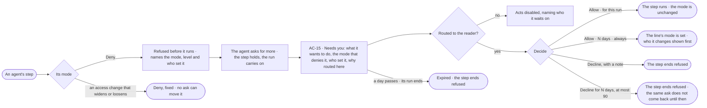

# AC-14 · A denied agent asks for more

**As** someone whose agent was denied by a mode **I want** the agent to ask for more in Needs you, naming the mode,
its level and who set it **so that** work is not lost to a Deny nobody meant — the agent proposes the wider mode, and
a person who may change it decides.

Tasks: [task.md](task.md) · Feature: [AC-F04](../../feature.md)

## Who can

| Lens | Can | Otherwise sees |
|---|---|---|
| Admin | Read every ask for more; decide one routed to them — *Allow* for this run, N days or always, or *Decline* | An ask routed to others reads, its acts disabled, naming who it waits on |
| Operator | Read every ask for more | An ask routed to others reads, its acts disabled, naming who it waits on. *With Can manage people or Can build agents*: decide one routed to them (AC-14.4); N days and *always* are offered only to someone who may change that line |

## Flow

## Acceptance criteria

| # | Given | When | Then |
|---|---|---|---|
| AC-14.1 | An agent's step whose mode is Deny | it is about to run | it is refused before it runs, naming the mode, its level and who set it; nothing is spent |
| AC-14.2 | A refused step | the agent asks for more | one ask appears in Needs you; the step holds and the rest of the run carries on |
| AC-14.3 | An ask for more | it is read | it shows what the step would do, exactly; the mode that denies it, its level and who set it; who asked and on whose behalf; and the mode it asks for |
| AC-14.4 | An ask for more | it is raised | it is routed to people who hold Allow on changing the line that denied it — on a rule, those who can manage people and the Owner; on the agent's own rule, those who can build agents — never the person who started the run nor anyone it benefits, and it says which |
| AC-14.5 | An ask for more, routed to the reader | they press *Allow* for this run | that step runs for that agent, in this run only; no mode changes |
| AC-14.6 | An ask for more, routed to someone who may change that line | they pick N days or always | *Who it changes* shows first; on confirm the line's mode is set, naming them, until the time picked |
| AC-14.7 | An ask for more about an access change that neither widens nor loosens (AC-14.14) | it is read | *Allow* lets this one change go; N days and always are not offered — an access change is never Allow for an agent |
| AC-14.8 | An ask for more | the reader declines with a note, or it expires, or its run ends | the step ends refused; the note is kept |
| AC-14.9 | An agent already asked for an item in this run | it is denied the same item again | it does not ask again; the step is refused, naming the open or decided ask |
| AC-14.10 | An agent | it tries to decide its own ask or to change a mode | it is refused; only a person decides |
| AC-14.11 | An Operator the ask is not routed to | they open it | it reads; the acts are disabled, naming who it waits on |
| AC-14.12 | A denied step | the reader opens *How it got here* on its run | it shows the step, the mode that denied it, its level, who set it, and the ask with its answer |
| AC-14.13 | A step of a run, denied on any item | the agent asks for more | it may ask once per run per item — one act on one thing (AC-F04); an ask matching one already open joins it; a helper's or a delegate's asks count against its root agent; past the holder's daily cap or the Graph's (AC-F04 *Asks for more are bounded*), the step is refused, naming the cap. A project's pick-up Deny opens no run, so nothing is asked (PJ-15.3) |
| AC-14.14 | An access change that widens the agent, its helpers, the person who started its run or its delegates, or loosens any line | an agent's step would make it | it is Deny, fixed — no line, ask or *Allow* moves it; the agent's route to more is an ask for the act it needs, decided never by whoever it benefits |
| AC-14.15 | An ask for more | it is raised, then allowed | it stores the exact act — function, arguments, targets and their versions — with a hash, and the yes runs only that act; a write whose targets changed since the ask is refused, naming what changed |
| AC-14.16 | An ask for more | it is raised | its deadline is one day, unless its run ends first |
| AC-14.17 | An ask for more, routed to the reader | they pick *Decline for N days*, at most 90 | the step ends refused; until then the same ask from that holder on that item is refused without asking, naming the decline |

## Screens

| Surface | Lens | First use | Empty after a filter | Loading | Has data | Failed | Agent working or proposing | No access |
|---|---|---|---|---|---|---|---|---|
| An ask for more | Admin | — | — | inbox · Loading | inbox · Asks for more | inbox · Already decided | inbox · An agent asks for more | — |
| An ask for more | Operator | — | — | inbox · Loading | inbox · Asks for more | inbox · Already decided | inbox · An agent asks for more | inbox · Not yours to answer |
| The denied step on its run | Admin | — | — | agents.run · Loading | agents.run · Denied by a mode | agents.run · Refused | agents.run · Waiting on an ask for more | — |
| The denied step on its run | Operator | — | — | agents.run · Loading | agents.run · Denied by a mode | agents.run · Refused | agents.run · Waiting on an ask for more | agents.run · Denied by a mode |
