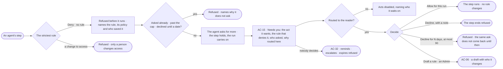

# AC-14 · A denied agent asks for more

**As** someone whose agent was denied by a rule **I want** the agent to ask for more in Needs you, naming the rule,
its policy and who saved it **so that** work is not lost to a Deny nobody meant — the agent proposes the act it
needs, and a named approver decides.

Tasks: [task.md](task.md) · Feature: [AC-F04](../../feature.md)

## Who can

| Lens | Can | Otherwise sees |
|---|---|---|
| Admin | Read every ask for more; decide one they are named for — *Allow for this run* or *Decline*; *Draft a rule* to make a lasting change (AC-06) | An ask not routed to them reads, its acts disabled, naming who it waits on |
| Operator | Read the asks for more of runs they are behind; decide one they are named for — *Allow for this run* or *Decline* | An ask not routed to them reads, its acts disabled, naming who it waits on; *Draft a rule* is disabled, naming the Admin role |

## Flow

## Acceptance criteria

| # | Given | When | Then |
|---|---|---|---|
| AC-14.1 | An agent's step whose strictest rule is Deny, or that no rule reaches | it is about to run | it is refused before it runs, naming the rule, its policy and who saved it, or *No rule*; nothing is spent |
| AC-14.2 | A refused step | the agent asks for more | one ask appears in Needs you; the step holds and the rest of the run carries on |
| AC-14.3 | An ask for more | it is read | it shows exactly the act the step would take; the rule that denies it, its policy and who saved it; who asked and on whose behalf; and the agent in the chain that was denied |
| AC-14.4 | An ask for more | it is raised | it is routed to the agent's named approvers, else its owners (AC-26), never the person behind the run nor anyone it benefits, and says which |
| AC-14.5 | An ask for more, routed to the reader | they press *Allow for this run* | that step runs for that agent, in this run only, never its children; no rule changes |
| AC-14.6 | An ask for more, read by an Admin | they press *Draft a rule* | a draft of the agent's policy opens with the rule proposed and *Who it changes* (AC-06); the ask is still decided on its own |
| AC-14.7 | An ask for more | the reader declines with a note, or it expires, or its run ends | the step ends refused; the note is kept |
| AC-14.8 | An ask for more | nobody decides by its deadline | it reminds, escalates and expires refused, never allowed (AC-32) |
| AC-14.9 | An agent already asked for an item in this run | it is denied the same item again | it does not ask again; the step is refused, naming the open or decided ask |
| AC-14.10 | An agent | it tries to decide its own ask, or to write a policy, rule, attachment, role, team, owner or approver | it is refused — *Only a person changes access* |
| AC-14.11 | A person the ask is not routed to | they open it | it reads; the acts are disabled, naming who it waits on |
| AC-14.12 | An ask for more, routed to the reader | they pick *Decline for N days*, at most 90 | the step ends refused; until then the same ask from that agent on that item is refused without asking, naming the decline |
| AC-14.13 | A step denied on any item | the agent asks for more | it may ask once per run per item — one verb on one resource; an ask matching one already open joins it; a helper's or a delegate's asks count against its root agent; past the agent's daily cap or the deployment's, the step is refused, naming the cap |
| AC-14.14 | A denied step | the reader opens *How it got here* on its run | it shows the step, the rule that denied it, its policy and version, who saved it, and the ask with its answer |
| AC-14.15 | An ask for more | it is raised, then allowed | it stores the exact act — function, arguments, targets and their versions — with a hash, and the yes runs only that act; a write whose targets changed since the ask is refused, naming what changed |
| AC-14.16 | An ask for more | it is raised | its deadline is one day, unless its run ends first |

## Screens

| Surface | Lens | First use | Empty after a filter | Loading | Has data | Failed | Agent working or proposing | No access |
|---|---|---|---|---|---|---|---|---|
| An ask for more | Admin | — | — | inbox · Loading | inbox · Asks for more | inbox · Already decided | inbox · An agent asks for more | — |
| An ask for more | Operator | — | — | inbox · Loading | inbox · Asks for more | inbox · Already decided | inbox · An agent asks for more | inbox · Not yours to answer |
| The denied step on its run | Admin | — | — | agents.run · Loading | agents.run · Refused by a rule | agents.run · Refused | agents.run · Waiting on an ask for more | — |
| The denied step on its run | Operator | — | — | agents.run · Loading | agents.run · Refused by a rule | agents.run · Refused | agents.run · Waiting on an ask for more | agents.run · Content withheld |
