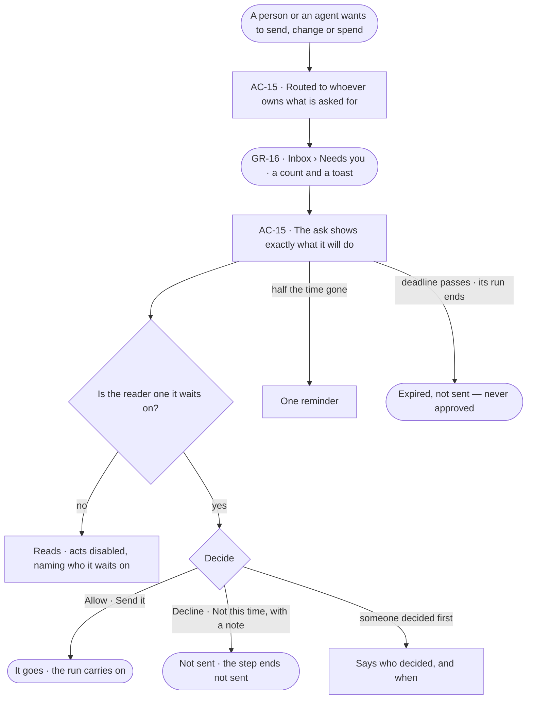
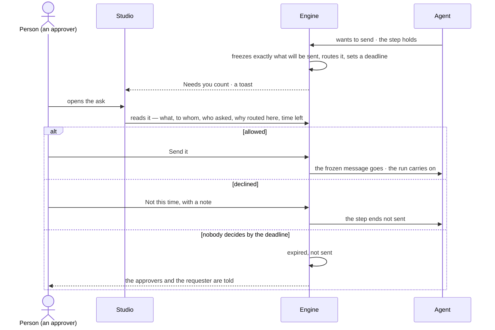

# Asks and approvals

> Whatever a line sets to Ask — a person's act or an agent's — waits for someone who holds Allow on it, showing
> exactly what it will do. The decision it helps make: *should this go — this message, this access, these tokens?*

## User journey

Journeys this feature is a step of: [J03 · Give an agent work and decide on the result](../../../../journeys/J03-give-an-agent-work-and-decide-on-the-result.md) · [J04 · Build an agent and improve it from what runs teach](../../../../journeys/J04-build-an-agent-and-improve-it-from-what-runs-teach.md) · [J06 · Set what an agent may touch](../../../../journeys/J06-set-what-an-agent-may-touch.md)

## Stories

| ID | Story | Status |
|---|---|---|
| AC-15 | [Decide what an agent asks before it acts](stories/AC-15-decide-what-an-agent-asks-before-it-acts/story.md) | idea |

## Access

| Act | Role (`.claude/team/TEAM.md` §7) | Everyone else sees |
|---|---|---|
| Read every pending ask in the Graph (*All*) and the answered ones | Operator — every member | — |
| Decide an ask — allow or decline, with a note | The people it is routed to, whatever their Graph role; a Graph role does not widen it | The ask reads; its acts are disabled, naming who it waits on |

## States

| State | What the person sees |
|---|---|
| First use | Needs you: *Nothing needs you*, as good news |
| Empty after a filter | Needs you filtered by product or kind with no match: *Nothing matches*, with *Clear filters* |
| Loading | The ask opens at once; what it will do loads in place |
| Has data | Asks first, nearest deadline first, each with what it will do, who asked, why it is routed here and the time left |
| Failed | The ask could not load, saying why, with *Try again*; a late or second decision is refused, saying who decided and when |
| Agent working or proposing | An agent's ask: what it will send, change or spend, exactly, with who asked and on whose behalf |
| No access | An ask routed to someone else reads, its acts disabled, naming who it waits on |

## Rules

| Rule | Detail |
|---|---|
| An ask shows what it will do | Exactly what will be sent — for a message its To, Subject and body; for a delivery the channel and message — frozen when it is asked. Allowing sends that, never a re-render. Every ask stores its exact act — function, arguments, targets and their versions — with a hash; a yes runs only that act, and a write whose targets changed since is refused ([A yes runs only what was asked](../../../access/product.md#decisions)) |
| An ask names its routing | Each ask says who asked and on whose behalf (*Ravi ▸ Route analyst*), what it wants in one line, who it is routed to and why (*world owner* · *agent owner* · *started the run* · *wrote the task* · *install admin*), how long it has waited, and its run |
| Routed to whoever owns what is asked for | The owner of the view of the graph for access; the target agent's owner for a delegation and a send; the person who started the run for budget; the task's author for a question; an install admin for workers; whoever may change the line that denied an agent (AC-14); people who hold Allow on the act for a person's ask — for a grant asked by *Ask <name>*, the person named when they may give it ([AC-07](../../../access/features/AC-F02-access-rules/stories/AC-07-read-access-without-the-grant-and-know-who-to-ask/story.md)). Never the asker, nor the person or agent it benefits |
| Only the people it is routed to decide | A Graph role does not widen it — an owner not named is refused like anyone else. Any one of them decides; no quorum, no order. On a yes the engine checks the decider and every check again before the act goes ([Checked when the step runs](../../../access/product.md#decisions)) |
| A deadline, one reminder | Each ask has a deadline. One reminder goes at half-time to those who have not decided. At the deadline it is *expired, not sent*; a late decision is refused |
| Never decided by itself | Nothing set to Ask is ever decided by itself; nothing acts without asking but where a person's line says Allow ([one access model](../../../access/product.md#decisions)). Expiry tells the approvers and the requester in the Inbox |
| An ask ends with its run | When its run ends, every pending ask of it leaves Needs you and closes expired; what it held is not sent. A held delivery and a breaking publish keep their own deadline |
| A waiting step holds; the run carries on | Only the step that asked waits |
| Allowed for this run | An allowed ask reaches that agent, for this run, never its children. *Allow always* exists only on a delegation and adds the target to the caller's *May delegate to* |
| A held delivery holds the send, not the run | The run has settled; declining costs nothing and its status is unchanged |
| A breaking publish | Its ask is the impact list; allowing opens the migration run; declining or expiry leaves the draft unpublished. It is routed to the Graph's owners other than the requester |
| Leans on | The Inbox (GR-F05) · access rules and asks for more (AC-F02 · AC-F04) · agents and their runs (AG-F03) · History (AC-F06) |

## Data touched

| Record | Read or write |
|---|---|
| Asks — kind, what it holds exactly and its hash, who asked and on whose behalf, routed to and why, deadline, status, who decided, when, the note | Write · read |
| History rows of every decision and every rule change (AC-F06) | Write |

## Decisions

| Decision | Detail |
|---|---|
| The act is in the row | An ask shows what it will send, change or spend in its row — the start of the body with *See all it will send* — and its acts beside it, as the design language says; nothing is decided unseen |
| An ask is decided as shown | Allow or decline what was shown. Changing it before it goes is a new run, not an edit of the ask |
| Acts carry their kind's words | A send: *Send it* · *Not this time*. Access, budget and delegation: *Allow* · *Decline*. A question: its answers |

## Open questions

| Question | Who answers |
|---|---|
| May a person change the arguments of a held step before allowing it, re-checked against what the agent may do? The project review notes allow it; this feature decides an ask as shown. Recommend: no — decline with a note; the agent runs again with it | Ravi |
| Does an answered ask stay readable in the Inbox (*Answered*), or only in History? Recommend: in History alone — the Inbox holds what waits | Ravi |

## Not building

| Item | Why not |
|---|---|
| Changing what an ask will send before allowing it | Allow or decline what was shown; an edit is a new run |
| Quorum or ordered approvers | Any one of the people it is routed to decides |
| Deciding by email reply | A decision is a signed-in act in Studio, the CLI or the API |
