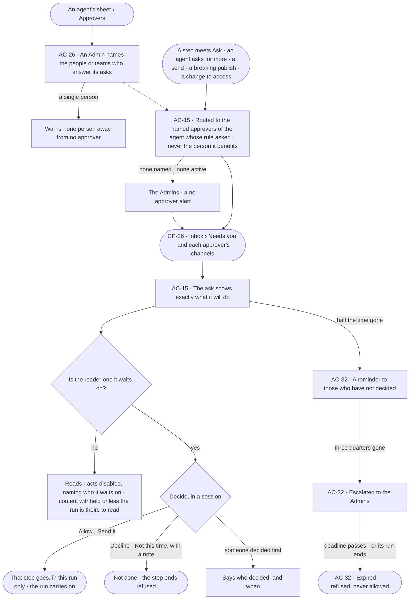
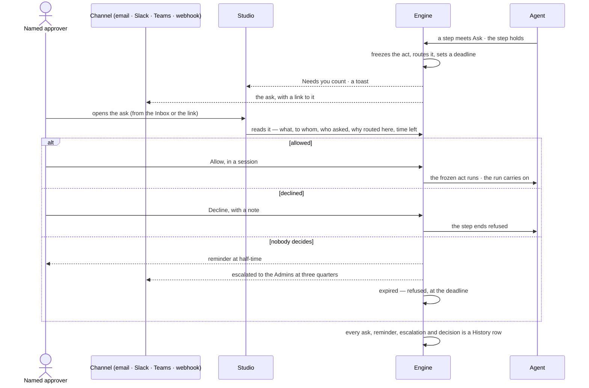

# Asks and approvals

> Whatever a rule sets to Ask waits for the agent's named approvers — people or teams, else the Admins with a
> *no approver* alert, never the person it benefits — showing exactly what it will do, in the Inbox and the channels
> each approver uses; a yes covers that step of that run; unanswered, it reminds, escalates to the Admins, then
> expires refused, never allowed.
> The decision it helps make: *should this go — this message, this write, these tokens?*

## User journey

Journeys this feature is a step of: [J03 · Give an agent work and decide on the result](../../../../journeys/J03-give-an-agent-work-and-decide-on-the-result.md) · [J04 · Build an agent and improve it from what runs teach](../../../../journeys/J04-build-an-agent-and-improve-it-from-what-runs-teach.md) · [J05 · Join a team](../../../../journeys/J05-join-a-team.md) · [J06 · Set what an agent may touch](../../../../journeys/J06-set-what-an-agent-may-touch.md)

## Stories

| ID | Story | Status |
|---|---|---|
| AC-26 | [Name who answers an agent's asks](stories/AC-26-name-who-answers-an-agents-asks/story.md) | idea |
| AC-15 | [Decide what an agent asks before it acts](stories/AC-15-decide-what-an-agent-asks-before-it-acts/story.md) | idea |
| AC-32 | [An unanswered ask reminds, escalates and expires](stories/AC-32-an-unanswered-ask-reminds-escalates-and-expires/story.md) | idea |

## Access

| Act | Role ([the role table](../AC-F02-access-policies/feature.md#the-role-table)) | Everyone else sees |
|---|---|---|
| Read an ask's content — what it will do, its arguments, what it will send | The people it is routed to, the person behind its run and Admins | That an ask waits, its kind, its agent, who it waits on and its time left — content withheld |
| Read an agent's named approvers | Every signed-in person | — |
| Name or change an agent's approvers | Admin, in a session, signing in again | Disabled — *Needs the Admin role — ask Priya or Lee* |
| Decide an ask — allow or decline, with a note | The people it is routed to, in a session; a role does not widen it — an Admin decides only once it is escalated to them | The ask reads; its acts are disabled, naming who it waits on |

## States

| State | What the person sees |
|---|---|
| First use | Needs you: *Nothing needs you*, as good news |
| Empty after a filter | Needs you filtered by kind or agent with no match: *Nothing matches*, with *Clear filters* |
| Loading | The ask opens at once; what it will do loads in place |
| Has data | Asks first, nearest deadline first, each with what it will do, who asked, why it is routed here, the time left and whether it was escalated |
| Failed | The ask could not load, saying why, with *Try again*; a late or second decision is refused, saying who decided and when, or that it expired |
| Agent working or proposing | An agent's ask: what it will send, write or spend, exactly, with who asked and on whose behalf |
| No access | An ask routed to someone else reads, its acts disabled, naming who it waits on; its content reads only to those who may read its run |

## Rules

| Rule | Detail |
|---|---|
| An ask shows what it will do | Exactly what will be sent — for a message its To, Subject and body; for a delivery the channel and message — frozen when it is asked. Every ask stores its exact act — function, arguments, targets and their versions — with a hash; a yes runs only that act, and a write whose targets changed since is refused |
| An ask names its routing | Each ask says who asked and on whose behalf (*Sam ▸ Reporting agent*), what it wants in one line, who it is routed to and why (*named approver* · *no approver — Admins* · *escalated* · *behind the run*), how long it has waited, and its run |
| Routed to the named approvers | An ask goes to the named approvers of the agent whose rule said Ask — along a caller chain, the agent in the chain that asked ([AC-26](stories/AC-26-name-who-answers-an-agents-asks/story.md)). Approvers are people or teams; an agent's owner or maker is never in the route for being one. A person's own act set to Ask runs as a built-in agent and is routed the same way. A question for the person runs back to the person behind the run. Never the person or agent it benefits |
| No approver falls to the Admins | When an agent names no approvers, or none who can answer is left — every one inactive, or the person it benefits — the ask goes to the Admins and raises a *no approver* alert ([CP-F11](../../../control/features/CP-F11-ops-alerting/feature.md#the-alert-kinds)) |
| A single person warns | Naming one person as an agent's only approver is allowed, with a warning that one absence sends its asks to the Admins; a team or two people clear it |
| A change to access waits for a second Admin | When a second Admin's yes is set ([AC-F02](../AC-F02-access-policies/feature.md#rules)), a saved change to an Access Policy, an attachment or a work connection is an ask routed to every other Admin; the Admin who made it is never in the route |
| Only the people it is routed to decide | A role does not widen it — an Admin not routed to is refused like anyone else, until it is escalated to them. Any one of them decides; no quorum, no order. On a yes the engine checks the decider and every check again before the act goes |
| Decided in a session | A decision is a person's signed-in act in Studio, the CLI or the API; a key, a service user or an agent never decides. A channel carries the ask and a link to it, never the decision |
| Remind, escalate, expire | Each ask has a deadline. At half-time one reminder reaches those who have not decided; at three quarters it is escalated — the Admins join who it waits on, never the person it benefits; at the deadline it expires refused, never allowed |
| Never decided by itself | Nothing set to Ask is ever decided by itself; expiry is a refusal, and tells the approvers and the person behind the run |
| An ask ends with its run | When its run ends, every pending ask of it closes expired; what it held is not done. A held delivery and a breaking publish keep their own deadline |
| A waiting step holds; the run carries on | Only the step that asked waits |
| A yes is this step of this run | An allowed ask lets that step, for that agent, in that run — never another step, its children or another run. Nothing an ask allows lasts: a lasting change is a rule an Admin saves ([AC-F02](../AC-F02-access-policies/feature.md)), and widening a limit is an Admin's edit in [Limits](../../../control/features/CP-F04-limits/feature.md), never an ask |
| Delegation follows grants | An agent hands work only to agents granted to the person behind the run, or already in the run's delegation chain; a delegation set to Ask is decided for that step only ([AG-F05](../../../../capabilities/agents/features/AG-F05-delegation-and-outside-agents/feature.md)) |
| A held delivery holds the send, not the run | The run has settled; declining costs nothing and its status is unchanged |
| A breaking publish | Its ask is the impact list; allowing opens the migration run; declining or expiry leaves the draft unpublished. It runs through the built-in Modeller agent and is routed to its approvers, never the requester |
| Content follows run privacy | An ask's content — its act, arguments and what it will send — reads to the people it is routed to, the person behind the run and Admins; anyone else reads that it waits, its kind, its agent, who it waits on and its time left ([AC-31](../AC-F09-what-left-the-platform/stories/AC-31-keep-a-runs-content-to-those-who-may-read-it/story.md)) |
| Every decision is in History | Every ask, reminder, escalation, decision and expiry is a History row, naming the channel the ask was opened from |
| Leans on | The Inbox and channels (CP-F08) · the *no approver* alert (CP-F11) · Access Policies and asks for more (AC-F02 · AC-F04) · users, teams and Admins (AC-F03) · agents and their runs (CP-F10) · History (AC-F06) |

## Data touched

| Record | Read or write |
|---|---|
| Asks — kind, what it holds exactly and its hash, who asked and on whose behalf, routed to and why, deadline, reminder and escalation, status, who decided, when, the note | Write · read |
| An agent's named approvers | Write · read |
| History rows of every ask and decision (AC-F06) | Write |

## Engine

The low-level design: what this feature stores, serves and refuses. Conventions — naming, errors, lists, events — are
[system-design.md](../../../../system-design.md) §§ 6–8; this section only fills them in.

### Records

| Table | Columns | Notes |
|---|---|---|
| `access_approvals` | `kind` (`access` · `budget` · `delegation` · `send` · `question` · `publish` · `act` · `workflow` · `access_change`) · `subject_kind` (`step` · `budget` · `delegation` · `question` · `model_publish` · `delivery` · `act` · `plan` · `policy_version` · `attachment` · `connection`) · `subject_id` · `agent_id` (whose rule asked) · `run_id?` · `step_run_id?` · `schedule_id?` · `title` · `wants` (one line) · `act` (function, arguments, targets and their versions, frozen) · `act_hash` · `payload` (exactly what goes, frozen) · `asked_by` (the actor chain) · `behind_user_id` · `asker_words?` · `recommended?` (the agent's answer and its reason) · `approver_ids[]` · `routed_reason` (`named approver` · `no approver` · `second admin` · `behind the run`) · `deadline_at` · `reminded_at?` · `escalated_at?` · `escalated_ids[]` · `status` (`pending` · `approved` · `declined` · `expired`) · `decided_by_id?` · `decided_at?` · `decided_via?` (`studio` · `cli` · `api`) · `opened_from?` (`inbox` · `mail` · `slack` · `teams` · `webhook`) · `note` · `declined_until?` · `created_at` | One row per ask. `payload` is what a send or a delivery sends; `act` is what a yes runs |
| `access_agent_approvers` | `agent_id` · `approver_kind` (`user` · `team`) · `approver_id` · `named_by_id` · `named_at` | An agent's named approvers; unique (`agent_id`, `approver_kind`, `approver_id`). None means the Admins, with a *no approver* alert |

### Reads

| Record | Owner |
|---|---|
| The rule that set an act to Ask and the agent whose policy holds it | [AC-F02](../AC-F02-access-policies/feature.md#engine) |
| Users, teams, who is active, the Admins | [AC-F03](../AC-F03-directory/feature.md#engine) |
| Asks for more — their caps and declines | [AC-F04](../AC-F04-what-an-agent-may-touch/feature.md#engine) |
| History — every event this feature writes | [AC-F06](../AC-F06-history/feature.md#engine) |
| Runs and their steps — the step that holds, resume, a run's end, the person behind it | [CP-F10](../../../control/features/CP-F10-runs-and-how-the-agents-are-doing/feature.md#engine) |
| The `budget` ask at an agent's ceiling | [AG-F01](../../../../capabilities/agents/features/AG-F01-build-an-agent/feature.md#engine) |
| A delegation and the run's delegation chain | [AG-F05](../../../../capabilities/agents/features/AG-F05-delegation-and-outside-agents/feature.md#engine) |
| A saved Access Policy version or attachment waiting for a second Admin | [AC-F02](../AC-F02-access-policies/feature.md#engine) |
| The *no approver* alert | [CP-F11](../../../control/features/CP-F11-ops-alerting/feature.md#engine) |
| Approving a plan into a workflow | [AG-F06](../../../../capabilities/agents/features/AG-F06-plans-and-workflows/feature.md#engine) |
| A schedule's held delivery and deadline; the shared clock | [AG-F07](../../../../capabilities/agents/features/AG-F07-schedules/feature.md#engine) |
| A breaking publish and its impact | [SE-F02](../../../../capabilities/semantics/features/SE-F02-change-and-publish-a-model/feature.md#engine) |
| The Inbox row each approver gets, Needs you, and delivery to each person's channels | [CP-F08](../../../control/features/CP-F08-the-inbox/feature.md#engine) |

### Routes

| Route, after `/api/v1/access/approvals` | Does | Story |
|---|---|---|
| `GET /` | A page by the list contract: `?view=for_you · all · answered` (what the reader may decide · every pending ask they can see · decided and expired, newest first) · `?kind=` · `?status=` · `?agent=` · `?run_id=` · `?escalated=true` · `?q=` on the title; content withheld on rows the reader may not read; the tab counts are the engine's | AC-15 |
| `POST /` | A person raises an ask for a role or an agent they lack — *Ask {name}* — `{grant, named_id?, act?}`; a repeat joins the open one | AC-07 |
| `GET /{id}` | One ask with what it holds, who asked and on whose behalf, routed to and why, time left, reminder and escalation | AC-15 · AC-32 |
| `POST /{id}/approve` | `{note? (2,000)}` — for this step of this run | AC-15 · AC-14 |
| `POST /{id}/decline` | `{note, days? (≤ 90)}` — `days` declines the same item from that agent until then | AC-15 · AC-14 |

| Route, after `/api/v1/access/agents/{agent}` | Does | Story |
|---|---|---|
| `GET /approvers` · `PUT /approvers` | The agent's named approvers, or *Admins — no approver* when none are named · replace them `{users[], teams[]}`; the reply carries `warning: single_person` when one person is the only approver; writes need signing in again | AC-26 |

### Events

| Event | When |
|---|---|
| `access.approvals.request` | An ask is raised, or joined — `details.joined` |
| `access.approvals.approve` · `access.approvals.decline` | A person decides — the note, `decided_via` and `opened_from` in `details` |
| `access.approvals.remind` | One reminder at half-time |
| `access.approvals.escalate` | Three quarters of the time gone — who joined in `details` |
| `access.approvals.no_approver` | An ask finds nobody to answer it and falls to the Admins — raises the *no approver* alert |
| `access.approvals.expire` | The deadline passes, or its run ends |
| `access.approvers.update` | An agent's named approvers change — before and after in `details` |

### Refusals

| Status | When | Sentence | Criterion |
|---|---|---|---|
| 409 | A second decision — `already_decided`, with `decided_by` and `decided_at` | *Already {allowed or declined} by {person} at {time}.* | AC-15.9 |
| 409 | A decision after the deadline | *The deadline has passed; it expired, refused.* | AC-32.6 |
| 403 | A person the ask is not routed to — an Admin before escalation included | *This waits on {approvers}.* | AC-15.17 · AC-15.18 · AC-14.11 |
| 403 | A decision with a key, as a service user, or by an agent | *Only a person's signed-in session decides an ask.* | AC-15.27 · AC-15.19 · AC-14.10 |
| 409 | On a yes, the decider may not decide it now, or a check the act needs now refuses — nothing runs | *{check} does not allow this now.* | AC-15.23 |
| 409 | On a yes, a target of the act changed since the ask | *{target} changed since this was asked — {what}.* | AC-15.24 · AC-14.15 |
| 422 | Naming an agent, a service user, the system user or a deactivated user as an approver | *Only active people answer asks.* | AC-26.3 |
| 403 | Changing an agent's approvers by someone who is not an Admin, or with a key | *This needs the Admin role.* | AC-26.10 · AC-26.11 |
| 403 | The Admin who made a change to access decides its ask | *Another Admin approves this change.* | AC-04.18 |
| 422 | Declining for more than 90 days | *At most 90 days.* | AC-14.12 |
| 404 | Reading an ask's content without the right to read its run | *Not found.* | AC-15.31 |
| step | A step that sends with no send gate installed — `blocked` · `approvals_unavailable`, closed, never sent | *Approvals are unavailable — nothing was sent.* | API only — a front-end built without a send gate, not a person's act |

### CLI

| Command | Does |
|---|---|
| `invana approvals list --user <username>` | The asks routed to that person, nearest deadline first |
| `invana approvals approve <id> --user <username> [--note]` · `invana approvals decline <id> --user <username> --note` | Decides as that person, held to every rule and refusal above, and resumes the run as the API does |

### Mechanisms

| Mechanism | How |
|---|---|
| Who raises one | The ask gate for a step whose strictest rule is Ask, or denied (an ask for more); the send gate for a step that sends and a schedule's outward delivery; a breaking publish; a plan to approve into a workflow; a person's act set to Ask (`kind = act`, its route answers `202` with the ask); *Ask {name}* |
| Routing | Computed when it is raised: the agent whose rule asked → its `access_agent_approvers`, each person on a named team; the person behind the run for a question; every other Admin for an `access_change`. The person it benefits and every inactive user are removed; with nobody left — or none named — it falls to the Admins, less the person it benefits, and `access.approvals.no_approver` raises the alert. Stored in `approver_ids` and `routed_reason` |
| What is frozen | `act` and its `act_hash`, and `payload`, when the ask is raised; a yes runs exactly that act and sends exactly that payload — never a re-render |
| The send gate | A step whose function sends goes through the send gate its front-end installs; the gate raises an ask `subject_kind = step` on the step row, its arguments frozen as the payload |
| Deadlines | An ask for more: one day · a held send: 24 hours · a schedule's delivery: the schedule's ([AG-F07](../../../../capabilities/agents/features/AG-F07-schedules/feature.md#engine)) · any other: 24 hours unless its raiser sets one |
| The clock | On the shared tick ([AG-F07](../../../../capabilities/agents/features/AG-F07-schedules/feature.md#mechanisms)): at half-time one reminder to those who have not decided (`reminded_at`); at three quarters escalation — the Admins, less the person it benefits, join `approver_ids` and `escalated_ids` (`escalated_at`); at the deadline expired, timed at the deadline even when the engine was down; asks of ended runs closed expired. Each step is idempotent |
| Delivery | Each ask, reminder, escalation and expiry writes an Inbox row for each person it reaches and goes to the channels they chose ([CP-F08](../../../control/features/CP-F08-the-inbox/feature.md#engine)); a channel carries a link to the ask, and opening it records `opened_from` |
| Decided once | The decision takes the row under a lock; anything after the first is refused |
| A yes | Re-checks that the decider may still decide it and every check the act needs, compares `act_hash` and its targets' versions, then runs the act and resumes the step's run. Nothing outlives the step: the next step meeting the same rule asks again |
| A held send | Allowed, the step sends what was frozen; declined or expired, it fails `send_declined` · *not sent*. A resumed run re-runs the held step against its decision |
| An ask that expires | The step ends refused; the run carries on with its other steps or ends as its plan says |
| A recently added decider | An ask decided by someone who recently gave the asker their access goes; the alert is [CP-F11](../../../control/features/CP-F11-ops-alerting/feature.md#the-alert-kinds)'s *recently added decider* |
| The asker's words | Kept apart from the engine's record of the act, as plain text with control and direction characters removed |
| Content withheld | Rows of `GET /` carry content only when the reader may read the run (AC-31); otherwise kind, agent, approvers, status and time left |

## System impact

| HLD section | Change | NFRs |
|---|---|---|
| § 6 Data and storage | Two tables in Postgres | — |
| § 8 APIs and events | The `…/access/approvals` routes and `access.approvals.*` events | — |
| § 9 Distributed execution | Reminders, escalation and expiry run on the shared clock tick; each is idempotent, so two engine processes repeat nothing | — |
| § 10 AI and agents | An agent's Ask, send, spend or delegation waits on its named approvers; a yes runs only the frozen act | NFR-SEC-1 |
| § 12 Qualities | Security: decided once, only by a person's session, re-checked at the yes; an ask never decides itself and expires refused | NFR-SEC-1 |

## Decisions

| Decision | Detail |
|---|---|
| The act is in the row | An ask shows what it will send, write or spend in its row — the start of the body with *See all it will send* — and its acts beside it, as the design language says; nothing is decided unseen |
| An ask is decided as shown | Allow or decline what was shown. Changing it before it goes is a new run, not an edit of the ask |
| Acts carry their kind's words | A send: *Send it* · *Not this time*. Access, budget, delegation and a plan to approve: *Allow* · *Decline*. A question: its answers |
| Escalation at three quarters | The reminder at half-time leaves the named approvers time to answer before the Admins are drawn in; escalation adds people, never removes the named approvers |
| Admins name approvers | Who answers an agent's asks is part of its access, so only an Admin names them; owners and makers of an agent are not in the route for being one |
| Channels carry a link | Email, Slack, Teams and webhooks carry the ask and a link to it; the decision is made in a signed-in session, so every decision is proven to be a person's |

## Open questions

| Question | Who answers |
|---|---|
| May a person change the arguments of a held step before allowing it, re-checked against what the agent may do? Recommend: no — decline with a note; the agent runs again with it | Ravi |
| Beyond what it will do, should an ask show what the step reads, what it writes and the tokens it is expected to spend? Recommend: yes — reads and writes from the stored act, tokens from the engine's estimate | Ravi |
| Does an answered ask stay readable in the Inbox (*Answered*), or only in History? Recommend: in History alone — the Inbox holds what waits | Ravi |

## Not building

| Item | Why not |
|---|---|
| Changing what an ask will send before allowing it | Allow or decline what was shown; an edit is a new run |
| Quorum or ordered approvers | Any one of the people it is routed to decides |
| Deciding from a channel | A channel carries a link; the decision is a signed-in act in Studio, the CLI or the API |
| An ask that allows itself at its deadline | Expiry is a refusal; nothing set to Ask is ever decided by itself |
| A yes for days or always · a standing list of agents to hand work to | A yes covers one step of one run; a lasting change is a rule an Admin saves, and delegation follows grants |
| Widening a limit by an ask | A limit is an Admin's setting in Limits; an ask lets one step of one run past it, never moves it |
