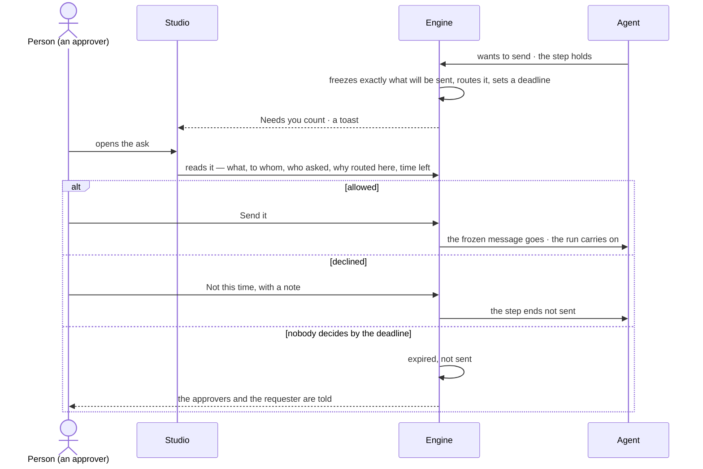

# Asks and approvals

> Whatever a line sets to Ask — a person's act or an agent's — waits for someone who holds Allow on it, showing
> exactly what it will do. The decision it helps make: *should this go — this message, this access, these tokens?*

## User journey

Journeys this feature is a step of: [J03 · Give an agent work and decide on the result](../../../../journeys/J03-give-an-agent-work-and-decide-on-the-result.md) · [J04 · Build an agent and improve it from what runs teach](../../../../journeys/J04-build-an-agent-and-improve-it-from-what-runs-teach.md) · [J06 · Set what an agent may touch](../../../../journeys/J06-set-what-an-agent-may-touch.md)

## Stories

| ID | Story | Status |
|---|---|---|
| AC-15 | [Decide what an agent asks before it acts](stories/AC-15-decide-what-an-agent-asks-before-it-acts/story.md) | idea |

## Access

| Act | Role (`.claude/team/TEAM.md` §7) | Everyone else sees |
|---|---|---|
| Read every pending ask in the Graph (*All*) and the answered ones | Operator — every member | — |
| Decide an ask — allow or decline, with a note | The people it is routed to, whatever their Graph role; a Graph role does not widen it | The ask reads; its acts are disabled, naming who it waits on |

## States

| State | What the person sees |
|---|---|
| First use | Needs you: *Nothing needs you*, as good news |
| Empty after a filter | Needs you filtered by product or kind with no match: *Nothing matches*, with *Clear filters* |
| Loading | The ask opens at once; what it will do loads in place |
| Has data | Asks first, nearest deadline first, each with what it will do, who asked, why it is routed here and the time left |
| Failed | The ask could not load, saying why, with *Try again*; a late or second decision is refused, saying who decided and when |
| Agent working or proposing | An agent's ask: what it will send, change or spend, exactly, with who asked and on whose behalf |
| No access | An ask routed to someone else reads, its acts disabled, naming who it waits on |

## Rules

| Rule | Detail |
|---|---|
| An ask shows what it will do | Exactly what will be sent — for a message its To, Subject and body; for a delivery the channel and message — frozen when it is asked. Allowing sends that, never a re-render. Every ask stores its exact act — function, arguments, targets and their versions — with a hash; a yes runs only that act, and a write whose targets changed since is refused ([A yes runs only what was asked](../../../access/product.md#decisions)) |
| An ask names its routing | Each ask says who asked and on whose behalf (*Ravi ▸ Route analyst*), what it wants in one line, who it is routed to and why (*world owner* · *agent owner* · *started the run* · *wrote the task* · *install admin*), how long it has waited, and its run |
| Routed to whoever owns what is asked for | The owner of the view of the graph for access; the target agent's owner for a delegation and a send; the person who started the run for budget; the task's author for a question; an install admin for workers; whoever may change the line that denied an agent (AC-14); people who hold Allow on the act for a person's ask — for a grant asked by *Ask <name>*, the person named when they may give it ([AC-07](../../../access/features/AC-F02-access-rules/stories/AC-07-read-access-without-the-grant-and-know-who-to-ask/story.md)). Never the asker, nor the person or agent it benefits |
| Only the people it is routed to decide | A Graph role does not widen it — an owner not named is refused like anyone else. Any one of them decides; no quorum, no order. On a yes the engine checks the decider and every check again before the act goes ([Checked when the step runs](../../../access/product.md#decisions)) |
| A deadline, one reminder | Each ask has a deadline. One reminder goes at half-time to those who have not decided. At the deadline it is *expired, not sent*; a late decision is refused |
| Never decided by itself | Nothing set to Ask is ever decided by itself; nothing acts without asking but where a person's line says Allow ([one access model](../../../access/product.md#decisions)). Expiry tells the approvers and the requester in the Inbox |
| An ask ends with its run | When its run ends, every pending ask of it leaves Needs you and closes expired; what it held is not sent. A held delivery and a breaking publish keep their own deadline |
| A waiting step holds; the run carries on | Only the step that asked waits |
| Allowed for this run | An allowed ask reaches that agent, for this run, never its children. *Allow always* exists only on a delegation and adds the target to the caller's *May delegate to* |
| A held delivery holds the send, not the run | The run has settled; declining costs nothing and its status is unchanged |
| A breaking publish | Its ask is the impact list; allowing opens the migration run; declining or expiry leaves the draft unpublished. It is routed to the Graph's owners other than the requester |
| Leans on | The Inbox (GR-F05) · access rules and asks for more (AC-F02 · AC-F04) · agents and their runs (AG-F03) · History (AC-F06) · whom a run's view lets it ask, and how often ([SE-F09 › Engine](../../../../capabilities/semantics/features/SE-F09-views-of-the-graph/feature.md#engine)) |

## Data touched

| Record | Read or write |
|---|---|
| Asks — kind, what it holds exactly and its hash, who asked and on whose behalf, routed to and why, deadline, status, who decided, when, the note | Write · read |
| History rows of every decision and every rule change (AC-F06) | Write |

## Engine

The low-level design: what this feature stores, serves and refuses. Conventions — naming, errors, lists, events — are
[system-design.md](../../../../system-design.md) §§ 6–8; this section only fills them in.

### Records

| Table | Columns | Notes |
|---|---|---|
| `access_approvals` | `graph_id` · `kind` (`access` · `budget` · `delegation` · `send` · `question` · `publish` · `act` · `workers`) · `subject_kind` (`access` · `grant` · `pending_change` · `budget` · `delegation` · `question` · `step` · `model_publish` · `delivery` · `act`) · `subject_id` · `run_id?` · `step_run_id?` · `schedule_id?` · `title` · `wants` (one line) · `act` (function, arguments, targets and their versions, frozen) · `act_hash` · `payload` (exactly what goes, frozen) · `asked_by` (the actor chain) · `asker_words?` · `recommended?` (the agent's answer and its reason) · `requested_by_id?` · `approver_ids[]` · `routed_reason` (`world owner` · `agent owner` · `started the run` · `wrote the task` · `install admin` · `may change the line` · `holds allow` · `named`) · `deadline_at` · `reminded_at?` · `status` (`pending` · `approved` · `declined` · `expired`) · `decided_by_id?` · `decided_at?` · `note` · `scope?` (`run` · `days` · `always`) · `days?` · `declined_until?` · `created_at` | One row per ask. `payload` is what a send or a delivery sends; `act` is what a yes runs |

### Reads

| Record | Owner |
|---|---|
| The line that set an act to Ask, who may change it, and a change that waits for an Owner | [AC-F02](../AC-F02-access-rules/feature.md#engine) |
| Holdings an allowed access ask adds | [AC-F03](../AC-F03-groups-keys-and-holders/feature.md#engine) |
| Asks for more — their caps and declines | [AC-F04](../AC-F04-what-an-agent-may-touch/feature.md#engine) |
| History — every event this feature writes | [AC-F06](../AC-F06-history/feature.md#engine) |
| Runs and their steps — the step that holds, resume, and a run's end | [AG-F03](../../../../capabilities/agents/features/AG-F03-runs-and-how-the-agents-are-doing/feature.md#engine) |
| The `budget` ask at an agent's ceiling | [AG-F01](../../../../capabilities/agents/features/AG-F01-build-an-agent/feature.md#engine) |
| A delegation and *May delegate to* | [AG-F05](../../../../capabilities/agents/features/AG-F05-delegation-and-outside-agents/feature.md#engine) |
| A schedule's held delivery, its approvers and deadline; the shared clock | [AG-F07](../../../../capabilities/agents/features/AG-F07-schedules/feature.md#engine) |
| A breaking publish and its impact | [SE-F02](../../../../capabilities/semantics/features/SE-F02-change-and-publish-a-model/feature.md#engine) |
| The owner of a view of the graph | [SE-F09](../../../../capabilities/semantics/features/SE-F09-views-of-the-graph/feature.md#engine) |
| The Inbox row each approver gets, and Needs you | [GR-F05](../../../graph/features/GR-F05-the-inbox/feature.md#engine) |

### Routes

| Route, after `/api/v1/u/{u}/{g}/access/approvals` | Does | Story |
|---|---|---|
| `GET /` | A page by the list contract: `?view=for_you · all · answered` (what the reader may decide · every pending ask they can see · decided and expired, newest first) · `?kind=` · `?status=` · `?run_id=` · `?mine=true` · `?q=` on the title; the tab counts are the engine's | AC-15 |
| `POST /` | A person raises an ask for a grant they lack — *Ask <name>* — `{grant, named_id?, act?}`; a repeat joins the open one | AC-07 |
| `GET /{id}` | One ask with what it holds, who asked and on whose behalf, routed to and why, time left | AC-15 |
| `POST /{id}/approve` | `{note? (2,000), scope?: run · days · always, days?}` — `days` and `always` where the kind offers them | AC-15 · AC-14 |
| `POST /{id}/decline` | `{note, days? (≤ 90)}` — `days` declines the same item from that holder until then | AC-15 · AC-14 |

### Events

| Event | When |
|---|---|
| `access.approvals.request` | An ask is raised, or joined — `details.joined` |
| `access.approvals.approve` · `access.approvals.decline` | A person decides — the note in `details` |
| `access.approvals.remind` | One reminder at half-time |
| `access.approvals.expire` | The deadline passes, or its run ends |

### Refusals

| Status | When | Sentence | Criterion |
|---|---|---|---|
| 409 | A second decision — `already_decided`, with `decided_by` and `decided_at` | *Already {allowed or declined} by {person} at {time}.* | AC-15.9 |
| 409 | A decision after the deadline | *The deadline has passed; it expires, not sent.* | AC-15.30 |
| 403 | A person the ask is not routed to — an Owner not named included | *This waits on {approvers}.* | AC-15.17 · AC-15.18 · AC-14.11 |
| 403 | A decision with a key, as a service account, or by an agent | *Only a person's signed-in session decides an ask.* | AC-15.27 · AC-15.19 · AC-14.10 |
| 409 | On a yes, the decider may not decide it now, or a check the act needs now refuses — nothing runs | *{check} does not allow this now.* | AC-15.23 |
| 409 | On a yes, a target of the act changed since the ask | *{target} changed since this was asked — {what}.* | AC-15.24 · AC-14.15 |
| 422 | `always` on a kind other than a delegation, or `days` or `always` on an agent's access change | *{scope} is not offered on this ask.* | AC-15.8 · AC-14.7 |
| 422 | Declining for more than 90 days | *At most 90 days.* | AC-14.17 |
| step | A step that sends with no send gate installed — `blocked` · `approvals_unavailable`, closed, never sent | *Approvals are unavailable — nothing was sent.* | API only — a front-end built without a send gate, not a person's act |

### CLI

| Command | Does |
|---|---|
| `invana approvals list --user <username>` | The asks routed to that person, nearest deadline first |
| `invana approvals approve <id> --user <username> [--note]` · `invana approvals decline <id> --user <username> --note` | Decides as that person, held to every rule and refusal above, and resumes the run as the API does |

### Mechanisms

| Mechanism | How |
|---|---|
| Who raises one | The ask gate for an agent's step set to Ask or denied (an ask for more); the send gate for a step that sends and a schedule's outward delivery; a breaking publish; a person's act set to Ask (`kind = act`, its route answers `202` with the ask); *Ask <name>*; a change that waits for an Owner |
| Routing | Computed when it is raised, from its kind ([Rules › Routed to whoever owns what is asked for](#rules)), into `approver_ids` and `routed_reason`; never the asker nor whoever it benefits. An approver who has left the Graph is skipped when a decision is checked |
| What is frozen | `act` and its `act_hash`, and `payload`, when the ask is raised; a yes runs exactly that act and sends exactly that payload — never a re-render |
| The send gate | A step whose function sends goes through the send gate its front-end installs; the gate raises an ask `subject_kind = step` on the step row, its arguments frozen as the payload, with a 24-hour deadline |
| Deadlines | An ask for more: one day · a held send: 24 hours · a schedule's delivery: the schedule's ([AG-F07](../../../../capabilities/agents/features/AG-F07-schedules/feature.md#engine)) · any other: 24 hours unless its raiser sets one |
| The clock | On the shared tick ([AG-F07](../../../../capabilities/agents/features/AG-F07-schedules/feature.md#mechanisms)): at half-time one reminder to those who have not decided (`reminded_at`); at the deadline expired, timed at the deadline even when the engine was down; asks of ended runs closed expired. Each step is idempotent |
| Decided once | The decision takes the row under a lock; anything after the first is refused |
| A yes | Re-checks that the decider may still decide it and every check the act needs, compares `act_hash` and its targets' versions, then runs the act and resumes the step's run. An access ask adds a holding `via = ask` for this run, N days or always; *Allow always* on a delegation adds the target to the caller's *May delegate to* |
| A held send | Allowed, the step sends what was frozen; declined or expired, it fails `send_declined` · *not sent*. A resumed run re-runs the held step against its decision |
| An ask that expires | Its run stays waiting on input; nothing resumes it — a person stops it, or its end closes the ask |
| Ends with its run | When a run ends, its pending asks close expired; a held delivery and a breaking publish keep their own deadline |
| An unattended run that sends | Its ask is raised all the same |
| A recently added decider | A person's ask decided by someone who added the asker to the Graph or to a rule in the last 30 days goes, and writes an alert to every Owner |
| The asker's words | Kept apart from the engine's record of the act, as plain text with control and direction characters removed |
| Needs you | Each ask writes an Inbox row for each approver ([GR-F05](../../../graph/features/GR-F05-the-inbox/feature.md#engine)) |

## System impact

| HLD section | Change | NFRs |
|---|---|---|
| § 6 Data and storage | One table in Invana's own store | — |
| § 8 APIs and events | The `…/access/approvals` routes and `access.approvals.*` events | — |
| § 9 Distributed execution | Reminders and expiry run on the shared clock tick; each is idempotent, so two engine processes repeat nothing | — |
| § 10 AI and agents | An agent's send, spend or delegation waits on a person; a yes runs only the frozen act | — |
| § 12 Qualities | Security: decided once, only by a person's session, re-checked at the yes; an ask never decides itself | — |

## Decisions

| Decision | Detail |
|---|---|
| The act is in the row | An ask shows what it will send, change or spend in its row — the start of the body with *See all it will send* — and its acts beside it, as the design language says; nothing is decided unseen |
| An ask is decided as shown | Allow or decline what was shown. Changing it before it goes is a new run, not an edit of the ask |
| Acts carry their kind's words | A send: *Send it* · *Not this time*. Access, budget and delegation: *Allow* · *Decline*. A question: its answers |

## Open questions

| Question | Who answers |
|---|---|
| May a person change the arguments of a held step before allowing it, re-checked against what the agent may do? The project review notes allow it; this feature decides an ask as shown. Recommend: no — decline with a note; the agent runs again with it | Ravi |
| Beyond what it will do, should an ask show what the step reads, what it writes and the tokens it is expected to spend? Recommend: yes — reads and writes from the stored act, tokens from the engine's estimate, never currency | Ravi |
| Does an answered ask stay readable in the Inbox (*Answered*), or only in History? Recommend: in History alone — the Inbox holds what waits | Ravi |

## Not building

| Item | Why not |
|---|---|
| Changing what an ask will send before allowing it | Allow or decline what was shown; an edit is a new run |
| Quorum or ordered approvers | Any one of the people it is routed to decides |
| Deciding by email reply | A decision is a signed-in act in Studio, the CLI or the API |
