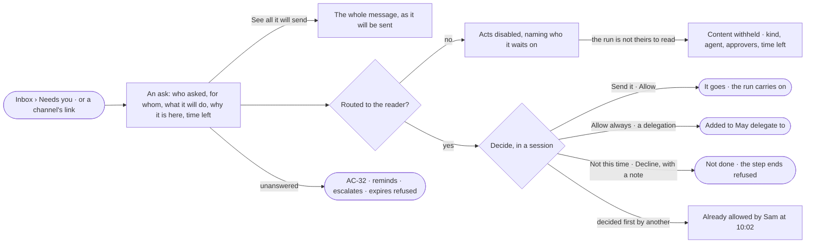

# AC-15 · Decide what an agent asks before it acts

**As** a named approver of an agent **I want** every ask routed to me — a write, a send, a delegation, tokens, a
person's act set to Ask — showing exactly what it will do **so that** nothing set to Ask leaves, changes or spends
without my yes — the agent proposes the act, and I decide whether it goes.

Tasks: [task.md](task.md) · Feature: [AC-F05](../../feature.md)

## Who can

| Lens | Can | Otherwise sees |
|---|---|---|
| Admin | Read every pending ask and its content; decide an ask routed to them, or escalated to them | An ask routed to others reads, its acts disabled, naming who it waits on — the Admin role does not widen it until it is escalated |
| Operator | Read every pending ask; read the content of asks routed to them, of runs they are behind and of agents they own; decide an ask routed to them | An ask routed to others reads, its acts disabled, naming who it waits on; on a run that is not theirs to read, its content is withheld |

## Flow

## Acceptance criteria

| # | Given | When | Then |
|---|---|---|---|
| AC-15.1 | An agent step that wants to send a message | the step reaches the send | it holds, and an ask appears in Needs you for the people it is routed to; the rest of the run carries on |
| AC-15.2 | An ask to send | it is read | it shows exactly what will be sent — To, Subject and the start of the body — with *See all it will send* opening the whole message as it will go |
| AC-15.3 | Any ask | it is read | it names who asked and on whose behalf (*Sam ▸ Reporting agent*), what it wants in one line, who it is routed to and why, how long it has waited, the deadline as time left, and its run |
| AC-15.4 | An ask | it is raised | it is routed to the named approvers of the agent whose rule said Ask — along a caller chain, the agent that asked — else its owners, else for a built-in agent the Admins; never the asker nor whoever it benefits; and it says which |
| AC-15.5 | An ask to send, routed to the reader | they press *Send it* | exactly what was shown is sent, never a re-render, and the run carries on |
| AC-15.6 | An ask routed to the reader | they press *Not this time* or *Decline* with a note | nothing is done, the step ends refused, and the note is kept |
| AC-15.7 | An ask set by a rule's Ask, routed to the reader | they press *Allow* | that step runs for that agent, in this run only, never its children |
| AC-15.8 | An ask to delegate | the reader picks *Allow always* | the callee is added to the caller's *May delegate to*; *Allow always* is offered on no other kind |
| AC-15.9 | An ask another approver decided first | the reader acts on it | it is refused, reading *Already allowed by Sam at 10:02 UTC on Oct 25* in place of the acts |
| AC-15.10 | An ask nobody decides | its time runs | it reminds, escalates to the agent's owners and the Admins, then expires refused (AC-32) |
| AC-15.11 | A pending ask | its run ends — served, failed or stopped | the ask leaves Needs you and closes expired; what it held is not done |
| AC-15.12 | A finished scheduled run whose outward delivery waits | its ask is allowed | the held deliveries are sent; declining leaves the run's own status unchanged |
| AC-15.13 | A breaking model publish | its ask is read | it shows the impact list; *Allow* opens the migration run; declining or expiry leaves the draft unpublished; it is routed to the built-in Modeller agent's approvers, never the requester |
| AC-15.14 | A named approver deactivated or taken off a named team | an ask still names them | the others may decide; with none left it goes to the agent's owners, then the Admins |
| AC-15.15 | An agent's ask with more than one way to answer | it is shown in *Needs you* | the agent's recommended answer is marked, with its reason; the person answers with one click |
| AC-15.16 | A person's act that a rule sets to Ask | they take it | it holds, telling them who it waits on; an ask appears in *Needs you* for the approvers of the built-in agent the act runs as, never the asker; the asker's own acts on it are disabled |
| AC-15.17 | An Admin who is not among the people an ask is routed to, before it is escalated | they open it | it reads; the acts are disabled, naming who it waits on |
| AC-15.18 | An Operator the ask is not routed to | they open it | it reads; the acts are disabled, naming who it waits on |
| AC-15.19 | An agent | it tries to allow an ask | it is refused; only a person decides |
| AC-15.20 | A decided ask | History is read | it shows who decided, when, the note, and where the ask was opened from (AC-F06) |
| AC-15.21 | An ask from an agent's run | the reader opens *How it got here* | it shows the run's steps and sources up to the step that asked, and the rule that made it ask, its policy and who saved it |
| AC-15.22 | Any ask | it is read | the engine's record of the act leads — what, to whom, every recipient, outside domains flagged; the asker's words follow, labelled as theirs and shown as plain text with control and direction characters visible; no answer is preselected; *always* is never the first choice; the sources the step read are linked |
| AC-15.23 | An ask routed to the reader | they allow it | the engine checks again, at that moment, that the reader may still decide it and every check the act needs; if one fails, the yes is refused, naming the check, and nothing runs |
| AC-15.24 | Any ask | it is raised, then allowed | it stores the exact act — function, arguments, targets and their versions — with a hash; the yes runs only that act; a write whose targets changed since the ask is refused, naming what changed |
| AC-15.25 | An ask delivered to an approver's email, Slack, Teams or webhook | they follow its link | the ask opens in Studio, where they decide it signed in; the channel never decides |
| AC-15.26 | An ask from a person | it is decided by someone who put the asker on a team or gave them the agent in the last 30 days | it goes, and History records an alert that every Admin is told of |
| AC-15.27 | An ask routed to the reader | they decide it with a key, as a service user, or as an agent | it is refused; only a person's signed-in session decides an ask |
| AC-15.28 | A person at the command line | they run `invana approvals list`, then `approve` or `decline` with a note | the asks routed to them read nearest deadline first, and a decision is held to every rule a decision in Studio is — routed to them, not late, not decided twice |
| AC-15.29 | An ask | it fails to load | it says what could not load, with *Try again* |
| AC-15.30 | Needs you filtered by kind or agent | nothing matches | *Nothing matches*, with *Clear filters* |
| AC-15.31 | An ask on a run the reader is not behind, of an agent they do not own, not routed to them, and they are not an Admin | it is read | it shows that it waits, its kind, its agent, who it waits on and its time left; its act, arguments and what it will send are withheld (AC-31) |

## Screens

| Surface | Lens | First use | Empty after a filter | Loading | Has data | Failed | Agent working or proposing | No access |
|---|---|---|---|---|---|---|---|---|
| Needs you — an ask | Admin | inbox · Nothing needs you | inbox · Nothing matches | inbox · Loading | inbox | inbox · Could not load | inbox · An agent asks to send | — |
| Needs you — an ask | Operator | inbox · Nothing needs you | inbox · Nothing matches | inbox · Loading | inbox | inbox · Could not load | inbox · An agent asks to send | inbox · Not yours to answer |
| An ask — what it will send | Admin | — | — | inbox · Loading | inbox · See all it will send | inbox · Already decided | inbox · An agent asks to send | — |
| An ask — what it will send | Operator | — | — | inbox · Loading | inbox · See all it will send | inbox · Already decided | inbox · An agent asks to send | inbox · Content withheld |
| A person's ask | Admin | — | — | inbox · Loading | inbox · A person asks | inbox · Already decided | — | — |
| A person's ask | Operator | — | — | inbox · Loading | inbox · A person asks | inbox · Already decided | — | inbox · Not yours to answer |
