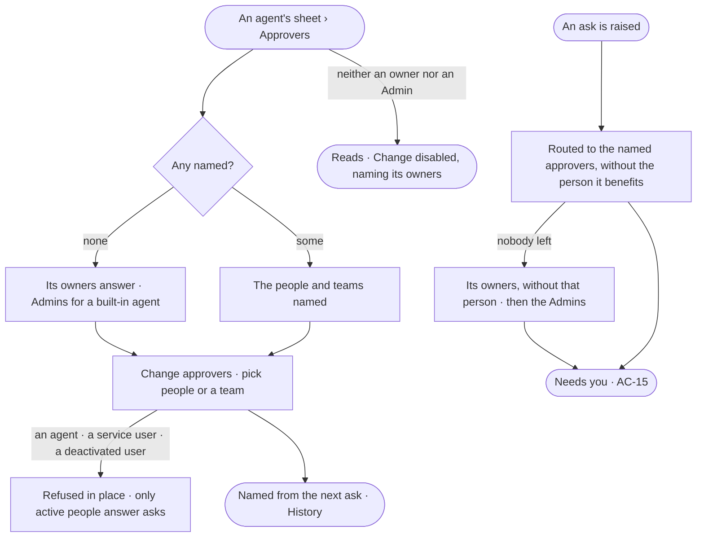

# AC-26 · Name who answers an agent's asks

**As** an agent builder **I want** to name the people or the team who answer my agent's asks **so that** every ask
reaches someone who knows the work, and never the person it would benefit.

Tasks: [task.md](task.md) · Feature: [AC-F05](../../feature.md)

## Who can

| Lens | Can | Otherwise sees |
|---|---|---|
| Admin | Name and change any agent's approvers, a built-in agent's included | — |
| Operator | Read every agent's approvers; on an agent they own, name and change them | On an agent they do not own: *Change approvers* disabled — *Only its owners or an Admin — ask Ravi* |

## Flow

## Acceptance criteria

| # | Given | When | Then |
|---|---|---|---|
| AC-26.1 | An agent | its *Approvers* are read | the people and teams named read, or with none *Its owners answer its asks*, naming them |
| AC-26.2 | An owner of the agent or an Admin | they name people, a team, or both | from the next ask they are its approvers; asks already raised keep the approvers they were routed to; History records who named whom |
| AC-26.3 | *Change approvers* | an agent, a service user, the system user or a deactivated user is chosen | it is not offered, and the API refuses it — *Only active people answer asks* |
| AC-26.4 | An ask the agent raises | it is routed | it goes to every named approver — each person on a named team — except the person it benefits, and reads *named approver* as its reason |
| AC-26.5 | An agent with no approvers named | it raises an ask | it goes to the agent's owners, except the person it benefits, reading *agent owner* |
| AC-26.6 | A built-in agent, owned by the system user, with none named | it raises an ask | it goes to the Admins, except the person it benefits, reading *Admin* |
| AC-26.7 | An ask whose only approver is the person it benefits | it is routed | it goes to the agent's owners without that person, then to the Admins; it is never decided by the person it benefits |
| AC-26.8 | A named approver who is deactivated, or leaves a named team | an ask is routed | they are skipped; with nobody left, AC-26.7 applies |
| AC-26.9 | An ask nobody answers | its time runs | it reminds, goes on to the agent's owners and the Admins, then expires refused — never allowed (AC-F05) |
| AC-26.10 | A person who neither owns the agent nor is an Admin | they open *Approvers* | they read; *Change approvers* is disabled, naming the agent's owners and the Admins |
| AC-26.11 | A change of approvers sent with a key | it is sent | it is refused — it needs a person's session |

## Screens

| Surface | Lens | First use | Empty after a filter | Loading | Has data | Failed | Agent working or proposing | No access |
|---|---|---|---|---|---|---|---|---|
| Approvers | Admin | agents.agent · Approvers · Its owners answer | — | agents.agent · Approvers · Loading | agents.agent · Approvers | agents.agent · Approvers · Not a person | — | — |
| Approvers | Operator | agents.agent · Approvers · Its owners answer | — | agents.agent · Approvers · Loading | agents.agent · Approvers | agents.agent · Approvers · Could not load | — | access.locked · Approvers |
