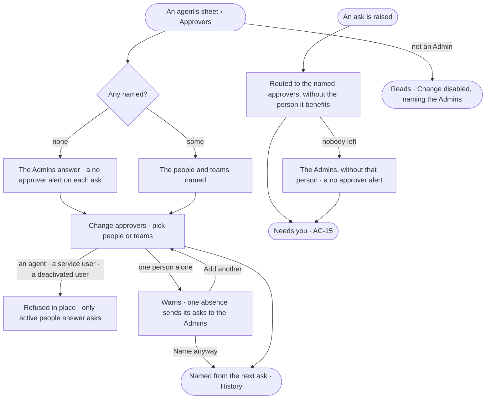

# AC-26 · Name who answers an agent's asks

**As** an Admin **I want** to name the people or teams who answer an agent's asks **so that** every ask reaches
someone who knows the work, never the person it would benefit, and never waits on one person's absence.

Tasks: [task.md](task.md) · Feature: [AC-F05](../../feature.md)

## Who can

| Lens | Can | Otherwise sees |
|---|---|---|
| Admin | Name and change any agent's approvers, a built-in agent's included, signing in again | Naming one person alone warns, and is still allowed |
| Operator | Read every agent's approvers; a Modeller reads the same | *Change approvers* disabled — *Needs the Admin role — ask Priya or Lee* |

## Flow

## Acceptance criteria

| # | Given | When | Then |
|---|---|---|---|
| AC-26.1 | An agent | its *Approvers* are read | the people and teams named read, or with none *No approver — the Admins answer its asks* |
| AC-26.2 | An Admin | they name people, teams, or both, signing in again | from the next ask they are its approvers; asks already raised keep the approvers they were routed to; History records who named whom |
| AC-26.3 | *Change approvers* | an agent, a service user, the system user or a deactivated user is chosen | it is not offered, and the API refuses it — *Only active people answer asks* |
| AC-26.4 | An ask the agent raises | it is routed | it goes to every named approver — each person on a named team — except the person it benefits, and reads *named approver* as its reason |
| AC-26.5 | An agent with no approvers named | it raises an ask | it goes to the Admins, except the person it benefits, reading *no approver — Admins*, and a *no approver* alert opens ([CP-F11](../../../../../control/features/CP-F11-ops-alerting/feature.md#the-alert-kinds)) |
| AC-26.6 | An agent whose maker or co-owner is not named | it raises an ask | they are not routed to for being its maker or owner |
| AC-26.7 | An ask whose only approver is the person it benefits | it is routed | it goes to the Admins without that person, with a *no approver* alert; it is never decided by the person it benefits |
| AC-26.8 | A named approver who is deactivated, or leaves a named team | an ask is routed | they are skipped; with nobody left, AC-26.7 applies |
| AC-26.9 | An ask nobody answers | its time runs | it reminds, is escalated to the Admins, then expires refused — never allowed (AC-32) |
| AC-26.10 | An Operator or a Modeller | they open *Approvers* | they read; *Change approvers* is disabled, naming the Admin role and the Admins; the API refuses the write |
| AC-26.11 | A change of approvers sent with a key | it is sent | it is refused — it needs a person's session |
| AC-26.12 | An Admin | they name one person as the only approver | it warns *One absence sends this agent's asks to the Admins — add a team or a second person*; *Name anyway* saves it |

## Screens

| Surface | Lens | First use | Empty after a filter | Loading | Has data | Failed | Agent working or proposing | No access |
|---|---|---|---|---|---|---|---|---|
| Approvers | Admin | agents.agent · Approvers · No approver | — | agents.agent · Approvers · Loading | agents.agent · Approvers | agents.agent · Approvers · Not a person | agents.agent · Approvers · One person warns | — |
| Approvers | Operator | agents.agent · Approvers · No approver | — | agents.agent · Approvers · Loading | agents.agent · Approvers | agents.agent · Approvers · Could not load | — | access.locked · Approvers |
