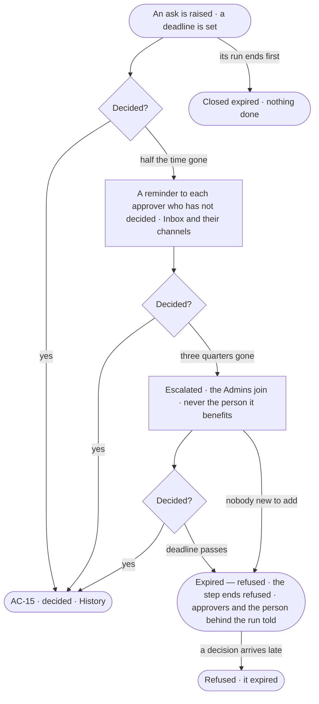

# AC-32 · An unanswered ask reminds, escalates and expires

**As** the person behind a run waiting on an ask **I want** an ask nobody answers to remind its approvers, then
reach the Admins, then end refused **so that** no ask waits unseen and nothing set to Ask is
ever allowed because nobody answered.

Tasks: [task.md](task.md) · Feature: [AC-F05](../../feature.md)

## Who can

| Lens | Can | Otherwise sees |
|---|---|---|
| Admin | Receive every escalated ask; decide it once escalated; read every ask's reminders, escalation and expiry | — |
| Operator | Receive the reminders of asks routed to them; decide them; read the state of asks of runs they are behind | An ask not routed to them reads its state — waiting, reminded, escalated, expired — its acts disabled, naming who it waits on |

## Flow

## Acceptance criteria

| # | Given | When | Then |
|---|---|---|---|
| AC-32.1 | An ask nobody has decided | half the time to its deadline passes | one reminder reaches each approver who has not decided, in the Inbox and the channels they chose; the ask reads *Reminded* |
| AC-32.2 | An ask still undecided | three quarters of its time passes | it is escalated: the Admins are added to who it waits on, never the person it benefits; the named approvers stay; it reads *Escalated*, naming who was added |
| AC-32.3 | An escalated ask | an Admin added by escalation opens it | they may decide it, held to every check a named approver is |
| AC-32.4 | An ask whose Admins are already among its approvers | it reaches three quarters | it is marked *Escalated* and nobody new is added |
| AC-32.5 | An ask nobody decides | its deadline passes | it reads *Expired — refused*; the step ends refused and nothing is done; the approvers and the person behind the run are told in the Inbox |
| AC-32.6 | An expired ask | someone it was routed to allows or declines it | it is refused, reading *The deadline has passed; it expired, refused*; nothing runs |
| AC-32.7 | The engine was down at the deadline | it comes back | the ask expires with the deadline as its time — never allowed late |
| AC-32.8 | A pending ask | its run ends first | it closes expired with no reminder or escalation after; nothing it held is done |
| AC-32.9 | A reminder, an escalation or an expiry | it happens | it is a History row, naming who it reached (AC-F06) |
| AC-32.10 | An approver's channel | delivery to it fails | the ask still waits in their Inbox; the failure is named on the ask, never hidden |
| AC-32.11 | The person behind the run, who is not an approver | they read the ask | it reads its state — waiting, reminded, escalated or expired — and its time left; its acts are disabled, naming who it waits on |
| AC-32.12 | Asks waiting on an Admin after escalation | Needs you is filtered *Escalated* | only escalated asks list; none matching reads *Nothing matches*, with *Clear filters* |

## Screens

| Surface | Lens | First use | Empty after a filter | Loading | Has data | Failed | Agent working or proposing | No access |
|---|---|---|---|---|---|---|---|---|
| An ask — reminded or escalated | Admin | — | inbox · Nothing matches | inbox · Loading | inbox · Escalated | inbox · Channel failed | inbox · An agent asks to send | — |
| An ask — reminded or escalated | Operator | — | inbox · Nothing matches | inbox · Loading | inbox · Reminded | inbox · Channel failed | inbox · An agent asks to send | inbox · Not yours to answer |
| An ask — expired | Admin | — | — | — | inbox · Expired, refused | inbox · Already expired | — | — |
| An ask — expired | Operator | — | — | — | inbox · Expired, refused | inbox · Already expired | — | inbox · Expired, refused |
