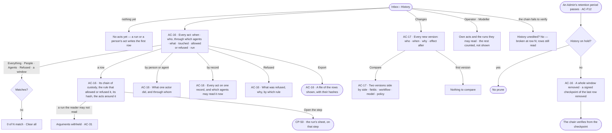
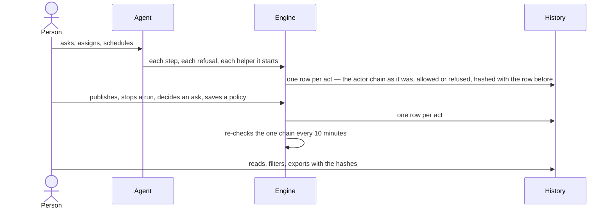

# History — what people and agents did, and every change

> Every act by a person or an agent in the deployment — who, through which agents, what it touched, allowed or
> refused, by which rule — in one append-only chain nobody can edit, and every new version of anything versioned
> with why it changed and what happened after.
> The decision it helps make: *can I trust what happened here — who did it, was it allowed, and did the change make
> things better or worse?*

## User journey

Journeys this feature is a step of: [J09 · Audit what an agent touched](../../../../journeys/J09-audit-what-an-agent-touched-and-what-left-the-platform.md)

## Stories

| ID | Story | Status |
|---|---|---|
| AC-16 | [Read what people and agents did, and prove it](stories/AC-16-read-what-people-and-agents-did-and-prove-it/story.md) | idea |
| AC-17 | [See every change and compare two versions](stories/AC-17-see-every-change-and-compare-two-versions/story.md) | idea |

## Access

| Act | Role ([the role table](../AC-F02-access-policies/feature.md#the-role-table)) | Everyone else sees |
|---|---|---|
| Read every row, the counts over the deployment, by actor, by record and refusals | Admin | — |
| Read a row's arguments | Whoever may read its run ([AC-31](../AC-F09-what-left-the-platform/stories/AC-31-keep-a-runs-content-to-those-who-may-read-it/story.md)) — an Admin included, by the same rule | Who, the act, the verdict and the rule; arguments *withheld* |
| Read their own acts and the rows of runs they may read | Every signed-in person — Operator, Modeller | The rest is counted, not shown — a line says how many |
| Export the rows the reader can see | Every signed-in person | — |
| Read every change and compare two versions of a record the reader can open | Every signed-in person | A record the reader cannot open reads as absent |
| Restore an earlier version | Not here — the record's own page, by its own role | — |

## States

| State | What the person sees |
|---|---|
| First use | *No acts yet — a run or a person's act writes the first row*. Changes with nothing versioned: *No changes yet* |
| Empty after a filter | *0 of N match*, with *Clear all*; *Export* disabled, *no rows match* |
| Loading | The head, filters and table drawn at once; rows load in place |
| Has data | Rows newest first, today unless a window is chosen; the head says History is unedited, when that was last checked, how long rows are kept and whether History is on hold |
| Failed | The rows could not load, saying why, with *Try again*. The chain failing to verify: *broken at row N*, in red; rows still read |
| Agent working or proposing | Rows arrive as acts happen; an agent's rows name the person it acted for |
| No access | An Operator or a Modeller reads their own acts and the rows of runs they may read, a line counting the rest; the counts over the deployment are not shown |

## Rules

| Rule | Detail |
|---|---|
| One chain for the deployment | Every act in the deployment is a row in one append-only chain with a gapless sequence; there is no chain per part of the deployment |
| One row per act | A step an agent took, a refusal, a helper it started, an ask and its decision, and every act of a person — publish, stop a run, save a policy, attach it, set a role, switch a graph database — is a row |
| Nothing is unrecorded | Every write in the product — a graph database, the model, a skill, a workflow, a policy, an agent, a task, a load — is in History; there is no silent write |
| Never edited | Rows are never edited or deleted one by one; a correction is a new row |
| Provably unedited | Each row is hashed with the one before; the chain is re-checked every 10 minutes from the latest checkpoint and the head says when it last held. An export carries each row's hash and the previous one |
| The actor and on whose behalf | Who acted and for whom are two names, never one — *Sam ▸ Reporting agent ▸ Order checker*; names are as they were when the row was written, and a departed person's read as their code when names are pseudonymised ([AC-F12](../AC-F12-leaving-and-keeping/feature.md)) |
| What caused what | A row links to the act that caused it, so a chain is followed up to the person who started it |
| Secrets never enter | A credential is removed before the row is written, not hidden when read |
| Arguments follow run privacy | A row's arguments read to whoever may read its run ([AC-31](../AC-F09-what-left-the-platform/stories/AC-31-keep-a-runs-content-to-those-who-may-read-it/story.md)) — the role grants none; anyone else who may see the row reads who, the act, the verdict and the rule |
| A row about a deleted record | Still reads, with the record's name as it was |
| A refusal names its reason and its rule apart | The reason — the role · may not use the agent · an Access Policy rule · switched off · a read-only graph database · a sensitive property · over a limit · the site's robots.txt — and the rule in words (*Deny reading Order in sales, for Finance*) |
| Kept until an Admin sets a period | Rows are kept until an Admin sets History's period ([AC-F12](../AC-F12-leaving-and-keeping/feature.md)); none is removed while History is on legal hold. Removing old rows removes a whole window, never chosen rows, and the removal is itself a row |
| A prune leaves a signed checkpoint | Each prune keeps a checkpoint — the last removed row's number and hash, signed — so the chain that stays still proves it follows on from what was removed |
| Every number is the engine's | Counts, per-day bars and top lists are counted over the stored rows, over the whole window |
| A change is the act that made a version | Changes are History narrowed to the acts that made a new version of a skill, rule, workflow, agent, model or Access Policy, and every load; the versions stay where they are kept |
| Why is never invented | A reason given when a version is made is kept (500 characters); none given reads empty, never inferred |
| Effect after is counted | Runs, failed runs and tokens on a version — what runs recorded they used; a model's is the deployment's runs while it was published, labelled *while published*, so nobody reads it as cause. Tokens only |
| A draft is not a version | Drafts never appear in Changes or a compare |
| One compare | Every product's History tab and *Compare* open the same compare |
| Restore is not here | Restoring makes a new version from the record's own page; History only reads |
| Running is not History | History is what people and agents did; what executed is Runs (CP-F10), and what left is the ledger (AC-F09) |
| Leans on | Runs and their steps (CP-F10) · asks and their decisions (AC-F05) · the ledger (AC-F09) · a record's own History tab — agents (AG-F01), skills (AG-F04), models (SE-F10), records and loads (RC-F06) · Access Policies (AC-F02) |

## Data touched

| Record | Read or write |
|---|---|
| History rows — when, the actor chain, the act, what it touched, allowed or refused and why, the rule, the run and step, where it ran, its hash and the previous one | Read |
| Checkpoints — the last row each prune removed, its hash and its signature | Write · read |
| History's period and hold ([AC-F12](../AC-F12-leaving-and-keeping/feature.md#engine)) | Read |
| Writes and their causes — actor, on whose behalf, what, the act that caused it | Read |
| The chain's last check — when, whether it held, where it broke | Read |
| Exports — who, the filters, the format, how many rows | Write · read |
| Versions of skills, rules, workflows, agents, models and Access Policies, loads, and why each was made | Read |
| Runs on each version — runs, failed, tokens | Read |

## Engine

The low-level design: what this feature stores, serves and refuses. Conventions — naming, errors, lists, events — are
[system-design.md](../../../../system-design.md) §§ 6–8; this section only fills them in. This feature owns the event
store: every feature's *Events* table names what it writes here, and links this section.

### Records

| Table | Columns | Notes |
|---|---|---|
| `events` | `id` · `created_at` · `actor_kind` (`user` · `agent` · `system` · `external` — a key's or an MCP client's call · `anonymous`) · `actor_id?` · `on_behalf_of_user_id?` · `key_id?` · `client_id?` · `parent_event_id?` · `action` (`<package>.<records>.<verb>`) · `target_kind?` · `target_id?` · `database_id?` · `project_id?` · `task_id?` · `run_id?` · `node_run_id?` · `skill_ids[]` · `details` (redacted at write) · `trace_id?` · `span_id?` | The event store: one append-only record of every write in the deployment |
| `access_history_rows` | `seq` (from 1, gapless) · `at` · `actor_kind` (`person` · `agent` · `system` · `external`) · `actor_user_id?` · `actor_agent_id?` · `actor_key_id?` · `actor_client_id?` · `actor_chain` (user ids, in order) · `actor_names` (names as they were — outside the hash) · `behind_user_id?` · `caused_by_seq?` · `act` · `layer` (`data` · `skill` · `workflow` · `agent` · `plugin` · `tool` · `model` · `access` · `run`) · `touched` · `verdict` (`allowed` · `refused` · `asked` · `held`) · `refused_by?` (`role` · `agent_not_granted` · `policy` · `switched_off` · `read_only` · `sensitive` · `limit` · `robots`) · `rule?` · `effect?` · `policy_id?` · `policy_version?` · `set_by_id?` · `run_id?` · `step_run_id?` · `run_number?` · `where` · `args` (redacted) · `hash` · `prev_hash` | One History row per act; unique `seq` |
| `access_history_checks` | `verified_at` · `ok` · `last_seq` · `broken_seq?` · `from_checkpoint_seq?` | The chain's checks |
| `access_history_checkpoints` | `at` · `last_removed_seq` · `last_removed_hash` · `rows_removed` · `signature` (HMAC-SHA-256 under the ledger key) · `key_version` | One row per prune; never removed |
| `access_history_exports` | `requested_by_id` · `filters` · `format` (`csv` · `jsonl`) · `rows` · `created_at` | One row per export |

### Reads

| Record | Owner |
|---|---|
| Skill versions — published, with the publish event's `why` | [AG-F04](../../../../capabilities/agents/features/AG-F04-skills/feature.md#engine) |
| Rule versions | [SE-F07](../../../../capabilities/semantics/features/SE-F07-rules/feature.md#engine) |
| Workflows by name and version, and the approval event's `why` | [AG-F06](../../../../capabilities/agents/features/AG-F06-plans-and-workflows/feature.md#engine) |
| An agent's create and update events, each with the changed fields before and after | [AG-F01](../../../../capabilities/agents/features/AG-F01-build-an-agent/feature.md#engine) |
| Model versions and their schema diff | [SE-F02](../../../../capabilities/semantics/features/SE-F02-change-and-publish-a-model/feature.md#engine) |
| Access Policy versions | [AC-F02](../AC-F02-access-policies/feature.md#engine) |
| Loads — the records each added, removed and changed, and the records failing | [RC-F02](../../../../capabilities/records/features/RC-F02-bring-records-in/feature.md#engine) |
| Runs, their steps and tokens — the effect after a version, *Open the step* | [CP-F10](../../../control/features/CP-F10-runs-and-how-the-agents-are-doing/feature.md#engine) |
| Which agents may read a record's kind now — Access Policies and the one evaluator | [AC-F02](../AC-F02-access-policies/feature.md#engine) |
| Asks and their decisions | [AC-F05](../AC-F05-asks-and-approvals/feature.md#engine) |
| Who may read a run's content — `may_read_run()` · the ledger key | [AC-F09](../AC-F09-what-left-the-platform/feature.md#mechanisms) |
| History's period, its hold, a departed person's pseudonym | [AC-F12](../AC-F12-leaving-and-keeping/feature.md#engine) |

### Routes

| Route, after `/api/v1/access/history` | Does | Story |
|---|---|---|
| `GET /rows` | A page of rows, newest first. Filters `since` (`today` default · `24h` · `7d` · `30d` · `all`) · `actor` · `act` · `layer` · `run_id` · `verdict` · `refused_by` · `preset` (`refused` · `writes` · `outside` · `secrets` · `people`); `hidden` counts the rows the reader may not see | AC-16 |
| `GET /rows/stats?since=` | `acts` · `acts_change_pct` · `people` · `agents` · `spawned` · `refused` · `refused_by` · `waiting_asks` · `presets` · `hidden` | AC-16 |
| `GET /rows/{seq}` | The row · its chain of custody · `args` (withheld unless the reader may read its run) · `hash` · `prev_hash` · `verified` · `verified_at` · `around[]` (two rows before and two after in its run) | AC-16 |
| `GET /actor?actor=agent:<id> \| person:<id>&since=` | `acts` · `writes` · `writes_refused` · `outside` · `secrets` · `secret_names` · `refused_by` · `data` · `tools` · `models` · `acted_through` | AC-16 |
| `GET /record?address=&since=` | `reads` · `writes` · `refused` · `people` · `agents` · `rows` · `readable_by {agents, teams}` | AC-16 |
| `GET /refusals` | `refused_today` · `acts_today` · `share_pct` · by reason · `by_day[30]` · `top_functions[]` · `by_rule[]` (`refused_by` · `rule` · `policy` · `refused` · `today`) | AC-16 |
| `GET /export?format=csv \| jsonl` · `GET /exports` | Stream the filtered rows, each with its hash and the previous one, and write an exports row · the exports, newest first | AC-16 |
| `GET /integrity?full=` | `{verified_at, ok, last_seq, broken_seq?, keep_days?, held, checkpoint?, rows}`; `full` re-verifies from the latest checkpoint, or row 1 when none | AC-16 |
| `GET /changes/{kind}/{id}` | One record's changes: `{record_kind, record_id, name, items[ChangeEntry]}` | AC-17 |
| `GET /changes/{kind}/{id}/compare?a=&b=` | Two versions; `a` omitted compares `b` with the one before | AC-17 |
| `GET /events` · `GET /events/stream` | The deployment's events by the list contract, every filter composing with `?changes=true` · the live tail | AC-17 |

### Events

| Event | When |
|---|---|
| `access.history.export` | An export is made |
| `access.history.prune` | Rows older than History's period are removed, a whole window — itself a History row, naming its checkpoint |
| `access.history.broken` | A check finds the chain broken, naming the row |

### Refusals

| Status | When | Sentence | Criterion |
|---|---|---|---|
| 404 | A row the reader may not see is opened | *Not found.* | AC-16.21 |
| 404 | A record's changes or compare, for a record the reader cannot open | *Not found.* | AC-17.17 |
| 422 | A compare naming a version the record does not have | *{record} has no version {v}.* | API only — Studio offers only versions the record has |

### CLI

| Command | Does |
|---|---|
| — | No command of its own — the export is the portable form |

### Mechanisms

| Mechanism | How |
|---|---|
| One emitter | A manager emits the event of its write inside the write's transaction; `trace_id` and `span_id` are filled from the current span by the emitter, never by a caller |
| Redacted at write | Credentials never reach `details`, `args` or a row — not even encrypted; a secret is named, never its value |
| Causality | `parent_event_id` links an event to the act that caused it; `caused_by_seq` does the same for a History row |
| The live tail | A database trigger notifies every insert into `events`; the engine fans it out to the streams Studio holds open |
| Who reads `events` | The change list and the live tail, notification rules ([CP-F08](../../../control/features/CP-F08-the-inbox/feature.md#engine)), provenance ([RC-F06](../../../../capabilities/records/features/RC-F06-provenance/feature.md#engine)), a task's tree ([PJ-F01](../../../../capabilities/projects/features/PJ-F01-projects-and-tasks/feature.md#engine)), the outbox relay that rebuilds the system graph, and traces — each a reading; none copies it |
| One writer of History | `record()` takes the last row under a row lock, sets `seq` and the hash, inserts. The Control Plane calls it for each step it settles and each refusal; delegation for each helper and refusal; every manager for each act a person, an agent, a key or an MCP client causes. Nothing updates or deletes a row |
| The hash chain | `hash = sha256(prev_hash ‖ canonical JSON of the row without actor_names)`; the first `prev_hash` is 64 zeros. Names live outside the hash, so pseudonymising a departed person changes `actor_names` and every row still verifies; who acted is proven by `actor_chain`'s ids. The shared clock tick ([AG-F07](../../../../capabilities/agents/features/AG-F07-schedules/feature.md#mechanisms)) re-verifies every 10 minutes from the last verified row into `access_history_checks`; `?full=` re-verifies from the latest checkpoint |
| What a reader sees | An Admin every row; anyone else their own acts and the rows of runs `may_read_run()` allows; the rest is counted as `hidden`. `args` is withheld on a row the reader sees but whose run they may not read — an Admin's too. Counts over the whole deployment are an Admin's |
| Counts | Counts, per-day bars and top lists are SQL over the whole window; table rows read from the newest 20,000 |
| A change with no percentage | `acts_change_pct` is absent while the 7-day daily mean is under 10 acts |
| Export | `csv` or `jsonl` of the filtered rows with each row's hash and the previous one; a CSV cell that would run as a formula is written as text |
| Retention | History's period from [AC-F12](../AC-F12-leaving-and-keeping/feature.md#engine), none by default; skipped while History is on hold. A prune removes every row older than the period, a whole window, and in the same transaction writes an `access_history_checkpoints` row — the last removed `seq` and `hash`, signed — and its own History row; `events` keeps the same window |
| Verifying past a prune | A check starts from the latest checkpoint: its signature must verify under the ledger key of its `key_version`, and the first kept row's `prev_hash` must equal `last_removed_hash`; then the chain runs as before. A checkpoint that fails reads *broken at the checkpoint of {date}* |
| What a change is | A version-minting event of a skill, rule, workflow, agent, model or Access Policy, or a load — the versions stay where their owner keeps them; there is no change table. `?changes=true` narrows the event list to those events |
| Each kind's versions | `skill` — published versions, a number, `why` from the publish event, effect pinned (runs offered that version) · `rule` — its versions, a number, pinned · `workflow` — by name, a number, `why` from the approval event, pinned · `agent` — its create and update events, `details.diff {field: {before, after}}`, a number, pinned · `model` — published versions, a number, effect over the window it was published · `policy` — its saved versions, a number, `why` from the save · `load` — the load, its records added · removed · changed and rows failing |
| `ChangeEntry` | `version` (a string) · `version_id?` (null for an agent) · `at` · `action` · `event_id` · `actor_id` · `actor_kind` · `actor_name` · `why` · `summary` · `effect` |
| `ChangeEffect` | `basis` (`pinned` · `window`) · `runs` · `failed` · `tokens_in` · `tokens_out` · `tokens` · `tokens_per_run` · `since` · `until` · `loads[{load_id, name, rows_failing}]` · `rows_failing` — tokens only |
| `ChangeCompare` | `record_kind` · `record_id` · `a` · `b` · `summary` · `fields[{field, before, after, lines}]` (text as unified lines) · `records {added, removed, changed}` (a load's) · `workflow` (a workflow's, or a skill's whose versions drew workflows) · `schema_diff` (a model's) · `rules` (a policy's rules added, removed and changed) · `tokens_per_run_change` (`b` against `a`; null when either ran nothing) |
| `why` on a write that mints | An optional `why` (500 characters) on each owner's minting write lands in its event's `details.why`; none given stays empty |
| Read-only everywhere | The deployment's `/admin` console shows `events` and History rows read-only |

## System impact

| HLD section | Change | NFRs |
|---|---|---|
| § 6 Data and storage | The event store `events` and four History tables in Postgres; History kept until an Admin sets a period, each prune leaving a signed checkpoint | NFR-REL-4 |
| § 8 APIs and events | The `…/access/history` routes; the event store is where every feature's events land | — |
| § 9 Distributed execution | The one chain is re-verified on the shared clock tick; one writer under a row lock keeps `seq` gapless | NFR-PERF-3 |
| § 12 Qualities | Security: append-only, hash-chained, verified every 10 minutes from a signed checkpoint, credentials redacted before the write; arguments read only as run privacy allows; names outside the hash, so pseudonymising edits no proof | NFR-REL-4 · NFR-SEC-2 |

## Decisions

| Decision | Detail |
|---|---|
| History is one place | People's acts, agents' acts, refusals and changes are filters of one History — *Everything · People · Agents · Changes · Refused* — not four pages |
| Rows read today | Until a window is chosen — today · last 24 hours · 7 days · 30 days · any time; an export takes the same window |
| A preset chip names its window | *Refused today*, *Writes in the last 7 days* — each preset says its window, with the engine's count beside it |
| A row opens beside the list | Its detail opens over the right of History; the list still takes clicks, so another row moves it |
| Others read less, and are told | An Operator or a Modeller sees their own acts and the runs they may read; a line counts what they cannot see. Counts over the whole deployment are an Admin's |
| By an actor includes its helpers | Every row whose chain names the actor — helpers of one kind grouped as *Order checker ×4*, a delegated agent its own row |
| Who may read a record now | Read from Access Policies — the agents whose rules allow Read on the record's kind and graph database, and for which teams — never from History |
| A change shows no percentage on an empty week | The change in acts against the 7-day daily mean is absent while that mean is under 10 acts a day |
| Compare carries tokens per run | The compare reads *Tokens per run* of one version against the other, as the engine counted it |
| A model's change names its loads | A model version's effect lists the loads it touched and how many records fail |

## Open questions

| Question | Who answers |
|---|---|

## Not building

| Item | Why not |
|---|---|
| Editing or deleting a row | A correction is a new row; a whole window goes only by retention |
| Scheduled exports and an archive to the blob store | An export on demand is the proof now |
| A History CLI | The export is the portable form |
| A change table or a copy of versions | The versions already exist; a copy drifts |
| Currency in effect after | Tokens only |
| Restore from History | A restore is the record's own write, which makes a new version |
| Filling in a reason or a diff for old versions | An empty field is honest; an inferred one is not |
| Versions of boards and reports | A frozen reading, not a change to a definition |
| A chain per team or per graph database | One deployment, one chain; a filter narrows it |
| Sending History to an outside log tool | That belongs to the deployment's own platform |
