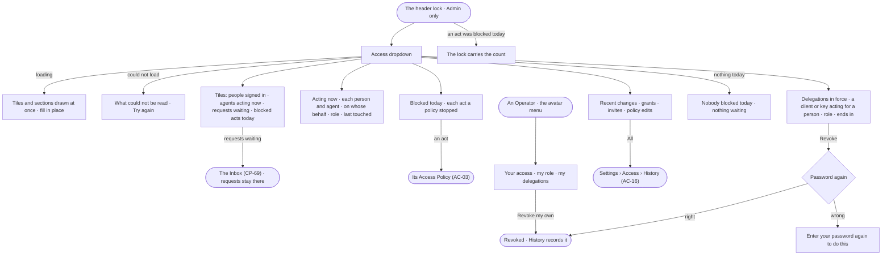

# AC-48 · See who is acting and what was blocked, from the header

**As** an Admin **I want** one glance from any screen at who and which agents are acting now, on whose behalf, what a
policy stopped today and what acts for a person until when **so that** I catch access going wrong while it happens and
end it in one click.

Tasks: [task.md](task.md) · Feature: [AC-F06](../../feature.md)

## Who can

| Lens | Can | Otherwise sees |
|---|---|---|
| Admin | Open the Access dropdown: every tile and section; open a blocked act's policy; *Revoke* a delegation with the password again; open the Inbox and Settings › Access › History from it | — |
| Operator | Operator · Modeller: read their own roles and delegations under *Your access* in the avatar menu; revoke their own | No *Access* button in the header — it is absent, not disabled |

## Flow

## Acceptance criteria

| # | Given | When | Then |
|---|---|---|---|
| AC-48.1 | An Admin | the header is read | it shows the *Access* lock; the lock carries a count only when an act was blocked today, the engine's |
| AC-48.2 | An Operator or a Modeller | the header is read | there is no *Access* button |
| AC-48.3 | An Admin | they click the lock | the Access dropdown opens anchored to it, no scrim; outside click or Esc closes it |
| AC-48.4 | The dropdown | its tiles are read | people signed in · agents acting now · requests waiting · blocked acts today — each as the engine counted it |
| AC-48.5 | Requests waiting | the Admin picks the tile | the Inbox dropdown opens (CP-69); the requests are decided there, never in Access |
| AC-48.6 | People and agents acting | *Acting now* is read | each person's session and each agent's run going, with on whose behalf, its role and when it last touched anything |
| AC-48.7 | Acts a policy refused today | *Blocked today* is read | each act with who, through which agent, what it touched and the rule that stopped it; picking one opens its Access Policy (AC-03) |
| AC-48.8 | A connected client or a key acting for a person | *Delegations in force* is read | each with the person it acts for, their role and when it ends — *never* for a key with no expiry |
| AC-48.9 | A delegation in force | the Admin presses *Revoke* and enters the password | it ends at once, leaves the list, and History records who revoked it |
| AC-48.10 | *Revoke* | the password is wrong or missing | it is refused — *Enter your password again to do this.* — and nothing ends |
| AC-48.11 | Grants, invites and policy edits | *Recent changes* is read | the newest, each with who and when; *All* opens Settings › Access › History (AC-16) |
| AC-48.12 | Nothing blocked and nothing waiting today | the dropdown opens | it reads *Nobody blocked today* and the tiles read their counts |
| AC-48.13 | The lists still loading | the dropdown opens | tiles and sections draw at once and fill in place |
| AC-48.14 | The engine cannot read the summary | the dropdown opens | it says what it could not read, with *Try again* |
| AC-48.15 | Anyone but an Admin | they call the access summary | it is refused *This needs the Admin role.* |
| AC-48.16 | An Operator | they open *Your access* in the avatar menu | their role, the agents they may use, and the clients and keys acting for them with when each ends, each with *Revoke* |
| AC-48.17 | An agent acting now | the Admin opens it | *How it got here* shows its run's steps and sources, its content as AC-31 allows |

## Screens

| Surface | Lens | First use | Empty after a filter | Loading | Has data | Failed | Agent working or proposing | No access |
|---|---|---|---|---|---|---|---|---|
| The Access dropdown | Admin | shell.access · Nobody blocked today | — | shell.access · Loading | shell.access | shell.access · Could not load | shell.access · Agents acting | — |
| The Access dropdown | Operator | — | — | — | — | — | — | shell.access · No button |
| Revoke a delegation | Admin | — | — | — | shell.access · Revoke | shell.access · Password refused | — | — |
| Revoke a delegation | Operator | — | — | — | — | — | — | — |
| Your access | Admin | shell.avatar.access · Nothing acts for you | — | shell.avatar.access · Loading | shell.avatar.access | shell.avatar.access · Could not load | — | — |
| Your access | Operator | shell.avatar.access · Nothing acts for you | — | shell.avatar.access · Loading | shell.avatar.access | shell.avatar.access · Could not load | — | — |
