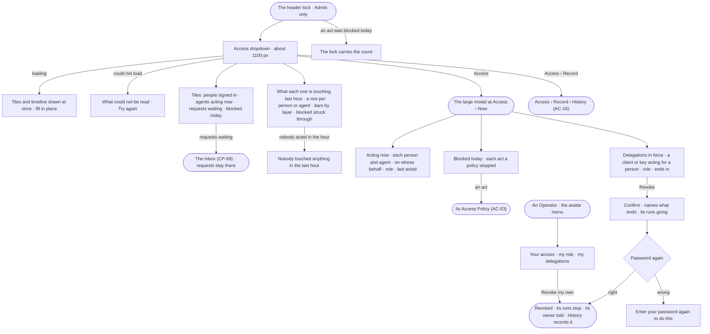

# AC-48 · See who is acting and what was blocked, from the header

**As** an Admin **I want** one glance from any screen at what each person and agent is touching right now — which
layer, for whom, and what a policy stopped — **so that** I catch access going wrong while it happens, and open Access ›
Now to end it.

Tasks: [task.md](task.md) · Feature: [AC-F06](../../feature.md)

## Who can

| Lens | Can | Otherwise sees |
|---|---|---|
| Admin | Open the Access dropdown: its tiles and swimlanes; follow its links. In Access › Now: read who acts, what was blocked today and the delegations in force; open a blocked act's policy; *Revoke* a delegation with the password again | — |
| Operator | Operator · Modeller: read their own roles and delegations under *Your access* in the avatar menu; revoke their own | No *Access* button in the header — it is absent, not disabled; Access › Now reads *Ask {Admin}* |

## Flow

## Acceptance criteria

| # | Given | When | Then |
|---|---|---|---|
| AC-48.1 | An Admin | the header is read | it shows the *Access* lock; the lock carries a count only when an act was blocked today, the engine's |
| AC-48.2 | An Operator or a Modeller | the header is read | there is no *Access* button |
| AC-48.3 | An Admin | they click the lock | the Access dropdown opens anchored to it, about 1100 px wide, no scrim; outside click or Esc closes it |
| AC-48.4 | The dropdown | its tiles are read | People signed in · Agents acting now · Requests waiting · Blocked today — each as the engine counted it |
| AC-48.5 | Requests waiting | the Admin picks the tile | the Inbox dropdown opens (CP-69); the requests are decided there, never in Access |
| AC-48.6 | People and agents acted in the last hour | *What each one is touching · last hour* is read | one row per person or agent, the most recent first; an agent's row names whom it acts for; on a time axis from an hour ago to now, each bar is what that actor touched in one layer — Model · Graph Data · graph database · outside system — and names it; drawn with the kit's Gantt in its *Layer access* reading, as the engine sent them |
| AC-48.7 | An act a policy refused in the last hour | its row is read | the act is a bar drawn struck through on its row; the row ends with its blocked count |
| AC-48.8 | More people and agents than the dropdown holds | it is read | the most recent rows show, and a line counts the rest and opens Access › Now |
| AC-48.9 | Nobody touched anything in the last hour | the dropdown opens | the tiles read their counts and the timeline reads *Nobody touched anything in the last hour* |
| AC-48.10 | The dropdown | the Admin follows *Access* or *Access › Record* | the large modal opens at Access › Now, or at Access › Record › History (AC-16); the dropdown lists no one acting, no delegation and no recent change of its own |
| AC-48.11 | Access › Now | *Acting now* is read | each person's session and each agent's run going, with on whose behalf, its role and when it last acted — *now* · *within 15 min* · *today*, counted from writes and runs only; never where or from which device |
| AC-48.12 | Acts a policy refused today | Access › Now's *Blocked today* is read | each act with who, through which agent, what it touched and the rule that stopped it; picking one opens its Access Policy (AC-03) |
| AC-48.13 | A connected client or a key acting for a person, or a project key | Access › Now's *Delegations in force* is read | each with the person or project it acts for, the role and when it ends; a key with no expiry is marked *Never* |
| AC-48.14 | A delegation in force | the Admin presses *Revoke* and enters the password | it ends at once and leaves the list; its queued and running runs stop; History records who revoked it and each run stopped; its owner gets an Update in the Inbox naming it and the Admin ([AC-10](../../../AC-F10-keys/stories/AC-10-mint-a-key-that-acts-as-its-owner-narrowed/story.md) · [AC-36](../../../AC-F11-connect-an-mcp-client/stories/AC-36-see-and-revoke-connected-clients/story.md)) |
| AC-48.15 | *Revoke* | the password is wrong or missing | it is refused — *Enter your password again to do this.* — and nothing ends |
| AC-48.16 | *Revoke* on a delegation | the confirm opens | it names the client or key, who it acts for, and how many of its runs going will stop |
| AC-48.17 | The timeline or Access › Now still loading | either opens | tiles, the timeline and sections draw at once and fill in place |
| AC-48.18 | The engine cannot read the summary | the dropdown or Access › Now opens | it says what it could not read, with *Try again* |
| AC-48.19 | Anyone but an Admin | they call the access summary or Access › Now's read | it is refused *This needs the Admin role.*; Access › Now reads *Ask {Admin}* in the large modal |
| AC-48.20 | An Operator | they open *Your access* in the avatar menu | their role, the agents they may use, and the clients and keys acting for them with when each ends, each with *Revoke* |
| AC-48.21 | An agent acting now | the Admin opens it from its row or Access › Now | *How it got here* shows its run's steps and sources, its content as AC-31 allows |
| AC-48.22 | An Admin's tab holding the counts stream | their role is taken away, their account is deactivated, or they sign out everywhere | within 2 seconds the stream closes; no deployment count reaches that tab again |
| AC-48.23 | A key, a connected client's token, or a token in the address | the counts stream is opened with it | it is refused — only a person's session, sent in the `Authorization` header, opens it |
| AC-48.24 | A session with 10 counts streams open, or an account with 20 | one more is opened | it is refused — *Too many open tabs — close one and try again.* |
| AC-48.25 | A client, key, agent or rule name, or what an act touched | a timeline row or Access › Now is read | it reads as text on one line, cut short where it overflows; a self-registered client reads *Unverified* with the host it returns to |
| AC-48.26 | An Admin | they open the dropdown or Access › Now | History records that they read the access summary — once per Admin per hour |
| AC-48.27 | The access summary or Access › Now's read | it is called with a `tz` that is not an IANA zone | it is refused — *tz: {value} is not a time zone.* |

## Screens

| Surface | Lens | First use | Empty after a filter | Loading | Has data | Failed | Agent working or proposing | No access |
|---|---|---|---|---|---|---|---|---|
| The Access dropdown | Admin | shell.access · Nobody touched anything | — | shell.access · Loading | shell.access | shell.access · Could not load | shell.access · Blocked in the timeline | — |
| The Access dropdown | Operator | — | — | — | — | — | — | shell.access · No button |
| Access › Now | Admin | settings.access_now · Nobody blocked today | — | settings.access_now · Loading | settings.access_now | settings.access_now · Could not load | settings.access_now · Agents acting | — |
| Access › Now | Operator | — | — | — | — | — | — | settings.access_now · Locked |
| Revoke a delegation | Admin | — | — | — | settings.access_now · Revoke | settings.access_now · Password refused | — | — |
| Revoke a delegation | Operator | — | — | — | — | — | — | — |
| Your access | Admin | shell.avatar.access · Nothing acts for you | — | shell.avatar.access · Loading | shell.avatar.access | shell.avatar.access · Could not load | — | — |
| Your access | Operator | shell.avatar.access · Nothing acts for you | — | shell.avatar.access · Loading | shell.avatar.access | shell.avatar.access · Could not load | — | — |
