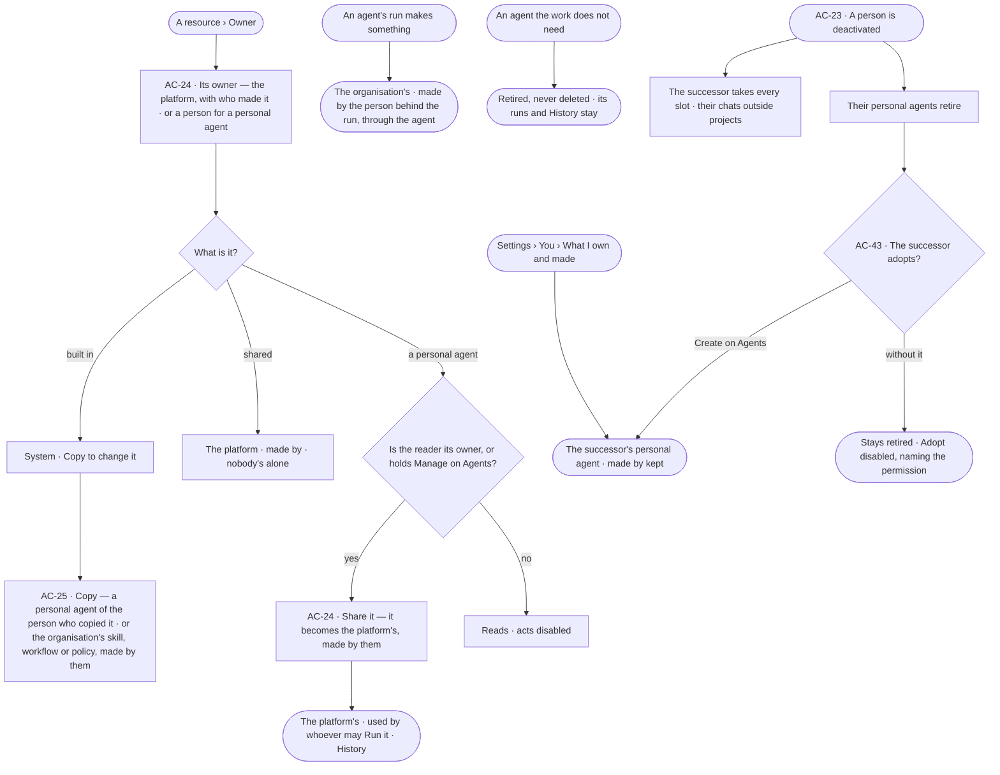

# Ownership

> The organisation owns the work: the platform — the system user — owns built-in and shared agents and every skill,
> workflow, Access Policy, board, project and schedule, keeping who made each; a personal agent is its person's.
> Every place a person sits on work is a slot with a fallback, so no work hangs on
> one person; when a person leaves, their successor takes every slot, their chats and the chance to adopt their
> personal agents. Agents retire, never delete; a built-in is copied to change it.
> The decision it helps make: *who answers for this — and what happens to it when they step away?*

## User journey

Journeys this feature is a step of: [J04 · Build an agent and improve it from what runs teach](../../../../journeys/J04-build-an-agent-and-improve-it-from-what-runs-teach.md) ·
[J12 · A person leaves and the team keeps working](../../../../journeys/J12-a-person-leaves-and-the-team-keeps-working.md)

## Stories

| ID | Story | Status |
|---|---|---|
| AC-24 | [See what I own and share a personal agent](stories/AC-24-see-what-i-own-and-share-a-personal-agent/story.md) | later |
| AC-25 | [Copy a built-in to change it](stories/AC-25-copy-a-built-in-to-change-it/story.md) | idea |
| AC-43 | [Adopt a departed person's agent and chats](stories/AC-43-adopt-a-departed-persons-agent-and-chats/story.md) | later |

## Access

Permissions are [the permission catalogue](../AC-F02-access-policies/feature.md#the-permission-catalogue)'s; an act a person lacks shows disabled, naming the permission and who can grant it.

| Act | Who may |
|---|---|
| Read the owner and maker of any resource · what one owns, made, and the slots one sits in | Every signed-in person |
| Share a personal agent | Its owner, or a person with Manage on Agents, in a session |
| Retire an agent | Its owner, on their personal agent; Manage on Agents, on any other ([AG-F01](../../../../capabilities/agents/features/AG-F01-build-an-agent/feature.md)) |
| Name the successor who takes every slot of a deactivated person | Edit on Access, while deactivating ([AC-23](../AC-F03-directory/stories/AC-23-deactivate-a-person-who-leaves/story.md)) |
| Read the chats a departed person started outside projects | Their successor, as their own — not listed to anyone else |
| Adopt a departed person's retired personal agent | Their successor, when they hold Create on Agents — not offered to anyone else |
| Copy a built-in | Create on its kind — a policy: Access; an agent: Agents; a skill or a workflow: Skills |

## States

| State | What the person sees |
|---|---|
| First use | *What I own and made*: *Nothing yet — what you make belongs to the organisation and shows here as made by you* |
| Empty after a filter | *Nothing matches*, with the filter named and *Clear filters* |
| Loading | The modal opens at once; the owner and maker load in place |
| Has data | The owner — *Platform*, *System* or a person — with who made it and when |
| Failed | What could not load or save, in a sentence, with *Try again*; a refused change says why in place |
| Agent working or proposing | — an agent never changes owners; what it makes is the organisation's, made by the person behind its run |
| No access | The owner and maker read; each act is disabled, naming the permission it needs and who can grant it |

## Rules

| Rule | Detail |
|---|---|
| The organisation owns the work | Built-in and shared agents, skills, workflows, Access Policies, boards, projects and schedules are owned by the platform — the system user — and each keeps who made it. No person owns them alone, so none goes when a person goes |
| Personal agents are their person's | A personal agent belongs to the person who made it, is used by them alone and runs only in the runs they start ([AG-F01](../../../../capabilities/agents/features/AG-F01-build-an-agent/feature.md)); sharing it makes it the platform's, made by them |
| Made by is kept | Every resource records who made it — the person, or the person behind the run through the agent — and it reads beside its owner. Making something grants nothing over it |
| Owning never widens | An owner acts on what they own within their permissions; owning or making a resource grants nothing else, but sharing and retiring what they own ([AC-F02 › Rules](../AC-F02-access-policies/feature.md#rules)) |
| Agents retire, never delete | An agent the work does not need is retired: it is offered to no one and runs nothing new; its runs, learnings, History and the work it made stay. A retired agent may be restored ([AG-F01](../../../../capabilities/agents/features/AG-F01-build-an-agent/feature.md)) |
| Built-ins are the system user's | What Invana ships is owned by the system user: no one changes its owner and no one edits it. *Copy* makes a custom one ([AC-25](stories/AC-25-copy-a-built-in-to-change-it/story.md)) |
| Every seat is a slot | A place a person sits on work is a slot with a fallback — the work never waits on that person ([Slots and fallbacks](#slots-and-fallbacks)) |
| A leaver has a successor | Deactivating a person names one active person as successor ([AC-23](../AC-F03-directory/stories/AC-23-deactivate-a-person-who-leaves/story.md)), who takes every slot a fallback gives them and the chats they started outside projects |
| Chats are the organisation's | A chat outside a project sits in its person's space and is the organisation's; when its person leaves it goes to their successor, who reads each answer as far as their own default agent may read its sources ([GP-F02](../../../graph/features/GP-F02-memory/feature.md#rules)). A chat inside a project stays with its project |
| A departed person's personal agent retires | It is offered to no one and runs nothing new; the successor may adopt it as their own personal agent ([AC-43](stories/AC-43-adopt-a-departed-persons-agent-and-chats/story.md)) |
| Leans on | The Directory — people, the system user, deactivating (AC-F03) · Access Policies and the permission catalogue (AC-F02) · History (AC-F06) · the features that own each resource ([Reads](#reads)) |

### Slots and fallbacks

| Slot | Held by | When its holder cannot act |
|---|---|---|
| An agent's approver | People or teams ([AC-F05](../AC-F05-asks-and-approvals/feature.md)) | The other approvers → the Admins, with a *no approver* alert |
| A project's team place | People ([PJ-F01](../../../../capabilities/projects/features/PJ-F01-projects-and-tasks/feature.md)) | The successor joins the team; a project left with no active person on its team alerts the Admins |
| A task's assignee | A person or an agent ([PJ-F01](../../../../capabilities/projects/features/PJ-F01-projects-and-tasks/feature.md)) | The successor, or the task goes back to *Open* |
| A schedule's or a pick-up's setter | The person who set it, recorded ([AG-F07](../../../../capabilities/agents/features/AG-F07-schedules/feature.md)) | Their successor becomes the setter and the person behind its next run. The first setter stays recorded |
| A personal key's owner | The person who minted it ([AC-F10](../AC-F10-keys/feature.md)) | The key is revoked; automation uses a project key, which no one's leaving stops |
| A work connection | A service identity, no person ([CP-F02](../../../control/features/CP-F02-plugins-and-outside-tools/feature.md)) | Nothing — no person holds it |
| A chat outside a project | Its person ([EX-F03](../../../../capabilities/explore/features/EX-F03-ask-a-question/feature.md)) | The successor |
| A personal agent | Its person ([AG-F01](../../../../capabilities/agents/features/AG-F01-build-an-agent/feature.md)) | Retired; the successor may adopt it |
| A holder of Super user | The active people who hold it ([AC-F03](../AC-F03-directory/feature.md)) | A deactivation or take-off that leaves none is refused |

### Where memory goes when a person leaves

| Memory | Goes |
|---|---|
| Project memory | Stays on its project, untouched |
| Agent learnings | Stay on their agent, untouched, still naming who gave the feedback |
| Org knowledge | Stays on the deployment, untouched |
| Chats outside projects | To the successor |
| A personal agent | Retired; the successor may adopt it |
| What a personal connection returned | Erased ([AC-F12](../AC-F12-leaving-and-keeping/feature.md)) |
| History | Append-only; the name kept or pseudonymised ([AC-F12](../AC-F12-leaving-and-keeping/feature.md)) |

## Data touched

| Record | Read or write |
|---|---|
| Owners of personal agents — person, how and when they came to own it | Write · read |
| Chats outside projects — their person ([EX-F03](../../../../capabilities/explore/features/EX-F03-ask-a-question/feature.md#engine)) | Write, through their owner, on succession |
| Who made each resource — on the resource's own row | Read |
| The resources owned (their own features) | Read; a copy writes a new one through its owner feature |

## Engine

The low-level design: what this feature stores, serves and refuses. Conventions — naming, errors, lists, events — are
[system-design.md](../../../../system-design.md) §§ 6–8; this section only fills them in.

### Records

| Table | Columns | Notes |
|---|---|---|
| `access_owners` | `resource_type` (`agent`) · `resource_id` · `user_id` (a person) · `via` (`made` · `copied` · `adopted`) · `added_by_id?` · `added_at` | Unique (`resource_type`, `resource_id`). Rows only for a personal agent — one row, its person. A resource with no row is the platform's |

Each owned resource keeps `made_by_id` (a person) and `made_via_agent_id?` on its own row in its own feature.

### Reads

| Record | Owner |
|---|---|
| Users — people, the system user, who is active | [AC-F03](../AC-F03-directory/feature.md#engine) |
| Access Policies and their copy | [AC-F02](../AC-F02-access-policies/feature.md#engine) |
| Agents, personal or shared, retired, and their copy | [AG-F01](../../../../capabilities/agents/features/AG-F01-build-an-agent/feature.md#engine) |
| Skills and their copy | [AG-F04](../../../../capabilities/agents/features/AG-F04-skills/feature.md#engine) |
| Workflows and their copy | [AG-F06](../../../../capabilities/agents/features/AG-F06-plans-and-workflows/feature.md#engine) |
| Schedules and their setter | [AG-F07](../../../../capabilities/agents/features/AG-F07-schedules/feature.md#engine) |
| Approvers — a slot | [AC-F05](../AC-F05-asks-and-approvals/feature.md#engine) |
| Projects, their teams and assignees — slots | [PJ-F01](../../../../capabilities/projects/features/PJ-F01-projects-and-tasks/feature.md#engine) |
| Chats — `explore_sessions` and who started each | [EX-F03](../../../../capabilities/explore/features/EX-F03-ask-a-question/feature.md#engine) |
| Deactivating and the successor | [AC-F03](../AC-F03-directory/feature.md#engine) |
| History — every event this feature writes | [AC-F06](../AC-F06-history/feature.md#engine) |

### Routes

| Route, after `/api/v1/access` | Does | Story |
|---|---|---|
| `GET /owners/{resource_type}/{id}` | Its owner — `platform`, `system` or its people (`username` · `name` · `via` · `added_by?` · `added_at`) — and `made_by` · `made_via_agent?` | AC-24 |
| `POST /owners/agent/{id}/share` | A personal agent becomes the platform's, `made_by` kept; who may use it is then a permission, Run on `agent/<name>` | AC-24 |
| `GET /owners/mine` | The caller's personal agents, what they made (`?resource_type=`) and the slots they sit in | AC-24 |
| `GET /owners/succession` · `POST /owners/agent/{id}/adopt` | What the caller took over as a successor — chats, tasks, project team places — and the retired personal agents they may adopt · adopt one | AC-43 |
| `POST /copies` | `{resource_type, name}` — a custom copy of a built-in through its owner feature; an agent copy is a personal agent of the caller, any other copy the platform's, `made_by` the caller | AC-25 |

### Events

| Event | When |
|---|---|
| `access.owners.share` | A personal agent is shared — it becomes the platform's |
| `access.copies.create` | A built-in is copied — what, and the version copied, in `details` |
| `access.owners.succession` | A deactivated person's slots and chats go to the successor — what went where in `details` |
| `access.owners.adopt` | A successor adopts a departed person's personal agent |

### Refusals

| Status | When | Sentence | Criterion |
|---|---|---|---|
| 422 | A share or an owner change on a platform-owned or built-in resource | *{name} is the organisation's — nobody owns it alone.* | AC-24.13 · AC-25.2 |
| 403 | Sharing a personal agent by anyone but its person | *Only {person} shares their own agent.* | AC-24.14 |
| 409 | A copy named with a name its kind already uses | *{name} is taken.* | AC-25.7 |
| 403 | Copying a built-in whose kind the caller may not Create | [AC-F02 › Refusals](../AC-F02-access-policies/feature.md#refusals) | AC-25.6 |
| 403 | A share or a copy with a key | [AC-F02 › Refusals](../AC-F02-access-policies/feature.md#refusals) | AC-24.10 |
| 409 | Adopting a personal agent already adopted | *{agent} is already {person}'s.* | AC-43.8 |
| 403 | Adopting by anyone but the departed person's successor | *Only {person}'s successor adopts their agents.* | AC-43.10 |
| 403 | Adopting by a successor without Create on `agent/*` | [AC-F02 › Refusals](../AC-F02-access-policies/feature.md#refusals) | AC-43.9 |

### CLI

| Command | Does |
|---|---|
| `invana owners show <type> <name>` | Read, as the route does |

### Mechanisms

| Mechanism | How |
|---|---|
| Made at birth | Every feature that makes a resource writes `made_by_id` — the person behind the act or the run — and `made_via_agent_id` when an agent made it, in the same transaction. A personal agent also gets its `access_owners` row; a built-in is the system user's |
| The person behind a run | A run carries the person it acts for; a delegated run carries its caller's ([AC-F04](../AC-F04-what-an-agent-may-touch/feature.md#rules)); a scheduled run or a pick-up carries its setter as the person behind it and as `made_by` for what it makes |
| Share | Removes the personal agent's `access_owners` row and sets the agent `shared`, in one transaction; `made_by` stays |
| Copy | `POST /copies` asks the resource's owner feature to copy the built-in at its current version, with `copied_from` and the version; the copy is custom, attached to nothing and granted to no one but, for an agent, its person |
| Succession | Called by [AC-F03 › Deactivating](../AC-F03-directory/feature.md#mechanisms) in its transaction: chats they started outside a project go to the successor through [EX-F03](../../../../capabilities/explore/features/EX-F03-ask-a-question/feature.md#engine), marked *From {person}*; tasks go to the successor or back to *Open* through [PJ-F01](../../../../capabilities/projects/features/PJ-F01-projects-and-tasks/feature.md#engine); each personal agent of theirs is retired ([AG-F01](../../../../capabilities/agents/features/AG-F01-build-an-agent/feature.md#engine)) and its `access_owners` row kept until it is adopted; an Inbox row tells the successor what they took over |
| Adopt | Moves the retired agent's `access_owners` row to the successor (`via = adopted`), restores it, and grants it to them alone; `made_by` stays; its Access Policies are unchanged |
| Slots | Each slot's feature keeps its holder; when a holder is deactivated or cannot answer, the fallback in [Slots and fallbacks](#slots-and-fallbacks) applies at the next act that needs the slot |

## System impact

| HLD section | Change | NFRs |
|---|---|---|
| § 6 Data and storage | One table in Postgres; `made_by_id` on each owned resource | — |
| § 8 APIs and events | The owners, succession, adopt, share and copies routes and `access.owners.*` · `access.copies.create` events above | — |
| § 12 Qualities | Security: owning grants nothing; the organisation owns shared work; a built-in is never edited; no work waits on one person | NFR-SEC-1 |

## Decisions

| Decision | Detail |
|---|---|
| Owner is a modal | *Owner* opens from any resource's header as a modal, so the resource stays readable behind it |
| A copied agent starts personal | A copy of a built-in agent is its maker's personal agent, to try before it is shared; any other copy is the organisation's from the start |
| One successor takes it all | The successor takes every slot a fallback gives them and the leaver's chats, so the Admin decides once, while deactivating |
| Adopting Needs Create on Agents | A personal agent is an agent like any other; a successor without Create on `agent/*` leaves it retired rather than hold an agent they could not build |
| Sharing needs no second act | A shared agent is the platform's at once; it reaches others only when an Admin grants it, so sharing alone gives no one anything |

## Open questions

| Question | Who answers |
|---|---|

## Not building

| Item | Why not |
|---|---|
| A person owning shared work | Work held by one person stops when they go; the platform owns it and keeps who made it |
| Co-owners of agents, skills, workflows, policies, boards, projects or schedules | The organisation owns them; a slot names who sits where |
| Teams or agents as owners | Teams own nothing; an agent's work is the organisation's, made by the person behind its run |
| Deleting an agent | Its runs, learnings and History must keep a name; it retires |
| Splitting a leaver's work across several successors | One successor keeps deactivating one decision; they may hand any of it on afterwards |
| Updating a copy when its built-in changes | A copy keeps the version it came from |
| Owning a decision | Decisions are immutable and superseded |
