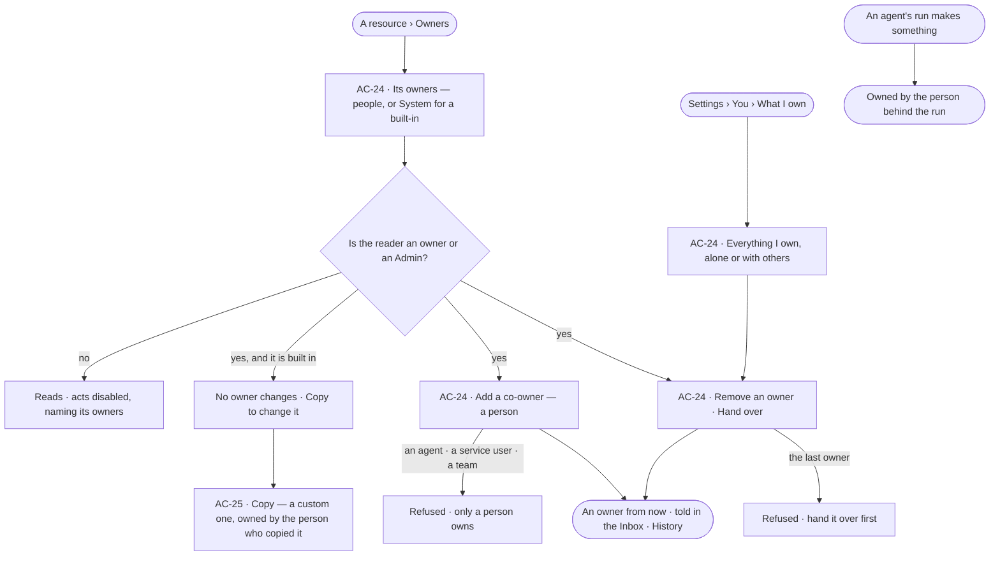

# Ownership

> Who owns each agent, skill, workflow, Access Policy, board, project, schedule and service user — one or more people,
> or the system user for what Invana ships — how a person adds a co-owner or hands something over, and how a built-in
> is copied to change it.
> The decision it helps make: *who answers for this — and who should, once I step away from it?*

## User journey

Journeys this feature is a step of: [J04 · Build an agent and improve it from what runs teach](../../../../journeys/J04-build-an-agent-and-improve-it-from-what-runs-teach.md)

## Stories

| ID | Story | Status |
|---|---|---|
| AC-24 | [Share and hand over what I own](stories/AC-24-share-and-hand-over-what-i-own/story.md) | idea |
| AC-25 | [Copy a built-in to change it](stories/AC-25-copy-a-built-in-to-change-it/story.md) | idea |

## Access

| Act | Role ([the role table](../AC-F02-access-policies/feature.md#the-role-table)) | Everyone else sees |
|---|---|---|
| Read the owners of any resource · what one owns | Every signed-in person | — |
| Add a co-owner · remove an owner · hand over | An owner of the resource, in a session; an Admin for any resource not built in | Disabled — *Only its owners or an Admin — ask Ravi* |
| Hand over everything a deactivated person owns alone | Admin, while deactivating ([AC-23](../AC-F03-directory/stories/AC-23-deactivate-a-person-who-leaves/story.md)) | — |
| Copy a built-in | Whoever may make one of its kind by the role table — a policy: Admin; an agent, a skill or a workflow: Modeller · Admin | Disabled, naming the role it needs |

## States

| State | What the person sees |
|---|---|
| First use | *What I own*: *You own nothing yet — what you make, and what an agent makes for you, is yours* |
| Empty after a filter | *Nothing matches*, with the filter named and *Clear filters* |
| Loading | The modal opens at once; owners load in place |
| Has data | Each owner with how they came to own it — *made it* · *added by Lee* · *handed over by Lee* · *copied it* — and when |
| Failed | What could not load or save, in a sentence, with *Try again*; a refused change says why in place |
| Agent working or proposing | — an agent never changes owners; what it makes is owned by the person behind its run |
| No access | Owners read; each act is disabled, naming the owners and the Admins |

## Rules

| Rule | Detail |
|---|---|
| What is owned | Agents · skills · workflows · Access Policies · boards · projects · schedules · service users. Decisions are not owned: they are immutable and superseded |
| Who owns | People and the system user, never an agent, a service user or a team. One or more owners; every owner may do what any other may |
| Always an owner | A resource never has no owner; the last owner is removed only by handing it over |
| What an agent makes | Owned by the person behind the run that made it — across a delegation chain, the person at its head; when a service user is behind it, by the service user's owners |
| Built-ins are the system user's | What Invana ships is owned by the system user: no one adds or removes its owners, and no one edits it. *Copy* makes a custom one owned by the person who copied it |
| Owning never widens | An owner acts on what they own within their role and the agents they may use; owning a resource grants nothing else ([the role table](../AC-F02-access-policies/feature.md#the-role-table)) |
| Leans on | The Directory — people, the system user, deactivating (AC-F03) · Access Policies and the role table (AC-F02) · History (AC-F06) · the features that own each resource ([Reads](#reads)) |

## Data touched

| Record | Read or write |
|---|---|
| Owners — resource, person, how and when they came to own it | Write · read |
| The resources owned (their own features) | Read; a copy writes a new one through its owner feature |

## Engine

The low-level design: what this feature stores, serves and refuses. Conventions — naming, errors, lists, events — are
[system-design.md](../../../../system-design.md) §§ 6–8; this section only fills them in.

### Records

| Table | Columns | Notes |
|---|---|---|
| `access_owners` | `resource_type` (`agent` · `skill` · `workflow` · `policy` · `board` · `project` · `schedule` · `service_user`) · `resource_id` · `user_id` (a person or the system user) · `via` (`made` · `added` · `handed_over` · `copied`) · `added_by_id?` · `added_at` | Unique (`resource_type`, `resource_id`, `user_id`); at least one row per resource |

### Reads

| Record | Owner |
|---|---|
| Users — people, the system user, who is active | [AC-F03](../AC-F03-directory/feature.md#engine) |
| Access Policies and their copy | [AC-F02](../AC-F02-access-policies/feature.md#engine) |
| Agents and their copy | [AG-F01](../../../../capabilities/agents/features/AG-F01-build-an-agent/feature.md#engine) |
| Skills and their copy | [AG-F04](../../../../capabilities/agents/features/AG-F04-skills/feature.md#engine) |
| Workflows and their copy | [AG-F06](../../../../capabilities/agents/features/AG-F06-plans-and-workflows/feature.md#engine) |
| Schedules | [AG-F07](../../../../capabilities/agents/features/AG-F07-schedules/feature.md#engine) |
| History — every event this feature writes | [AC-F06](../AC-F06-history/feature.md#engine) |

### Routes

| Route, after `/api/v1/access` | Does | Story |
|---|---|---|
| `GET /owners/{resource_type}/{id}` | Its owners: `username` · `name` · `via` · `added_by?` · `added_at`; `built_in` when the system user owns it | AC-24 |
| `POST /owners/{resource_type}/{id}` · `DELETE /owners/{resource_type}/{id}/{username}` | Add a co-owner `{user}` · remove an owner | AC-24 |
| `POST /owners/{resource_type}/{id}/hand-over` | `{to}` — the person becomes an owner and the caller stops being one, in one act | AC-24 |
| `GET /owners/mine` | What the caller owns by the list contract (`?resource_type=` · `?alone=`), each with its other owners | AC-24 |
| `POST /copies` | `{resource_type, name}` — a custom copy of a built-in through its owner feature, owned by the caller, `via = copied` | AC-25 |

### Events

| Event | When |
|---|---|
| `access.owners.add` · `access.owners.remove` · `access.owners.hand_over` | An owner is added · removed · a resource is handed over — the resource and the people in `details` |
| `access.copies.create` | A built-in is copied — what, and the version copied, in `details` |

### Refusals

| Status | When | Sentence | Criterion |
|---|---|---|---|
| 409 | Removing the last owner | *{resource} needs an owner — hand it over first.* | AC-24.5 |
| 422 | An owner who is an agent, a service user, a team or a deactivated user | *Only an active person owns {resource}.* | AC-24.4 |
| 403 | An owner change by someone who is neither an owner nor an Admin | *Only its owners or an Admin — ask {owners}.* | AC-24.9 |
| 422 | An owner change on a built-in | *{name} is built in — copy it to change it.* | AC-25.2 |
| 409 | A copy named with a name its kind already uses | *{name} is taken.* | AC-25.7 |
| 403 | Copying a built-in whose kind the caller's role may not make | [AC-F02 › Refusals](../AC-F02-access-policies/feature.md#refusals) | AC-25.6 |
| 403 | An owner change or a copy with a key | [AC-F02 › Refusals](../AC-F02-access-policies/feature.md#refusals) | AC-24.10 |

### CLI

| Command | Does |
|---|---|
| `invana owners show <type> <name>` · `invana owners add <type> <name> <username>` · `invana owners hand-over <type> <name> <username>` | Read, add and hand over, as the routes do; refused with a key |

### Mechanisms

| Mechanism | How |
|---|---|
| Owned at birth | Every feature that makes a resource writes its first `access_owners` row in the same transaction: `via = made` for the person behind the act or the run — for a service user, a row for each of its owners; for a built-in, the system user |
| The person behind a run | A run carries the person it acts for; a delegated run carries its caller's ([AC-F04](../AC-F04-what-an-agent-may-touch/feature.md#engine)); what any step makes is theirs |
| Hand-over | Adds the receiver `via = handed_over` and removes the giver, in one transaction; on deactivation ([AC-F03](../AC-F03-directory/feature.md#mechanisms)) it runs for everything the leaver owns alone, and the leaver's other rows are removed |
| Copy | `POST /copies` asks the resource's owner feature to copy the built-in at its current version, with `copied_from` and the version; the copy is custom, owned `via = copied`, attached to nothing and granted to no one |
| The new owner is told | An Inbox row for each person added or handed to ([CP-F08](../../../control/features/CP-F08-the-inbox/feature.md#engine)) |

## System impact

| HLD section | Change | NFRs |
|---|---|---|
| § 6 Data and storage | One table in Postgres | — |
| § 8 APIs and events | The owners and copies routes and `access.owners.*` · `access.copies.create` events above | — |
| § 12 Qualities | Security: only people own; owning grants nothing; a built-in is never edited | NFR-SEC-1 |

## Decisions

| Decision | Detail |
|---|---|
| Owners are a modal | *Owners* opens from any owned resource's header as a modal, so the resource stays readable behind it |
| No acceptance step | A person added or handed something is told in the Inbox; they need not accept, and may hand it on |
| One table for every resource | Owners live in one place, so *What I own* and hand-over read one record |

## Open questions

| Question | Who answers |
|---|---|

## Not building

| Item | Why not |
|---|---|
| Teams or agents as owners | Teams own nothing; an agent's work is its person's |
| Owner levels — primary, secondary | Co-owners are equal; one owner reads as plainly as two |
| Updating a copy when its built-in changes | A copy is the person's own; it keeps the version it came from |
| Owning a decision | Decisions are immutable and superseded |
