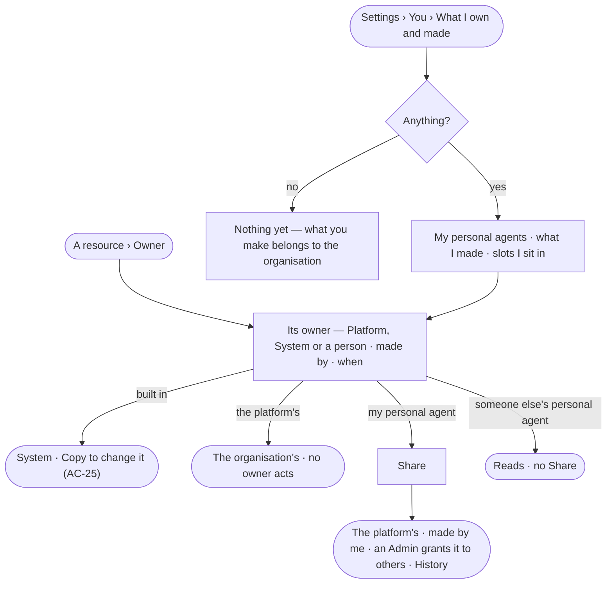

# AC-24 · See what I own and share a personal agent

**As** an agent builder **I want** to see what I own and made, and share a personal agent with the organisation,
**so that** nothing the team relies on depends on me alone when I step away.

Tasks: [task.md](task.md) · Feature: [AC-F07](../../feature.md)

## Who can

| Access | Can | Otherwise sees |
|---|---|---|
| Admin | Read the owner and maker of anything; share their own personal agents | A platform-owned or built-in resource has no owner acts — *The organisation's* |
| Operator | Read the owner and maker of anything; with Create on Agents, share their own personal agents | On someone else's personal agent, no *Share* |

## Flow

## Acceptance criteria

| # | Given | When | Then |
|---|---|---|---|
| AC-24.1 | Any agent, skill, workflow, Access Policy, board, project or schedule | *Owner* is opened | it reads its owner — *Platform*, *System* or the person who owns it — and who made it, through which agent, and when |
| AC-24.2 | A person who made something, or behind the run of an agent that made it | it is read | it is the organisation's and reads *Made by {person}*, through the agent where one made it; a delegated run's work reads the person at the head of the chain |
| AC-24.7 | A signed-in person | they open *Settings › You › What I own and made* | their personal agents, what they made by kind and the slots they sit in — approver, project team place, assignee, setter — read; with nothing, *Nothing yet — what you make belongs to the organisation and shows here as made by you* |
| AC-24.8 | A person who made an agent but whose policies do not allow Create on `agent/*` | they open it | it reads; making it lets them change nothing — making widens nothing (the permission catalogue) |
| AC-24.10 | A share sent with a key | it is sent | it is refused — it needs a person's session |
| AC-24.11 | A filter on *What I own and made* that matches nothing | it is applied | *Nothing matches* reads with *Clear filters* |
| AC-24.12 | Owners could not load or save | the modal is used | it says what failed, with *Try again*; nothing changes |
| AC-24.13 | A platform-owned or built-in resource | a share is sent for it through the API | it is refused — *{name} is the organisation's — nobody owns it alone* |
| AC-24.14 | A personal agent | its person presses *Share* | it becomes the platform's, *Made by {person}*; it stays granted to them, reaches others only when an Admin grants it, and History records it; anyone else's *Share* is refused |

## Screens

| Surface | Access | First use | Empty after a filter | Loading | Has data | Failed | Agent working or proposing | No access |
|---|---|---|---|---|---|---|---|---|
| Owner | Admin | settings.me · Owners · Made by you | — | settings.me · Owners · Loading | settings.me · Owners | settings.me · Owners · Could not save | — | — |
| Owner | Operator | settings.me · Owners · Made by you | — | settings.me · Owners · Loading | settings.me · Owners | settings.me · Owners · Could not save | — | settings.me · Owners · Locked · Owners |
| Share a personal agent | Admin | — | — | settings.me · Owners · Loading | settings.me · Owners · Share | settings.me · Owners · Could not save | — | — |
| Share a personal agent | Operator | — | — | — | — | — | — | settings.me · Owners · Locked · Owners |
| What I own and made | Admin | settings.me · Own nothing yet | settings.me · Nothing matches | settings.me · Loading | settings.me · What I own | settings.me · Could not load | — | — |
| What I own and made | Operator | settings.me · Own nothing yet | settings.me · Nothing matches | settings.me · Loading | settings.me · What I own | settings.me · Could not load | — | — |
