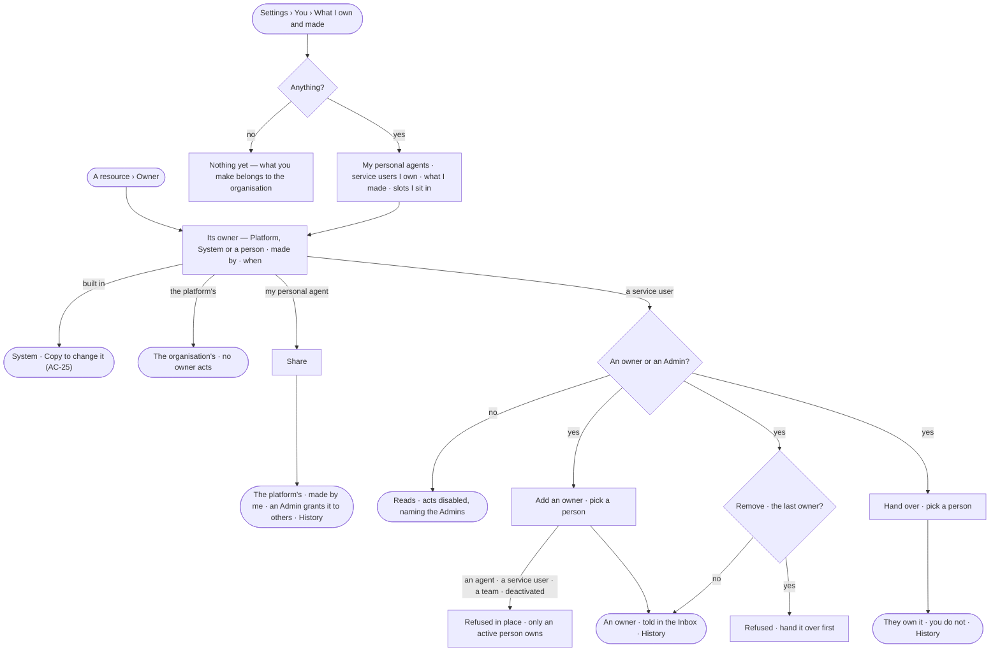

# AC-24 · Share and hand over what I own

**As** an agent builder **I want** to see what I own and made, share a personal agent with the organisation and hand a
service user over **so that** nothing the team relies on depends on me alone, and someone answers for it when I step
away.

Tasks: [task.md](task.md) · Feature: [AC-F07](../../feature.md)

## Who can

| Lens | Can | Otherwise sees |
|---|---|---|
| Admin | Read the owner and maker of anything; add, remove and hand over the owners of any service user; share their own personal agents | A platform-owned or built-in resource has no owner acts — *The organisation's* |
| Operator | Read the owner and maker of anything; on a service user they own, add an owner, remove one and hand it over; a Modeller also shares their own personal agents | On a service user they do not own: *Add an owner*, *Remove* and *Hand over* disabled — *Needs the Admin role — ask Priya or Lee*; on someone else's personal agent, no *Share* |

## Flow

## Acceptance criteria

| # | Given | When | Then |
|---|---|---|---|
| AC-24.1 | Any agent, skill, workflow, Access Policy, board, project, schedule or service user | *Owner* is opened | it reads its owner — *Platform*, *System* or the people who own it — and who made it, through which agent, and when |
| AC-24.2 | A person who made something, or behind the run of an agent that made it | it is read | it is the organisation's and reads *Made by {person}*, through the agent where one made it; a delegated run's work reads the person at the head of the chain |
| AC-24.3 | An owner of a service user | they add a person as an owner | the person is an owner from then on, equal to the others, and is told in the Inbox; History records who added whom |
| AC-24.4 | *Add an owner* | an agent, a service user, a team or a deactivated user is chosen | it is not offered in Studio, and the API refuses it — *Only an active person owns {resource}* |
| AC-24.5 | The last owner of a service user | they remove themselves | it is refused — *{resource} needs an owner — hand it over first* |
| AC-24.6 | An owner of a service user | they hand it over to a person | that person owns it and the giver does not, in one act; both read it in History |
| AC-24.7 | A signed-in person | they open *Settings › You › What I own and made* | their personal agents, the service users they own, what they made by kind and the slots they sit in — approver, reviewer, assignee, setter — read; with nothing, *Nothing yet — what you make belongs to the organisation and shows here as made by you* |
| AC-24.8 | A person who made an agent but whose role does not hold *Build an agent* | they open it | it reads; making it lets them change nothing — making widens nothing (the role table) |
| AC-24.9 | A person who neither owns a service user nor is an Admin | they open its *Owner* | owners read; *Add an owner*, *Remove* and *Hand over* are disabled, naming the Admin role and the Admins |
| AC-24.10 | An owner change or a share sent with a key | it is sent | it is refused — it needs a person's session |
| AC-24.11 | A filter on *What I own and made* that matches nothing | it is applied | *Nothing matches* reads with *Clear filters* |
| AC-24.12 | Owners could not load or save | the modal is used | it says what failed, with *Try again*; nothing changes |
| AC-24.13 | A platform-owned or built-in resource | an owner is added, removed or handed over through the API | it is refused — *{name} is the organisation's — nobody owns it alone* |
| AC-24.14 | A personal agent | its person presses *Share* | it becomes the platform's, *Made by {person}*; it stays granted to them, reaches others only when an Admin grants it, and History records it; anyone else's *Share* is refused |

## Screens

| Surface | Lens | First use | Empty after a filter | Loading | Has data | Failed | Agent working or proposing | No access |
|---|---|---|---|---|---|---|---|---|
| Owner | Admin | access.owners · Made by you | — | access.owners · Loading | access.owners | access.owners · Last owner | — | — |
| Owner | Operator | access.owners · Made by you | — | access.owners · Loading | access.owners | access.owners · Could not save | — | access.locked · Owners |
| Share a personal agent | Admin | — | — | access.owners · Loading | access.owners · Share | access.owners · Could not save | — | — |
| Share a personal agent | Operator | — | — | — | — | — | — | access.locked · Owners |
| What I own and made | Admin | settings.me · Own nothing yet | settings.me · Nothing matches | settings.me · Loading | settings.me · What I own | settings.me · Could not load | — | — |
| What I own and made | Operator | settings.me · Own nothing yet | settings.me · Nothing matches | settings.me · Loading | settings.me · What I own | settings.me · Could not load | — | — |
