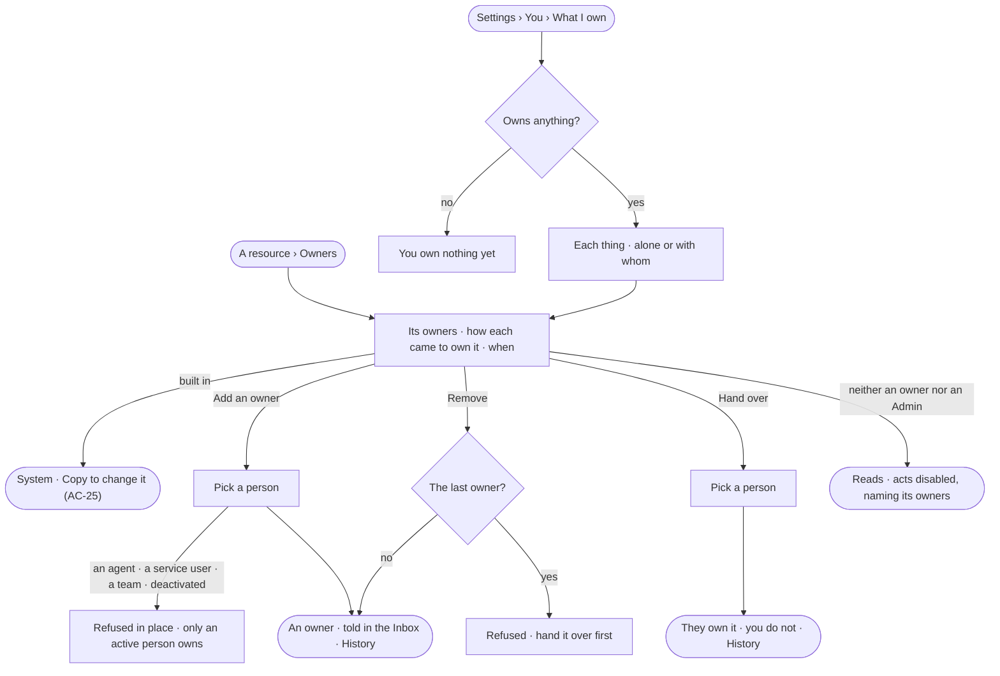

# AC-24 · Share and hand over what I own

**As** an agent builder **I want** to see everything I own, add co-owners and hand a thing over to someone else
**so that** what I made never depends on me alone, and someone answers for it when I step away.

Tasks: [task.md](task.md) · Feature: [AC-F07](../../feature.md)

## Who can

| Lens | Can | Otherwise sees |
|---|---|---|
| Admin | Read the owners of anything; add, remove and hand over owners of anything not built in | A built-in reads *System* and has no owner acts |
| Operator | Read the owners of anything; on what they own, add a co-owner, remove one and hand it over | On what they do not own: *Add an owner*, *Remove* and *Hand over* disabled — *Only its owners or an Admin — ask Ravi* |

## Flow

## Acceptance criteria

| # | Given | When | Then |
|---|---|---|---|
| AC-24.1 | An agent, skill, workflow, Access Policy, board, project, schedule or service user | *Owners* is opened | each owner reads with *made it*, *added by …*, *handed over by …* or *copied it*, and when |
| AC-24.2 | A person who made something, or behind the run of an agent that made it | its owners are read | that person is its owner — never the agent; a delegated run's work is owned by the person at the head of the chain |
| AC-24.3 | An owner | they add a person as a co-owner | the person is an owner from then on, equal to the others, and is told in the Inbox; History records who added whom |
| AC-24.4 | *Add an owner* | an agent, a service user, a team or a deactivated user is chosen | it is not offered in Studio, and the API refuses it — *Only an active person owns {resource}* |
| AC-24.5 | The last owner | they remove themselves | it is refused — *{resource} needs an owner — hand it over first* |
| AC-24.6 | An owner | they hand it over to a person | that person owns it and the giver does not, in one act; both read it in History |
| AC-24.7 | A signed-in person | they open *Settings › You › What I own* | everything they own reads by kind, each marked *alone* or with its other owners; with nothing, *You own nothing yet — what you make, and what an agent makes for you, is yours* |
| AC-24.8 | An owner | they own an agent but their role does not hold *Build an agent* | owning it lets them read its owners and change them, never edit it — owning widens nothing (the role table) |
| AC-24.9 | A person who neither owns it nor is an Admin | they open *Owners* | owners read; *Add an owner*, *Remove* and *Hand over* are disabled, naming its owners and the Admins |
| AC-24.10 | An owner change sent with a key | it is sent | it is refused — it needs a person's session |
| AC-24.11 | A filter on *What I own* that matches nothing | it is applied | *Nothing matches* reads with *Clear filters* |
| AC-24.12 | Owners could not load or save | the modal is used | it says what failed, with *Try again*; nothing changes |

## Screens

| Surface | Lens | First use | Empty after a filter | Loading | Has data | Failed | Agent working or proposing | No access |
|---|---|---|---|---|---|---|---|---|
| Owners | Admin | access.owners · Made by you | — | access.owners · Loading | access.owners | access.owners · Last owner | — | — |
| Owners | Operator | access.owners · Made by you | — | access.owners · Loading | access.owners | access.owners · Could not save | — | access.locked · Owners |
| What I own | Admin | settings.me · Own nothing yet | settings.me · Nothing matches | settings.me · Loading | settings.me · What I own | settings.me · Could not load | — | — |
| What I own | Operator | settings.me · Own nothing yet | settings.me · Nothing matches | settings.me · Loading | settings.me · What I own | settings.me · Could not load | — | — |
