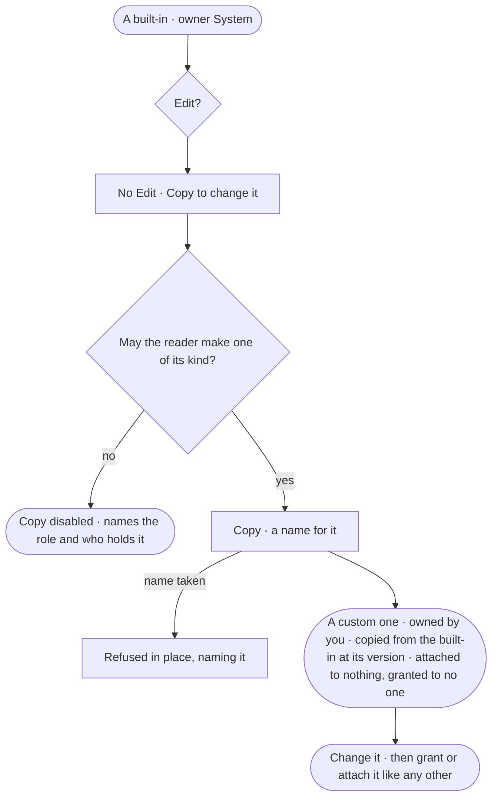

# AC-25 · Copy a built-in to change it

**As** an agent builder **I want** to copy a built-in agent, skill, workflow or Access Policy into one of my own
**so that** I can change it to fit our work while what Invana ships stays as shipped.

Tasks: [task.md](task.md) · Feature: [AC-F07](../../feature.md)

## Who can

| Lens | Can | Otherwise sees |
|---|---|---|
| Admin | Copy any built-in; the copy is theirs | — |
| Operator | Read every built-in, its owner *System* and its version; a Modeller copies a built-in agent, skill or workflow | *Copy* disabled, naming the role it needs — *Needs the Modeller role* for an agent, a skill or a workflow, *Needs the Admin role* for a policy — and who holds it |

## Flow

## Acceptance criteria

| # | Given | When | Then |
|---|---|---|---|
| AC-25.1 | A built-in agent, skill, workflow or Access Policy | it is read | its owner reads *System*, with the version Invana ships; it offers *Copy* and no *Edit*, *Delete* or owner acts |
| AC-25.2 | A built-in | an edit, a delete or an owner change is sent through the API | it is refused — *{name} is built in — copy it to change it* |
| AC-25.3 | A person whose role may make one of its kind | they *Copy* it with a free name | a custom one exists, owned by them alone, reading *Copied from {built-in} at version {n}*; History records it |
| AC-25.4 | A copy of a built-in agent | it is made | it carries the built-in's instructions and skills, is granted to no one and has no policy attached until an Admin attaches one (AC-11) and grants it (AC-22) |
| AC-25.5 | A copy | Invana ships a new version of its built-in | the copy stays as it is; it is the person's own |
| AC-25.6 | A person whose role may not make one of its kind | they open the built-in | it reads in full; *Copy* is disabled, naming the role it needs and who holds it |
| AC-25.7 | A name already used for one of its kind | a copy is made with it | it is refused in place, naming it |
| AC-25.8 | A copy could not be made | *Copy* is sent | nothing is made; the reason reads in place, with *Try again* |

## Screens

| Surface | Lens | First use | Empty after a filter | Loading | Has data | Failed | Agent working or proposing | No access |
|---|---|---|---|---|---|---|---|---|
| A built-in's owner and Copy | Admin | — | — | access.owners · Loading | access.owners · Built in | access.owners · Could not copy | — | — |
| A built-in's owner and Copy | Operator | — | — | access.owners · Loading | access.owners · Built in | — | — | access.locked · Copy needs a role |
| The copy | Admin | — | — | — | access.owners · Copied | access.owners · Name taken | — | — |
| The copy | Operator | — | — | — | — | — | — | access.locked · Copy needs a role |
