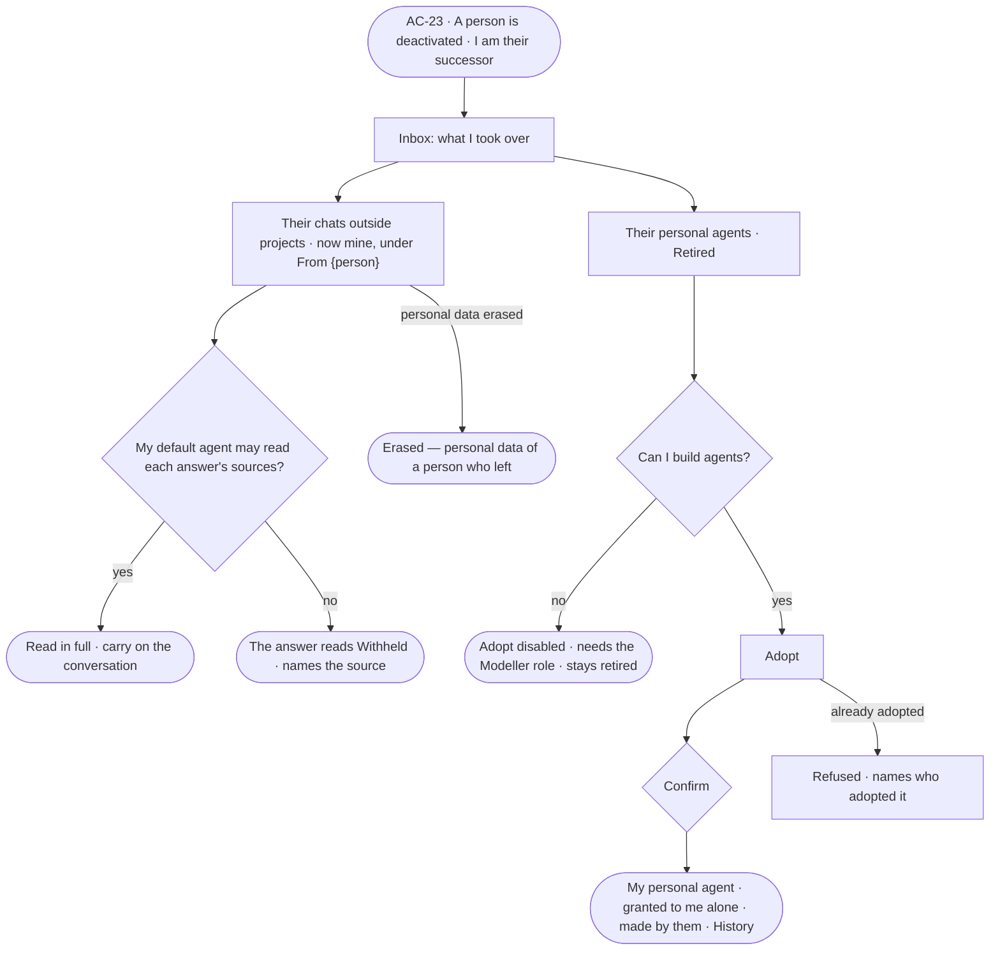

# AC-43 · Adopt a departed person's agent and chats

**As** the successor of a person who left **I want** their chats outside projects to come to me, and to adopt the
personal agents they made **so that** I carry on where they stopped, with the conversations and the agent that did
the work, and nothing they started is lost.

Tasks: [task.md](task.md) · Feature: [AC-F07](../../feature.md)

## Who can

| Lens | Can | Otherwise sees |
|---|---|---|
| Admin | As a successor: read the departed person's chats, which are theirs now; adopt a retired personal agent of the person they succeeded | Another successor's chats and agents are not offered |
| Operator | As a successor: read the departed person's chats, which are theirs now; a Modeller also adopts a retired personal agent of the person they succeeded | *Adopt* disabled — *Needs the Modeller role — ask Priya or Lee*; the agent stays retired |

## Flow

## Acceptance criteria

| # | Given | When | Then |
|---|---|---|---|
| AC-43.1 | A person deactivated with me as successor | I open my Inbox | it lists what I took over — chats, service users, tasks, reviewer places — and the personal agents I may adopt, each with the engine's count |
| AC-43.2 | Their chats outside projects | I open my conversations | they read under *From {person}*, mine now; I may reopen, rename, archive or continue each like my own |
| AC-43.3 | A chat I took over | I read an answer in it | it shows in full when my default agent may read every source it drew on; otherwise it reads *Withheld — your agent may not read {resource}* (GP-F02) |
| AC-43.4 | A chat whose answers drew on the departed person's personal connections | I read them | each such answer reads *Erased — personal data of a person who left* (AC-45) |
| AC-43.5 | A chat inside a project | the person is deactivated | it stays with its project; nothing moves |
| AC-43.6 | Their personal agents | the deactivation saves | each is retired — offered to no one, running nothing new — its runs, learnings and History kept |
| AC-43.7 | A retired personal agent of the person I succeeded, and the Modeller or Admin role | I choose *Adopt* and confirm | it becomes my personal agent, granted to me alone, its Access Policies as they were, *made by* still naming its maker; History records it |
| AC-43.8 | A retired personal agent already adopted | I choose *Adopt* | it is refused — *{agent} is already {person}'s* |
| AC-43.9 | An Operator successor | they reach *Adopt* | it is disabled, naming the Modeller role and the Admins; the agent stays retired |
| AC-43.10 | Someone who is not the successor | they open a departed person's personal agent | it reads *Retired*; *Adopt* is not offered; the API refuses it |
| AC-43.11 | Adopting could not save | it is sent | the agent stays retired, saying why, with *Try again* |

## Screens

| Surface | Lens | First use | Empty after a filter | Loading | Has data | Failed | Agent working or proposing | No access |
|---|---|---|---|---|---|---|---|---|
| What I took over | Admin | settings.me · Took over nothing | — | settings.me · Loading | settings.me · Took over | settings.me · Could not load | — | — |
| What I took over | Operator | settings.me · Took over nothing | — | settings.me · Loading | settings.me · Took over | settings.me · Could not load | — | — |
| Adopt a personal agent | Admin | — | — | — | access.owners · Adopt | access.owners · Already adopted | — | access.owners · Not the successor |
| Adopt a personal agent | Operator | — | — | — | access.locked · Adopt | — | — | access.locked · Adopt |
