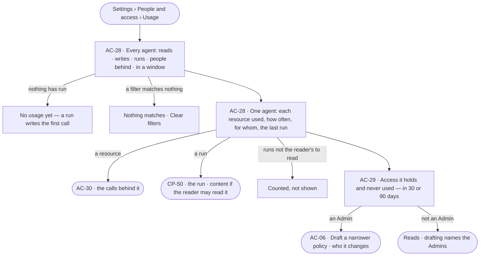

# Access usage

> What each agent actually read, wrote and ran — which graph databases and kinds, which skills, workflows, agents,
> plugins and tools, how often, and for whom — beside the access it holds and never uses.
> The decision it helps make: *is this agent doing what it was given access for — and should it hold less?*

## User journey

Journeys this feature is a step of: [J09 · Audit what an agent touched](../../../../journeys/J09-audit-what-an-agent-touched-and-what-left-the-platform.md)

## Stories

| ID | Story | Status |
|---|---|---|
| AC-28 | [See what an agent touched](stories/AC-28-see-what-an-agent-touched/story.md) | idea |
| AC-29 | [Find access an agent never uses](stories/AC-29-find-access-an-agent-never-uses/story.md) | idea |

## Access

| Act | Role ([the role table](../AC-F02-access-policies/feature.md#the-role-table)) | Everyone else sees |
|---|---|---|
| Read every agent's usage — every resource, count and person behind | Admin | — |
| Read an agent's usage over the runs the reader may read — runs they are behind, agents they own | Every signed-in person — Operator, Modeller | The rest is counted, not shown — *N runs are not yours to read* |
| Read access an agent never uses | Admin · the agent's owners | Hidden for others; the agent's access reads in [AC-F04](../AC-F04-what-an-agent-may-touch/feature.md) |
| Draft a narrower policy from unused access | Admin, in a session ([AC-06](../AC-F02-access-policies/stories/AC-06-draft-a-policy-and-see-who-it-changes/story.md)) | Disabled, naming the Admin role and the Admins |

## States

| State | What the person sees |
|---|---|
| First use | *No usage yet — a run writes the first call* |
| Empty after a filter | *Nothing matches*, with the filter named and *Clear filters* |
| Loading | The sheet opens at once; counts read `—` until the engine gives them |
| Has data | Each agent with its reads, writes and runs in the window and the people behind them; one agent's resources, each with its count and last use; access never used |
| Failed | What could not load, in a sentence, with *Try again* |
| Agent working or proposing | Runs still going count as they settle; a running run reads *running* beside its count |
| No access | An Operator or a Modeller reads usage over runs they may read; a line counts the rest |

## Rules

| Rule | Detail |
|---|---|
| Read from the record | Usage is counted by the engine from the ledger ([AC-F09](../AC-F09-what-left-the-platform/feature.md)) and History ([AC-F06](../AC-F06-history/feature.md)); there is no usage table to drift |
| Resources, as rules name them | Usage is grouped by the resource a rule names — `data/<graph database>/<kind>` · `skill/` · `workflow/` · `agent/` · `plugin/` · `tool/<plugin>/<tool>` — so used and allowed line up |
| For whom | Every count names the people behind the runs and their teams; a run's person behind is the one the policy check held it to |
| Content follows run privacy | Counts over runs the reader may not read are counted, never shown; a run's content opens only as [AC-31](../AC-F09-what-left-the-platform/stories/AC-31-keep-a-runs-content-to-those-who-may-read-it/story.md) says |
| Unused is a suggestion | Access never used in the window is listed, never removed; a narrower policy is an Admin's saved version after *Who it changes* |
| Windows | 7 days · 30 days · 90 days · a range within the 365 days the ledger is kept |
| Leans on | The ledger (AC-F09) · History (AC-F06) · Access Policies and the one evaluator (AC-F02) · what an agent may touch (AC-F04) |

## Data touched

| Record | Read or write |
|---|---|
| Ledger rows — calls to graph databases, AI models and tools (AC-F09) | Read |
| History rows — steps run, refusals, the person behind (AC-F06) | Read |
| Access Policies and their rules (AC-F02) | Read |

## Engine

The low-level design: what this feature stores, serves and refuses. Conventions — naming, errors, lists, events — are
[system-design.md](../../../../system-design.md) §§ 6–8; this section only fills them in.

### Records

| Table | Columns | Notes |
|---|---|---|
| — | — | No table of its own: usage is a reading of [AC-F09](../AC-F09-what-left-the-platform/feature.md#engine)'s ledger rows and [AC-F06](../AC-F06-history/feature.md#engine)'s History rows |

### Reads

| Record | Owner |
|---|---|
| Ledger rows | [AC-F09](../AC-F09-what-left-the-platform/feature.md#engine) |
| History rows | [AC-F06](../AC-F06-history/feature.md#engine) |
| Access Policies, attachments and `decide()` | [AC-F02](../AC-F02-access-policies/feature.md#engine) |
| Who may read a run's content — `may_read_run()` | [AC-F09](../AC-F09-what-left-the-platform/feature.md#mechanisms) |
| Owners of an agent | [AC-F07](../AC-F07-ownership/feature.md#engine) |

### Routes

| Route, after `/api/v1/access/usage` | Does | Story |
|---|---|---|
| `GET /agents?since=` | A page by the list contract (`?q=` · `?kind=` · `?person=` · `?team=`): per agent `reads` · `writes` · `runs` · `people` · `refused` · `last_used_at` · `hidden_runs` | AC-28 |
| `GET /agents/{name}?since=&person=&team=` | One agent: per resource `{resource, verb, calls, records, people[], teams[], last_used_at, last_run_id}`; per graph database its reads and writes; `hidden_runs` | AC-28 |
| `GET /agents/{name}/unused?days=30 · 90` | Each resource a rule on an attached policy allows or asks for that no step used in the window: `{resource, verb, rule, policy, team?, last_used_at?}` | AC-29 |

### Events

| Event | When |
|---|---|
| — | No event of its own: it only reads |

### Refusals

| Status | When | Sentence | Criterion |
|---|---|---|---|
| 404 | Unused access read by someone who neither owns the agent nor is an Admin | *Not found.* | AC-29.8 |
| 422 | A window beyond the 365 days the ledger is kept | *Calls are kept 365 days.* | AC-28.9 |

### CLI

| Command | Does |
|---|---|
| `invana access usage <agent> [--since 30d] [--unused]` | One agent's usage, or the access it never used; held to the reader's rights like the routes |

### Mechanisms

| Mechanism | How |
|---|---|
| Counts | SQL over ledger and History rows in the window, grouped by agent, resource and person behind; table rows read the newest 20,000, counts the whole window |
| Usage to resource | A ledger row's target and kinds map to the resource a rule names: a graph database call to `data/<graph database>/<kind>` per kind · a tool call to `tool/<plugin>/<tool>` · a step's function to `plugin/<name>` · a skill, workflow or agent run to its own |
| What a reader sees | Rows of runs `may_read_run()` refuses are summed into `hidden_runs` and never itemised |
| Unused | The resources the attached policies reach for Allow or Ask, minus every resource used in the window; a wildcard rule reads as unused only when nothing it matches was used |

## System impact

| HLD section | Change | NFRs |
|---|---|---|
| § 8 APIs and events | The `…/access/usage` routes | — |
| § 12 Qualities | Security: an agent's access is read beside its use, so access nobody uses can be narrowed | NFR-SEC-1 |

## Decisions

| Decision | Detail |
|---|---|
| A tab beside Access Policies | *Usage* is a tab of *Settings › People and access*; an agent opens beside the list |
| 90 days by default for unused | A shorter window flags access used monthly or quarterly as unused |

## Open questions

| Question | Who answers |
|---|---|

## Not building

| Item | Why not |
|---|---|
| Removing unused access by itself | Only a person saves a policy, after seeing who it changes |
| A usage table | It would drift from the ledger and History it counts |
| Usage per record | The ledger keeps record IDs; one record's acts are History's by record |
