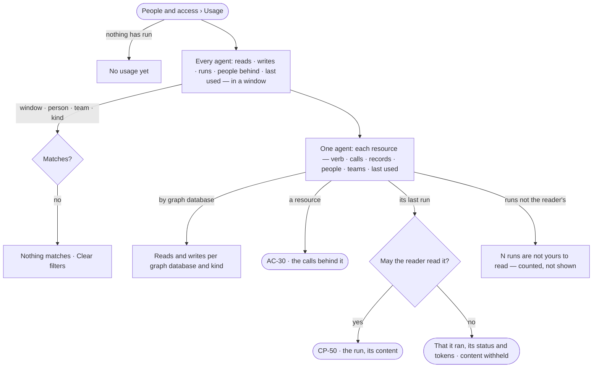

# AC-28 · See what an agent touched

**As** an Admin answering for an agent **I want** what it actually read, wrote and ran — which graph databases and
kinds, which skills, workflows, agents, plugins and tools, how often and for whom — over a window **so that** I can
show what it did with the access it holds, without hunting through runs.

Tasks: [task.md](task.md) · Feature: [AC-F08](../../feature.md)

## Who can

| Lens | Can | Otherwise sees |
|---|---|---|
| Admin | Read every agent's usage over every run | — |
| Operator | Read an agent's usage over runs they are behind and agents they own | The rest counted, not shown — *N runs are not yours to read* |

## Flow

## Acceptance criteria

| # | Given | When | Then |
|---|---|---|---|
| AC-28.1 | No agent has run | *Usage* opens | it reads *No usage yet — a run writes the first call* |
| AC-28.2 | Runs in the window | *Usage* is read | one row per agent: reads, writes, runs, refusals, the people behind them and when it was last used, counted by the engine; 30 days unless a window is chosen |
| AC-28.3 | An agent | it is opened | each resource it used reads as a rule names it — `data/<graph database>/<kind>`, `skill/…`, `workflow/…`, `agent/…`, `plugin/…`, `tool/…` — with the verb, the calls, the records touched, the people and teams behind them, and its last use |
| AC-28.4 | An agent that read or wrote data | *By graph database* is read | each graph database it reached reads with its kinds, reads and writes |
| AC-28.5 | A resource | the reader opens it | the calls behind it open in *What left the platform*, filtered to that agent and resource (AC-30) |
| AC-28.6 | A filter by person, team or kind | it is applied | only matching usage counts; with no match, *Nothing matches*, naming the filter, with *Clear filters* |
| AC-28.7 | An Operator or a Modeller | they open an agent | usage over runs they are behind and agents they own reads; the rest reads *N runs are not yours to read — counted, not shown* |
| AC-28.8 | A run the reader may not read | they open it from usage | it reads that it ran, its status and its tokens; its steps, queries, records and calls are withheld (AC-31) |
| AC-28.9 | A window | it reaches past 365 days | it is refused, reading *Calls are kept 365 days* |
| AC-28.10 | A run still going | usage is read | its calls count as they settle; the agent reads *running* beside its count |
| AC-28.11 | Usage | it fails to load | it says what could not load, with *Try again* |

## Screens

| Surface | Lens | First use | Empty after a filter | Loading | Has data | Failed | Agent working or proposing | No access |
|---|---|---|---|---|---|---|---|---|
| Usage — every agent | Admin | access.usage · No usage yet | access.usage · Nothing matches | access.usage · Loading | access.usage | access.usage · Could not load | access.usage · Running | — |
| Usage — every agent | Operator | access.usage · No usage yet | access.usage · Nothing matches | access.usage · Loading | access.usage · Counted, not shown | access.usage · Could not load | access.usage · Running | access.usage · Counted, not shown |
| Usage — one agent | Admin | access.usage · Agent · Never used | access.usage · Agent · Nothing matches | access.usage · Agent · Loading | access.usage · Agent | access.usage · Agent · Could not load | access.usage · Agent · Running | — |
| Usage — one agent | Operator | access.usage · Agent · Never used | access.usage · Agent · Nothing matches | access.usage · Agent · Loading | access.usage · Agent · Counted, not shown | access.usage · Agent · Could not load | access.usage · Agent · Running | access.locked · Content withheld |
