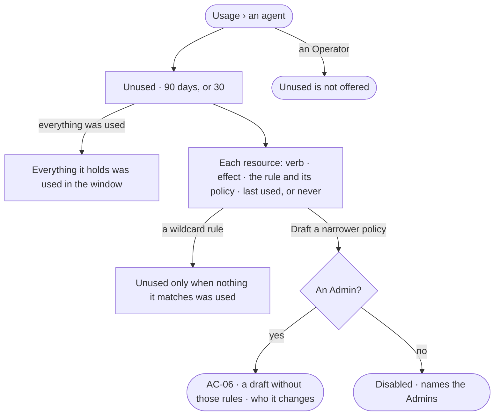

# AC-29 · Find access an agent never uses

**As** an Admin **I want** the access each agent holds and never used in 30 or 90 days, beside the rule that grants
it **so that** I can narrow its policies to what it needs — the engine lists what went unused, and I decide whether
to take it away.

Tasks: [task.md](task.md) · Feature: [AC-F08](../../feature.md)

## Who can

| Lens | Can | Otherwise sees |
|---|---|---|
| Admin | Read every agent's unused access; *Draft a narrower policy* (AC-06) | — |
| Operator | Read an agent's usage over the runs they may read (AC-13); a Modeller reads every agent's unused access as an Admin does, without drafting | *Unused* is not offered to an Operator. *Draft a narrower policy* is disabled for a Modeller, naming the Admin role and the Admins |

## Flow

## Acceptance criteria

| # | Given | When | Then |
|---|---|---|---|
| AC-29.1 | An agent with policies attached | *Unused* is read | each resource a rule allows or asks for that no step used in the window reads — verb, effect, the rule and its policy, and its last use or *Never* |
| AC-29.2 | The window | it is read | it is 90 days unless the reader picks 30 |
| AC-29.3 | An agent that used everything it holds | *Unused* is read | it reads *Everything it holds was used in the last {n} days* |
| AC-29.4 | A wildcard rule — `data/*/Customer`, `tool/web/*` | it is read | it is unused only when nothing it matches was used; a partly used one reads what was used under it |
| AC-29.5 | Unused access | an Admin presses *Draft a narrower policy* | a draft of the policy opens without those rules, with *Who it changes* (AC-06); nothing changes until they save |
| AC-29.6 | A built-in policy with unused access | an Admin drafts from it | the draft is a copy, owned by the platform and made by them; the built-in policy is never edited |
| AC-29.7 | A Modeller | they read *Unused* on any agent | it reads; *Draft a narrower policy* is disabled, naming the Admin role and the Admins |
| AC-29.8 | An Operator | they reach *Unused* | it is not offered, and the route reads *Not found* |
| AC-29.9 | Unused access | it is listed | nothing is taken away by itself; only a saved policy narrows an agent |
| AC-29.10 | *Unused* | it fails to load | it says what could not load, with *Try again* |

## Screens

| Surface | Lens | First use | Empty after a filter | Loading | Has data | Failed | Agent working or proposing | No access |
|---|---|---|---|---|---|---|---|---|
| Unused access | Admin | access.usage · Unused · Everything used | — | access.usage · Unused · Loading | access.usage · Unused | access.usage · Unused · Could not load | — | — |
| Unused access | Operator | access.usage · Unused · Everything used | — | access.usage · Unused · Loading | access.usage · Unused · Read only | access.usage · Unused · Could not load | — | access.locked · Not offered |
