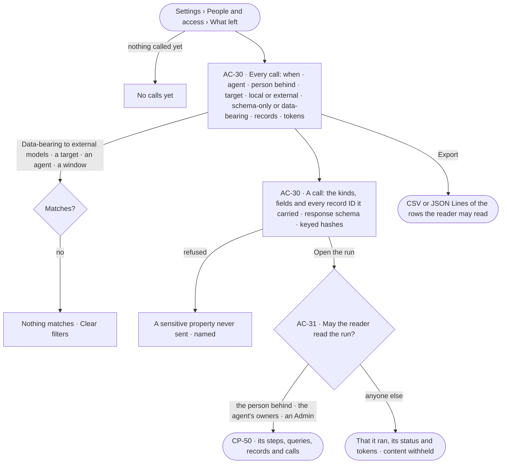
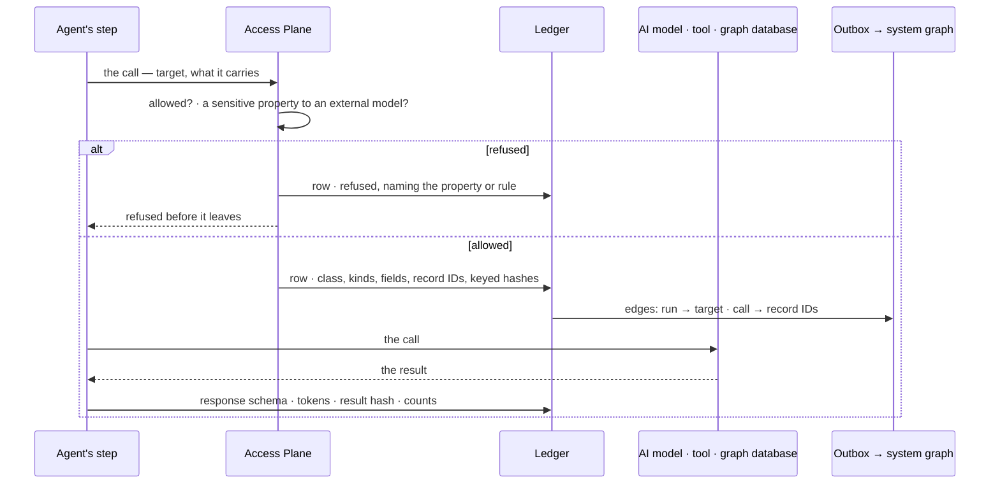

# What left the platform

> The ledger: every call to an AI model, a tool or a graph database — which run, agent and person, which direction,
> schema-only or data-bearing, and exactly which kinds, fields and record IDs it carried — and who may read a run's
> content.
> The decision it helps make: *what did our data go to, and was it allowed to go there?*

## User journey

Journeys this feature is a step of: [J09 · Audit what an agent touched](../../../../journeys/J09-audit-what-an-agent-touched-and-what-left-the-platform.md)

## Stories

| ID | Story | Status |
|---|---|---|
| AC-30 | [See what went to which model or tool](stories/AC-30-see-what-went-to-which-model-or-tool/story.md) | idea |
| AC-31 | [Keep a run's content to those who may read it](stories/AC-31-keep-a-runs-content-to-those-who-may-read-it/story.md) | idea |

## Access

| Act | Role ([the role table](../AC-F02-access-policies/feature.md#the-role-table)) | Everyone else sees |
|---|---|---|
| Read every call and its content — kinds, fields, record IDs, query | Admin | — |
| Read the calls and content of runs the reader is behind, and of agents they own | Every signed-in person — Operator, Modeller | Calls of other runs: that they happened, their target, class and tokens — content withheld |
| Read a run's content — its steps, queries, records, calls and answer | The person behind it, the agent's owners, Admins | That it ran, its status and its tokens |
| Export the calls the reader may read | Every signed-in person | — |

## States

| State | What the person sees |
|---|---|
| First use | *No calls yet — the first question writes the first row* |
| Empty after a filter | *Nothing matches*, with the filter named and *Clear filters*; *Export* disabled |
| Loading | The sheet opens at once; rows load in place; counts read `—` until the engine gives them |
| Has data | Calls newest first, today unless a window is chosen; a head counting data-bearing calls to external models in the window |
| Failed | What could not load, in a sentence, with *Try again* |
| Agent working or proposing | Rows arrive as calls happen; a call whose result is still coming reads *waiting on the result* |
| No access | Calls of runs the reader may not read show their target, class and tokens; content reads *withheld — only {person behind}, the agent's owners and Admins read it* |

## Rules

| Rule | Detail |
|---|---|
| Every call is a row | Every call to an AI model, a tool, an outside agent or a graph database, out or in, is one ledger row, written before its result is used; a call that cannot be recorded does not run |
| Schema-only or data-bearing | A call that carries only the model — kinds, properties, the typed query plan — is *schema-only*; one that carries record values or IDs is *data-bearing* |
| What a row keeps | Run · step · agent · person behind · direction · target · class · kinds, fields and record IDs sent · response schema · tokens · keyed hashes of what went and what came back. A graph database read keeps its query, kinds, counts, a result hash and at most 1,000 record IDs; anything sent to an AI model or a tool keeps every ID |
| Never a value | A row keeps names, IDs and keyed hashes, never a record's values, a prompt's text or a credential; a value is proved by hashing it with the same key and comparing |
| Local or external | Every AI model is marked local or external ([CP-F01](../../../control/features/CP-F01-ai-models/feature.md)); a sensitive property ([SE-F03](../../../../capabilities/semantics/features/SE-F03-meaning/feature.md)) never goes to an external model — the call is refused before it leaves, naming the property, and the refusal is a row |
| Run privacy | A run's content — its steps, queries, records, calls, what it sent and its answer — reads to the person behind it, the agent's owners and Admins; anyone else reads that it ran, its status and its tokens. Every surface that shows content holds to it: the run, *How it got here*, a ledger row, a History row's arguments, an ask, usage |
| Edges in the system graph | Each row's run, target and record IDs follow into the system graph through the outbox, as IDs and hashes only; Postgres stays the truth |
| Kept for a year | Rows are kept 365 days; a prune removes a whole window and is a History row |
| Every number is the engine's | Counts and totals are counted over stored rows; tokens only |
| Leans on | Access Policies (AC-F02) · History (AC-F06) · owners (AC-F07) · runs (CP-F10) · AI models and their mark (CP-F01) · tools (CP-F02) · graph databases (CP-F05) · sensitive properties (SE-F03) |

## Data touched

| Record | Read or write |
|---|---|
| Ledger rows | Write · read |
| Ledger exports | Write · read |
| Runs, their person behind and agent (CP-F10) · owners (AC-F07) | Read |

## Engine

The low-level design: what this feature stores, serves and refuses. Conventions — naming, errors, lists, events — are
[system-design.md](../../../../system-design.md) §§ 6–8; this section only fills them in. This feature owns the
ledger: the AI model client, the connectors and the plugin layer each write their call's row through it.

### Records

| Table | Columns | Notes |
|---|---|---|
| `access_ledger_calls` | `id` · `at` · `run_id?` · `step_run_id?` · `agent_id` · `behind_user_id` · `direction` (`outbound` · `inbound`) · `target_kind` (`model` · `tool` · `agent` · `graph_database`) · `target` (the model version, `<plugin>/<tool>`, the agent or the graph database) · `locality?` (`local` · `external`, for a model) · `class` (`schema_only` · `data_bearing`) · `verdict` (`sent` · `refused`) · `refused_reason?` (the property or the rule) · `kinds[]` · `fields[]` · `record_ids[]` · `record_ids_total` · `query?` (a graph database read, redacted) · `counts?` · `response_schema?` · `tokens_in?` · `tokens_out?` · `sent_hash` · `result_hash?` · `history_seq?` | One row per call. Hashes are HMAC-SHA-256 under a ledger key wrapped by the install key. Never a value, a prompt's text or a credential |
| `access_ledger_exports` | `requested_by_id` · `filters` · `format` (`csv` · `jsonl`) · `rows` · `created_at` | One row per export |

### Reads

| Record | Owner |
|---|---|
| Runs, their steps, the person behind and the agent | [CP-F10](../../../control/features/CP-F10-runs-and-how-the-agents-are-doing/feature.md#engine) |
| Owners of an agent | [AC-F07](../AC-F07-ownership/feature.md#engine) |
| AI models and their local or external mark | [CP-F01](../../../control/features/CP-F01-ai-models/feature.md#engine) |
| Tools and outside MCP servers | [CP-F02](../../../control/features/CP-F02-plugins-and-outside-tools/feature.md#engine) |
| Graph databases | [CP-F05](../../../control/features/CP-F05-graph-databases/feature.md#engine) |
| Sensitive properties | [SE-F03](../../../../capabilities/semantics/features/SE-F03-meaning/feature.md#engine) |
| History — the row each call settles into | [AC-F06](../AC-F06-history/feature.md#engine) |

### Routes

| Route, after `/api/v1/access/ledger` | Does | Story |
|---|---|---|
| `GET /calls` | A page by the list contract: `?since=` (`today` default · `24h` · `7d` · `30d` · a range) · `?direction=` · `?target_kind=` · `?target=` · `?locality=` · `?class=` · `?verdict=` · `?agent=` · `?person=` · `?run_id=` · `?preset=data_bearing_external · refused`; content withheld on rows of runs the reader may not read | AC-30 |
| `GET /calls/stats?since=` | `calls` · `data_bearing` · `data_bearing_external` · `refused` · `records_sent` · `tokens` · by target · by agent — over rows the reader may read, `hidden` for the rest | AC-30 |
| `GET /calls/{id}` | One call: every column, its run and step, the History row it settled into; content withheld unless the reader may read the run | AC-30 · AC-31 |
| `POST /calls/{id}/verify` | `{value}` — hashes it with the ledger key and answers whether it matches what went or came back; stores nothing | AC-30 |
| `GET /calls/export?format=csv \| jsonl` · `GET /exports` | Stream the filtered rows the reader may read and write an exports row · the exports, newest first | AC-30 |

### Events

| Event | When |
|---|---|
| `access.ledger.export` | An export is made |
| `access.ledger.prune` | Rows older than 365 days are removed, a whole window |
| `access.ledger.refused` | A call is refused before it leaves — the property or rule in `details` |

### Refusals

| Status | When | Sentence | Criterion |
|---|---|---|---|
| step | A call that would carry a sensitive property to an external model — refused before it leaves | *{property} is sensitive — it never goes to an external model.* | AC-30.7 |
| step | The ledger row cannot be written — the call does not run | *This call could not be recorded; it did not run.* | AC-30.10 |
| 404 | A run's content, or a call's content, read by someone who is not behind the run, does not own the agent and is not an Admin | *Not found.* | AC-31.2 · AC-31.4 |
| 422 | A window beyond the 365 days rows are kept | *Calls are kept 365 days.* | AC-30.12 |

### CLI

| Command | Does |
|---|---|
| `invana ledger list [--since 7d] [--class data_bearing] [--locality external] [--agent <name>]` | The calls the reader may read, newest first |
| `invana ledger verify <call> --value <file>` | Whether the value matches what the call sent or received |

### Mechanisms

| Mechanism | How |
|---|---|
| Three writers, one ledger | The AI model client, the connectors and the plugin layer call `ledger.record(call)` before the call leaves and `ledger.settle(call, result)` before the result is used; a failure of either fails the step |
| The class | `schema_only` when the payload holds only names from the published model and the typed query plan; `data_bearing` when it holds any record value or ID — decided from the payload the caller builds, never from the caller's word |
| The sensitive check | Before an AI model call: the payload's fields are matched against the sensitive properties of the published model; an external model with any match is refused, naming the first |
| Record IDs | Every ID sent to an AI model or a tool; for a graph database read the first 1,000, with `record_ids_total` |
| Keyed hashes | HMAC-SHA-256 under the ledger key, so a value can be proved without being kept, and no one without the key can test guesses |
| `may_read_run(person, run)` | True when the person is behind the run, owns its agent ([AC-F07](../AC-F07-ownership/feature.md#engine)) or is an Admin. Every route that returns a run's content — runs, *How it got here*, ledger calls, History arguments, asks, usage — calls it and withholds content when it is false |
| What a withheld row carries | Its time, agent, person behind, target, class, verdict, status and tokens; never kinds, fields, IDs, a query or an answer |
| The outbox | Each settled row writes an outbox row; the relay adds `(run)-[:CALLED]->(target)` and `(call)-[:CARRIED]->(record)` edges in the system graph, IDs and hashes only |
| Retention | 365 days; a prune removes a whole window and writes its History row |

## System impact

| HLD section | Change | NFRs |
|---|---|---|
| § 6 Data and storage | Two tables in Postgres; ledger edges in the system graph through the outbox | NFR-SEC-7 |
| § 7 Architecture | The AI model client, connectors and plugin layer write the ledger before a call leaves | NFR-SEC-7 |
| § 10 AI and agents | A sensitive property never reaches an external model; every call is schema-only or data-bearing | NFR-SEC-8 |
| § 12 Qualities | Privacy: a run's content reads only to the person behind it, the agent's owners and Admins; no value, prompt text or credential is kept | NFR-SEC-2 |

## Decisions

| Decision | Detail |
|---|---|
| A tab beside Usage | *What left* is a tab of *Settings › People and access*; a call opens beside the list |
| The preset an auditor asks for first | *Data-bearing to external models* is the first preset, with its count for the window |
| Withheld, not hidden | A call of a run the reader may not read still lists, so nothing seems missing; only its content is withheld |
| Run privacy lives here | The Access Plane owns who may read a run's content; every surface that shows content calls the one check |

## Open questions

| Question | Who answers |
|---|---|

## Not building

| Item | Why not |
|---|---|
| Keeping values, prompt text or answers in the ledger | Names, IDs and keyed hashes prove what went without becoming a second copy of the data |
| Sharing run content with a team | Content reads to the person behind, the agent's owners and Admins; a finding or a board is how work is shared |
| Sending the ledger to an outside log tool | That belongs to the deployment's own platform; an export is the portable form |
