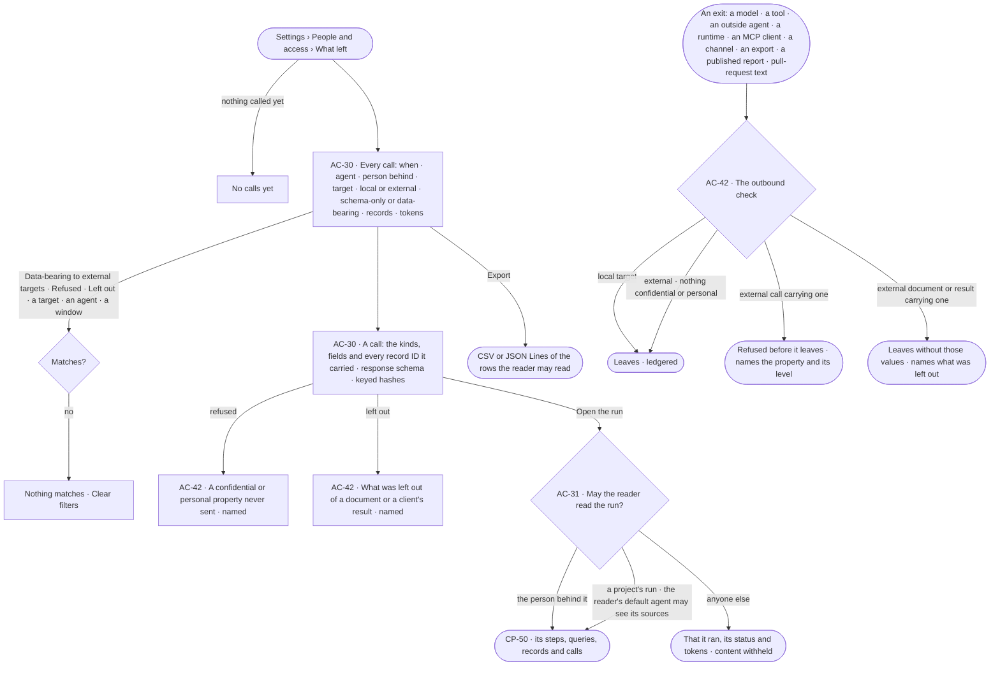
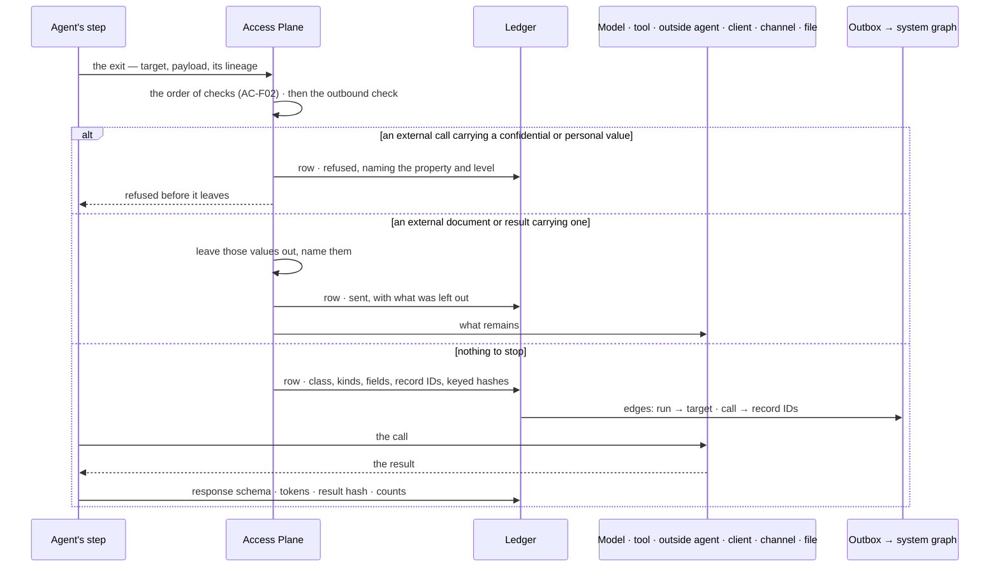

# What left the platform

> The ledger and the one door out: every call to an AI model, a tool, an outside agent or a graph database — which
> run, agent and person, which direction, schema-only or data-bearing, and exactly which kinds, fields and record IDs
> it carried; the **outbound check** every exit passes, so a confidential or personal value never leaves for an outside
> target; and who may read a run's content.
> The decision it helps make: *what did our data go to, and was it allowed to go there?*

## User journey

Journeys this feature is a step of: [J09 · Audit what an agent touched](../../../../journeys/J09-audit-what-an-agent-touched-and-what-left-the-platform.md)

## Stories

| ID | Story | Status |
|---|---|---|
| AC-30 | [See what went to which model or tool](stories/AC-30-see-what-went-to-which-model-or-tool/story.md) | idea |
| AC-31 | [Keep a run's content to those who may read it](stories/AC-31-keep-a-runs-content-to-those-who-may-read-it/story.md) | idea |
| AC-42 | [Stop sensitive data at every exit](stories/AC-42-stop-sensitive-data-at-every-exit/story.md) | idea |

## Access

| Act | Role ([the role table](../AC-F02-access-policies/feature.md#the-role-table)) | Everyone else sees |
|---|---|---|
| Read every call — kinds, fields, record IDs, query, never a value | Admin | — |
| Read the calls of runs the reader may read | Every signed-in person — Operator, Modeller | Calls of other runs: that they happened, their target, class, verdict and tokens — content withheld |
| Read a run's content — its steps, queries, records, calls and answer | The person behind it; for a run that belongs to a project, anyone whose default agent may see its sources ([GP-F02](../../../graph/features/GP-F02-memory/feature.md#engine)) — an Admin too, never by role alone | That it ran, its agent, its status and its tokens |
| Read which targets are external, and what the outbound check stopped or left out | Every signed-in person, over the calls they may read | — |
| Mark an AI model local or external | Admin, in AI models ([CP-F01](../../../control/features/CP-F01-ai-models/feature.md)) | Reads here, linking to AI models |
| Export the calls the reader may read | Every signed-in person | — |

## States

| State | What the person sees |
|---|---|
| First use | *No calls yet — the first question writes the first row* |
| Empty after a filter | *Nothing matches*, with the filter named and *Clear filters*; *Export* disabled |
| Loading | The sheet opens at once; rows load in place; counts read `—` until the engine gives them |
| Has data | Calls newest first, today unless a window is chosen; a head counting data-bearing calls to external targets, refused calls and calls with something left out in the window |
| Failed | What could not load, in a sentence, with *Try again* |
| Agent working or proposing | Rows arrive as calls happen; a call whose result is still coming reads *waiting on the result*; a step stopped by the outbound check reads in its run, naming the property |
| No access | Calls of runs the reader may not read show their target, class, verdict and tokens; content reads *withheld — only {person behind}, or someone whose agent may read its sources, reads it* |

## Rules

| Rule | Detail |
|---|---|
| Every call is a row | Every call to an AI model, a tool, an outside agent or a graph database, out or in, and every other exit — a client's result, a channel message, an export, a published report, pull-request text — is one ledger row, written before its result is used; a call that cannot be recorded does not run |
| Schema-only or data-bearing | A call that carries only the model — kinds, properties, the typed query plan — is *schema-only*; one that carries record values or IDs is *data-bearing* |
| What a row keeps | Run · step · agent · person behind · direction · target · class · verdict · kinds, fields and record IDs sent · what the outbound check left out · the connection used · response schema · tokens · keyed hashes of what went and what came back. A graph database read keeps its query, kinds, counts, a result hash and at most 1,000 record IDs; anything sent to an AI model or a tool keeps every ID |
| Never a value | A row keeps names, IDs and keyed hashes, never a record's values, a prompt's text or a credential; a value is proved by hashing it with the same key and comparing |
| Local or external | Every target is local or external. Local: an AI model an Admin marks local ([CP-F01](../../../control/features/CP-F01-ai-models/feature.md)) and Invana's own core plugins and graph databases. External: every other AI model; every tool plugin and outside server ([CP-F02](../../../control/features/CP-F02-plugins-and-outside-tools/feature.md)); every outside agent; every outside runtime whose model runs outside, as its adapter declares; every MCP client ([AC-F11](../AC-F11-connect-an-mcp-client/feature.md)); every channel; every export, published report and pull-request text |
| One outbound check for every exit | Before anything leaves for an external target, its payload — a prompt, a tool's arguments, a result, a document — is checked against the sensitivity of what it carries: each property's level ([SE-F03](../../../../capabilities/semantics/features/SE-F03-meaning/feature.md#engine)) and, for a copy, the highest level among its sources ([GP-F02](../../../graph/features/GP-F02-memory/feature.md#engine)). Nothing confidential or personal leaves ([AC-42](stories/AC-42-stop-sensitive-data-at-every-exit/story.md)) |
| Refused or left out | A call — to an external AI model, an outside tool (its arguments too) or an outside agent — carrying a confidential or personal value is **refused** before it leaves, naming the property and its level. A result to an MCP client or an outside runtime, a channel message, an export, a published report or pull-request text carrying one **leaves without it**: those values are left out and what was left out is named in what leaves and in the row |
| Outside runtimes reach data only through Invana's tools | An outside runtime on a worker reads data only by calling Invana's MCP tools; what each tool returns is redacted by lineage, passes the outbound check and is ledgered at the tool; the worker sandbox limits the runtime's network to what the agent's `net/` rules allow ([CP-F03](../../../control/features/CP-F03-workers-and-the-queue/feature.md)) |
| Exports and published reports carry lineage | An export or a published report records the sources of everything in it; what the person exporting may not see is never in it, and what is confidential or personal is left out, named |
| Run privacy | A run's content — its steps, queries, records, calls, what it sent and its answer — is a copy: the person behind the run reads it; for a run that belongs to a project, anyone whose default agent may see every source reads it ([GP-F02](../../../graph/features/GP-F02-memory/feature.md#engine)); a role never reads it by itself. Everyone else reads that it ran, its agent, its status and its tokens. Every surface that shows content holds to it: the run, *How it got here*, a ledger row, a History row's arguments, an ask, usage |
| Edges in the system graph | Each row's run, target and record IDs follow into the system graph through the outbox, as IDs and hashes only; Postgres stays the truth |
| Kept for a year | Rows are kept 365 days; a prune removes a whole window and is a History row |
| Every number is the engine's | Counts and totals are counted over stored rows; tokens only |
| Leans on | Access Policies and the order of checks (AC-F02) · History (AC-F06) · runs (CP-F10) · AI models and their mark (CP-F01) · tools and connections (CP-F02) · workers and the sandbox (CP-F03) · graph databases (GP-F01) · lineage (GP-F02) · sensitivity levels (SE-F03) |

## Data touched

| Record | Read or write |
|---|---|
| Ledger rows | Write · read |
| Ledger exports | Write · read |
| Runs, their person behind, agent and project (CP-F10) | Read |
| Lineage of a copy (GP-F02) · sensitivity levels (SE-F03) | Read |

## Engine

The low-level design: what this feature stores, serves and refuses. Conventions — naming, errors, lists, events — are
[system-design.md](../../../../system-design.md) §§ 6–8; this section only fills them in. This feature owns the
ledger and the outbound check: the AI model client, the connectors, the plugin layer, the MCP server, channels,
exports and report publishing each pass their exit through it.

### Records

| Table | Columns | Notes |
|---|---|---|
| `access_ledger_calls` | `id` · `at` · `run_id?` · `step_run_id?` · `agent_id` · `behind_user_id` · `direction` (`outbound` · `inbound`) · `target_kind` (`model` · `tool` · `agent` · `graph_database` · `runtime` · `mcp_client` · `channel` · `export` · `report` · `pull_request`) · `target` (the model version, `<plugin>/<tool>`, the agent, the graph database, the client, the channel or the file) · `locality` (`local` · `external`) · `connection?` (`work:<name>` · `personal:<username>`) · `class` (`schema_only` · `data_bearing`) · `verdict` (`sent` · `refused` · `left_out`) · `refused_reason?` (the property and level, or the rule) · `left_out[]?` (each property and level left out, with a count) · `kinds[]` · `fields[]` · `record_ids[]` · `record_ids_total` · `query?` (a graph database read, redacted) · `counts?` · `response_schema?` · `tokens_in?` · `tokens_out?` · `sent_hash` · `result_hash?` · `history_seq?` | One row per exit. Hashes are HMAC-SHA-256 under a ledger key wrapped by the install key. Never a value, a prompt's text or a credential |
| `access_ledger_exports` | `requested_by_id` · `filters` · `format` (`csv` · `jsonl`) · `rows` · `created_at` | One row per export |

### Reads

| Record | Owner |
|---|---|
| Runs, their steps, the person behind, the agent and the project | [CP-F10](../../../control/features/CP-F10-runs-and-how-the-agents-are-doing/feature.md#engine) |
| The person's default agent and the evaluator | [AC-F02](../AC-F02-access-policies/feature.md#engine) |
| Lineage of a copy and `lineage.may_see` | [GP-F02](../../../graph/features/GP-F02-memory/feature.md#engine) |
| AI models and their local or external mark | [CP-F01](../../../control/features/CP-F01-ai-models/feature.md#engine) |
| Tools, outside servers and the connection a call used | [CP-F02](../../../control/features/CP-F02-plugins-and-outside-tools/feature.md#engine) |
| Graph databases | [CP-F05](../../../control/features/CP-F05-graph-databases/feature.md#engine) |
| Sensitivity levels of properties | [SE-F03](../../../../capabilities/semantics/features/SE-F03-meaning/feature.md#engine) |
| History — the row each call settles into | [AC-F06](../AC-F06-history/feature.md#engine) |

### Routes

| Route, after `/api/v1/access/ledger` | Does | Story |
|---|---|---|
| `GET /calls` | A page by the list contract: `?since=` (`today` default · `24h` · `7d` · `30d` · a range) · `?direction=` · `?target_kind=` · `?target=` · `?locality=` · `?class=` · `?verdict=` · `?agent=` · `?person=` · `?run_id=` · `?preset=data_bearing_external · refused · left_out`; content withheld on rows of runs the reader may not read, except for an Admin | AC-30 · AC-42 |
| `GET /calls/stats?since=` | `calls` · `data_bearing` · `data_bearing_external` · `refused` · `left_out` · `records_sent` · `tokens` · by target · by agent — over rows the reader may read, `hidden` for the rest | AC-30 · AC-42 |
| `GET /calls/{id}` | One call: every column, its run and step, the History row it settled into; content withheld unless the reader may read it | AC-30 · AC-31 |
| `POST /calls/{id}/verify` | `{value}` — hashes it with the ledger key and answers whether it matches what went or came back; stores nothing | AC-30 |
| `GET /calls/export?format=csv \| jsonl` · `GET /exports` | Stream the filtered rows the reader may read and write an exports row · the exports, newest first | AC-30 |
| `GET /targets` | Every target kind and known target with its locality and who set it | AC-42 |

### Events

| Event | When |
|---|---|
| `access.ledger.export` | An export is made |
| `access.ledger.prune` | Rows older than 365 days are removed, a whole window |
| `access.ledger.refused` | An exit is refused before it leaves — the property and level, or the rule, in `details` |
| `access.ledger.left_out` | An exit leaves without some values — each property and level left out, in `details` |

### Refusals

| Status | When | Sentence | Criterion |
|---|---|---|---|
| step | A call to an external AI model, an outside tool or an outside agent that would carry a confidential or personal value — refused before it leaves | *{property} is {level} — it never leaves for {target}.* | AC-30.7 · AC-42.2 · AC-42.3 |
| step | The ledger row cannot be written — the exit does not happen | *This call could not be recorded; it did not run.* | AC-30.10 |
| step | An exit whose payload carries a copy with no lineage — its level cannot be known | *{copy} has no recorded sources — it does not leave.* | AC-42.9 |
| 404 | A run's content, or a call's content, read by someone who may not read it | *Not found.* | AC-31.2 · AC-31.4 |
| 422 | A window beyond the 365 days rows are kept | *Calls are kept 365 days.* | AC-30.12 |

### CLI

| Command | Does |
|---|---|
| `invana ledger list [--since 7d] [--class data_bearing] [--locality external] [--verdict refused · left_out] [--agent <name>]` | The calls the reader may read, newest first |
| `invana ledger verify <call> --value <file>` | Whether the value matches what the call sent or received |

### Mechanisms

| Mechanism | How |
|---|---|
| Every exit, one ledger | The AI model client, the connectors, the plugin layer, the MCP server, channels, exports and report publishing call `ledger.record(exit)` before it leaves and `ledger.settle(exit, result)` before the result is used; a failure of either fails the step |
| The class | `schema_only` when the payload holds only names from the published model and the typed query plan; `data_bearing` when it holds any record value or ID — decided from the payload the caller builds, never from the caller's word |
| `outbound.check(payload, target)` | Runs inside `ledger.record` for every exit. `target.locality` is `local` → it passes. `external` → every property in the payload is looked up for its level ([SE-F03](../../../../capabilities/semantics/features/SE-F03-meaning/feature.md#engine)), and every copy in it by its lineage's level ([GP-F02](../../../graph/features/GP-F02-memory/feature.md#engine)); a `confidential` or `personal` match on a `model` · `tool` · `agent` target refuses the exit, naming the first; on a `runtime` · `mcp_client` · `channel` · `export` · `report` · `pull_request` target those values are removed, the rest goes, and `left_out` names each property and level with a count. Matching is on the payload Invana builds, never on the caller's word |
| Locality | `model` from its mark ([CP-F01](../../../control/features/CP-F01-ai-models/feature.md#engine)); `tool` local only for a core plugin; `runtime` from its adapter's declared model place; `agent` · `mcp_client` · `channel` · `export` · `report` · `pull_request` always external; `graph_database` local |
| Record IDs | Every ID sent to an AI model or a tool; for a graph database read the first 1,000, with `record_ids_total` |
| Keyed hashes | HMAC-SHA-256 under the ledger key, so a value can be proved without being kept, and no one without the key can test guesses |
| `may_read_run(person, run)` | True when the person is behind the run, or the run belongs to a project and `lineage.may_see(person, run.transcript)` is true ([GP-F02](../../../graph/features/GP-F02-memory/feature.md#engine)). A role adds nothing. Every route that returns a run's content — runs, *How it got here*, ledger calls, History arguments, asks, usage — calls it and withholds content when it is false; an Admin reads every ledger row's kinds, fields, IDs and query, which hold no value |
| What a withheld row carries | Its time, agent, person behind, target, class, verdict, status and tokens; never kinds, fields, IDs, a query or an answer |
| The outbox | Each settled row writes an outbox row; the relay adds `(run)-[:CALLED]->(target)` and `(call)-[:CARRIED]->(record)` edges in the system graph, IDs and hashes only |
| Retention | 365 days; a prune removes a whole window and writes its History row |

## System impact

| HLD section | Change | NFRs |
|---|---|---|
| § 6 Data and storage | Two tables in Postgres; ledger edges in the system graph through the outbox | NFR-SEC-7 |
| § 7 Architecture | Every exit — the AI model client, connectors, plugin layer, MCP server, channels, exports, report publishing — writes the ledger and passes the outbound check before it leaves | NFR-SEC-7 · NFR-SEC-8 |
| § 10 AI and agents | Nothing confidential or personal reaches an external model, tool, outside agent or runtime; outside runtimes read data only through Invana's tools | NFR-SEC-8 |
| § 12 Qualities | Privacy: a run's content reads to the person behind it and, for a project's run, as far as the reader's default agent may see its sources; no value, prompt text or credential is kept | NFR-SEC-2 · NFR-SEC-11 |

## Decisions

| Decision | Detail |
|---|---|
| A tab beside Usage | *What left* is a tab of *Settings › People and access*; a call opens beside the list |
| The preset an auditor asks for first | *Data-bearing to external targets* is the first preset, with its count for the window; *Refused* and *Left out* follow |
| Withheld, not hidden | A call of a run the reader may not read still lists, so nothing seems missing; only its content is withheld |
| Run privacy lives here | The Access Plane owns who may read a run's content; every surface that shows content calls the one check |
| A call is refused, a document is trimmed | A prompt or a tool's arguments cannot be sent in part without changing what is asked, so the call is refused; a result, a message or a file still serves without the values, so they are left out and named |
| Confidential and personal never leave | The two highest levels stay inside the deployment whatever the target; public and internal go where the agent's rules let them |
| A role reads no content | The Admin role is platform acts; a run's content reads through lineage like any copy, and an Admin audits through the ledger, which holds no value |

## Open questions

| Question | Who answers |
|---|---|

## Not building

| Item | Why not |
|---|---|
| Keeping values, prompt text or answers in the ledger | Names, IDs and keyed hashes prove what went without becoming a second copy of the data |
| Sharing run content with a team | Content reads to the person behind it and through lineage; a finding or a board is how work is shared |
| Sending the ledger to an outside log tool | That belongs to the deployment's own platform; an export is the portable form |
| An exception to let one confidential or personal value out | One door with no side gate; a value that must reach an outside model needs a local model, or its level changed in Meaning, which History records |
| Content scanning for values with no level | The check reads the model's levels and lineage; guessing at free text would refuse or leak by chance |
