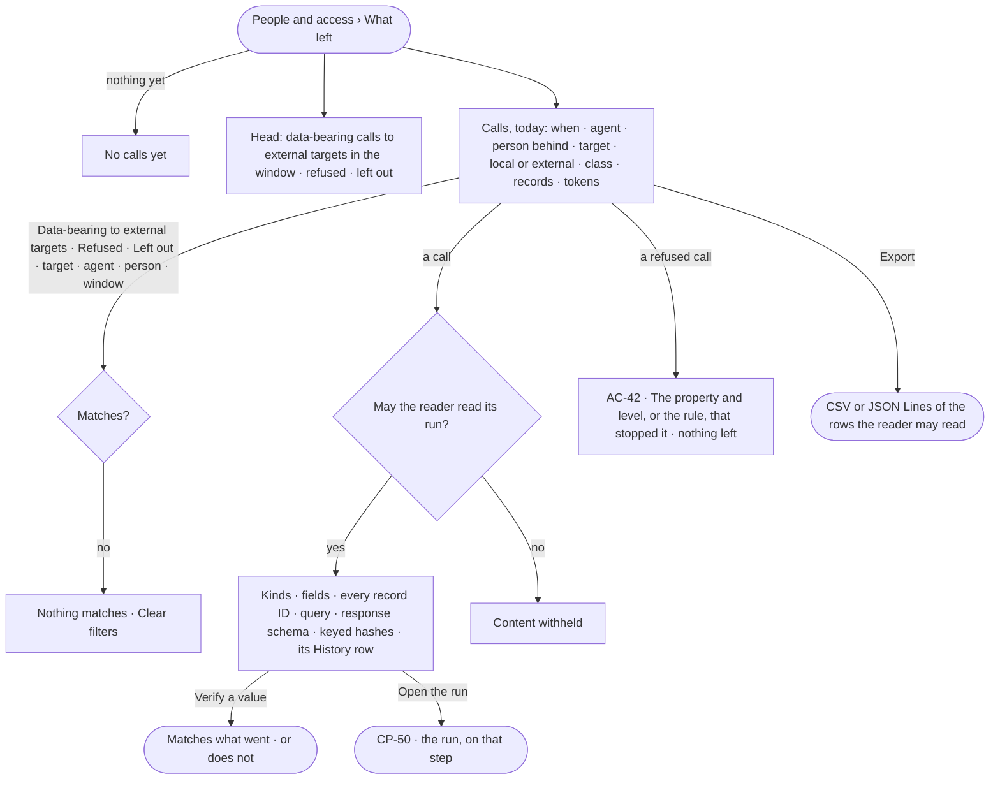

# AC-30 · See what went to which model or tool

**As** an Admin answering an auditor **I want** every call to an AI model, a tool, an outside agent or a graph database
— schema-only or data-bearing, local or external, and exactly which kinds, fields and record IDs it carried — **so that** I
can show what our data went to, for which run and person, and that nothing confidential or personal left.

Tasks: [task.md](task.md) · Feature: [AC-F09](../../feature.md)

## Who can

Roles are [the role table](../../../AC-F02-access-policies/feature.md#the-role-table).

| Lens | Can | Otherwise sees |
|---|---|---|
| Admin | Read every call — kinds, fields, record IDs and query, never a value; verify a value against a call; export | — |
| Operator | Read the calls of runs they may read (AC-31); verify and export those; a Modeller the same | Other calls list with their time, agent, target, class, verdict and tokens; content reads *withheld — only {person behind}, or someone whose agent may read its sources, reads it* |

## Flow

## Acceptance criteria

| # | Given | When | Then |
|---|---|---|---|
| AC-30.1 | No call yet | *What left* opens | it reads *No calls yet — the first question writes the first row* |
| AC-30.2 | Calls today | *What left* opens | rows read newest first: when · agent · person behind · direction · target · local or external · schema-only or data-bearing · records carried · tokens; today unless a window is chosen |
| AC-30.3 | The head | it is read | it counts, over the window, the data-bearing calls to external targets, the refused calls, the calls with something left out and the records sent, as the engine counted them |
| AC-30.4 | The preset *Data-bearing to external targets*, *Refused* or *Left out*, or a filter by target, agent, person, class or window | it is applied | only matching calls list, the filter shown; with no match, *Nothing matches*, with *Clear filters*, and *Export* disabled |
| AC-30.5 | A call the reader may read | it is opened | its detail opens beside the list: the kinds and fields it carried, every record ID sent to an AI model or a tool, the response schema, the tokens, its keyed hashes, its run and step, and the History row it settled into |
| AC-30.6 | A graph database read | it is opened | it shows the query, the kinds, the counts, the result hash and at most 1,000 record IDs, with how many there were in all |
| AC-30.7 | A call that would carry a confidential or personal property to an external model | it is about to leave | it is refused before it leaves, naming the property and its level (AC-42); the refusal is a row reading *Refused* and nothing was sent |
| AC-30.8 | A schema-only call | it is read | it reads *Schema-only* and carries no record ID |
| AC-30.9 | A call | it is read | no record value, prompt text or credential shows — only names, IDs and keyed hashes |
| AC-30.10 | A call that cannot be recorded | it is about to leave | it does not run; the step fails, reading *This call could not be recorded; it did not run* |
| AC-30.11 | A value the reader holds | they press *Verify* on a call and give it | it says whether the value matches what the call sent or received; nothing is stored |
| AC-30.12 | A window | it reaches past 365 days | it is refused, reading *Calls are kept 365 days* |
| AC-30.13 | The rows shown | the reader presses *Export* and picks CSV or JSON Lines | a file of exactly the rows they may read downloads, and the export is listed with who made it |
| AC-30.14 | An Operator or a Modeller | they open a call of a run they may not read (AC-31) | its time, agent, target, class, verdict and tokens read; its content reads *withheld*; an Admin reads its kinds, fields, IDs and query, never a value |
| AC-30.15 | A call whose result has not come back | it is read | it reads *waiting on the result* and settles in place |
| AC-30.16 | *What left* | it fails to load | it says what could not load, with *Try again* |

## Screens

| Surface | Lens | First use | Empty after a filter | Loading | Has data | Failed | Agent working or proposing | No access |
|---|---|---|---|---|---|---|---|---|
| What left — calls | Admin | access.ledger · No calls yet | access.ledger · Nothing matches | access.ledger · Loading | access.ledger | access.ledger · Could not load | access.ledger · Waiting on the result | — |
| What left — calls | Operator | access.ledger · No calls yet | access.ledger · Nothing matches | access.ledger · Loading | access.ledger · Withheld rows | access.ledger · Could not load | access.ledger · Waiting on the result | access.ledger · Withheld rows |
| A call | Admin | — | — | access.ledger · Call · Loading | access.ledger · Call | access.ledger · Call · Refused | — | — |
| A call | Operator | — | — | access.ledger · Call · Loading | access.ledger · Call | access.ledger · Call · Refused | — | access.locked · Content withheld |
| Verify a value | Admin | — | — | access.ledger · Verify · Checking | access.ledger · Verify · Matches | access.ledger · Verify · Does not match | — | — |
| Verify a value | Operator | — | — | access.ledger · Verify · Checking | access.ledger · Verify · Matches | access.ledger · Verify · Does not match | — | access.locked · Content withheld |
| Export | Admin | — | access.ledger · Nothing to export | — | access.ledger · Export | access.ledger · Could not load | — | — |
| Export | Operator | — | access.ledger · Nothing to export | — | access.ledger · Export | access.ledger · Could not load | — | access.ledger · Export |
| The run behind a call | Admin | — | — | agents.run · Loading | agents.run · Step | agents.run · Failed | — | — |
| The run behind a call | Operator | — | — | agents.run · Loading | agents.run · Step | agents.run · Failed | — | agents.run · Content withheld |
