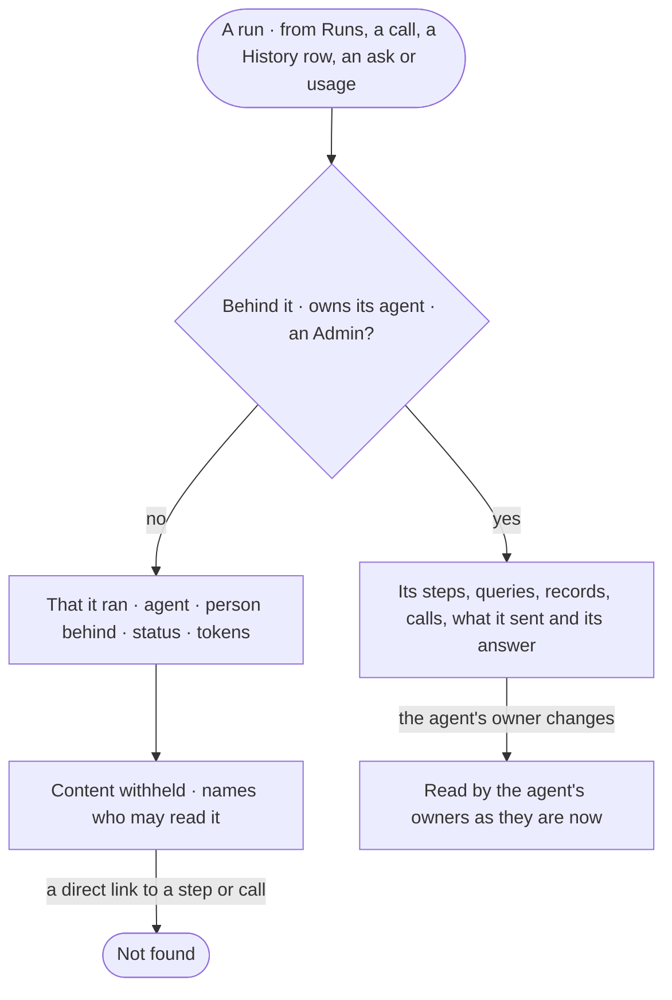

# AC-31 · Keep a run's content to those who may read it

**As** an analyst who asked an agent a question **I want** what my run read, sent and answered to be readable only
by me, the agent's owners and the Admins **so that** I can ask about sensitive work, while everyone else can still
see that it ran, its status and its tokens.

Tasks: [task.md](task.md) · Feature: [AC-F09](../../feature.md)

## Who can

| Lens | Can | Otherwise sees |
|---|---|---|
| Admin | Read every run's content | — |
| Operator | Read the content of runs they are behind and of agents they own | Any other run: that it ran, its agent, the person behind it, its status and its tokens — content reads *withheld — only {person behind}, the agent's owners and Admins read it* |

## Flow

## Acceptance criteria

| # | Given | When | Then |
|---|---|---|---|
| AC-31.1 | A run | the person behind it, an owner of its agent or an Admin opens it | its steps, queries, records, calls, what it sent and its answer read in full |
| AC-31.2 | A run | anyone else opens it | it reads that it ran, its agent, the person behind it, its status and its tokens; its content reads *withheld — only {person behind}, the agent's owners and Admins read it*; its content routes answer *Not found* |
| AC-31.3 | A step of a run the reader may not read | *How it got here* is opened | the steps list by name and status; their arguments, rows and sources are withheld |
| AC-31.4 | A call of such a run, in *What left the platform* | it is opened | its time, agent, target, class and tokens read; its kinds, fields, record IDs and query are withheld (AC-30) |
| AC-31.5 | A History row of such a run | it is opened | who, the act, the verdict and the rule read; its arguments are withheld (AC-16) |
| AC-31.6 | An ask from such a run | it is read by someone not routed to it | its kind, agent, who it waits on and its time left read; its act and what it will send are withheld (AC-15) |
| AC-31.7 | Usage over such runs | it is read | they are counted, not shown (AC-28) |
| AC-31.8 | An agent whose owners change | a run of it is read | its owners as they are now may read it; a former owner may not, unless they were behind it |
| AC-31.9 | A run started by a schedule or a key | its content is read | the person behind it is the schedule's creator or the key's owner, and reads it |
| AC-31.10 | The tokens of a run the reader may not read | they are read | tokens read as the engine stored them; there is no currency |

## Screens

| Surface | Lens | First use | Empty after a filter | Loading | Has data | Failed | Agent working or proposing | No access |
|---|---|---|---|---|---|---|---|---|
| A run | Admin | — | — | agents.run · Loading | agents.run · Step | agents.run · Failed | agents.run · Running | — |
| A run | Operator | — | — | agents.run · Loading | agents.run · Step | agents.run · Failed | agents.run · Running | agents.run · Content withheld |
| A ledger call | Admin | — | — | access.ledger · Call · Loading | access.ledger · Call | access.ledger · Call · Refused | — | — |
| A ledger call | Operator | — | — | access.ledger · Call · Loading | access.ledger · Call | access.ledger · Call · Refused | — | access.locked · Content withheld |
| A History row | Admin | — | — | inbox.history · Loading | inbox.history · Row | inbox.history · Could not load | — | — |
| A History row | Operator | — | — | inbox.history · Loading | inbox.history · Row | inbox.history · Could not load | — | inbox.history · Arguments withheld |
| An ask | Admin | — | — | inbox · Loading | inbox | inbox · Could not load | inbox · An agent asks to send | — |
| An ask | Operator | — | — | inbox · Loading | inbox | inbox · Could not load | inbox · An agent asks to send | inbox · Content withheld |
