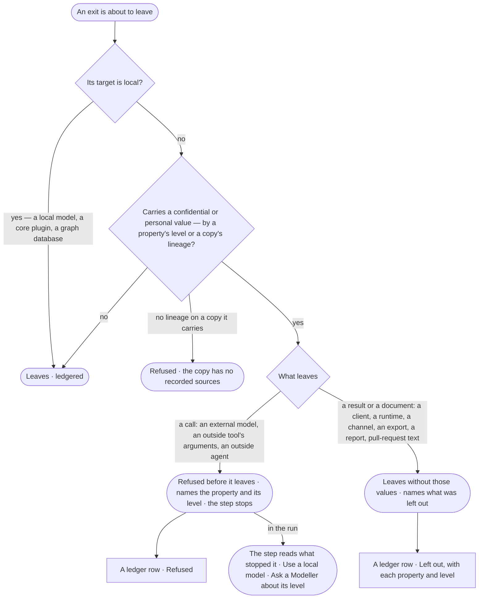

# AC-42 · Stop sensitive data at every exit

**As** an Admin **I want** one check on everything that leaves the deployment — a model call, a tool's arguments, an
outside agent, an outside runtime, an MCP client, a channel, an export, a published report, pull-request text — so
that nothing confidential or personal leaves **so that** I can let agents use outside models and tools without
reading every prompt, and prove to an auditor that those values stayed in.

Tasks: [task.md](task.md) · Feature: [AC-F09](../../feature.md)

## Who can

Roles are [the role table](../../../AC-F02-access-policies/feature.md#the-role-table). The check has no switch: no
role turns it off.

| Lens | Can | Otherwise sees |
|---|---|---|
| Admin | Read every target with its locality; mark an AI model local or external in AI models; read every refused and left-out exit in *What left* | — |
| Operator | Read every target with its locality; read the refused and left-out exits of runs they may read (AC-31); see in their own run which step was stopped and why; a Modeller the same, and sets a property's level in Meaning (SE-20) | Marking a model is disabled, naming the Admins; exits of runs they may not read show their target, verdict and tokens, content withheld |

## Flow

## Acceptance criteria

| # | Given | When | Then |
|---|---|---|---|
| AC-42.1 | Any target | *What left › Targets* is read | each target kind and known target reads local or external, with who set it for an AI model; MCP clients, outside agents, channels, exports, published reports and pull-request text read external, always |
| AC-42.2 | A prompt to an external AI model carrying a value of a confidential or personal property | it is about to leave | it is refused before it leaves, naming the property and its level — *{property} is {level} — it never leaves for {model}*; nothing is sent |
| AC-42.3 | An outside tool's or an outside agent's call whose arguments carry such a value | it is about to leave | it is refused the same way, naming the tool or agent |
| AC-42.4 | A result to an MCP client, or a tool result to an outside runtime, carrying such values | it is sent | it leaves without those values; what was left out is named in it — each property, its level and how many values |
| AC-42.5 | An export, a published report, a channel message or pull-request text carrying such values | it leaves | it leaves without them, naming what was left out, in the file or message and in its row in *What left* |
| AC-42.6 | A copy — an answer, a finding, a report, a snapshot, a note, a memory node — whose sources include a confidential or personal property | it is in what leaves for an external target | it counts at the highest level of its sources: refused in a call, left out of a document |
| AC-42.7 | A local AI model, a core plugin or a graph database | a payload carrying confidential or personal values reaches it | it passes; the row reads *local* |
| AC-42.8 | A public or internal value | it leaves for an external target the agent's rules allow | it passes the check; the call is still ledgered schema-only or data-bearing |
| AC-42.9 | A copy with no recorded sources | it is in what leaves for an external target | it is refused — *{copy} has no recorded sources — it does not leave* |
| AC-42.10 | A step stopped by the check | its person opens the run | the step reads the property, its level and the target, with *Use a local model* and who sets a level (SE-20) |
| AC-42.11 | Every refused and left-out exit | *What left* is read | each is a row with verdict *Refused* or *Left out*, the property and level, never the value; the head counts both (AC-30) |
| AC-42.12 | Any exit | it would leave without passing the check — a new caller, a missed path | it does not leave: every exit is recorded in *What left* before it leaves, and recording runs the check |
| AC-42.13 | An Operator or a Modeller | they try to mark an AI model local | it is refused — *This needs an Admin* |

## Screens

| Surface | Lens | First use | Empty after a filter | Loading | Has data | Failed | Agent working or proposing | No access |
|---|---|---|---|---|---|---|---|---|
| Targets and their locality | Admin | access.ledger · Targets | access.ledger · Nothing matches | access.ledger · Loading | access.ledger · Targets | access.ledger · Could not load | — | — |
| Targets and their locality | Operator | access.ledger · Targets | access.ledger · Nothing matches | access.ledger · Loading | access.ledger · Targets | access.ledger · Could not load | — | access.ledger · Targets |
| Refused and left-out exits | Admin | access.ledger · No calls yet | access.ledger · Nothing matches | access.ledger · Loading | access.ledger · Left out | access.ledger · Call · Refused | access.ledger · Waiting on the result | — |
| Refused and left-out exits | Operator | access.ledger · No calls yet | access.ledger · Nothing matches | access.ledger · Loading | access.ledger · Left out | access.ledger · Call · Refused | access.ledger · Waiting on the result | access.ledger · Withheld rows |
| A step stopped by the check | Admin | — | — | — | agents.run · Stopped at the exit | — | agents.run · Stopped at the exit | — |
| A step stopped by the check | Operator | — | — | — | agents.run · Stopped at the exit | — | agents.run · Stopped at the exit | agents.run · Content withheld |
| A model's locality | Admin | settings.ai · Locality not set | — | settings.ai · Loading | settings.ai · Locality | settings.ai · Could not load | — | — |
| A model's locality | Operator | settings.ai · Locality · Read only | — | settings.ai · Loading | settings.ai · Locality · Read only | settings.ai · Could not load | — | access.locked |
