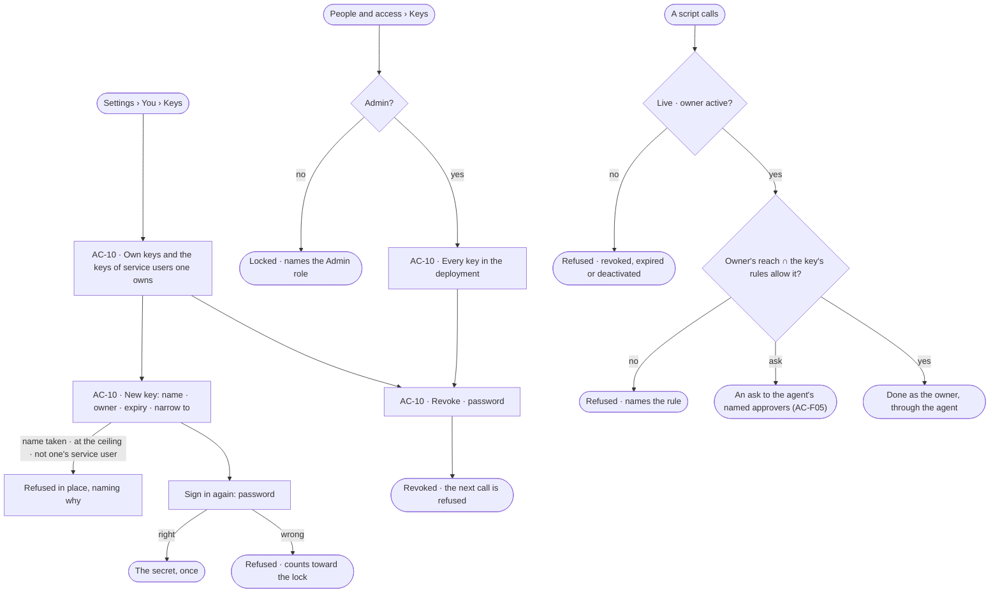

# Keys

> A long-lived credential for software — a script, CI, Claude Code — that acts as its owner and never more, narrowed
> to what one job needs, expiring, and shown once. The decision it helps make: *what may this piece of software do in
> my name, and for how long?*

## User journey

Journeys this feature is a step of: [J07 · Ready a deployment](../../../../journeys/J07-ready-a-deployment.md)

## Stories

| ID | Story | Status |
|---|---|---|
| AC-10 | [Mint a key that acts as its owner, narrowed](stories/AC-10-mint-a-key-that-acts-as-its-owner-narrowed/story.md) | idea |

## Access

| Act | Role ([the role table](../AC-F02-access-policies/feature.md#the-role-table)) | Everyone else sees |
|---|---|---|
| Read one's own keys and the keys of service users one owns | Every signed-in person — Operator, Modeller, Admin | — |
| Mint · revoke one's own key, or a key of a service user one owns | Every signed-in person, in a session, with the password again | — |
| Read every key in the deployment · revoke any | Admin, in a session; revoking with the password again | *People and access › Keys* locked — *Needs the Admin role — ask Priya or Lee*; another person's key is absent (`404`) |
| Any key act with a key | No one — keys are managed from a session | Refused — *This needs a person's session, not a key* |

## States

| State | What the person sees |
|---|---|
| First use | *No keys yet* — *For scripts and Claude Code. A key acts as you, can do less than you, and expires* — with *New key* |
| Empty after a filter | *Nothing matches*, with the filter named and *Clear filters* |
| Loading | The tab opens at once; the list shows loading rows |
| Has data | One row per key: name · owner · last four · narrowed to · expires · last used; expired and revoked keys marked |
| Failed | What could not load or save, in a sentence, with *Try again*; a refused mint says why in place |
| Agent working or proposing | — no agent mints or revokes a key |
| No access | An Operator or a Modeller reads *People and access › Keys* as locked, naming the Admin role; their own keys are on *Settings › You › Keys* |

## Rules

| Rule | Detail |
|---|---|
| A key acts as key ∩ owner | Its owner's role and the agents they may use, read at each call, narrowed by the key's own rules. A key never does more than its owner |
| An owner is a person or a service user | A person mints keys for themselves and for the service users they own ([AC-33](../AC-F03-directory/stories/AC-33-make-a-service-user-for-automation/story.md)); a service user acts only through keys |
| A key only narrows | Its own rules are Allow · verb · resource in the grammar of [Access Policies](../AC-F02-access-policies/feature.md#rules); what they do not name, the key cannot do. *Read only* is where a new key starts |
| A key expires, or says it never does | 30, 90 or 365 days, or never; 90 is offered first. An expired key stays listed until revoked |
| Shown once | The secret is in the mint's answer only; the engine keeps its hash and last four |
| Managing credentials and access needs a session | A key never mints or revokes a key, changes a password, changes access or connects a client; a person minting or revoking signs in again |
| A key's details are its owner's and Admins' | Anyone else finds another person's key absent |
| A ceiling per owner | 20 live keys unless the deployment sets another |
| In the header only | A key travels in `Authorization: Bearer`; a key in a URL is not accepted |
| Keys outlive a password change | A script should not break because its owner changed their password; deactivating the owner stops their keys |
| Leans on | Sessions and signing in again (AC-F01) · the Directory — owners, service users, deactivation (AC-F03) · Access Policies and the one evaluator (AC-F02) · asks (AC-F05) · History (AC-F06) |

## Data touched

| Record | Read or write |
|---|---|
| Keys — owner, name, hash, last four, own rules, expiry, last use, revocation | Write · read |
| The owner's role, active state, the agents they may use and the service users they own (AC-F03 · AC-F07) | Read |
| History rows of a mint, a revoke and a refused call (AC-F06) | Write |

## Engine

The low-level design: what this feature stores, serves and refuses. Conventions — naming, errors, lists, events — are
[system-design.md](../../../../system-design.md) §§ 6–8; this section only fills them in.

### Records

| Table | Columns | Notes |
|---|---|---|
| `access_keys` | `owner_id` (a person or a service user) · `name` (1–64) · `token_hash` (sha256, unique) · `last_four` · `narrowed` (`read_only` · `everything` · `rules`) · `created_by_id` · `created_at` · `expires_at?` · `last_used_at?` · `revoked_at?` · `revoked_by_id?` | Unique (`owner_id`, `name`) among live keys |
| `access_key_rules` | `key_id` · `verb` (`read` · `write` · `run`) · `resource` (`type/name`, whole-segment `*`) | Present only when `narrowed = rules`; deleted with the key's revocation |

### Reads

| Record | Owner |
|---|---|
| A session, signing in again and the lock | [AC-F01](../AC-F01-sign-in-account-and-sessions/feature.md#engine) |
| The owner's kind, role, active state and the agents they may use | [AC-F03](../AC-F03-directory/feature.md#engine) |
| Who owns a service user | [AC-F07](../AC-F07-ownership/feature.md#engine) |
| The resource grammar and the one evaluator | [AC-F02](../AC-F02-access-policies/feature.md#engine) |
| History — every event this feature writes | [AC-F06](../AC-F06-history/feature.md#engine) |

### Routes

| Route, after `/api/v1/access` | Does | Story |
|---|---|---|
| `GET /keys` | By the list contract (`?owner=` · `?state=` `live` · `expired` · `revoked` · `?q=` on name): an Admin reads every key; anyone else the keys they own and their service users' — `name` · `owner` · `last_four` · `narrowed` · `rules[]` · `expires_at?` · `last_used_at?` · `created_by` · `state` | AC-10 |
| `GET /keys/{id}` | One key; `404` to anyone who is not its owner, an owner of its service user, or an Admin | AC-10 |
| `POST /keys` | Mint `{name, owner?, expires_in_days: 30 \| 90 \| 365 \| null, narrowed, rules?[], password}` — the secret only in this answer | AC-10 |
| `DELETE /keys/{id}` | Revoke `{password}` — its owner, an owner of its service user, or an Admin | AC-10 |

### Events

| Event | When |
|---|---|
| `access.keys.create` · `access.keys.revoke` | A key is minted · revoked — the key's name, owner and who acted; never the secret |
| `access.keys.refused` | A key's call is refused — revoked, expired, owner deactivated, or outside its rules; once per key per minute |

### Refusals

| Status | When | Sentence | Criterion |
|---|---|---|---|
| 401 | A revoked key | *This key was revoked on {date}.* | AC-10.9 |
| 401 | An expired key | *This key expired on {date}.* | AC-10.10 |
| 401 | A key whose owner is deactivated | *This account is deactivated.* | AC-10.8 |
| 401 | A key in a URL, or a value no key has | *Send a key in the Authorization header.* | AC-10.14 |
| 403 | A call outside the key's own rules | *Key {name} does not allow {verb} on {resource}.* | AC-10.5 |
| 403 | A call the owner's agents may not make | [AC-F02 › Refusals](../AC-F02-access-policies/feature.md#refusals) | AC-10.6 |
| 403 | Any key route, or another session-only act, called with a key | *This needs a person's session, not a key.* | AC-10.12 |
| 401 | Mint or revoke without the password, or with a wrong one | *Enter your password again to do this.* | AC-10.2 · AC-10.9 |
| 403 | A mint naming as owner a service user the person does not own | *Only {service user}'s owners mint its keys.* | AC-10.7 |
| 404 | Reading or revoking a key that is not one's own, one's service user's, or read by an Admin | *Not found.* | AC-10.16 |
| 409 | A name the owner uses on a live key | *{name} is taken.* | AC-10.20 |
| 409 | An owner at the ceiling | *{owner} has {n} live keys — revoke one first.* | AC-10.11 |
| 422 | An expiry other than 30, 90, 365 days or never | *A key expires in 30, 90 or 365 days, or never.* | AC-10.2 |

### CLI

| Command | Does |
|---|---|
| `invana keys list [--owner]` | Keys as `GET /keys` reads them |
| `invana keys revoke <id>` | Revokes, as `DELETE /keys/{id}`; prompts for the password |

### Mechanisms

| Mechanism | How |
|---|---|
| The secret | `invana_pat_` + 32 random bytes, base64url; only its sha256 and last four are stored |
| Telling a key apart | A `Bearer` value with the `invana_pat_` prefix is looked up by hash ([AC-F01 › Mechanisms](../AC-F01-sign-in-account-and-sessions/feature.md#mechanisms)) |
| Key ∩ owner | The call is checked as the owner — role, agents, teams ([AC-F02 › One evaluator](../AC-F02-access-policies/feature.md#mechanisms)) — and then against the key: `everything` passes, `read_only` passes Read only, `rules` passes only a verb and resource one of its rules matches. Both must pass; the stricter refusal is the one named |
| Read at each call | Revocation, expiry, the owner's deactivation and every change to the owner's reach take effect on the next call; nothing is cached on the key |
| Last used | `last_used_at` is written at most once a minute per key |
| Revoking | Sets `revoked_at` and `revoked_by_id` and deletes the key's `access_key_rules` |
| Session-only | Every route here refuses a key and a connected client's token; mint and revoke verify `password` as [signing in again](../AC-F01-sign-in-account-and-sessions/feature.md#mechanisms) does |
| Never in a log | The secret enters no event, log line, span or ledger row (NFR-SEC-2) |

## System impact

| HLD section | Change | NFRs |
|---|---|---|
| § 6 Data and storage | Two tables in Postgres | — |
| § 8 APIs and events | The `/api/v1/access/keys` routes and `access.keys.*` events; who calls and how they prove it — a script or the CLI | — |
| § 12 Qualities | Security: a key acts as key ∩ owner, read at every call; secrets shown once and stored hashed; managing keys needs a session and the password again | NFR-SEC-1 · NFR-SEC-2 · NFR-SEC-4 |

The code change is [migrations.md](../../../../migrations.md) M14.

## Decisions

| Decision | Detail |
|---|---|
| Keys are their own feature | A credential for software is not a Directory entry; keys live on *Settings › You › Keys* and, for Admins, *People and access › Keys* |
| A key starts at Read only | The minter widens it on purpose — to *Everything I may do* or named rules — and sees what it will do before it is made |
| A key's rules only Allow | A key narrows; Ask and Deny are its owner's agents' policies' to say. What a key's rules do not name, it cannot do |
| No key marked for agents | Every act already runs through an agent and its Access Policies; a key needs no mark of its own to be held to them |
| Revoking asks for the password too | Every change to keys signs in again, the same as access and credentials |

## Open questions

| Question | Who answers |
|---|---|

## Not building

| Item | Why not |
|---|---|
| A key that acts as more than its owner | A key is software borrowing a person's reach, never widening it |
| Keys that manage keys or access | Automation never changes who may do what |
| Showing a secret again | Only its hash is kept |
| A key bound to one graph database or agent by itself | The key's rules name resources — `data/<graph-database>/…` or `agent/<name>` — when a job needs only one |
| Rotating a key in place | Mint a new one, move the script, revoke the old one |
| Keys in a URL | Addresses end up in logs and histories |
