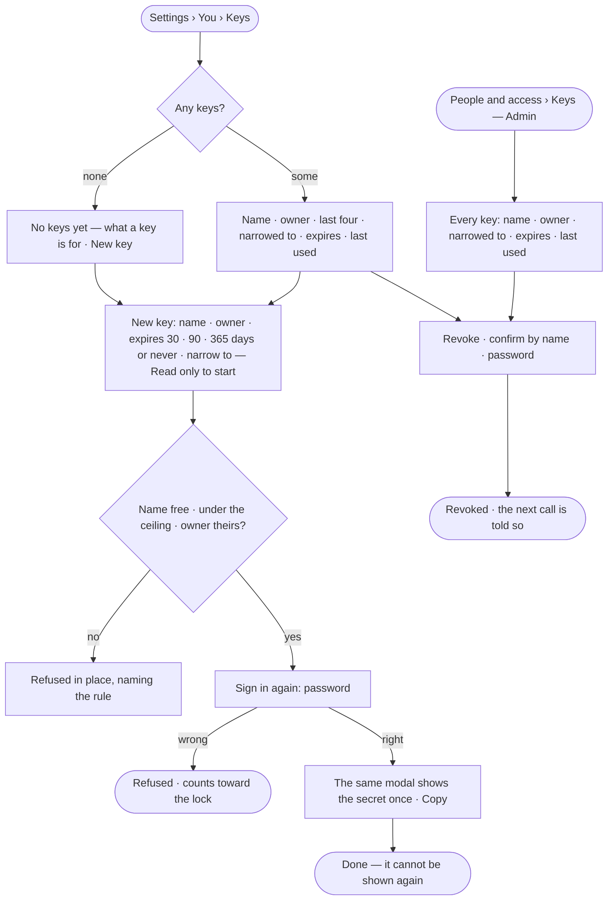
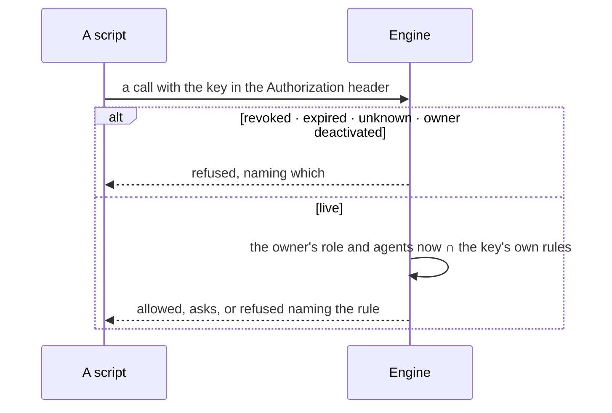

# AC-10 · Mint a key that acts as its owner, narrowed

**As** an agent builder **I want** a key for a script, CI or Claude Code that acts as me — or as a service user I
own — narrowed to what one job needs, expiring and shown once, **so that** software works without my password, and a
leaked key reaches only what that job needed.

Tasks: [task.md](task.md) · Feature: [AC-F10](../../feature.md)

## Who can

| Lens | Can | Otherwise sees |
|---|---|---|
| Admin | Mint and revoke their own keys and the keys of service users they own; read every key in the deployment and revoke any. Each mint and revoke asks for the password again | — |
| Operator | Mint and revoke their own keys and the keys of service users they own. Each mint and revoke asks for the password again | *Owner* offers only themselves and the service users they own; *People and access › Keys* is locked, naming the Admin role |

## Flow

## Acceptance criteria

| # | Given | When | Then |
|---|---|---|---|
| AC-10.1 | A person with no keys | *Settings › You › Keys* is read | *No keys yet* says what a key is for — *For scripts and Claude Code. A key acts as you, can do less than you, and expires* — with *New key* |
| AC-10.2 | A person | they mint a key with a name and an expiry of 30, 90 or 365 days, or never, and enter their password again | the same modal turns into the secret with *Copy* and *It is not shown again*; *Done* closes it |
| AC-10.3 | A minted key | the modal is closed | the secret can never be shown again; the list shows its last four |
| AC-10.4 | A key | a script uses it | it acts as its owner across the deployment — their role and the agents they may use, read at each call — narrowed by the key's own rules |
| AC-10.5 | A key narrowed to some rules | a call outside them is made | it is refused, naming the key and the rule it lacks |
| AC-10.6 | A key with a rule its owner's agents do not hold | a call under that rule is made | it is refused by the owner's reach, naming the policy — a key never does more than its owner |
| AC-10.7 | An owner of a service user | they mint a key with that service user as *Owner* | it acts as the service user, with its role and the agents granted to it |
| AC-10.8 | A key whose owner is deactivated | it is used | it is refused — *This account is deactivated*; reactivating the owner makes it work again until it expires |
| AC-10.9 | A key | its owner or an Admin revokes it, confirming by name and entering the password again | it shows as *Revoked*; the next call with it is refused, told it was revoked |
| AC-10.10 | A key past its expiry | it is used | it is refused, naming the day it expired; the row stays, marked *Expired* |
| AC-10.11 | An owner at the deployment's ceiling of live keys — 20 unless set otherwise | the list is read | *New key* is disabled and the count says why |
| AC-10.12 | A call made with a key | it tries to mint or revoke a key, change a password, change access or connect a client | it is refused — *This needs a person's session, not a key* |
| AC-10.13 | An owner's password change | their keys are used | they still work; only sessions end |
| AC-10.14 | A key in a URL | a call carries it there | it is not accepted — a key travels only in the `Authorization` header |
| AC-10.15 | *People and access › Keys*, read by an Admin | it is read | every key in the deployment — live, expired or revoked: name · owner · narrowed to · expires · last used · who minted it; filtered by owner and state |
| AC-10.16 | An Operator or a Modeller | they open *People and access › Keys* | it is locked, naming the Admin role and the Admins; their own keys and their service users' keys are on *Settings › You › Keys* |
| AC-10.17 | *New key* | it opens | *Narrow to* starts at *Read only*; the minter may choose *Everything I may do* or name rules — verb and resource — and sees what the key will be able to do before it is made |
| AC-10.18 | *Never* as the expiry | it is chosen | the form says a key that never expires lives until it is revoked; the list shows *Never* beside it |
| AC-10.19 | A key | it calls the deployment's MCP server | it acts there as key ∩ owner, exactly as on the API ([AC-F11](../../../AC-F11-connect-an-mcp-client/feature.md)) |
| AC-10.20 | A name the owner already uses on a live key | a key is minted with it | it is refused in place, naming it |
| AC-10.21 | A key | it calls | its *Last used* shows the day of the call |
| AC-10.22 | A key minted, revoked or refused | History is read | each is a row naming the key, its owner and who acted — never the secret |

## Screens

| Surface | Lens | First use | Empty after a filter | Loading | Has data | Failed | Agent working or proposing | No access |
|---|---|---|---|---|---|---|---|---|
| Your keys | Admin | settings.me · No keys yet | — | settings.me · Loading | settings.me · Keys | settings.me · At the ceiling | — | — |
| Your keys | Operator | settings.me · No keys yet | — | settings.me · Loading | settings.me · Keys | settings.me · At the ceiling | — | — |
| New key — then its secret | Admin | — | — | access.sign_in_again | settings.me · Key created | settings.me · Name taken | — | — |
| New key — then its secret | Operator | — | — | access.sign_in_again | settings.me · Key created | settings.me · Name taken | — | settings.me · Only you and your service users as owner |
| Every key | Admin | settings.people · No keys yet | settings.people · Nothing matches | settings.people · Loading | settings.people · Keys | settings.people · Could not load | — | — |
| Every key | Operator | — | — | — | — | — | — | access.locked · Keys |
