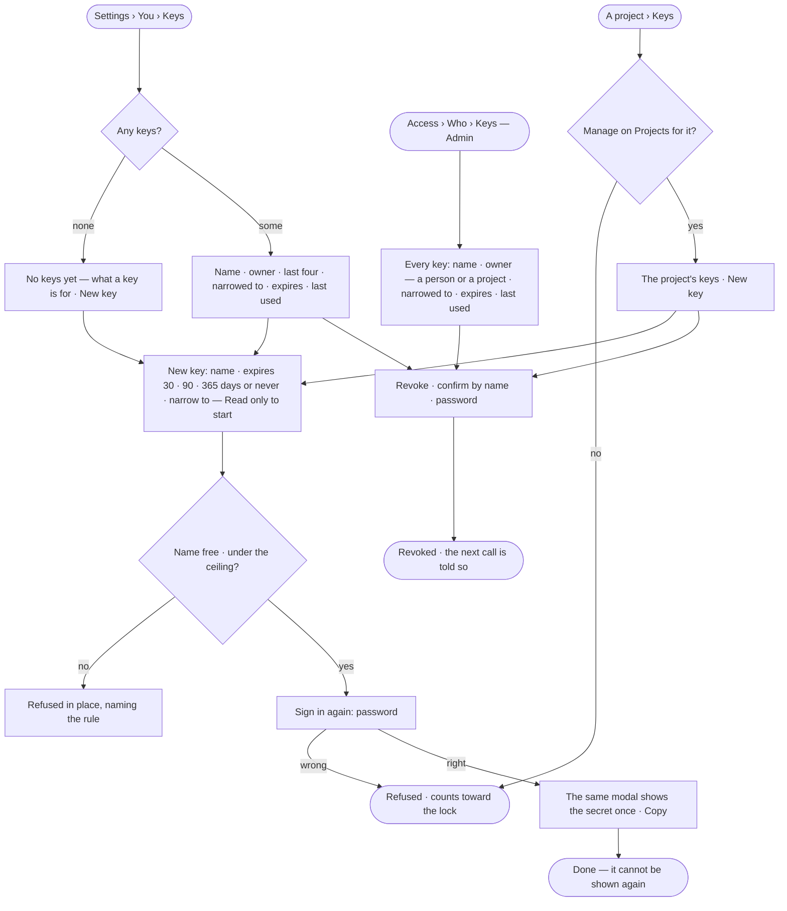
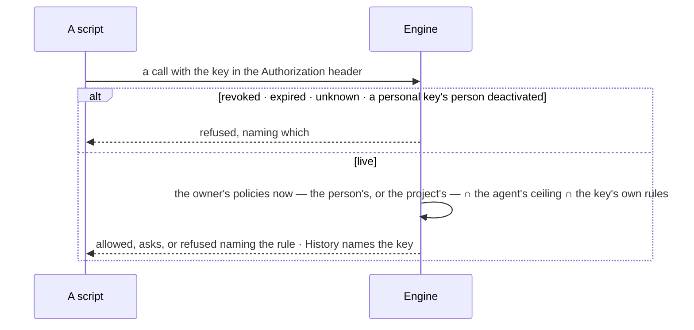

# AC-10 · Mint a key that acts as its owner, narrowed

**As** an agent builder **I want** a key for a script, CI or Claude Code that acts as me — or, for automation that is
no one person's, as my project — narrowed to what one job needs, expiring and shown once, **so that** software works
without my password, keeps working when people come and go, and a leaked key reaches only what that job needed.

Tasks: [task.md](task.md) · Feature: [AC-F10](../../feature.md)

## Who can

| Access | Can | Otherwise sees |
|---|---|---|
| Admin | Mint and revoke their own personal keys, and the keys of any project they hold Manage on Projects for; read every key in the deployment and revoke any (Manage on Access). Each mint and revoke asks for the password again | — |
| Operator | Mint and revoke their own personal keys; read the keys of the projects they are on. Each mint and revoke asks for the password again | A project's *New key* disabled — *Needs Manage on Projects — ask Priya or Lee*; *Access › Who › Keys* locked, naming Manage on Access and who can grant it |

## Flow

## Acceptance criteria

| # | Given | When | Then |
|---|---|---|---|
| AC-10.1 | A person with no keys | *Settings › You › Keys* is read | *No keys yet* says what a key is for — *For scripts and Claude Code. A key acts as you, can do less than you, and expires* — with *New key* |
| AC-10.2 | A person | they mint a key with a name and an expiry of 30, 90 or 365 days, or never, and enter their password again | the same modal turns into the secret with *Copy* and *It is not shown again*; *Done* closes it |
| AC-10.3 | A minted key | the modal is closed | the secret can never be shown again; the list shows its last four |
| AC-10.4 | A personal key | a script uses it | it acts with its person's policies ∩ the agent's ceiling, read at each call, narrowed by the key's own rules |
| AC-10.5 | A key narrowed to some rules | a call outside them is made | it is refused, naming the key and the rule it lacks |
| AC-10.6 | A key with a rule its owner's policies or the agent's ceiling do not allow | a call under that rule is made | it is refused, naming the policy — a key never does more than its owner |
| AC-10.7 | A person with Manage on Projects for a project | they mint a key on the project's *Keys* | it is a project key: every run it starts is inside the project, acting with the project's policies ∩ the agent's ceiling, narrowed by the key's own rules; without Manage on Projects, *New key* is disabled naming the permission, and the API refuses |
| AC-10.8 | A personal key whose person is deactivated | it is used | it is refused — *This account is deactivated*; reactivating the owner makes it work again until it expires |
| AC-10.9 | A key | its person — for a project key, someone with Manage on Projects for it — or an Admin revokes it, confirming by name and entering the password again | it shows as *Revoked*; the next call with it is refused, told it was revoked |
| AC-10.10 | A key past its expiry | it is used | it is refused, naming the day it expired; the row stays, marked *Expired* |
| AC-10.11 | An owner at the deployment's ceiling of live keys — 20 unless set otherwise | the list is read | *New key* is disabled and the count says why |
| AC-10.12 | A call made with a key | it tries to mint or revoke a key, change a password, change access or connect a client | it is refused — *This needs a person's session, not a key* |
| AC-10.13 | An owner's password change | their keys are used | they still work; only sessions end |
| AC-10.14 | A key in a URL | a call carries it there | it is not accepted — a key travels only in the `Authorization` header |
| AC-10.15 | *Access › Who › Keys*, read by an Admin | it is read | every key in the deployment — live, expired or revoked: name · owner — a person or a project · narrowed to · expires · last used · who minted it; filtered by owner and state |
| AC-10.16 | A person without Manage on Access | they open *Access › Who › Keys* | it is locked, naming the permission and who can grant it; their own keys are on *Settings › You › Keys*, a project's on its *Keys*; a key they may not read is absent |
| AC-10.17 | *New key* | it opens | *Narrow to* starts at *Read only*; the minter may choose *Everything I may do* or name rules — verb and resource — and sees what the key will be able to do before it is made |
| AC-10.18 | *Never* as the expiry | it is chosen | the form says a key that never expires lives until it is revoked; the list shows *Never* beside it |
| AC-10.19 | A key | it calls the deployment's MCP server | it acts there as key ∩ owner, exactly as on the API ([AC-F11](../../../AC-F11-connect-an-mcp-client/feature.md)) |
| AC-10.20 | A name the owner already uses on a live key | a key is minted with it | it is refused in place, naming it |
| AC-10.21 | A key | it calls | its *Last used* shows the day of the call |
| AC-10.22 | A key minted, used, revoked or refused | History is read | each is a row naming the key, its owner — a person or a project — and who acted; a run a project key starts names the key and the project where a person would be — never the secret |
| AC-10.23 | A key with runs queued or running | it is revoked | those runs stop, each with a History row naming who revoked the key |
| AC-10.24 | A key revoked by an Admin, not its owner | the owner opens the Inbox | an Update names the key and the Admin who revoked it — for a project key, its minter |
| AC-10.25 | A project key | its minter leaves the team or is deactivated, or people join or leave | it keeps working, its reach still the project's policies |
| AC-10.26 | A project with keys | it is archived | its keys are revoked in the same act; their next call is told so |
| AC-10.27 | A key | it sends a raw query to a graph database where its owner's policies or the agent's ceiling hide anything | it is refused with *Raw queries are not available on {graph database}*, naming no kind and no rule; typed query plans run (AC-27.27) |
| AC-10.28 | *New key* | the person fills its name, *Narrow to*, expiry and owner and enters their password | *Only you and your projects* limits the owner; *Sign in again* names *Make the key*; a wrong password returns to the same *Sign in again* with the message, nothing minted; a right one shows the secret once, *Copy* reads *Copied* and *Done* returns to *Keys* with the new row |

## Screens

| Surface | Access | First use | Empty after a filter | Loading | Has data | Failed | Agent working or proposing | No access |
|---|---|---|---|---|---|---|---|---|
| Your keys | Admin | settings.me · No keys yet | — | settings.me · Loading | settings.me · Keys | settings.me · At the ceiling | — | — |
| Your keys | Operator | settings.me · No keys yet | — | settings.me · Loading | settings.me · Keys | settings.me · At the ceiling | — | — |
| New key — then its secret | Admin | settings.me · New key | — | access.signin · Sign in again · Make the key | settings.me · New key · Secret once | settings.me · New key · Name taken | — | — |
| New key — then its secret | Operator | settings.me · New key | — | access.signin · Sign in again · Make the key | settings.me · New key · Secret once | settings.me · New key · Name taken | — | — |
| A project's keys | Admin | projects.projects · Detail · Keys · No keys yet | — | projects.projects · Detail · Keys · Loading | projects.projects · Detail · Keys | projects.projects · Detail · Keys · At the ceiling | — | — |
| A project's keys | Operator | projects.projects · Detail · Keys · No keys yet | — | projects.projects · Detail · Keys · Loading | projects.projects · Detail · Keys | projects.projects · Detail · Keys · Could not load | — | projects.projects · Detail · Keys · New key disabled |
| Every key | Admin | settings.people · No keys yet | settings.people · Nothing matches | settings.people · Loading | settings.people · Keys | settings.people · Could not load | — | — |
| Every key | Operator | — | — | — | — | — | — | settings.people · Locked · Keys |
| New key · Owner and expiry | Admin | — | — | — | settings.me · New key · Only you and your projects | — | — | — |
| New key · Owner and expiry | Operator | — | — | — | settings.me · New key · Only you and your projects | — | — | — |
| New key · Your password | Admin | — | — | — | access.signin · Sign in again · Make the key | access.signin · Sign in again · Make the key · Wrong password | — | — |
| New key · Your password | Operator | — | — | — | access.signin · Sign in again · Make the key | access.signin · Sign in again · Make the key · Wrong password | — | — |
| New key · Copied | Admin | — | — | — | settings.me · New key · Copied | — | — | — |
| New key · Copied | Operator | — | — | — | settings.me · New key · Copied | — | — | — |
| Revoke a key | Admin | — | — | — | access.signin · Sign in again · Revoke the key | access.signin · Sign in again · Revoke the key · Wrong password | — | — |
| Revoke a key | Operator | — | — | — | access.signin · Sign in again · Revoke the key | access.signin · Sign in again · Revoke the key · Wrong password | — | — |
| Revoked | Admin | — | — | — | settings.me · Keys · Revoked | — | — | — |
| Revoked | Operator | — | — | — | settings.me · Keys · Revoked | — | — | — |
