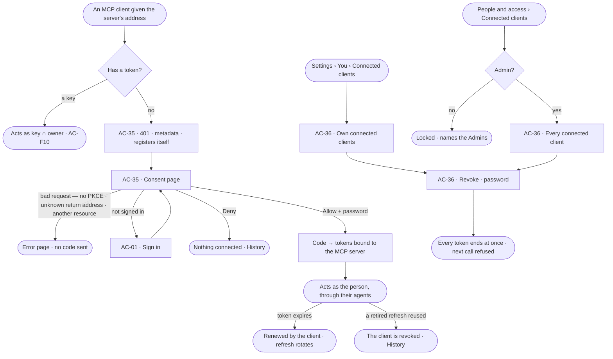
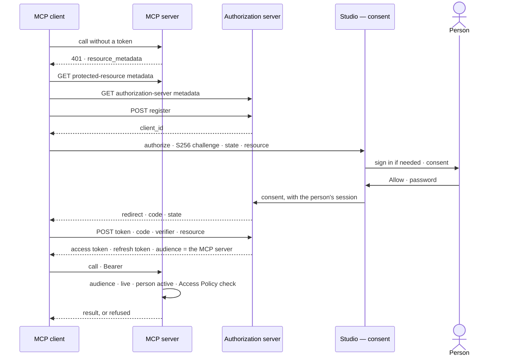

# Connect an MCP client

> The deployment's one MCP server as an OAuth 2.1 resource, with Invana as its own authorization server: a person
> points Claude Code or an IDE at it, signs in, consents once, and the client acts as them — until they revoke it. Keys
> still work for scripts. The decision it helps make: *which tools may act as me, and should this one still?*

## User journey

Journeys this feature is a step of: [J07 · Ready a deployment](../../../../journeys/J07-ready-a-deployment.md)

## Stories

| ID | Story | Status |
|---|---|---|
| AC-35 | [Connect an MCP client as me](stories/AC-35-connect-an-mcp-client-as-me/story.md) | idea |
| AC-36 | [See and revoke connected clients](stories/AC-36-see-and-revoke-connected-clients/story.md) | idea |

## Access

| Act | Role ([the role table](../AC-F02-access-policies/feature.md#the-role-table)) | Everyone else sees |
|---|---|---|
| Register a client · read the metadata | Anyone who can reach the deployment — no credential; rate-limited | — |
| Connect a client as oneself — consent | Every person with an active account — Operator, Modeller, Admin — in a session, with the password again | A service user, an agent and the system user never sign in, so never consent; a service user uses a key |
| Read and revoke one's own connected clients | Every signed-in person, in a session; revoking with the password again | — |
| Read every connected client · revoke any | Admin, in a session; revoking with the password again | *People and access › Connected clients* locked — *Needs the Admin role — ask Priya or Lee*; another person's client is absent (`404`) |
| Call the MCP server | A connected client, as its person · a key, as key ∩ owner | `401` with where to find the metadata |

## States

| State | What the person sees |
|---|---|
| First use | *No clients yet*, with the MCP server's address to give Claude Code |
| Empty after a filter | *Nothing matches*, with the filter named and *Clear filters* |
| Loading | The consent page and the tabs open at once; lists show loading rows |
| Has data | The consent card; one row per connected client: name · returns to · connected · last used |
| Failed | A bad authorize request is an error page naming what was wrong; a list that could not load says so, with *Try again* |
| Agent working or proposing | — no agent connects or revokes a client |
| No access | An Operator or a Modeller reads *People and access › Connected clients* as locked, naming the Admin role |

## Rules

| Rule | Detail |
|---|---|
| One MCP server, one authorization server | The deployment's MCP server is the only resource; Invana is its authorization server. What the server serves is the Control Plane's ([CP-F02](../../../control/features/CP-F02-plugins-and-outside-tools/feature.md)) |
| OAuth 2.1, authorization code with PKCE only | `S256` is the only challenge method; no implicit grant, no password grant, no client credentials |
| Discovery by metadata | Protected-resource metadata (RFC 9728) points at the authorization server; its metadata (RFC 8414) names every endpoint; a `401` from the MCP server says where the first is |
| Clients register themselves | Dynamic client registration (RFC 7591); a name a client gives itself is shown as *Unverified*. Return addresses are `https` or loopback, matched exactly — a loopback's port may vary |
| Consent is a person's yes | A signed-in person, with the password again; nothing is connected without it, and a code is sent only to a registered return address |
| Tokens are bound to the MCP server | Every authorize and token request names the MCP server as its resource (RFC 8707); a token carries it as its audience and is refused anywhere else |
| A connected client acts as its person | Their role and the agents they may use, read at each call; every call is ledgered naming the person and the client |
| Never session-only acts | A connected client never manages keys, access or credentials |
| Revoking ends it at once | Every access and refresh token of the connection ends; the client connects again from the start |
| Sign out and password changes leave clients alone | Only revoking or deactivating the person ends a connected client |
| Rate-limited | Registration, the token endpoint and the MCP server take at most 30 requests a minute from one address (NFR-SEC-6) |
| Keys still work | A key on the MCP server acts as key ∩ owner ([AC-F10](../AC-F10-keys/feature.md)) |
| Leans on | Sign in and signing in again (AC-F01) · the Directory (AC-F03) · Access Policies and the one evaluator (AC-F02) · keys (AC-F10) · History (AC-F06) · the ledger (AC-F09) · the MCP server and what it serves (CP-F02) |

## Data touched

| Record | Read or write |
|---|---|
| Registered clients — name, return addresses | Write · read |
| Connections — a person's yes to a client, with last use and revocation | Write · read |
| Codes and tokens — hashed | Write · read |
| The person's role, active state and agents (AC-F03) | Read |
| History rows of a registration, a consent, a denial, a revoke and a reuse (AC-F06) | Write |

## Engine

The low-level design: what this feature stores, serves and refuses. Conventions — naming, errors, lists, events — are
[system-design.md](../../../../system-design.md) §§ 6–8; this section only fills them in.

### Records

| Table | Columns | Notes |
|---|---|---|
| `access_clients` | `client_id` (random, unique) · `client_name` · `redirect_uris[]` · `software_id?` · `software_version?` · `registered_at` · `registered_from` (address) | A registration no person consents to within 24 hours is removed |
| `access_client_connections` | `client_id` · `user_id` (a person) · `resource` · `connected_at` · `last_used_at?` · `revoked_at?` · `revoked_by_id?` · `revoked_why?` (`person` · `admin` · `reuse` · `deactivated`) | One row per consent; what *Connected clients* lists |
| `access_client_codes` | `connection_id` · `code_hash` (unique) · `code_challenge` · `redirect_uri` · `resource` · `expires_at` (60 seconds) · `used_at?` | Used once |
| `access_client_tokens` | `connection_id` · `kind` (`access` · `refresh`) · `token_hash` (unique) · `issued_at` · `expires_at` · `retired_at?` | Access tokens live 60 minutes; a refresh token 30 days from its last use |

### Reads

| Record | Owner |
|---|---|
| The session, signing in again, the lock and the rate limit | [AC-F01](../AC-F01-sign-in-account-and-sessions/feature.md#engine) |
| The person's role, active state and the agents they may use | [AC-F03](../AC-F03-directory/feature.md#engine) |
| The one evaluator | [AC-F02](../AC-F02-access-policies/feature.md#engine) |
| A key on the MCP server | [AC-F10](../AC-F10-keys/feature.md#engine) |
| The ledger row of each call | [AC-F09](../AC-F09-what-left-the-platform/feature.md#engine) |
| History — every event this feature writes | [AC-F06](../AC-F06-history/feature.md#engine) |

### Routes

| Route | Does | Story |
|---|---|---|
| `GET /.well-known/oauth-protected-resource/mcp` | Protected-resource metadata: `resource` (the MCP server's address) · `authorization_servers` · `bearer_methods_supported: ["header"]` | AC-35 |
| `GET /.well-known/oauth-authorization-server` | Authorization-server metadata: `issuer` · `authorization_endpoint` · `token_endpoint` · `registration_endpoint` · `revocation_endpoint` · `response_types_supported: ["code"]` · `grant_types_supported: ["authorization_code", "refresh_token"]` · `code_challenge_methods_supported: ["S256"]` · `token_endpoint_auth_methods_supported: ["none"]` | AC-35 |
| `POST /api/v1/access/oauth/register` | Register a client `{client_name, redirect_uris[], software_id?, software_version?}` → `201` `{client_id, …}` | AC-35 |
| `GET /oauth/authorize` (Studio) | The consent page: checks `client_id`, `redirect_uri`, `code_challenge`, `code_challenge_method`, `state` and `resource`, signs the person in if needed | AC-35 |
| `POST /api/v1/access/oauth/consent` | From the consent page, with the person's session: `{client_id, redirect_uri, code_challenge, state, resource, allow, password?}` → the address to send the browser back to, with `code` or `error=access_denied` | AC-35 |
| `POST /api/v1/access/oauth/token` | `grant_type=authorization_code` with `code` · `code_verifier` · `redirect_uri` · `client_id` · `resource`; or `grant_type=refresh_token` with `refresh_token` · `client_id` · `resource` → `{access_token, refresh_token, token_type: "Bearer", expires_in}` | AC-35 |
| `POST /api/v1/access/oauth/revoke` | A client revokes its own token (RFC 7009) | AC-35 |
| `GET /api/v1/access/clients` | Connected clients by the list contract (`?user=` · `?q=` on name): an Admin reads every one; anyone else their own — `client_name` · `redirect_host` · `user` · `connected_at` · `last_used_at?` | AC-36 |
| `DELETE /api/v1/access/clients/{id}` | Revoke a connection `{password}` — its person or an Admin | AC-36 |

### Events

| Event | When |
|---|---|
| `access.clients.register` | A client registers — its name and return addresses |
| `access.clients.connect` · `access.clients.deny` | A person allows · denies a client |
| `access.clients.revoke` | A connection is revoked — by its person, an Admin, a reuse or a deactivation (`details.why`) |
| `access.clients.reuse_detected` | A retired refresh token or a used code is presented again |
| `access.clients.refused` | A connected client's call is refused — wrong audience, revoked, person deactivated; once per connection per minute |

### Refusals

| Status | When | Sentence | Criterion |
|---|---|---|---|
| 401 | A call to the MCP server with no token or an unknown one — `WWW-Authenticate: Bearer resource_metadata="…"` | *Connect this client, or send a key.* | AC-35.1 |
| 400 | Registration with a return address that is neither `https` nor loopback | *{address} cannot be a return address — use https or a loopback address.* | AC-35.3 |
| 400 | Authorize with no code challenge, `plain`, an unregistered return address, or a resource other than the MCP server — shown on the error page, never sent to the client | *This request cannot be allowed — {what was wrong}.* | AC-35.8 |
| 401 | Consent without the password, or with a wrong one | *Enter your password again to do this.* | AC-35.6 |
| 400 | A code with the wrong verifier, used twice or past 60 seconds — `invalid_grant`; a reused code ends the connection | *This code cannot be used.* | AC-35.9 |
| 400 | A retired refresh token — `invalid_grant`; the connection is revoked | *This connection has ended — connect again.* | AC-35.13 |
| 401 | A token whose audience is not the route's | *This token is for the MCP server only.* | AC-35.11 |
| 401 | A revoked connection, or a person deactivated | *This connection has ended — connect again.* | AC-35.14 · AC-36.3 |
| 403 | A session-only act by a connected client | *This needs a person's session, not a key.* | AC-35.12 · AC-36.8 |
| 403 | A call the person's agents may not make | [AC-F02 › Refusals](../AC-F02-access-policies/feature.md#refusals) | AC-35.10 |
| 404 | Reading or revoking another person's connection, not as an Admin | *Not found.* | AC-36.6 |
| 429 | Registration, the token endpoint or the MCP server past 30 requests a minute from one address | *Too many requests — try again in a minute.* | AC-35.16 |

### CLI

| Command | Does |
|---|---|
| `invana clients list [--user]` | Connected clients as `GET /clients` reads them |
| `invana clients revoke <id>` | Revokes, as `DELETE /clients/{id}`; prompts for the password |

### Mechanisms

| Mechanism | How |
|---|---|
| The resource | The MCP server's address, `https://<deployment>/mcp`, is the one `resource` and the one audience; it comes from the deployment's configured public address, never from a request header |
| Tokens are opaque rows | `invana_mcp_` + 32 random bytes; only the sha256 is stored, so a revoke is a database update and takes effect on the next call |
| Telling a token apart | A `Bearer` value with the `invana_mcp_` prefix is a connected client's ([AC-F01 › Mechanisms](../AC-F01-sign-in-account-and-sessions/feature.md#mechanisms)); the MCP server accepts it and a key, every other route refuses it |
| PKCE | The code stores the `S256` challenge; the token request's verifier must hash to it |
| Consent is session-bound | `POST /oauth/consent` needs a person's session token and verifies `password` as [signing in again](../AC-F01-sign-in-account-and-sessions/feature.md#mechanisms) does; `state` is returned to the client unchanged |
| Rotation and reuse | Each refresh retires the presented refresh token and issues a new pair; a retired one presented again revokes the connection with `revoked_why = reuse` |
| Read at each call | The person's role, active state and agents are read at each MCP call; a deactivation revokes their connections with `revoked_why = deactivated` |
| Who is behind the call | The person of the connection, and the connection's client name, are what the ledger and History record — never a name the client sends in a header |
| Cleanup | Registrations with no connection after 24 hours, used and expired codes, and retired tokens past their expiry are removed by the deployment's housekeeping |
| Never in a log | Codes, verifiers and tokens enter no event, log line, span or ledger row (NFR-SEC-2) |

## System impact

| HLD section | Change | NFRs |
|---|---|---|
| § 6 Data and storage | Four tables in Postgres | — |
| § 8 APIs and events | The OAuth metadata and endpoints, `/api/v1/access/clients`, `access.clients.*` events; who calls and how they prove it — an MCP client | — |
| § 12 Qualities | Security: Invana is the MCP server's own authorization server — PKCE, audience-bound tokens, consent with the password again, revocation at once, rate limits | NFR-SEC-1 · NFR-SEC-2 · NFR-SEC-4 · NFR-SEC-6 · NFR-SEC-7 |

The code change is [migrations.md](../../../../migrations.md) M16.

## Decisions

| Decision | Detail |
|---|---|
| Invana is its own authorization server | No outside identity provider is needed, since sign-in is password only; one deployment, one issuer |
| Dynamic registration, names shown as unverified | Any MCP client can connect without an Admin pre-registering it; the consent page says the name is the client's own word and shows where it returns |
| Consent asks for the password | Connecting a client makes a credential; it signs in again like keys and access |
| One scope: act as me | A connected client acts as its person through the agents they may use; a client that should do less uses a narrowed key ([AC-F10](../AC-F10-keys/feature.md)) |
| Consent each time | A client that connects again is asked again and becomes a new connection; nothing is remembered silently |
| Connected clients sit beside keys | *Settings › You › Connected clients*, and for Admins *People and access › Connected clients* |

## Open questions

| Question | Who answers |
|---|---|

## Not building

| Item | Why not |
|---|---|
| Client ID metadata documents | Fetching a client's own address from the engine is an outbound call for every unknown client; dynamic registration covers Claude Code and IDEs |
| Narrowing a connected client | A key narrows; a connected client is the person |
| An outside identity provider as the issuer | Sign-in is password only ([AC-F01](../AC-F01-sign-in-account-and-sessions/feature.md#not-building)) |
| Tokens for any other resource | The MCP server is the one resource; the API takes sessions and keys |
| Remembered consent | Every connection is a person's fresh yes |
| Outside MCP servers' credentials | Those are credentials Invana holds to reach out, the Control Plane's ([CP-F02](../../../control/features/CP-F02-plugins-and-outside-tools/feature.md)) |
