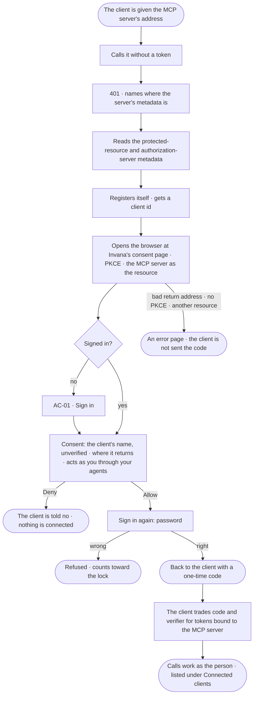
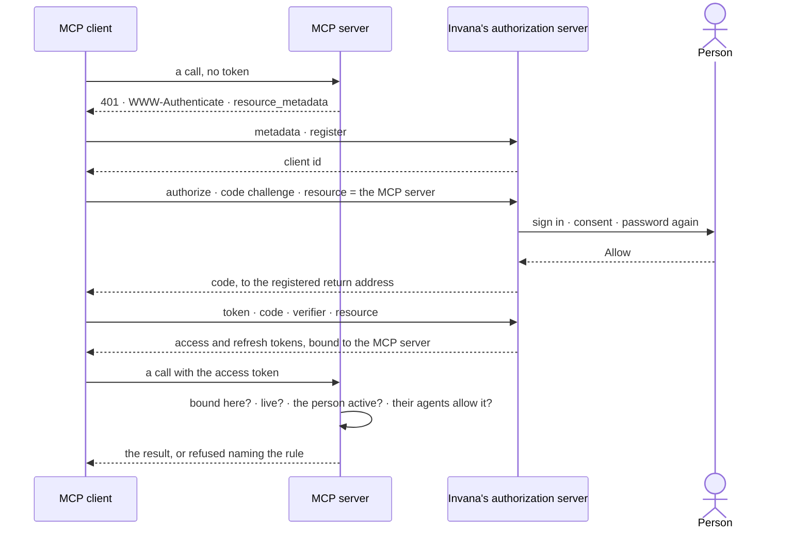

# AC-35 · Connect an MCP client as me

**As** an analyst **I want** to point Claude Code or my IDE at the deployment's MCP server, sign in in my browser and
say yes once **so that** the client works as me, through the agents I may use, without me copying a key into a config
file.

Tasks: [task.md](task.md) · Feature: [AC-F11](../../feature.md)

## Who can

| Lens | Can | Otherwise sees |
|---|---|---|
| Admin | Connect an MCP client as themselves, consenting with the password again; the client acts as them through the agents they may use | — |
| Operator | Connect an MCP client as themselves, consenting with the password again; the client acts as them through the agents they may use | A person without an account reads *Ask your admin for an account* on sign-in; a service user connects with a key, never this way |

## Flow

## Acceptance criteria

| # | Given | When | Then |
|---|---|---|---|
| AC-35.1 | An MCP client with no token | it calls the deployment's MCP server | it is answered `401` with `WWW-Authenticate` naming the protected-resource metadata, from which it finds Invana's authorization server |
| AC-35.2 | The authorization server's metadata | it is read | it names the authorize, token, registration and revocation endpoints, `S256` as the only code challenge method, and the authorization code and refresh token grants only |
| AC-35.3 | A client | it registers with a name and return addresses that are `https` or a loopback address | it gets a client id; any other return address is refused, naming it |
| AC-35.4 | A person not signed in | the consent page opens | they sign in (AC-01) and come back to the consent page, not Home |
| AC-35.5 | The consent page | it draws | the client's name, marked *Unverified — the client named itself*, the address it returns to, *Acts as you, through the {n} agents you may use*, *Allow* and *Deny* |
| AC-35.6 | *Allow* | the person enters their password again | the client is sent a one-time code at its registered return address and appears under *Connected clients* (AC-36); History records the connection |
| AC-35.7 | *Deny* | it is pressed | the client is told access was denied; nothing is connected; History records it |
| AC-35.8 | An authorize request with no code challenge, `plain`, a return address not registered, or a resource other than the deployment's MCP server | it arrives | an error page names what was wrong, and the client is never sent a code |
| AC-35.9 | A code | it is traded with the wrong verifier, a second time, or after 60 seconds | it is refused, and a code used twice ends every token issued from it |
| AC-35.10 | A connected client | it calls the MCP server | it acts as the person — their role and the agents they may use, read at each call — and *Access usage*, *What left the platform* and History name the person and the connected client |
| AC-35.11 | A connected client's token | it is sent to any route but the MCP server | it is refused — the token is bound to the MCP server |
| AC-35.12 | A connected client | it tries a session-only act — keys, access, credentials | it is refused — *This needs a person's session, not a key* |
| AC-35.13 | A connected client's access token | it expires | the client renews it with its refresh token without the person; the refresh token rotates, and reusing a retired one revokes the client and is recorded |
| AC-35.14 | A person who is deactivated, or whose client is revoked | the client calls | it is refused at once (AC-23.4 · AC-36.3) |
| AC-35.15 | A key | it calls the MCP server | it still works, as key ∩ owner (AC-10.19) |
| AC-35.16 | One address | it calls the token endpoint or the MCP server more than 30 times a minute | the rest are refused as too many requests (AC-34.4) |

## Screens

| Surface | Lens | First use | Empty after a filter | Loading | Has data | Failed | Agent working or proposing | No access |
|---|---|---|---|---|---|---|---|---|
| Consent | Admin | access.consent | — | access.consent · Loading | access.consent | access.consent · Bad request | — | — |
| Consent | Operator | access.consent | — | access.consent · Loading | access.consent | access.consent · Bad request | — | access.signin · No account |
| Sign in again to allow | Admin | — | — | access.sign_in_again · Checking | access.sign_in_again | access.sign_in_again · Wrong password | — | — |
| Sign in again to allow | Operator | — | — | access.sign_in_again · Checking | access.sign_in_again | access.sign_in_again · Wrong password | — | — |
| Connected — back to the client | Admin | — | — | — | access.consent · Connected | access.consent · Denied | — | — |
| Connected — back to the client | Operator | — | — | — | access.consent · Connected | access.consent · Denied | — | — |
