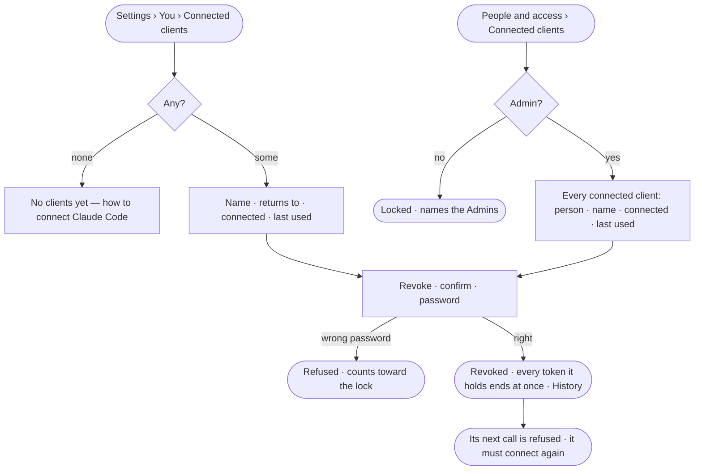

# AC-36 · See and revoke connected clients

**As** an analyst **I want** to see every MCP client acting as me, when each last called, and to cut one off at once
**so that** a lost laptop or an old tool stops working as me the moment I say so.

Tasks: [task.md](task.md) · Feature: [AC-F11](../../feature.md)

## Who can

| Lens | Can | Otherwise sees |
|---|---|---|
| Admin | Read and revoke their own connected clients; read every connected client in the deployment and revoke any. Each revoke asks for the password again | — |
| Operator | Read and revoke their own connected clients, with the password again | *People and access › Connected clients* locked, naming the Admin role; another person's clients are absent |

## Flow

## Acceptance criteria

| # | Given | When | Then |
|---|---|---|---|
| AC-36.1 | A person with no connected clients | *Settings › You › Connected clients* is read | *No clients yet* says what a connected client is and shows the deployment's MCP server address to give Claude Code |
| AC-36.2 | A person with connected clients | the tab is read | one row each: the client's name, marked *Unverified*, the address it returns to, when it was connected and when it last called |
| AC-36.3 | A connected client | its person revokes it, confirming and entering the password again | every token it holds ends at once; its next call is refused and it must connect again; History records who revoked it |
| AC-36.4 | An Admin | they open *People and access › Connected clients* | every connected client in the deployment reads with its person, name, connected and last used; filtered by person |
| AC-36.5 | An Admin | they revoke another person's connected client with the password again | it ends at once, and History records that the Admin revoked it |
| AC-36.6 | An Operator or a Modeller | they open *People and access › Connected clients* | it is locked, naming the Admin role and the Admins; another person's client is absent from the API |
| AC-36.7 | *Sign out everywhere* or a password change | it is done | connected clients keep working; only revoking ends them |
| AC-36.8 | A revoke made with a key or a connected client's token | it is sent | it is refused — *This needs a person's session, not a key* |
| AC-36.9 | The same client connected twice | the list is read | each connection reads as its own row and is revoked on its own |
| AC-36.10 | The list could not load | it is opened | *Could not load connected clients* reads, with *Try again* |

## Screens

| Surface | Lens | First use | Empty after a filter | Loading | Has data | Failed | Agent working or proposing | No access |
|---|---|---|---|---|---|---|---|---|
| Your connected clients | Admin | settings.me · No clients yet | — | settings.me · Loading | settings.me · Connected clients | settings.me · Could not load | — | — |
| Your connected clients | Operator | settings.me · No clients yet | — | settings.me · Loading | settings.me · Connected clients | settings.me · Could not load | — | — |
| Revoke | Admin | — | — | access.sign_in_again · Checking | settings.me · Revoked | access.sign_in_again · Wrong password | — | — |
| Revoke | Operator | — | — | access.sign_in_again · Checking | settings.me · Revoked | access.sign_in_again · Wrong password | — | — |
| Every connected client | Admin | settings.people · No clients yet | settings.people · Nothing matches | settings.people · Loading | settings.people · Connected clients | settings.people · Could not load | — | — |
| Every connected client | Operator | — | — | — | — | — | — | access.locked · Connected clients |
