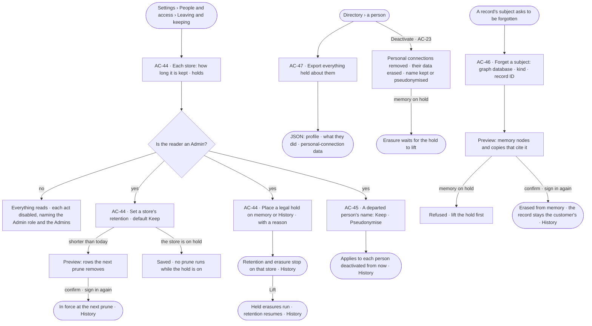
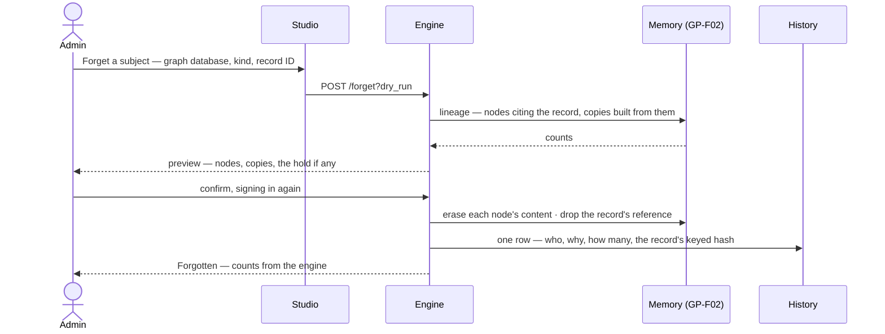

# Leaving and keeping

> How long the deployment keeps what the work leaves, and what goes when a person leaves: retention per store, set by
> an Admin and kept by default; a legal hold that stops retention and erasure; one setting that keeps or
> pseudonymises a departed person's name; a departed person's personal-connection data erased; a subject forgotten
> everywhere memory cites them; and everything held about a person exported as JSON. Light and on-prem: the
> deployment is the customer's, and so are its graph databases.
> The decision it helps make: *what do we keep, for how long — and what must go when someone leaves or asks?*

## User journey

Journeys this feature is a step of: [J12 · A person leaves and the team keeps working](../../../../journeys/J12-a-person-leaves-and-the-team-keeps-working.md)

## Stories

| ID | Story | Status |
|---|---|---|
| AC-44 | [Set how long memory and History are kept, and hold them](stories/AC-44-set-how-long-memory-and-history-are-kept-and-hold-them/story.md) | idea |
| AC-45 | [Decide what happens to a person's name and personal data when they leave](stories/AC-45-decide-what-happens-to-a-persons-name-and-personal-data-when-they-leave/story.md) | idea |
| AC-46 | [Forget a subject everywhere memory cites them](stories/AC-46-forget-a-subject-everywhere-memory-cites-them/story.md) | idea |
| AC-47 | [Export everything held about a person](stories/AC-47-export-everything-held-about-a-person/story.md) | idea |

## Access

| Act | Role ([the role table](../AC-F02-access-policies/feature.md#the-role-table)) | Everyone else sees |
|---|---|---|
| Read each store's retention, the holds on and off, and the names setting | Every signed-in person — Operator, Modeller, Admin | — |
| Set a store's retention · place or lift a legal hold · set the names setting | Admin, in a session, signing in again | Disabled — *Needs the Admin role — ask Priya or Lee* |
| Forget a subject · read the subjects forgotten | Admin, in a session, signing in again | Hidden — *Forget a subject* is not offered |
| Export everything held about a person | Admin, in a session, signing in again | Hidden — *Export their data* is not offered on a person's row |

## States

| State | What the person sees |
|---|---|
| First use | Every store reads *Keep — nothing is removed until an Admin sets a period*; no holds; names *Keep*; *No subject forgotten yet* |
| Empty after a filter | The forgotten subjects or the exports: *Nothing matches*, with the filter named and *Clear filters* |
| Loading | The sheet opens at once; each store's row loads in place; a preview reads *Counting…* until the engine answers |
| Has data | Each store with its period, who set it and when, the date of its last prune; each hold with its reason, who placed it and when; the names setting; the subjects forgotten, newest first |
| Failed | What could not load or save, in a sentence, with *Try again*; a refused act says why in place |
| Agent working or proposing | — no agent sets retention, holds, the names setting, forgets or exports; an erasure waiting on a hold reads *Waiting for the hold on memory to lift* |
| No access | An Operator or a Modeller reads each store, the holds and the names setting; each act is disabled, naming the Admin role and the Admins; *Forget a subject* and *Export their data* are not offered |

## Rules

| Rule | Detail |
|---|---|
| Kept by default | Each store — memory, History, the ledger, the query log and recall — keeps everything until an Admin sets a period for it. Retention is per store, never per record, per person or per project |
| Retention removes whole windows | A prune removes everything older than the store's period, a whole window at a time, never chosen rows, and is itself a History row ([AC-F06](../AC-F06-history/feature.md)) |
| A hold stops retention and erasure | A legal hold is on memory or on History. While it is on, no prune runs on that store, and nothing erases from it — forgetting a subject is refused and a departed person's erasure waits. Placing and lifting a hold are History rows |
| Names are kept or pseudonymised | One deployment setting decides, for every person deactivated while it is set: **Keep** — their name stays on their work · **Pseudonymise** — their name and email are erased and the work names them *Former member* with a short code, the same code everywhere |
| Personal-connection data goes when a person leaves | Deactivating a person removes their personal connections and erases what those connections returned — every copy whose sources include their personal connection ([GP-F02](../../../graph/features/GP-F02-memory/feature.md#rules)) — content erased, the copy keeping its kind, when and *Erased — personal data of a person who left* |
| Forgetting is through lineage | Forgetting a subject — a record in a graph database — erases every memory node that cites it and the content of every copy built from those nodes, found through lineage. The record itself is the customer's: Invana never deletes from a customer's graph database |
| What is forgotten stays forgotten | A memory rebuild from History, the outbox relay and recall skip a forgotten record; memory never cites it again from what it held before. A run that reads the record after it was forgotten cites it afresh — the customer removes it from their graph database to stop that |
| History is never edited | Retention removes whole windows; erasure never touches a History row. A forgotten record's ID, and a departed person's name under *Keep*, stay in the rows that were written; under *Pseudonymise* the name reads as the code, and each row still verifies ([AC-F06](../AC-F06-history/feature.md#mechanisms)) |
| A subject export is everything held about one person | Their profile, what they did — History rows they acted in or were behind, their conversations, tasks and asks — and their personal-connection data, as JSON. It names its subject and is a History row and a ledger row |
| Erasure cannot be undone | An erased copy, an erased name and a forgotten subject do not come back; a reactivated person under *Pseudonymise* is given a name and an email again |
| Leans on | The Directory and deactivating (AC-F03) · slots and the successor (AC-F07) · History and its checkpoints (AC-F06) · the ledger and its key (AC-F09) · Memory and lineage (GP-F02) · personal connections (CP-F02) · recall (AG-F09) · the query log (SE-F10) |

## Data touched

| Record | Read or write |
|---|---|
| Retention per store, holds, the names setting | Write · read |
| Forgotten subjects — the record's keyed hash, why, who, counts | Write · read |
| Subject exports — who, for whom, when, size | Write · read |
| Users — a departed person's name and email, erased under *Pseudonymise* ([AC-F03](../AC-F03-directory/feature.md#engine)) | Write, through the Directory |
| Personal connections ([CP-F02](../../../control/features/CP-F02-plugins-and-outside-tools/feature.md#engine)) | Write — removed, through their owner |
| Memory nodes and `graph_lineage` ([GP-F02](../../../graph/features/GP-F02-memory/feature.md#engine)) | Read · write — erased, through their owner |
| History rows and checkpoints ([AC-F06](../AC-F06-history/feature.md#engine)) · ledger rows ([AC-F09](../AC-F09-what-left-the-platform/feature.md#engine)) · recall items ([AG-F09](../../../../capabilities/agents/features/AG-F09-learn-from-memory/feature.md#engine)) · the query log ([SE-F10](../../../../capabilities/semantics/features/SE-F10-health-and-history/feature.md#engine)) | Read; each owner prunes by the period set here |

## Engine

The low-level design: what this feature stores, serves and refuses. Conventions — naming, errors, lists, events — are
[system-design.md](../../../../system-design.md) §§ 6–8; this section only fills them in. Every store's prune and every
erasure is done by the feature that owns the store; this feature holds the settings and starts the erasures.

### Records

| Table | Columns | Notes |
|---|---|---|
| `access_retention` | `store` (`memory` · `history` · `ledger` · `query_log` · `recall`) · `keep_days?` (none — keep) · `set_by_id?` · `set_at?` · `last_pruned_at?` | One row per store, written at start with `keep_days` none |
| `access_legal_holds` | `store` (`memory` · `history`) · `reason` (500 characters) · `placed_by_id` · `placed_at` · `lifted_by_id?` · `lifted_at?` | At most one open hold (no `lifted_at`) per store |
| `access_keeping_settings` | `departed_names` (`keep` · `pseudonymise`; `keep` by default) · `set_by_id?` · `set_at?` | One row for the deployment |
| `access_forgotten_subjects` | `database_id` · `kind` · `record_hash` (the record ID's keyed hash under the ledger key) · `reason` (500 characters) · `requested_by_id` · `at` · `nodes_erased` · `copies_erased` | One row per subject forgotten; the record ID itself is never stored. Unique (`database_id`, `kind`, `record_hash`) |
| `access_departures` | `user_id` · `successor_id` · `names` (`kept` · `pseudonymised`) · `pseudonym?` (`Former member · 4F7A`) · `connections_removed` · `copies_erased` · `state` (`done` · `waiting_on_hold`) · `at` | One row per deactivation, written by [AC-F03 › Deactivating](../AC-F03-directory/feature.md#mechanisms); `state` stays `waiting_on_hold` until the hold on memory lifts and the erasure runs |
| `access_subject_exports` | `subject_user_id` · `requested_by_id` · `rows` · `bytes` · `created_at` | One row per subject export; the file is streamed, never stored |

### Reads

| Record | Owner |
|---|---|
| Users, deactivating and the successor | [AC-F03](../AC-F03-directory/feature.md#engine) · [AC-F07](../AC-F07-ownership/feature.md#engine) |
| History rows, the prune and its checkpoint | [AC-F06](../AC-F06-history/feature.md#engine) |
| Ledger rows, the ledger key and keyed hashes | [AC-F09](../AC-F09-what-left-the-platform/feature.md#engine) |
| Memory nodes, `graph_lineage` and `lineage` walks | [GP-F02](../../../graph/features/GP-F02-memory/feature.md#engine) |
| Personal connections | [CP-F02](../../../control/features/CP-F02-plugins-and-outside-tools/feature.md#engine) |
| Recall items | [AG-F09](../../../../capabilities/agents/features/AG-F09-learn-from-memory/feature.md#engine) |
| The query log | [SE-F10](../../../../capabilities/semantics/features/SE-F10-health-and-history/feature.md#engine) |
| Conversations a person started | [EX-F03](../../../../capabilities/explore/features/EX-F03-ask-a-question/feature.md#engine) |
| Tasks a person is assigned or set | [PJ-F01](../../../../capabilities/projects/features/PJ-F01-projects-and-tasks/feature.md#engine) |
| Asks a person raised or answered | [AC-F05](../AC-F05-asks-and-approvals/feature.md#engine) |

### Routes

| Route, after `/api/v1/access/keeping` | Does | Story |
|---|---|---|
| `GET /` | Each store's `keep_days`, `set_by`, `set_at`, `last_pruned_at` and `held`; every hold, open and lifted; `departed_names`; `waiting_on_hold` — departures and erasures waiting | AC-44 · AC-45 |
| `PATCH /retention/{store}` | `{keep_days \| null, confirm?}` — without `confirm`, the preview: `would_remove` per store at the next prune; needs signing in again | AC-44 |
| `POST /holds` · `POST /holds/{id}/lift` | Place a hold `{store, reason}` · lift it; lifting runs every erasure waiting on it; each needs signing in again | AC-44 |
| `PATCH /names` | `{departed_names}`; needs signing in again | AC-45 |
| `POST /forget` | `{database, kind, record_id, reason, confirm?}` — without `confirm`, the preview: `nodes`, `copies`, `held`; with it, the erasure; needs signing in again | AC-46 |
| `GET /forgotten` | Forgotten subjects by the list contract (`?database=` · `?since=`): database, kind, `record_hash`, reason, who, when, counts | AC-46 |
| `GET /subject-exports/{username}` · `GET /subject-exports` | Stream the JSON of everything held about the person and write an exports row; needs signing in again · the exports, newest first | AC-47 |

### Events

| Event | When |
|---|---|
| `access.keeping.retention` | A store's period is set — `{store, from, to}` in `details` |
| `access.keeping.hold_place` · `access.keeping.hold_lift` | A hold is placed · lifted — the store and the reason in `details` |
| `access.keeping.names` | The names setting changes — `{from, to}` |
| `access.keeping.depart` | A deactivation's erasure runs — names kept or pseudonymised, connections removed, copies erased |
| `access.keeping.forget` | A subject is forgotten — the database, kind, `record_hash`, reason and counts; never the record ID |
| `access.keeping.subject_export` | A subject export is made — its subject and size |

### Refusals

| Status | When | Sentence | Criterion |
|---|---|---|---|
| 409 | A second open hold on a store | *{store} is already on hold.* | AC-44.8 |
| 422 | A hold on a store other than memory or History | *Only memory and History are held.* | API only — Studio offers the two |
| 422 | A period under one day | *Keep at least a day, or keep everything.* | AC-44.4 |
| 409 | Forgetting a subject while memory is on hold | *Memory is on legal hold — lift the hold first.* | AC-46.6 |
| 404 | Forgetting a record in a graph database the deployment does not have | *{database} is not connected.* | AC-46.8 |
| 404 | A subject export for a user who is not a person | *{user} is not a person.* | AC-47.7 |
| 403 | Any write here, or a forget or a subject export, by someone whose role is not Admin | [AC-F02 › Refusals](../AC-F02-access-policies/feature.md#refusals) | AC-44.10 · AC-45.8 · AC-46.10 · AC-47.8 |
| 403 | Any of these with a key or a connected client | [AC-F02 › Refusals](../AC-F02-access-policies/feature.md#refusals) | AC-44.11 · AC-46.11 · AC-47.9 |

### CLI

| Command | Does |
|---|---|
| `invana keeping show` | Each store's period, the holds and the names setting |
| `invana keeping forget --database <name> --kind <kind> --record <id> --reason <text>` | Prints the preview, then forgets on `--confirm`, as `POST /forget`; refused with a key |

### Mechanisms

| Mechanism | How |
|---|---|
| Each store prunes itself | On the shared clock tick ([AG-F07](../../../../capabilities/agents/features/AG-F07-schedules/feature.md#mechanisms)), each store's owner reads its `access_retention` row and removes whole windows older than `keep_days`, unless an open hold names the store: memory — nodes and `graph_lineage` rows older than the period, through [GP-F02](../../../graph/features/GP-F02-memory/feature.md#engine) · History — [AC-F06 › Retention](../AC-F06-history/feature.md#mechanisms), with its checkpoint · the ledger — [AC-F09](../AC-F09-what-left-the-platform/feature.md#engine) · the query log — [SE-F10](../../../../capabilities/semantics/features/SE-F10-health-and-history/feature.md#engine) · recall items — [AG-F09](../../../../capabilities/agents/features/AG-F09-learn-from-memory/feature.md#engine). Each prune writes `last_pruned_at` and its owner's prune event |
| A hold | An open `access_legal_holds` row for a store: its owner's prune skips; `forget` refuses; a departure's erasure of copies writes `waiting_on_hold`. Lifting it runs every waiting erasure, oldest first, in the same act |
| Departure | Called by [AC-F03 › Deactivating](../AC-F03-directory/feature.md#mechanisms) in its transaction: removes the person's `control_personal_connections` rows, their sealed tokens crypto-shredded ([CP-F02](../../../control/features/CP-F02-plugins-and-outside-tools/feature.md#engine) · NFR-SEC-10); finds every copy with a `personal/<username>/…` source in `graph_lineage` and erases its content, keeping its kind, when and who made it — or, with memory on hold, writes `waiting_on_hold`; under `pseudonymise`, erases the person's `name` and `email` on `access_users`, sets their display name to the pseudonym and writes it on `access_departures` |
| The pseudonym | `Former member · ` and four hex characters of the keyed hash of the user's id, unique among departures; every surface that names a person reads their display name from `access_users`, so the work names them by the code at once |
| Forget | `record_hash = HMAC(ledger key, database ‖ kind ‖ record_id)`. Lineage walks from the `RecordRef` back along `CITES`, `FOUND`, `CAME_FROM` and `FROM` ([GP-F02 › Edge kinds](../../../graph/features/GP-F02-memory/feature.md#mechanisms)): the `RecordRef` and every `CITES` edge to it are removed; each `Evidence` node citing it holds its `record_hash` in place of the record ID; each copy built from that evidence has its content erased, keeping its kind, when, who made it and *Erased — a forgotten subject*. The ledger holds the hash in place of its record IDs for it, through [AC-F09](../AC-F09-what-left-the-platform/feature.md#engine); recall items citing it go through [AG-F09](../../../../capabilities/agents/features/AG-F09-learn-from-memory/feature.md#engine). One transaction per owner; the counts are the engine's |
| Forgotten stays forgotten | The outbox relay and a rebuild from History look up each `RecordRef`'s keyed hash in `access_forgotten_subjects` and skip it when the source row was written before the subject was forgotten |
| Subject export | One JSON document, streamed: `profile` (username, name, email, role, teams, grants, default agent, created, signed in, deactivated) · `work` (History rows where the person is the actor or behind the run, their conversations with their turns, tasks they set or were assigned, asks they raised or answered) · `personal_connections` (each server, label, connected and last used — never a token — and the copies those connections returned). It passes the outbound check as the exit kind `subject_export` ([AC-F09](../AC-F09-what-left-the-platform/feature.md#engine)) and is one ledger row and one History row, naming its subject |

## System impact

| HLD section | Change | NFRs |
|---|---|---|
| § 6 Data and storage | Six tables in Postgres; every store kept until an Admin sets a period; erasure through each store's owner | NFR-REL-4 · NFR-SEC-10 |
| § 8 APIs and events | The `…/access/keeping` routes and `access.keeping.*` events above | — |
| § 12 Qualities | Privacy: retention per store, legal hold, names kept or pseudonymised, personal-connection data erased on leaving, forget a subject through lineage, subject export; Security: History never edited, its checkpoints signed; TLS on every internal link; key rotation | NFR-SEC-2 · NFR-SEC-12 · NFR-SEC-13 |

## Decisions

| Decision | Detail |
|---|---|
| One sheet | *Settings › People and access › Leaving and keeping* holds retention, holds, the names setting and the subjects forgotten; *Forget a subject* opens a modal from it, *Export their data* a modal from a person's row in the Directory |
| Keep is the default | Nothing is removed until an Admin chooses to; a shorter period shows what the next prune removes before it is saved |
| Holds are per store | A hold covers all of memory or all of History, never a person or a project — light, and enough for an on-prem deployment that answers one matter at a time |
| Erasure at deactivation | A departed person's personal-connection data and, under *Pseudonymise*, their name go when they are deactivated; the modal says so before the Admin confirms |
| An Admin makes a subject export | The export carries the person's personal-connection data to the Admin answering their request — the one place it reaches anyone but its person, named in History and the ledger |

## Open questions

| Question | Who answers |
|---|---|

## Not building

| Item | Why not |
|---|---|
| Deleting from a customer's graph database | The graph database is the customer's; forgetting erases what Invana holds |
| Editing or erasing a History row | History is the append-only proof; retention removes whole windows with a signed checkpoint |
| Retention per record, person, project or team | One period per store reads plainly and prunes whole windows |
| Holds on a person, a project or a case | A hold on a whole store is enough for the matters an on-prem deployment answers |
| A compliance report or a GDPR, SOC 2 or retention-policy write-up | The deployment's behaviours are specified; a write-up of them is the customer's |
| Scheduled or automatic subject exports, or a self-service one | An Admin answers a person's request; the export is on demand |
| Restoring erased data | Erasure is final by design |
