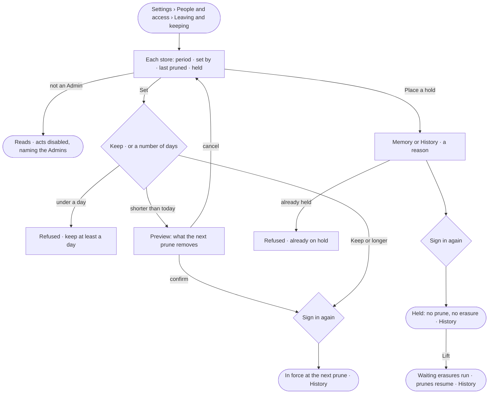

# AC-44 · Set how long memory and History are kept, and hold them

**As** an Admin **I want** to set how long each store — memory, History, what left the platform, the query log and recall — keeps
what the work leaves, and to put memory or History on legal hold **so that** the deployment keeps what our policy
says and nothing a matter needs is removed while it is open.

Tasks: [task.md](task.md) · Feature: [AC-F12](../../feature.md)

## Who can

| Lens | Can | Otherwise sees |
|---|---|---|
| Admin | Read and set each store's period, or *Keep*; place and lift a legal hold on memory or History, with a reason. Each change asks them to sign in again | — |
| Operator | Read each store's period, the holds and who set them; a Modeller reads the same | *Set*, *Place a hold* and *Lift* disabled — *Needs the Admin role — ask Priya or Lee* |

## Flow

## Acceptance criteria

| # | Given | When | Then |
|---|---|---|---|
| AC-44.1 | A fresh deployment | *Leaving and keeping* opens | memory, History, what left the platform, the query log and recall each read *Keep — nothing is removed until an Admin sets a period*, with no hold |
| AC-44.2 | An Admin | they set a store's period to a number of days, or to *Keep*, and sign in again | it is in force from the next prune; the row reads the period, who set it and when; History records the store, from and to |
| AC-44.3 | An Admin shortening a store's period | they set it | before it saves, a preview reads how many rows or nodes the next prune removes, counted by the engine, with *Confirm* and *Cancel* |
| AC-44.4 | An Admin | they set a period under one day | it is refused — *Keep at least a day, or keep everything* |
| AC-44.5 | A store with a period | the next prune runs | everything older than the period is removed, a whole window at a time, never chosen rows; the removal is a History row and the row reads when it last pruned |
| AC-44.6 | An Admin | they place a legal hold on memory or History with a reason and sign in again | the store reads *On hold* with the reason, who placed it and when; History records it |
| AC-44.7 | A store on hold | its prune comes, or someone forgets a subject or a person leaves | no prune runs on it; forgetting is refused (AC-46.6); a departed person's erasure from memory waits, reading *Waiting for the hold on memory to lift* (AC-45.6) |
| AC-44.8 | A store already on hold | an Admin places another hold on it | it is refused — *{store} is already on hold* |
| AC-44.9 | A hold | an Admin lifts it and signs in again | the store's prunes resume and every erasure waiting on it runs, oldest first; History records who lifted it and when |
| AC-44.10 | An Operator or a Modeller | they open *Leaving and keeping* | each store, hold and setting reads; *Set*, *Place a hold* and *Lift* are disabled, naming the Admin role and the Admins; the API refuses the write |
| AC-44.11 | A retention or hold change made with a key | it is sent | it is refused — it needs a person's session |
| AC-44.12 | The settings could not load or save | the sheet opens or a change is sent | it reads what failed, with *Try again*; nothing changes |

## Screens

| Surface | Lens | First use | Empty after a filter | Loading | Has data | Failed | Agent working or proposing | No access |
|---|---|---|---|---|---|---|---|---|
| Stores and holds | Admin | settings.keeping · Keep everything | — | settings.keeping · Loading | settings.keeping | settings.keeping · Could not load | settings.keeping · Waiting on a hold | — |
| Stores and holds | Operator | access.locked · Keeping · Keep everything | — | access.locked · Keeping · Loading | access.locked · Keeping | access.locked · Keeping · Could not load | access.locked · Keeping · Waiting on a hold | access.locked · Keeping |
| Set a period — preview | Admin | — | — | settings.keeping · Counting | settings.keeping · Preview | settings.keeping · Under a day | — | — |
| Set a period — preview | Operator | — | — | — | — | — | — | access.locked · Keeping |
| Place or lift a hold | Admin | — | — | — | settings.keeping · Hold | settings.keeping · Already held | — | — |
| Place or lift a hold | Operator | — | — | — | — | — | — | access.locked · Keeping |
