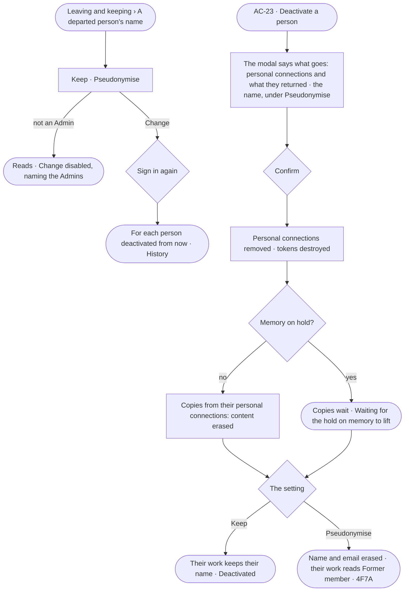

# AC-45 · Decide what happens to a person's name and personal data when they leave

**As** an Admin **I want** one setting that keeps or pseudonymises a departed person's name on their work, and their
personal-connection data erased when they leave **so that** the work stays whole and readable, and what was only
theirs does not stay behind them.

Tasks: [task.md](task.md) · Feature: [AC-F12](../../feature.md)

## Who can

| Lens | Can | Otherwise sees |
|---|---|---|
| Admin | Set *Keep* or *Pseudonymise* for departed people's names, signing in again; read before deactivating a person what will be erased (AC-23) | — |
| Operator | Read the setting; read a departed person's work under their name or their code; a Modeller reads the same | *Change* disabled — *Needs the Admin role — ask Priya or Lee* |

## Flow

## Acceptance criteria

| # | Given | When | Then |
|---|---|---|---|
| AC-45.1 | A fresh deployment | *A departed person's name* is read | it reads *Keep* |
| AC-45.2 | An Admin | they set *Pseudonymise* or *Keep* and sign in again | it applies to each person deactivated from then on, never to those already departed; History records from and to |
| AC-45.3 | An Admin deactivating a person (AC-23) | the modal opens | it says how many personal connections the person has and how many copies those connections returned, counted by the engine, that both are erased, and whether their name is kept or pseudonymised |
| AC-45.4 | A person deactivated | the deactivation saves | their personal connections are removed and their tokens destroyed; every copy whose sources include one of their personal connections reads its kind, when and who made it, its content *Erased — personal data of a person who left* |
| AC-45.5 | A person deactivated under *Keep* | their work is read — tasks, findings, decisions, History | it names them as before, marked *Deactivated* |
| AC-45.6 | Memory on hold | a person is deactivated | their personal connections are removed at once; the copies they returned wait, *Leaving and keeping* reading *Waiting for the hold on memory to lift*, and are erased when the hold lifts |
| AC-45.7 | A person deactivated under *Pseudonymise* | their work, History rows and exports are read | their name and email are gone; they read as *Former member · 4F7A*, the same code everywhere; each History row still verifies |
| AC-45.8 | An Operator or a Modeller | they reach *Change* | it is disabled, naming the Admin role and the Admins; the API refuses the write |
| AC-45.9 | A pseudonymised person | an Admin reactivates them (AC-23) | the Admin gives a name and an email again; nothing erased comes back |
| AC-45.10 | The setting could not save | it is sent | it stays as it was, saying why, with *Try again* |

## Screens

| Surface | Lens | First use | Empty after a filter | Loading | Has data | Failed | Agent working or proposing | No access |
|---|---|---|---|---|---|---|---|---|
| A departed person's name | Admin | settings.keeping · Keep | — | settings.keeping · Loading | settings.keeping · Pseudonymise | settings.keeping · Could not save | — | — |
| A departed person's name | Operator | access.locked · Keeping · Keep | — | access.locked · Keeping · Loading | access.locked · Keeping | — | — | access.locked · Keeping |
| What leaving erases — in the deactivate modal | Admin | settings.people · Deactivate · Nothing personal | — | settings.people · Deactivate · Loading | settings.people · Deactivate · What goes | settings.people · Deactivate · Could not save | settings.people · Deactivate · Waiting on a hold | — |
| What leaving erases — in the deactivate modal | Operator | — | — | — | — | — | — | access.locked · A person |
| A departed person's work | Admin | — | — | — | settings.people · Former member | — | — | — |
| A departed person's work | Operator | — | — | — | access.locked · Former member | — | — | access.locked · Former member |
