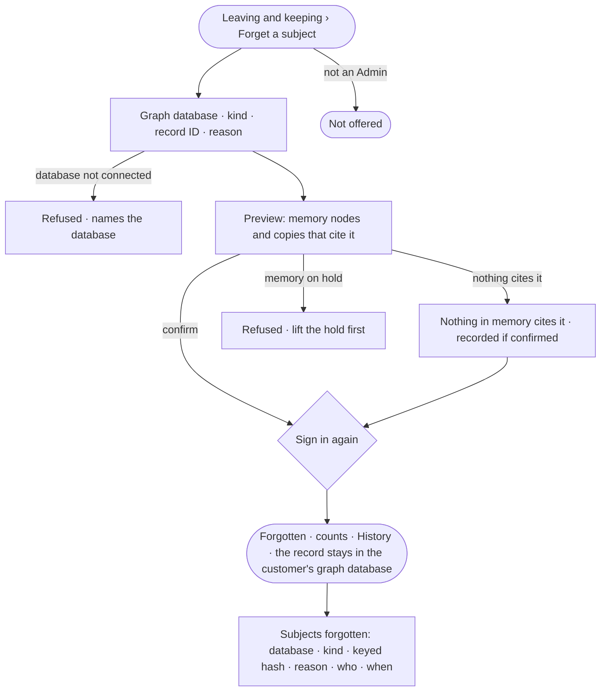

# AC-46 · Forget a subject everywhere memory cites them

**As** an Admin answering a person's request to be forgotten **I want** to name the record that is them and have every
memory node that cites it erased, found through lineage **so that** Invana keeps nothing about them in what the work
left, while the record itself stays the customer's to delete in their graph database.

Tasks: [task.md](task.md) · Feature: [AC-F12](../../feature.md)

## Who can

| Lens | Can | Otherwise sees |
|---|---|---|
| Admin | Forget a subject — a graph database, a kind and a record ID, with a reason — after its preview, signing in again; read the subjects forgotten | — |
| Operator | — ; a Modeller the same | *Forget a subject* and the subjects forgotten are not offered |

## Flow

## Acceptance criteria

| # | Given | When | Then |
|---|---|---|---|
| AC-46.1 | An Admin | they choose *Forget a subject* | a modal asks for the graph database, the kind, the record ID and a reason, and says the record itself stays in the customer's graph database |
| AC-46.2 | A record cited in memory | the Admin previews forgetting it | the engine counts the memory nodes that cite it and the copies built from them — answers, findings, reports, notes, transcripts — before anything changes |
| AC-46.3 | The preview | the Admin confirms and signs in again | every memory node citing the record loses it; each copy built from it reads its kind, when and who made it, its content *Erased — a forgotten subject*; the modal reads the counts the engine erased |
| AC-46.4 | A subject forgotten | History is read | one row names who forgot it, when, why, the database and kind, and the counts — never the record ID |
| AC-46.5 | A subject forgotten | memory is rebuilt, or recall runs | nothing it held before cites the record again |
| AC-46.6 | Memory on legal hold | an Admin tries to forget a subject | it is refused — *Memory is on legal hold — lift the hold first* |
| AC-46.7 | A record nothing in memory cites | the Admin previews it | it reads *Nothing in memory cites it*; confirming still records that it was forgotten |
| AC-46.8 | A graph database the deployment does not have | it is named | it is refused — *{database} is not connected* |
| AC-46.9 | Subjects forgotten | *Leaving and keeping* is read by an Admin | each reads its database, kind, keyed hash, reason, who and when, newest first; a filter that matches none reads *Nothing matches* with *Clear filters* |
| AC-46.10 | An Operator or a Modeller | they open *Leaving and keeping*, or call the route | *Forget a subject* is not offered; the API refuses it |
| AC-46.11 | A forget sent with a key | it is sent | it is refused — it needs a person's session |
| AC-46.12 | Forgetting could not finish | it is sent | nothing is erased in the store that failed, the modal says which, with *Try again* |

## Screens

| Surface | Lens | First use | Empty after a filter | Loading | Has data | Failed | Agent working or proposing | No access |
|---|---|---|---|---|---|---|---|---|
| Forget a subject | Admin | access.forget · Nothing cites it | — | access.forget · Counting | access.forget · Preview | access.forget · Could not finish | — | access.forget · On hold |
| Forget a subject | Operator | — | — | — | — | — | — | access.locked · Keeping |
| Subjects forgotten | Admin | settings.keeping · None forgotten | settings.keeping · Nothing matches | settings.keeping · Loading | settings.keeping · Forgotten | settings.keeping · Could not load | — | — |
| Subjects forgotten | Operator | — | — | — | — | — | — | access.locked · Keeping |
