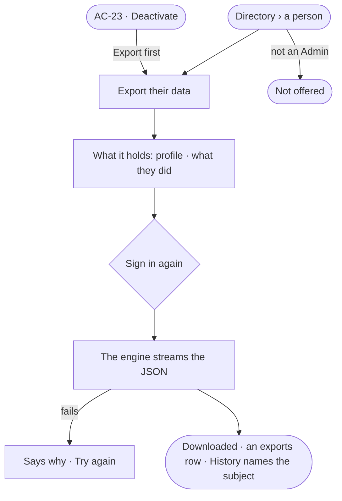

# AC-47 · Export everything held about a person

**As** an Admin answering a person's request for their data **I want** one JSON file of everything the deployment
holds about them — their profile and what they did **so that** I can hand them a
complete answer without searching store by store.

Tasks: [task.md](task.md) · Feature: [AC-F12](../../feature.md)

## Who can

| Access | Can | Otherwise sees |
|---|---|---|
| Admin | Export everything held about any person, active or deactivated, signing in again; read the exports made | — |
| Operator | — | *Export their data* is not offered on a person's row |

## Flow

## Acceptance criteria

| # | Given | When | Then |
|---|---|---|---|
| AC-47.1 | An Admin on a person's row | they choose *Export their data* | a modal lists what the file holds — profile and what they did — with the engine's counts |
| AC-47.2 | The modal | the Admin signs in again | a JSON file downloads with `profile` (username, name, email, policies, teams, agents granted, default agent, created, last signed in, deactivated), `work` (History rows they acted in or were behind, their conversations with their turns, tasks they set or were assigned, asks they raised or answered) |
| AC-47.3 | Any export | the file is read | it never holds a password hash, a key, a token or a secret |
| AC-47.4 | A subject export | History is read | one History row names who made it, for whom and its size |
| AC-47.5 | A person deactivated | an Admin exports their data | their profile and what they did export, marked *Deactivated* |
| AC-47.6 | An Admin deactivating a person (AC-23) | the modal opens | it offers *Export their data first*, and returns to the deactivate modal when the file has downloaded |
| AC-47.7 | An agent or the system user | an export is asked for them | it is refused — *{user} is not a person* |
| AC-47.8 | A person without Edit on `setting/retention` | they open a person's row, or call the route | *Export their data* is not offered; the API refuses it |
| AC-47.9 | An export asked with a key | it is sent | it is refused — it needs a person's session |
| AC-47.10 | The export fails while streaming | it is made | no exports row is written; the modal says why, with *Try again* |

## Screens

| Surface | Access | First use | Empty after a filter | Loading | Has data | Failed | Agent working or proposing | No access |
|---|---|---|---|---|---|---|---|---|
| Export their data | Admin | settings.people · Export their data · Nothing done yet | — | settings.people · Export their data · Exporting | settings.people · Export their data | settings.people · Export their data · Could not export | — | — |
| Export their data | Operator | — | — | — | — | — | — | settings.people · Export their data · Locked · A person |
| Export first — in the deactivate modal | Admin | — | — | — | settings.people · Deactivate · Export first | — | — | — |
| Export first — in the deactivate modal | Operator | — | — | — | — | — | — | settings.people · Locked · A person |
