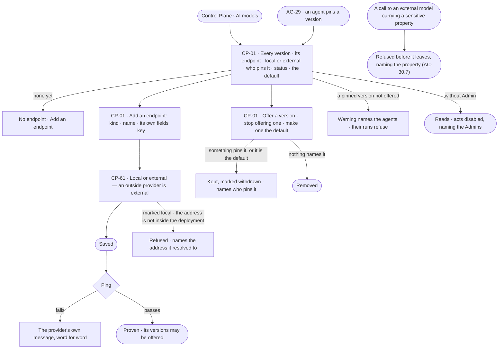

# AI models

> The model endpoints the deployment uses and every model version they offer, each by its exact name, marked **local**
> or **external**, with who pins it and which one answers by default. The decisions it helps make: *which model
> versions do we offer, which may see sensitive data, and can we stop offering one without breaking an agent?*

## User journey

Journeys this feature is a step of: [J01 · From a fresh deployment to a first answer](../../../../journeys/J01-from-a-fresh-deployment-to-a-first-answer.md) · [J07 · Ready a deployment](../../../../journeys/J07-ready-a-deployment.md)

## Stories

| ID | Story | Status |
|---|---|---|
| CP-01 | [Offer the model versions agents may pin](stories/CP-01-offer-the-model-versions-agents-may-pin/story.md) | idea |
| CP-61 | [Mark an AI model local or external](stories/CP-61-mark-an-ai-model-local-or-external/story.md) | idea |

## Access

The role × feature table is [AC-F02 › The role table](../../../access/features/AC-F02-access-policies/feature.md#the-role-table)
(*Workers and the queue · limits · AI models · skill scripts*: Operator Reads · Modeller Reads · Admin Acts); this is
what it means here.

| Act | Role | Everyone else sees |
|---|---|---|
| Read every endpoint, model version, local or external, status, the default and who pins it | Operator · Modeller · Admin | — |
| Add, edit, rename or remove an endpoint · mark it local or external · ping it · offer or stop offering a version · choose the default | Admin, with the password again for a key or a change to local | *Add an endpoint* and each act disabled — *Needs the Admin role — ask {admins}*; the key is never shown |
| Pin a version on an agent | As AG-29 | As AG-29 |

## States

| State | What the person sees |
|---|---|
| First use | No endpoint: *Add an endpoint*, and why a question cannot be answered without one |
| Empty after a filter | *No {local · external} model versions* · *Clear* |
| Loading | The section opens at once; rows fill in place |
| Has data | Every model version by its exact name — endpoint, *Local* or *External*, pinned by, status, *Default* on one — and each endpoint's last ping |
| Failed | A ping that failed, with the provider's own words; a local mark refused, naming the address; a removal or rename refused, naming who still names it |
| Agent working or proposing | — no agent changes the deployment's models |
| No access | Every row reads, never a key; each act is disabled, naming the Admins |

## Rules

| Rule | Detail |
|---|---|
| The deployment's | An endpoint is set up once for the deployment by an Admin; every agent and every run resolves through it |
| An endpoint holds many versions | One endpoint is one address and one credential; its model versions are rows under it, each by the provider's exact name |
| Its name is an address | `llm/<endpoint>/<version>` is what an agent's pin, the ledger and History carry; a person picks the name; lowercase letters, digits, hyphens and underscores |
| The form follows the provider | Anthropic · OpenAI · Google · Azure · Ollama · a local model · the Claude Agent SDK (which may use a local sign-in rather than a key) — only the fields that provider needs |
| Local or external | Every endpoint is **local** — run inside the deployment — or **external** — run by an outside provider; its versions carry the mark. An outside provider is always external; a local or self-hosted endpoint is external until an Admin marks it local |
| Local is proven | Marking an endpoint local is refused unless its address resolves inside the deployment — loopback or a private network; every call resolves it again, rebinding checked, and a call that resolves outside is held to external |
| Sensitive stays local | A call carrying a sensitive property ([SE-F03](../../../../capabilities/semantics/features/SE-F03-meaning/feature.md)) to an external model is refused before it leaves, naming the property — the check and its ledger row are [AC-F09](../../../access/features/AC-F09-what-left-the-platform/feature.md#rules)'s |
| Every call is ledgered | Each call records the model's address and whether it was local, schema-only or data-bearing ([AC-F09](../../../access/features/AC-F09-what-left-the-platform/feature.md)) |
| One default | An Admin makes one offered version the deployment's default; an agent that pins none uses it. With no default and no pin, the run is refused before it starts |
| Save, then ping | An endpoint is stored first and proven by a ping; the provider's own message is shown word for word, never reworded |
| Keys are sealed and never read back | Sealed under the install key; a blank key on edit keeps the stored one; setting one asks for the password again |
| A version nothing names can go | Removing a version, or renaming or removing an endpoint, that an agent, a skill version, an eval judge or the default names is refused, naming them |
| A pinned version stays listed | A version that something pins and is not offered reads *withdrawn*, naming who pins it; those agents' runs refuse rather than fall back |
| No release feed | Invana never says a newer version exists; an Admin offers the version they want |
| Failures name the provider | A rate limit, a stopped local model or a rotated key fails naming the endpoint — never as *cannot answer* |
| Leans on | Agents pinning a version (AG-F01 · AG-29) · sensitive properties (SE-F03) · the ledger and the sensitive check (AC-F09) · rate limits (CP-F04) · History (AC-F06) |

## Data touched

| Record | Read or write |
|---|---|
| Endpoints — name, kind, address, sealed credential, local or external, last ping | Read · write |
| Model versions — exact name, what it can do, status, default | Read · write |
| Pins — agents, skill versions, eval judges (AG-F01 · AG-F04) | Read |
| A ping's run (CP-F10) and History rows (AC-F06) | Write |

## Engine

The low-level design: what this feature stores, serves and refuses. Conventions — naming, errors, lists, events — are
[system-design.md](../../../../system-design.md) §§ 6–8; this section only fills them in.

### Records

| Table | Columns | Notes |
|---|---|---|
| `control_llm_endpoints` | `name` (`^[a-z0-9][a-z0-9_-]*$`) · `provider` (`anthropic` · `openai` · `google` · `azure` · `ollama` · `local` · `claude_agent_sdk`) · `credential_kind` (`api_key` · `local_sign_in` · `none`) · `api_key_sealed?` · `base_url?` · `locality` (`local` · `external`) · `last_ping_at?` · `last_ping_ok?` · `last_ping_error?` · `updated_by_id` · `updated_at` | An endpoint; `name` unique. The key is sealed under the install key and never serialised |
| `control_llms` | `endpoint_id` · `model_id` (the provider's exact name) · `display_name?` · `capabilities` (`context_window` · `supports_tools` · `embedding` · `cost_rank` · `power_rank`) · `status` (`offered` · `withdrawn`) · `is_default` | A model version under an endpoint; unique (`endpoint_id`, `model_id`); at most one `is_default`. Its address is `llm/<endpoint>/<model_id>`; its locality is its endpoint's |

### Reads

| Record | Owner |
|---|---|
| Pins — an agent's model version, a skill version's, an eval judge's | [AG-F01](../../../../capabilities/agents/features/AG-F01-build-an-agent/feature.md#engine) · [AG-F04](../../../../capabilities/agents/features/AG-F04-skills/feature.md#engine) |
| The AI model client every run calls, and a run's resolved model | [AG-F01](../../../../capabilities/agents/features/AG-F01-build-an-agent/feature.md#engine) |
| Sensitive properties | [SE-F03](../../../../capabilities/semantics/features/SE-F03-meaning/feature.md) |
| The sensitive check and the ledger row of each call | [AC-F09](../../../access/features/AC-F09-what-left-the-platform/feature.md#engine) |
| Rate limits per model version | [CP-F04](../CP-F04-limits/feature.md#engine) |
| A ping's run | [CP-F10](../CP-F10-runs-and-how-the-agents-are-doing/feature.md#engine) |
| History rows | [AC-F06](../../../access/features/AC-F06-history/feature.md#engine) |

### Routes

| Route, after `/api/v1/control/llms` | Does | Story |
|---|---|---|
| `GET /` | Every endpoint, by the list contract — search `name`, filter `kind` · `locality`, sort `created_at` · `name` · `-updated_at`; never a key | CP-01 · CP-61 |
| `POST /` | Add an endpoint `{name, provider, credential, base_url?, locality, password}` | CP-01 · CP-61 |
| `GET /{name}` · `PATCH /{name}` · `DELETE /{name}` | Read · edit (a blank key keeps the stored one; a new `name` renames; a key or `locality: local` needs `password`) · remove an endpoint | CP-01 · CP-61 |
| `POST /{name}/ping` | Ping it: opens a run, stores `last_ping_*` | CP-01 |
| `GET /{name}/models` | Its model versions — search `model_id`, filter `status` | CP-01 |
| `POST /{name}/models` · `PATCH /{name}/models/{model_id}` · `DELETE /{name}/models/{model_id}` | Offer a version · edit its ranks or status · remove it | CP-01 |
| `PUT /default` | `{address}` — make one offered version the deployment's default | CP-01 |
| `GET /pins` | Each address with who pins it — agents, skill versions, judges — and whether it is the default | CP-01 |

### Events

| Event | When |
|---|---|
| `control.llm_endpoints.create` · `.update` · `.delete` · `.ping` | An endpoint is added, edited (a locality change carries old and new), removed or pinged |
| `control.llms.add` · `.update` · `.remove` · `.default` | A model version is offered, edited or withdrawn, removed, or made the default |

### Refusals

| Status | When | Sentence | Criterion |
|---|---|---|---|
| 403 | Any write by anyone but an Admin | *Needs the Admin role — ask {admins}.* | CP-01.12 |
| 401 | Setting a key or marking an endpoint local without the password, with a wrong one, or with a key | *Enter your password again to do this.* | CP-61.6 |
| 422 | An endpoint name outside `^[a-z0-9][a-z0-9_-]*$` | *Use lowercase letters, digits, hyphens and underscores.* | CP-01.9 |
| 409 | An endpoint name already taken | *{name} is taken.* | API only — the form checks it as it is typed |
| 422 | Marking local an endpoint of an outside provider, or one whose address resolves outside the deployment | *{address} resolves to {ip}, outside the deployment — it stays external.* | CP-61.3 · CP-61.4 |
| 409 | Removing a version, or renaming or removing an endpoint, that something pins or that is the default | *{address} is named by {pins}.* | CP-01.6 · CP-01.20 |
| 409 | A run whose pinned version is withdrawn or not offered | *{address} is not offered — {agent} pins it.* | CP-01.7 |
| 422 | A run with no pin and no default | *No AI model answers — ask {admins}.* | CP-01.22 |
| step | A call carrying a sensitive property to an external model | *{property} is sensitive — it never goes to an external model.* — AC-F09's | CP-61.7 |

### CLI

| Command | Does |
|---|---|
| `invana llms list` | Every endpoint, its kind, local or external and last ping — never a key |
| `invana llms models <endpoint>` | Its model versions by address — what `agents pin --model` takes |

### Mechanisms

| Mechanism | How |
|---|---|
| A call's unit | `LLMEndpoint` — the endpoint, the model version, its locality and its credential, resolved once when a run opens from the agent's pin, else the default; a run with neither is refused before it starts |
| Locality per call | Each call resolves the endpoint's address; `local` holds only when it resolves to loopback or a private network, rebinding checked; otherwise the call is treated as external and the ledger row says so ([AC-F09](../../../access/features/AC-F09-what-left-the-platform/feature.md#mechanisms)) |
| Marking local | Saving `locality: local` resolves the address once and refuses it outside the deployment; an outside provider's kind cannot be local |
| A ping | A run of kind `system` that calls the endpoint once; the provider's message is stored in `last_ping_error` word for word |
| Ranks | `cost_rank` · `power_rank` are seeded from the published rate when a version is offered; no published rate, or a subscription endpoint, ranks in the middle; an Admin may edit both, and nothing derives over an edit |
| Withdrawn | Stopping an offered version that something pins, or the default, sets `status: withdrawn`; one nothing names is deleted |
| One cache | Only the model call is cached: keyed by a hash of endpoint, model version, prompt and parameters, with a configured time to live; the step records `cached` so a cached run is never read as a cheap one. Query results are never cached |
| A rate limit is backpressure | A 429 is `transient`, retried with backoff and jitter; the per-model wait is [CP-F04](../CP-F04-limits/feature.md#engine) |

## System impact

| HLD section | Change | NFRs |
|---|---|---|
| § 6 Data and storage | Two tables in Postgres; a key sealed under the install key | — |
| § 8 APIs and events | `/api/v1/control/llms` routes and `control.llm_endpoints.*` · `control.llms.*` events | — |
| § 10 AI and agents | One model per call; no failover; one cache on the model call; local or external resolved per call | — |
| § 11 Failure modes and the outside boundary | A provider's failure is named with the endpoint and its own words; Invana inherits the provider's availability | — |
| § 12 Qualities | Security and privacy: keys never read back; local proven per call; a sensitive property never reaches an external model | NFR-SEC-2 · NFR-SEC-8 |

## Decisions

| Decision | Detail |
|---|---|
| AI models are the Control Plane's | *AI models* lists every endpoint and version; an endpoint's detail and adding one are modals |
| Local is a claim the engine checks | An Admin says local; the engine believes it only while the address resolves inside the deployment |
| One default model | With no per-question picker and no view of the graph, the default is what answers when an agent pins nothing |
| A ping is a run | Who proved an endpoint worked, when, and what it said, is a run like any other |
| A model is ranked when offered | Cost and capability ranks come from the published rate; a deployment on a negotiated rate sets its own; a subscription endpoint ranks in the middle |
| One model per call | No automatic failover — a silent switch changes what produced an answer |

## Open questions

| Question | Who answers |
|---|---|
| — | — |

## Not building

| Item | Why not |
|---|---|
| A model picker when asking | The agent's pin or the default answers; a second place to choose is one too many |
| Automatic failover between endpoints | A silent switch changes what produced an answer |
| Quotas per endpoint | Spend is limited per team, user and agent (CP-F04) |
| Access Policy rules on models | Policies name what an agent touches; which data may reach a model is the local or external mark and sensitive properties |
| Fetching a provider's catalogue | A typed exact name is enough and does not move when a catalogue does |
