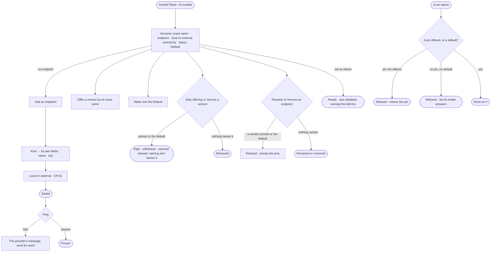

# CP-01 · Offer the model versions agents may pin

**As** an Admin **I want** every model endpoint and model version by its exact name, local or external, who pins
which, which one is the default, and what is withdrawn **so that** the first question never fails on configuration,
and no agent breaks on a model nobody serves.

Tasks: [task.md](task.md) · Feature: [CP-F01](../../feature.md)

## Who can

| Lens | Can | Otherwise sees |
|---|---|---|
| Admin | Add, edit, rename and remove an endpoint; ping it; offer and stop offering a version; make one the default | — |
| Operator | Operator · Modeller: read every endpoint, version, local or external, status, the default and who pins it ([the role table](../../../../../access/features/AC-F02-access-policies/feature.md#the-role-table)) | *Add an endpoint*, *Ping* and each act disabled — *Needs the Admin role — ask {admins}*; keys are never shown |

## Flow

## Acceptance criteria

| # | Given | When | Then |
|---|---|---|---|
| CP-01.1 | Anyone signed in | they open *AI models* | every model version reads by its exact name, with its endpoint, *Local* or *External*, who pins it — agents, skill versions, eval judges — its status: offered · withdrawn · not offered — and *Default* on one |
| CP-01.2 | A deployment with no endpoint | the section opens | it says no question can be answered yet and offers *Add an endpoint* |
| CP-01.3 | An Admin adding an endpoint | they pick its kind | only that provider's fields show; the Claude Agent SDK may use a local sign-in rather than a key |
| CP-01.4 | A new endpoint | it is saved | it is stored, then *Ping* proves it; a failure shows the provider's message word for word |
| CP-01.5 | A saved endpoint | it is edited with the key left blank | the stored key is kept; the key is never read back |
| CP-01.6 | A version an agent, a skill version or an eval judge pins, or the default | the Admin removes it, or renames its endpoint | it is refused — *{address} is named by {pins}* |
| CP-01.7 | A version an agent pins | the Admin stops offering it | it stays listed as *withdrawn*, with a warning naming who pins it; those agents' runs refuse — *{address} is not offered — {agent} pins it* — and nothing falls back |
| CP-01.8 | A version nothing names | the Admin removes it | it is removed |
| CP-01.9 | An endpoint name | it is not lowercase letters, digits, hyphens and underscores | it is refused — *Use lowercase letters, digits, hyphens and underscores* |
| CP-01.10 | A provider that rate-limits, a local model that is not running, or a rotated key | a run calls it | the run fails, naming the endpoint and the provider's message — never as *cannot answer* |
| CP-01.11 | A ping | it runs | it is a run; History records who pinged, when and the result (AC-F06) |
| CP-01.12 | An Operator or a Modeller | they open AI models, or call a write route | everything reads but keys; *Add an endpoint*, *Ping* and every act are disabled — *Needs the Admin role — ask {admins}* — and the route answers 403 |
| CP-01.13 | A model version | it is read | it shows *Local* or *External*, its endpoint's mark (CP-61) |
| CP-01.14 | An Admin | they make an offered version the *Default* | it reads *Default* and no other version does; an agent that pins none runs on it |
| CP-01.15 | An endpoint marked local | a call goes to it | it counts as local only when the engine resolves its address to loopback or a private network at that call, rebinding checked; one that resolves elsewhere is treated as external, and *What left the platform* records it so (CP-61 · AC-F09) |
| CP-01.16 | An Admin adding or editing an endpoint | they set it local or external | an outside provider is always external; a local or self-hosted endpoint is external until marked local, as CP-61 says |
| CP-01.17 | A filter by *Local* or *External* | nothing matches | it reads *No {local · external} model versions*, with *Clear* |
| CP-01.18 | An Admin on an endpoint | they add a model version by the provider's exact name | it lists under that endpoint as *offered*, ranked from its published rate (CP-F01 › Decisions) |
| CP-01.19 | An Admin | they change an endpoint's address or its own fields | the change is stored, *Ping* proves it again, and History records who changed it and when (AC-F06) |
| CP-01.20 | An Admin | they remove an endpoint | it is refused while something pins one of its versions or one is the default — *{address} is named by {pins}*; otherwise the endpoint and its versions are removed |
| CP-01.21 | Anyone on the command line | they run `invana llms list` or `invana llms models` | the endpoints, their model versions and local or external read as the section shows them, never a key |
| CP-01.22 | An agent that pins no version, with no default set | a person asks a question or an agent run starts | it is refused before the run starts — *No AI model answers — ask {admins}* |

## Screens

| Surface | Lens | First use | Empty after a filter | Loading | Has data | Failed | Agent working or proposing | No access |
|---|---|---|---|---|---|---|---|---|
| AI models | Admin | settings.ai · No endpoint | settings.ai · Nothing matches | settings.ai · Loading | settings.ai | settings.ai · Withdrawn | — | — |
| AI models | Operator | settings.ai · No endpoint | settings.ai · Nothing matches | settings.ai · Loading | settings.ai · Read only | settings.ai · Withdrawn | — | settings.ai · Read only |
| An endpoint | Admin | settings.ai · Add an endpoint | — | settings.ai · Pinging | settings.ai · Endpoint | settings.ai · Ping failed | — | — |
| An endpoint | Operator | — | — | settings.ai · Loading | settings.ai · Endpoint · Read only | settings.ai · Ping failed | — | settings.ai · Read only |
