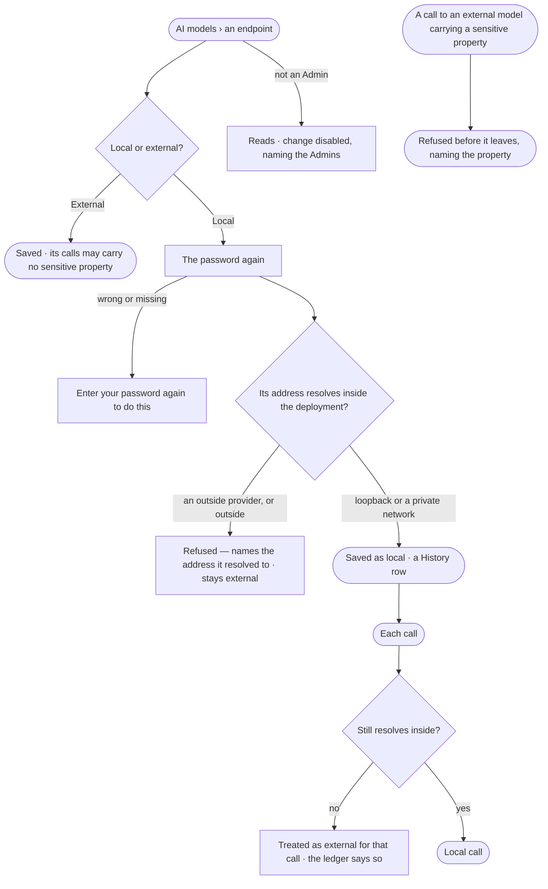

# CP-61 · Mark an AI model local or external

**As** an Admin **I want** each AI model endpoint marked local — running inside the deployment — or external — run by
an outside provider **so that** sensitive properties only ever reach a model we run ourselves, and everyone can see
which models data may leave the platform through.

Tasks: [task.md](task.md) · Feature: [CP-F01](../../feature.md)

## Who can

| Access | Can | Otherwise sees |
|---|---|---|
| Admin | With Edit on `setting/ai-models`, mark an endpoint local or external, with the password again to mark it local | — |
| Operator | Read each endpoint's and version's *Local* or *External* mark ([the permission catalogue](../../../../../access/features/AC-F02-access-policies/feature.md#the-permission-catalogue)) | *Local · External* reads; changing it is disabled — *Needs Edit on AI model settings — ask {who can grant}* |

## Flow

## Acceptance criteria

| # | Given | When | Then |
|---|---|---|---|
| CP-61.1 | AI models | it is read | every endpoint and each of its versions reads *Local* or *External* |
| CP-61.2 | A new endpoint of an outside provider — Anthropic, OpenAI, Google, Azure | it is added | it is *External*, and *Local* is not offered |
| CP-61.3 | A self-hosted endpoint whose address resolves to loopback or a private network | an Admin marks it *Local* with the password | it saves as *Local* and History holds a row naming who and the address |
| CP-61.4 | A self-hosted endpoint whose address resolves outside the deployment | an Admin marks it *Local* | *{address} resolves to {ip}, outside the deployment — it stays external*; nothing changes |
| CP-61.5 | A local endpoint whose address resolves outside the deployment at a call | the call is made | it is treated as external for that call, and History reads it as *external* (AC-F06) |
| CP-61.6 | Marking *Local* without the password, with a wrong one, or with a key | it is saved | *Enter your password again to do this*; nothing changes |
| CP-61.7 | A call that would carry a sensitive property to an external model | the agent makes it | it is refused before it leaves, naming the property (AC-42) |
| CP-61.8 | An Operator | they read AI models | the marks read; changing one is disabled — *Needs Edit on AI model settings — ask {who can grant}*; the route answers 403 |
| CP-61.9 | A filter for *Local* or *External* with no match | it is applied | *No {local · external} model versions* and *Clear* |
| CP-61.10 | The read fails | AI models opens | what could not be read, in the engine's words, and *Retry* |
| CP-61.11 | An Admin | they press *Mark as Local* on an endpoint's *Locality* | *Sign in again* names *Mark as Local* and returns to *Locality · Local*; a wrong password returns to the same *Sign in again* with the message and the mark unchanged; an address that resolves outside the deployment reads *Stays external* |

## Screens

| Surface | Access | First use | Empty after a filter | Loading | Has data | Failed | Agent working or proposing | No access |
|---|---|---|---|---|---|---|---|---|
| AI models — local or external | Admin | settings.ai · No endpoint | settings.ai · No match | settings.ai · Loading | settings.ai · Local or external | settings.ai · Stays external | — | — |
| AI models — local or external | Operator | settings.ai · No endpoint | settings.ai · No match | settings.ai · Loading | settings.ai · Local or external | settings.ai · Could not load | — | settings.ai · Read only |
| Mark as Local · Locality | Admin | — | — | — | settings.ai · Endpoint · Locality | — | — | — |
| Mark as Local · Locality | Operator | — | — | — | — | — | — | settings.ai · Read only |
| Mark as Local · Sign in again | Admin | — | — | — | access.signin · Sign in again · Mark as Local | access.signin · Sign in again · Mark as Local · Wrong password | — | — |
| Mark as Local · Sign in again | Operator | — | — | — | — | — | — | settings.ai · Read only |
| Mark as Local · Marked | Admin | — | — | — | settings.ai · Endpoint · Locality · Local | settings.ai · Stays external | — | — |
| Mark as Local · Marked | Operator | — | — | — | — | — | — | settings.ai · Read only |
