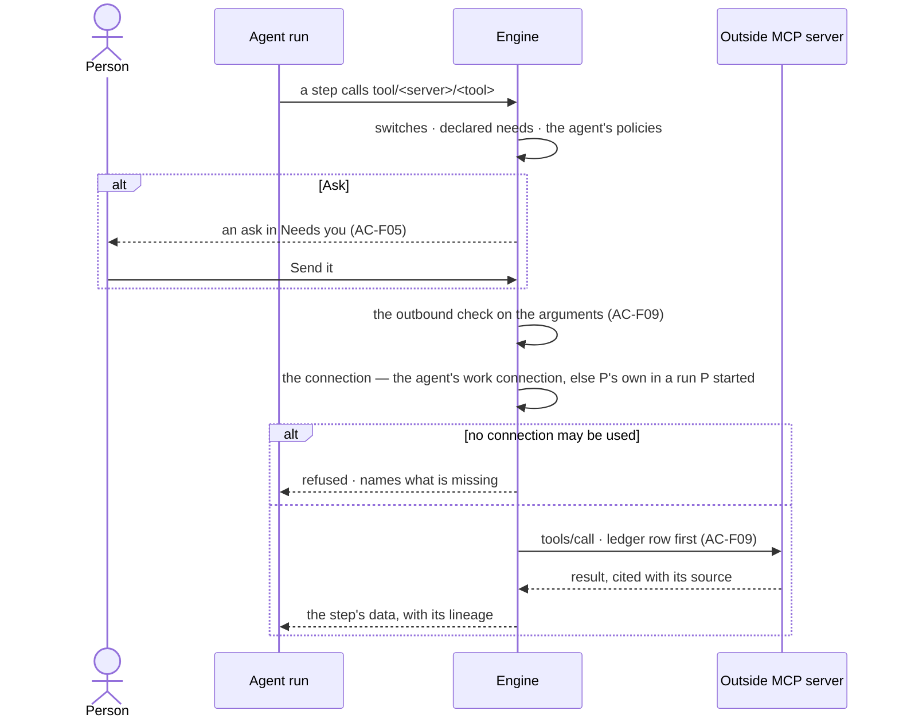

# Plugins and MCP

> Where the deployment meets the outside, in both directions: the plugins agents call — the core plugins that are the
> product, the tools Invana ships, every outside MCP server an Admin adds, the Team packs and the **runtime plugins**
> that let an agent run with Claude Code or Codex — each switched on by an Admin and off for the runs a person starts;
> the connections Invana holds to reach an outside server — **work
> connections**, service identities an Admin makes and attaches to agents, and **personal connections**, a person's own
> account used only in the runs they start; what every plugin declares it needs; and the deployment's one MCP server
> that Claude Code and other clients call through a person's default agent. The decision it helps make: *what may
> agents reach outside Invana, as whom, and what may the outside reach in here?*

## User journey

Journeys this feature is a step of: [J07 · Ready a deployment](../../../../journeys/J07-ready-a-deployment.md)

```mermaid
flowchart TD
  s([Settings › Invana › Plugins]) --> pl["CP-04 · Every plugin: core · tool · outside server · pack · on or off · who switched it"]
  pl -->|core| always(["Always on · no switch"])
  pl -->|Admin turns a plugin on| on(["On for the deployment · from the next step"])
  pl -->|not an Admin| ro["The deployment's switch reads · Ask an Admin"]
  pl -->|anyone · off for me| mine(["CP-63 · Off only for the runs I start"])
  pl --> nd["CP-44 · What it needs · which agents may use it"]
  nd -->|a need no policy allows · no connection| miss(["Missing · names the rule, mode or connection · AC-13"])
  pl -->|Admin · Add a server| add["CP-02 · Address · name · how Invana signs in"]
  add -->|cannot list its tools · address refused| af(["Names the address and what failed · nothing stored"])
  add --> cr["CP-42 · None · a token · OAuth · may people connect their own?"]
  cr --> wc["CP-62 · Admin makes a work connection — a service identity · sealed"]
  wc -->|a second Admin's yes is on| aw(["Waits for another Admin · not in force until then"])
  wc --> att["CP-62 · A Modeller or an Admin attaches it to agents"]
  cr -->|people may connect their own| per["CP-43 · A person connects their own account"]
  per --> own(["CP-63 · Used only in runs that person starts and their helpers"])
  add -->|listed| fz(["Tools frozen · off until an Admin turns it on"])
  fz --> rf["CP-02 · Read its tools again → a new revision"]
  pl -->|a runtime plugin · Admin| rti["CP-64 · Install Claude Code or Codex: its versions · where its model runs · what it needs"]
  rti -->|not an Admin| rtr(["Reads · Install disabled, naming the Admins"])
  rti --> rtg(["Carried by the worker groups an Admin picks (CP-10) · offered in Runs with (AG-61)"])
  rti -->|agents still run with it · Remove| rtb(["Refused, naming the agents"])
  pl -->|a Team pack| pk["CP-20 · Install: each piece offered in its own product"]
  pk -->|a piece clashes| pkc(["Names the piece · nothing installed"])
  pk -->|not an Admin| pkr(["Reads · Install disabled, naming the Admins"])
  pk -->|its Access Policy files| pkp(["Drafts · Waiting for an Admin to apply · decide nothing until then (AC-04)"])
  pk -->|its agents| pka(["In the catalogue as Team pack agents · granted to nobody until an Admin grants them (AG-35)"])
  pk -->|its .mcp.json names a server| pks(["Listed for an Admin to add — CP-02 · never started"])
  m([Settings › Invana › MCP server]) --> sv["CP-03 · Address · what it serves · how to connect · recent calls"]
  sv -->|Admin| sw(["Serve or stop serving an agent or a record tool"])
  out([Claude Code · an IDE · a script]) --> tok{"A connected client (AC-F11) or a key (AC-F10)?"}
  tok -->|neither| rj(["401 · where to find the metadata"])
  tok -->|yes| run(["CP-03 · Lists served ∩ what the default agent may use · each call a run for the person"])
  run -->|a call the agents may not make| den(["Refused · names the rule · recorded"])
  run -->|a confidential or personal value in the result| red(["Left out and named · AC-42"])
```

## Stories

| ID | Story | Status |
|---|---|---|
| CP-04 | [See every plugin and switch it on or off](stories/CP-04-see-every-plugin-and-switch-it-on-or-off/story.md) | idea |
| CP-44 | [See what a plugin needs and which agents may use it](stories/CP-44-see-what-a-plugin-needs-and-which-agents-may-use-it/story.md) | idea |
| CP-02 | [Add an outside MCP server and let agents call its tools](stories/CP-02-add-an-outside-mcp-server-and-let-agents-call-its-tools/story.md) | idea |
| CP-42 | [Choose how Invana signs in to an outside server](stories/CP-42-choose-how-invana-signs-in-to-an-outside-server/story.md) | idea |
| CP-62 | [Make a work connection and attach it to agents](stories/CP-62-make-a-work-connection-and-attach-it-to-agents/story.md) | idea |
| CP-43 | [Connect my own account to an outside server](stories/CP-43-connect-my-own-account-to-an-outside-server/story.md) | idea |
| CP-63 | [Connect my own accounts for my own runs](stories/CP-63-connect-my-own-accounts-for-my-own-runs/story.md) | idea |
| CP-03 | [Let Claude Code and other clients use the deployment](stories/CP-03-let-claude-code-and-other-clients-use-the-deployment/story.md) | idea |
| CP-20 | [Install a Team pack](stories/CP-20-install-a-team-pack/story.md) | idea |
| CP-64 | [Install an agent runtime](stories/CP-64-install-an-agent-runtime/story.md) | idea |

## Access

| Act | Role ([the role table](../../../access/features/AC-F02-access-policies/feature.md#the-role-table)) | Everyone else sees |
|---|---|---|
| Read every plugin, its functions and versions, what each needs, its switches and who set them | Every signed-in person — Operator, Modeller, Admin | — |
| Turn a plugin on or off for the deployment | Admin | The deployment's switch reads, naming who set it — *Ask an Admin — Priya or Lee* |
| Turn a plugin off, or back on, for the runs one starts | Every signed-in person, for themselves | — |
| Add an outside MCP server · read its tools again | Admin | *Add a server* and *Read its tools again* are disabled, naming the Admins |
| Set how Invana signs in to an outside server · set or clear a shipped tool's secret | Admin, in a session, with the password again | Disabled, naming the Admins; a secret never reads back to anyone |
| Make, renew or remove a work connection | Admin, in a session, with the password again; a second Admin's yes when the deployment asks for it ([AC-F02](../../../access/features/AC-F02-access-policies/feature.md#rules)) | Every work connection reads — its server, label, state and the agents it is attached to; acts disabled, naming the Admins |
| Attach a work connection to an agent · take it off | Modeller · Admin, as building an agent | Reads on the agent; disabled, naming the Modeller role |
| Read every work connection and the agents each is attached to | Every signed-in person | — |
| Connect or disconnect one's own personal connection to an outside server | Every person with an active account, in a session, with the password again | A service user, an agent and the system user have no personal connection; shared work never uses one |
| Read and disconnect any person's personal connection | Admin, in a session, with the password again | Another person's personal connection is absent |
| Install or remove a Team pack | Admin | *Install* and *Remove* are disabled, naming the Admins |
| Apply an Access Policy file a Team pack brought | Admin, as [AC-F02](../../../access/features/AC-F02-access-policies/feature.md#access) | The file reads *Waiting for an Admin to apply*; *Apply* is disabled, naming the Admin role |
| Install or remove a runtime plugin · read every runtime, what it declares and which groups carry it | Admin installs and removes · Operator, Modeller and Admin read | *Install* and *Remove* are disabled, naming the Admins |
| Read the deployment's MCP server — address, what it serves, how to connect | Every signed-in person | — |
| Serve or stop serving an agent or a record tool over the MCP server | Admin | The switches read, naming the Admins |
| Read the MCP server's recent calls | Every signed-in person, their own calls · Admin, every call | Another person's calls are absent |
| Call the MCP server | A connected client as its person ([AC-F11](../../../access/features/AC-F11-connect-an-mcp-client/feature.md)) · a key as key ∩ owner ([AC-F10](../../../access/features/AC-F10-keys/feature.md)) | `401`, saying where to find the metadata |
| Say yes to an outside tool call | As [AC-F05](../../../access/features/AC-F05-asks-and-approvals/feature.md) | As AC-F05 |

## States

| State | What the person sees |
|---|---|
| First use | Plugins: the core plugins on; every tool plugin and pack off · outside servers: none, *Add a server* · work connections: none, *Make a work connection* · personal connections: *No accounts connected* · the MCP server: nothing served, *No calls yet*, with how to connect |
| Empty after a filter | *Nothing matches*, with the filter named and *Clear filters* |
| Loading | The section opens at once; rows fill in place |
| Has data | Plugins with both switches and who set them · each function with its version and needs · outside servers with their tools, revision and how Invana signs in · each server's work connections and the agents each is attached to · a person's personal connections and the runs that used them · what the MCP server serves and its recent calls |
| Failed | A server that cannot be reached or an address refused, named with what failed; a plugin not installed, naming its extra; a connection whose sign-in expired, *Reconnect*; a call refused, naming the rule or the missing connection |
| Agent working or proposing | A run reaching an outside tool waits for a yes in Needs you (AC-F05) |
| No access | Every list reads; the deployment's switches, *Add a server*, connections and serving are disabled, naming the role they need |

## Rules

| Rule | Detail |
|---|---|
| A plugin is a Claude plugin | Every plugin is a folder in the Claude plugin layout — `.claude-plugin/plugin.json`, `skills/`, `agents/`, `.mcp.json` — with Invana's own fields under `metadata` in `plugin.json` ([Mechanisms › A plugin's folder](#mechanisms)). A plugin made for Claude Code reads as one, and a plugin made here is one |
| Hooks and commands never load | A plugin's `hooks/` and `commands/` are code and prompts for a person at a terminal: a plugin that carries either does not load, naming the file |
| A plugin is a package | A versioned package of functions, skills and built-in workflows, of five kinds: **core** — the product, in the engine · **tool** — one that reaches outside, every one an MCP server · **outside server** — an MCP server an Admin adds, one plugin each · **pack** — a Team pack · **runtime** — the adapter for an outside runtime an agent may run with |
| A runtime plugin | An adapter for one outside runtime — Claude Code or Codex — installed by an Admin and carried by the worker groups an Admin picks ([CP-F03](../CP-F03-workers-and-the-queue/feature.md)). It declares the runtime versions it drives, where the runtime's model runs — *local* or *external* — and the files, programs and hosts the runtime needs; a declaration grants nothing — only the agent's Access Policies do ([AC-37](../../../access/features/AC-F02-access-policies/stories/AC-37-say-what-an-agent-may-touch-on-a-worker/story.md)). An *external* model makes every session's prompt an outbound exit ([AC-F09](../../../access/features/AC-F09-what-left-the-platform/feature.md#rules)). Invana's own runtime is core: always installed, always carried |
| A runtime in use stays | A runtime plugin that an active or paused agent runs with is not removed; switching it off refuses those agents' new runs, naming who switched it off |
| A connection that fails is told | A work or personal connection that cannot sign in — expired, revoked, refused — raises a connection failed alert ([CP-F11](../CP-F11-ops-alerting/feature.md#the-alert-kinds)); it closes when the connection signs in again, is renewed or is removed |
| The default kit | Core: `graph.read` · `graph.write` · `graph.stitch` · `data` · `model` · `nl` · `plan` · `work` · `answer` · `board` · `thinking` · `ledger`. Tools: `web` · `mail`. Packs: Life sciences · [Software delivery](../../../../packs/software-delivery.md). Graph database connectors are [CP-F05](../CP-F05-graph-databases/feature.md#mechanisms)'s and channels [CP-F08](../CP-F08-the-inbox/feature.md#rules)'s, never plugins |
| No domain in the core | A domain arrives whole as a pack. The Life sciences pack carries the `science` tools — PubMed, UniProt, PubChem — and the genomic simulator with its starter, meaning and project types |
| Core is always on | A core plugin has no switch at either level |
| New starts off | A tool plugin, an outside server and an installed pack start off until an Admin turns them on |
| Two switches | The deployment's — Admin only, a hard off for everyone and a ceiling on every run · a person's own — off narrows only the runs that person starts and their helpers, and never turns on what the deployment has off; a schedule, a pick-up and a service user's run are not narrowed by anyone's own switch |
| Off means refused before it starts | Work that needs a plugin that is off is refused before it starts, naming who switched it off; a schedule skips its firing and raises an ops alert; a workflow that needs it is flagged and its runs refused until it is on |
| Switching takes effect at the next step | No restart; a step already running finishes |
| Every function declares what it needs | Each function's manifest names the verbs and resources it needs — an outside tool needs Run on its own `tool/<plugin>/<tool>`. It is usable when every need is within the agent's policies and the graph database's mode allows it; the gate is [AC-F04](../../../access/features/AC-F04-what-an-agent-may-touch/feature.md#rules)'s. A declaration grants nothing. A function that needs nothing says so with an empty list; a manifest with no `needs` does not load |
| Outside tools start at Ask | Every outside call is Run on `tool/<plugin>/<tool>`; the built-in policies set every tool to Ask ([AC-F02](../../../access/features/AC-F02-access-policies/feature.md#mechanisms)), so a call waits for a yes in Needs you until an Admin writes a rule that allows it. Its ask reads as a send — *Send it* · *Not this time* |
| Every outside call passes the outbound check | A tool's arguments are an exit: one carrying a confidential or personal value is refused before it leaves, naming the property ([AC-F09](../../../access/features/AC-F09-what-left-the-platform/feature.md#rules)) |
| Every outside call is ledgered | Outbound, with what it carried, before its result is used ([AC-F09](../../../access/features/AC-F09-what-left-the-platform/feature.md)) |
| Outside answers are data | A tool's result is cited with its source, carries its lineage ([GP-F02](../../../graph/features/GP-F02-memory/feature.md#engine)) and is never followed as an instruction |
| Credentials are never an environment variable | An outside server signs in with nothing, a token, or OAuth; every credential is sealed under the install key, never read back, and setting one asks for the password again. A shipped tool's settings — the mail server, the web search address — are the deployment's own secrets |
| Work connections | A **work connection** is a service identity on one outside server — a token, or an OAuth sign-in as a service account — made once by an Admin and attached to agents by a Modeller or an Admin ([CP-62](stories/CP-62-make-a-work-connection-and-attach-it-to-agents/story.md)). An agent holds at most one work connection per server. Shared work — a schedule, a pick-up, a service user's run, a delegation no person started — uses only work connections |
| Personal connections | A **personal connection** is a person's own account on a server that allows them, over OAuth ([CP-43](stories/CP-43-connect-my-own-account-to-an-outside-server/story.md)). It is used only in runs that person starts and their helpers — never in shared work, never for anyone else ([CP-63](stories/CP-63-connect-my-own-accounts-for-my-own-runs/story.md)). What it returns is a copy whose source is that person's connection: it shows only to them ([GP-F02](../../../graph/features/GP-F02-memory/feature.md#engine)) |
| Which connection a call uses | The work connection attached to the agent, when there is one; otherwise, in a run a person started, that person's personal connection; otherwise the call is refused before it leaves, naming what is missing |
| A second Admin's yes, when set | With the deployment setting on, making, renewing or removing a work connection waits for another Admin's yes and is not in force until then ([AC-F02](../../../access/features/AC-F02-access-policies/feature.md#rules)) |
| Addresses are checked | An outside address that is not `https`, or resolves to a loopback, link-local or the deployment's own address, is refused, at add and at every call |
| An outside server's tools are frozen | The list an Admin saw when adding it; a later change on the server reaches no plan until an Admin reads its tools again, which is a new revision |
| A function keeps its version | Each function versions on its own; a run records the version it ran; after a breaking version the previous one serves re-runs |
| Outside work runs on workers | Tool steps run on workers, never in the engine serving Studio; with no worker free they wait, then fail saying no worker took them |
| One MCP server for the deployment | `https://<deployment>/mcp`. Its sign-in is the Access Plane's — a connected client ([AC-F11](../../../access/features/AC-F11-connect-an-mcp-client/feature.md)) or a key ([AC-F10](../../../access/features/AC-F10-keys/feature.md)); this feature owns what it serves |
| It serves what an Admin chose, as far as the default agent may go | Nothing is served at first. An Admin serves agents — each as `ask_<agent>` — and the record tools *Check records* and *Load records*. A caller acts through the person's default agent ([AC-F02](../../../access/features/AC-F02-access-policies/feature.md#rules)): it lists only what is served, granted to the person and within the default agent's reach, and every call is checked again by the one evaluator |
| Every call is a run | For the person behind the client or the key: the served agent — the Loader for the record tools — runs as the default agent's helper, so the caller chain narrows it ([AC-F04](../../../access/features/AC-F04-what-an-agent-may-touch/feature.md#rules)); in Runs, History and the ledger; a refusal before a run is recorded, not run |
| A client is outside | What a call returns to a client passes the outbound check as an external target: a confidential or personal value is left out and named ([AC-F09](../../../access/features/AC-F09-what-left-the-platform/feature.md#rules)) |
| The only write is a load | *Load records* is a load ([RC-F02](../../../../capabilities/records/features/RC-F02-bring-records-in/feature.md)) through the Loader — into a read + write graph database, checked against the model, rejected record by record, undone by a person |
| A caller reads what it started | Every call returns its run; the caller reads it with the same credential |
| A Team pack brings a team's work whole | A pack bundles a team's agents and skills, a model starter, meaning, taxonomies, standards, rules, Access Policy files, and project types with their report templates; each piece stays owned by its product and is offered there. [The Software delivery pack](../../../../packs/software-delivery.md) is one |
| A pack's policies wait for an Admin | Each Access Policy file a pack carries lands as a draft that decides nothing until an Admin applies it, after *Who it changes* ([AC-F02](../../../access/features/AC-F02-access-policies/feature.md#rules)); until then the agents it names reach nothing — no match is Deny |
| A pack's agents are the platform's | Turned on, a pack's agents list in the catalogue as *Team pack* agents, owned by the platform, made by the pack ([AG-F02](../../../../capabilities/agents/features/AG-F02-the-agents-catalogue/feature.md#rules)); each is granted to nobody until an Admin grants it ([AC-F03](../../../access/features/AC-F03-directory/feature.md)) |
| A pack's outside servers are listed, never started | An outside MCP server a pack's `.mcp.json` names is listed for an Admin to add (CP-02); one started as a local process is refused, as Invana reaches servers by address. The tools a pack ships itself run on the workers, as every tool plugin's do |
| Versions | The MCP and JSON Schema versions Invana speaks are pinned in [Mechanisms](#mechanisms) › *Standards* |
| Leans on | Access Policies, the default agent and a second Admin's yes (AC-F02) · declared needs, the gate and the caller chain (AC-F04) · asks (AC-F05) · History (AC-F06) · the ledger and the outbound check (AC-F09) · keys (AC-F10) · connected clients (AC-F11) · lineage (GP-F02) · workers (CP-F03) · ops alerts (CP-F08 · CP-F11) · agents (AG-F01) · functions and workflows (AG-F06) · loads (RC-F02) |

## Data touched

| Record | Read or write |
|---|---|
| Plugins, the deployment's switch and each person's own | Read · write |
| Outside servers — address, revision, frozen tools, how Invana signs in, whether people may connect their own | Read · write |
| A shipped tool's secrets — sealed | Write · never read back |
| Work connections — sealed credentials, the agents each is attached to | Write · read (label, state and attachments only) |
| Personal connections — each person's tokens, sealed | Write · read (the account's label, state and the runs that used it only) |
| What the MCP server serves | Read · write |
| Runs opened over MCP, with the tool and the client or key | Write · read |
| Loads (RC-F02) | Write |
| Team packs and what each installed | Read · write |
| A pack's Access Policy files, as drafts (AC-F02) · its agents and skills, as the platform's (AG-F01 · AG-F04) | Write on turning it on · read |
| Runtime plugins — versions, where the model runs, what each declares | Read · write |
| History rows of every switch, add, credential change, connection and refusal (AC-F06) | Write |

## Engine

The low-level design: what this feature stores, serves and refuses. Conventions — naming, errors, lists, events — are
[system-design.md](../../../../system-design.md) §§ 6–8; this section only fills them in.

### Records

| Table | Columns | Notes |
|---|---|---|
| `control_plugins` | `name` (the key) · `kind` (`tool` · `mcp` · `pack` · `runtime`) · `enabled` (default `false`) · `switched_by_id?` · `switched_at?` · `installed_at?` · `installed_by_id?` | One row per switchable plugin; core plugins have none and are always on |
| `control_plugin_user_switches` | `plugin` · `user_id` · `off_at` | A person's own off; a row exists only while it is off. Unique (`plugin`, `user_id`) |
| `control_plugin_secrets` | `plugin` · `name` (a secret the manifest declares) · `value_sealed` · `set_by_id` · `set_at` | A shipped tool's setting. Unique (`plugin`, `name`) |
| `control_mcp_servers` | `name` (`^[a-z][a-z0-9_]{0,31}$`, the key, unique across plugins) · `url` · `revision` (from 1) · `tools` (the frozen list, each `key` · `version` · `read_only_hint` · `needs` · input and output schema) · `skipped` (each tool left out, with why) · `server` (`name` · `version` · `protocol` from its `initialize`) · `auth` (`none` · `token` · `oauth`) · `personal` (people may connect their own; `oauth` only) · `oauth?` (`issuer` · `client_id` · `client_secret_sealed?` · `scopes[]`) · `frozen_at` · `added_by_id` | One outside server, one plugin of kind `mcp`. Previous revisions' tools stay readable for re-runs |
| `control_work_connections` | `name` (`[a-z0-9-]`, unique per server) · `server` · `label` (the service account's name) · `kind` (`token` · `oauth`) · `token_sealed?` · `access_token_sealed?` · `refresh_token_sealed?` · `expires_at?` · `state` (`awaiting` · `connected` · `expired`) · `made_by_id` · `made_at` · `approved_by_id?` · `last_used_at?` | A service identity on one server; `awaiting` while a second Admin's yes is pending. Never a person's account |
| `control_work_connection_agents` | `connection_id` · `agent_id` · `server` · `attached_by_id` · `attached_at` | Unique (`agent_id`, `server`) — one work connection per agent per server |
| `control_personal_connections` | `server` · `user_id` · `label` (the account's name as the server gives it) · `access_token_sealed` · `refresh_token_sealed?` · `expires_at?` · `state` (`connected` · `expired`) · `connected_at` · `last_used_at?` | A person's own account on a server with `personal` on. Unique (`server`, `user_id`); disconnecting removes the row |
| `control_runtimes` | `plugin` (a `runtime` plugin) · `runtime` (`claude_code` · `codex`, unique) · `versions` (the range it drives) · `model_runs` (`local` · `external`) · `needs` (`{verb, resource}` in `fs/` · `cmd/` · `net/`) · `installed_by_id` · `installed_at` | One per installed runtime plugin, read from its manifest; which groups carry it is [CP-F03](../CP-F03-workers-and-the-queue/feature.md#engine)'s |
| `control_mcp_served` | `kind` (`agent` · `tool`) · `ref` · `served` · `changed_by_id` · `changed_at` | Unique (`kind`, `ref`); what the deployment's MCP server offers |
| `control_mcp_sessions` | `session_id` (random) · `credential_kind` (`client` · `key`) · `credential_id` · `protocol` · `created_at` · `last_used_at` | One per `initialize`; a later call must carry a session its credential opened |

### Reads

| Record | Owner |
|---|---|
| The role table, the evaluator, the built-in policies, the default agent and the second-Admin setting | [AC-F02](../../../access/features/AC-F02-access-policies/feature.md#engine) |
| The gate — switches, declared needs and the caller chain at each step | [AC-F04](../../../access/features/AC-F04-what-an-agent-may-touch/feature.md#engine) |
| The outbound check | [AC-F09](../../../access/features/AC-F09-what-left-the-platform/feature.md#engine) |
| Lineage of what a call returns | [GP-F02](../../../graph/features/GP-F02-memory/feature.md#engine) |
| Signing in again for an act | [AC-F01](../../../access/features/AC-F01-sign-in-account-and-sessions/feature.md#mechanisms) |
| The person and service users, active or not | [AC-F03](../../../access/features/AC-F03-directory/feature.md#engine) |
| Asks for an outside call and their answers | [AC-F05](../../../access/features/AC-F05-asks-and-approvals/feature.md#engine) |
| History — every event this feature writes | [AC-F06](../../../access/features/AC-F06-history/feature.md#engine) |
| The ledger row of every outside call and every MCP call | [AC-F09](../../../access/features/AC-F09-what-left-the-platform/feature.md#engine) |
| A key on the MCP server | [AC-F10](../../../access/features/AC-F10-keys/feature.md#engine) |
| A connected client, its token and its rate limit | [AC-F11](../../../access/features/AC-F11-connect-an-mcp-client/feature.md#engine) |
| A function's manifest, the catalogue and a step's `key@version`; workflows a switch flags | [AG-F06](../../../../capabilities/agents/features/AG-F06-plans-and-workflows/feature.md#engine) |
| Runs opened over MCP | [CP-F10](../CP-F10-runs-and-how-the-agents-are-doing/feature.md#engine) |
| Agents that may be served, and their status | [AG-F01](../../../../capabilities/agents/features/AG-F01-build-an-agent/feature.md#engine) |
| Loads | [RC-F02](../../../../capabilities/records/features/RC-F02-bring-records-in/feature.md#engine) |
| A pack's pieces as each product offers them | Each product's `## Engine` |
| A pack's Access Policy files — drafts until an Admin applies them | [AC-F02](../../../access/features/AC-F02-access-policies/feature.md#engine) |
| A pack's agents and skills, and the catalogue that lists them | [AG-F01](../../../../capabilities/agents/features/AG-F01-build-an-agent/feature.md#engine) · [AG-F04](../../../../capabilities/agents/features/AG-F04-skills/feature.md#engine) · [AG-F02](../../../../capabilities/agents/features/AG-F02-the-agents-catalogue/feature.md#engine) |
| Workers that run tool steps | [CP-F03](../CP-F03-workers-and-the-queue/feature.md#engine) |
| Ops alerts a skipped schedule raises | [CP-F08](../CP-F08-the-inbox/feature.md#engine) |

### Routes

| Route, after `/api/v1/control` | Does | Story |
|---|---|---|
| `GET /plugins` | By the list contract — `?f.kind=` · `?f.enabled=` · `?q=` name or title. Each: `name` · `kind` · `version` · `title` · `extra` · `installed` · `enabled` · `switched_by` · `switched_at` · `my_switch` (`on` · `off`) · `switchable` · counts of functions, skills and workflows | CP-04 · CP-20 |
| `GET /plugins/{name}` | One plugin: the summary, each function's manifest with its `needs`, each workflow and skill, the secrets it declares (names, and whether each is set), and for a pack each piece with the product that offers it | CP-04 · CP-44 · CP-20 |
| `GET /plugins/{name}/agents?person=` | Each agent and whether it may use each function for that person — missing needs named ([AC-F04](../../../access/features/AC-F04-what-an-agent-may-touch/feature.md#routes)) | CP-44 |
| `PUT /plugins/{name}/switch` | `{enabled}` — the deployment's switch | CP-04 |
| `PUT /plugins/{name}/my-switch` | `{on}` — the caller's own switch | CP-04 |
| `PUT /plugins/{name}/secrets/{secret}` · `DELETE /plugins/{name}/secrets/{secret}` | Set `{value, password}` · clear `{password}` a shipped tool's secret | CP-42 |
| `POST /plugins/{name}/install` · `POST /plugins/{name}/remove` | Install or remove a Team pack or a runtime plugin | CP-20 · CP-64 |
| `GET /runtimes` | Every runtime — Invana's always first — each with `runtime` · `plugin` · `versions` · `model_runs` · `needs` · `enabled` · `groups` (worker groups that carry it) · `agents` (count of agents that run with it) · `may_remove` | CP-64 |
| `POST /mcp-servers` | Add `{name, url, auth, personal?, client_id?, client_secret?, password?}` — lists its tools with a work connection made in the same act, or with none, and freezes them → `201` | CP-02 · CP-42 |
| `POST /mcp-servers/{name}/refresh` | Read its tools again — a new revision | CP-02 |
| `PUT /mcp-servers/{name}/auth` | `{auth, personal, client_id?, client_secret?, password}` — change how Invana signs in; turning `personal` off disconnects every personal connection | CP-42 |
| `GET /work-connections` · `POST /work-connections` | Every work connection — `name` · `server` · `label` · `kind` · `state` · `agents` · `made_by` · `last_used_at` · make one `{server, name, label, kind, token?, password}`; `oauth` returns the address to send the browser to | CP-62 |
| `PUT /work-connections/{id}` · `DELETE /work-connections/{id}` | Renew its credential `{token?, password}` · remove it `{password}`, the agents it is attached to listed first | CP-62 |
| `POST /work-connections/{id}/approve` · `…/decline` | A second Admin's yes or no on an `awaiting` connection, with the password again | CP-62 |
| `PUT /work-connections/{id}/agents/{agent}` · `DELETE /work-connections/{id}/agents/{agent}` | Attach to an agent · take off | CP-62 |
| `GET /personal-connections` | The caller's personal connections — `server` · `label` · `state` · `connected_at` · `last_used_at` · `runs` (the last runs that used it); an Admin reads every person's with `?user=` | CP-43 · CP-63 |
| `POST /personal-connections/{server}/connect` | `{password}` → the address to send the browser to, with PKCE and the server as the resource | CP-43 |
| `GET /connections/callback` | The server's redirect for a work or a personal connection: exchanges the code, seals the tokens, returns to the page it came from | CP-43 · CP-62 |
| `DELETE /personal-connections/{server}?user=` | Disconnect `{password}` — one's own, or any person's as an Admin | CP-43 |
| `GET /mcp-server` | `url` · `transport` · `protocol_version` · how to connect (connected client and key) · `agents_served` · `tools_served` · `calls_today` | CP-03 |
| `GET /mcp-server/served` · `PUT /mcp-server/served/{kind}/{ref}` | What may be served, each with `served` · serve or stop serving one `{served}` | CP-03 |
| `GET /mcp-server/calls` | By the list contract, newest first — `run_id` · `at` · `person` · `client` or `key` · `tool` · `status` · `result`; the caller's own, or every call for an Admin | CP-03 |

| Route, at the deployment's root | Does | Story |
|---|---|---|
| `POST /mcp` | The MCP server — JSON-RPC over Streamable HTTP, JSON responses: `initialize` · `notifications/initialized` (`202`) · `ping` · `tools/list` · `tools/call` | CP-03 |
| `GET /mcp` · `DELETE /mcp` | `405` — no stream | CP-03 |

### Events

| Event | When |
|---|---|
| `control.plugins.switch` · `control.plugins.my_switch` | The deployment's switch · a person's own — `{enabled}` |
| `control.plugins.install` · `control.plugins.remove` | A Team pack is installed or removed, with its pieces |
| `control.plugins.secret_set` · `control.plugins.secret_clear` | A shipped tool's secret is set or cleared — its name, never its value |
| `control.mcp_servers.add` · `control.mcp_servers.refresh` · `control.mcp_servers.auth` | An outside server is added · read again · changes how Invana signs in |
| `control.work_connections.create` · `.update` · `.delete` · `.approve` · `.decline` · `.expired` | A work connection is made · renewed · removed · a second Admin approves or declines it · the server stops renewing it |
| `control.work_connections.attach` · `control.work_connections.detach` | A work connection is attached to an agent · taken off |
| `control.personal_connections.connect` · `control.personal_connections.disconnect` · `control.personal_connections.expired` | A person connects · disconnects, or an Admin disconnects (`details.by`) · the server stops renewing it |
| `control.runtimes.install` · `control.runtimes.remove` | A runtime plugin is installed · removed, with its runtime and versions |
| `control.connections.failed` · `control.connections.recovered` | A work or personal connection cannot sign in — expired, revoked, refused — naming which and why · it signs in again, is renewed or removed; CP-F11 opens and closes a connection failed alert from them |
| `control.mcp_served.update` | An agent or record tool is served or stops being served |
| `control.mcp.refused` | A call to the MCP server refused before a run — the person, the client or key, the tool and the rule |

### Refusals

| Status | When | Sentence | Criterion |
|---|---|---|---|
| 403 | A deployment switch, an add, a refresh, an install or remove, a credential or secret change, a work connection made, renewed or removed, or serving, by anyone but an Admin | *This needs an Admin — ask {admins}.* | CP-04.9 · CP-02.11 · CP-42.8 · CP-62.9 · CP-20.6 · CP-03.13 |
| 403 | Attaching or taking off a work connection by an Operator | *This needs the Modeller role.* | CP-62.10 |
| 403 | The Admin who made a work connection approves it | *Another Admin approves this change.* | CP-62.4 |
| 401 | A credential or secret change, a work connection made, renewed, removed or approved, or connecting or disconnecting a personal connection, without the password, with a wrong one, or with a key | *Enter your password again to do this.* | CP-42.7 · CP-62.11 · CP-43.9 |
| 409 | Attaching a second work connection on one server to an agent | *{agent} already uses {connection} on {server} — take it off first.* | CP-62.6 |
| 422 | `personal` on a server that does not sign in with OAuth | *People connect their own only over OAuth.* | CP-42.10 |
| 409 | Switching a core plugin | *{name} is part of Invana and is always on.* | CP-04.3 |
| 409 | Turning on a tool plugin whose extra is not installed | *{name} is not installed — install `invana[{extra}]`.* | CP-04.5 |
| 409 | Turning on, for oneself, a plugin the deployment has off | *{name} is off for the deployment — ask {admins}.* | CP-04.8 |
| 409 | Work that needs a plugin that is off — `switched_off`, with who and when | *{name} is off — switched off by {person} {when}.* | CP-04.6 · CP-04.7 |
| 409 | A server name taken by any plugin | *{name} is taken.* | CP-02.2 |
| 422 | A bad server name, or an address that is not `https` or resolves to a loopback, link-local or the deployment's own address | *{field}: {why}.* | CP-02.2 · CP-02.10 |
| 422 | A server that cannot be reached, refuses the credential or is not an MCP server | *{url}: {what failed}.* | CP-02.3 |
| 422 | A `token` work connection with no token, or an `oauth` server whose authorization server cannot be found and no client id is given | *{field}: {why}.* | CP-42.3 · CP-42.4 |
| 404 | An unknown plugin, server or account | *Not found.* | API only — Studio lists only what exists |
| 409 | A pack piece whose name is taken in its product | *{piece} clashes with {existing} in {product}.* | CP-20.4 |
| start refused | A plugin folder with no `.claude-plugin/plugin.json`, with Invana's fields outside `metadata`, or carrying `hooks/` or `commands/` — the process does not start | *{plugin}: {file} — {why}.* | CP-20.10 |
| 403 | Applying a pack's Access Policy file without the Admin role | [AC-F02 › Refusals](../../../access/features/AC-F02-access-policies/feature.md#refusals) | CP-20.8 |
| 409 | Removing a runtime plugin an active or paused agent runs with | *{n} agents run with {runtime} — change what they run with first.* | CP-64.6 |
| 409 | Installing a runtime plugin for a runtime already installed | *{runtime} is already installed by {plugin}.* | CP-64.7 |
| start refused | A runtime plugin whose manifest does not declare its versions, where its model runs or its needs | *{plugin}: a runtime declares its versions, where its model runs and its needs.* | CP-64.8 |
| 403 | Installing or removing a runtime plugin by anyone but an Admin | *This needs an Admin — ask {admins}.* | CP-64.9 |
| start refused | A function whose manifest has no `needs` key, or a need outside the resource grammar — the process does not start | *{plugin}: {function} does not declare its needs.* | CP-44.5 |
| step refused | A function needing a shipped tool's secret that is not set | *{plugin} needs {secret} — an Admin sets it.* | CP-42.6 |
| step refused | A call from a run a person started, whose agent has no work connection on the server, and whose person has no personal connection there, or an expired one | *Connect your {server} account to let {agent} use it.* | CP-43.5 · CP-43.7 |
| step refused | A call from shared work — a schedule, a pick-up, a service user's run — whose agent has no work connection on the server | *{agent} has no work connection on {server} — a Modeller or an Admin attaches one.* | CP-62.7 · CP-63.4 |
| step refused | A call whose arguments carry a confidential or personal value | [AC-F09 › Refusals](../../../access/features/AC-F09-what-left-the-platform/feature.md#refusals) | CP-02.15 |
| step failed | An outside server down at call time, or an address that now resolves somewhere refused | *{url} did not answer.* · *{url} resolves to {address}, which is refused.* | CP-02.9 · CP-02.10 |
| 401 | A call to the MCP server with no client token and no key | [AC-F11 › Refusals](../../../access/features/AC-F11-connect-an-mcp-client/feature.md#refusals) | CP-03.5 |
| 400 | A call with a session its credential did not open, or a protocol version other than the pinned one | *Unknown session.* · *This server speaks MCP {pinned}, not {asked}.* | CP-03.12 |
| 403 | A call whose agent the person may not use, or that no rule allows | [AC-F02 › Refusals](../../../access/features/AC-F02-access-policies/feature.md#refusals) | CP-03.6 |
| 409 | A call to a served agent that is paused, retired or a draft | *{agent} is {status}.* | CP-03.4 |
| run failed | *Load records* into a read-only graph database, or without Write on the kind | *{database} is read-only — {why}.* · AC-F02's sentence | CP-03.10 |

### CLI

| Command | Does |
|---|---|
| `invana plugins list` · `show <name>` | Every plugin with its version, kind, both switches and its functions · one as JSON |
| `invana plugins on · off <name> [--mine]` | The deployment's switch as an Admin, or the caller's own |
| `invana plugins secret set · clear <plugin> <secret>` | A shipped tool's secret, as an Admin; the value and the password from a prompt, never a flag |
| `invana plugins install · remove <pack>` | Install or remove a Team pack, as an Admin |
| `invana plugins mcp add <url> --name <name> --auth none · token · oauth [--personal]` · `mcp refresh <name>` | Add an outside server · read its tools again, as an Admin; a token from a prompt |
| `invana connections list` · `invana connections make <server> --name <name> --kind token` · `invana connections attach · detach <name> --agent <agent>` | Work connections: list · make, as an Admin, the token and the password from a prompt · attach and take off, as a Modeller or an Admin |

### Mechanisms

| Mechanism | How |
|---|---|
| A plugin's folder | The Claude plugin layout: `.claude-plugin/plugin.json` · `skills/<slug>/` — an Agent Skills folder, `SKILL.md` with Invana's fields under `metadata:` ([AG-F04](../../../../capabilities/agents/features/AG-F04-skills/feature.md#rules)) · `agents/<name>.md` — the Markdown agent file ([AG-F08](../../../../capabilities/agents/features/AG-F08-portable-agents-and-skills/feature.md#rules)) · `.mcp.json` — the MCP servers it names. Invana's own folders sit beside them: `tasks/<folder>/manifest.toml` and `run.py` per function · `flows/<key>.toml` per built-in workflow. A pack adds `starter/` · `meaning/` · `taxonomies/` · `standards/` · `rules/` · `policies/<name>.yaml` (Access Policy files, [AC-F02](../../../access/features/AC-F02-access-policies/feature.md#mechanisms)'s format) · `project_types/<key>/` · `simulators/` |
| `.claude-plugin/plugin.json` | The Claude plugin manifest — `name` · `version` · `description` · `author` · `license` — and Invana's fields under `metadata`: `kind` (`core` · `tool` · `pack` · `runtime`) · `title` · `engine` (the engine range) · `extra` · `secrets` · the ordered `tasks`, `flows`, `skills` and `agents` · `worker_servers` (the servers in `.mcp.json` the plugin ships itself, run on the workers). A core plugin's `version` is the engine's. Read with `json`; a field Claude Code's manifest does not know never sits outside `metadata` |
| `.mcp.json` | `mcpServers`, each by name: a server in `worker_servers` runs on the workers as a tool plugin's; every other is an outside server, listed for an Admin to add by its address (CP-02) and never started; one with a `command` — a local process — is refused, named on the plugin |
| A function's needs | `manifest.toml` › `needs`: a list of `{verb, resource}` in the resource grammar of [AC-F02](../../../access/features/AC-F02-access-policies/feature.md#mechanisms) — `data/{database}/{kind}` from the step's arguments, `tool/<plugin>/<tool>` for an outside call. An outside server's tool needs Run on its own `tool/<server>/<tool>`, written when it is frozen |
| Loaded once, frozen | Plugins load once per process into a frozen registry. The process stops, naming the file, when a manifest does not validate, has no `needs` key, a key's last segment is not its folder, `run.py` has no `async def run(ctx, v)`, a key repeats, `plugin.json` is missing, carries an Invana field outside `metadata` or lists other tasks, flows, skills or agents than its folders hold, or the folder holds `hooks/` or `commands/`. Switches are read at dispatch |
| Installed | From the engine's package metadata — `invana[tools-web]` · `invana[tools-mail]` · `invana[mcp]`; a pack is its own package. An extra with no third-party requirement is always installed. Not installed: listed from its manifest, naming the extra |
| Admission | Before a run is dispatched the coordinator checks every plugin its plan names against `enabled` and, for a run a person started, that person's own switch; one that is off refuses the run, naming who switched it off ([CP-F03](../CP-F03-workers-and-the-queue/feature.md)). Turning a plugin off flags every workflow that needs it and makes each schedule that needs it skip its next firing with an ops alert to the person who set it and the Admins |
| Secrets | Sealed under the install key ([system-design § 6](../../../../system-design.md#files-and-encryption)); the worker making the call unseals it for that call only. `ctx.secret(name)` refuses a name the plugin did not declare. Nothing is carried on a run, an event, a log line, a span or a ledger row |
| Tool plugins Invana ships | `web` — `web.search` (`query`, `limit` 10 → `results` (title · url · snippet) · `searched_at`; secret `web_search`, a SearXNG address) · `web.read_url` (`url` → `url` · `title` · `text` · `links` · `fetched_at`) · `web.download_file` (`url`, `max_mb` 50 → `url` · `files` · `rows` · `fetched_at`). `mail` — `mail.read` (`folder`, `limit`, `unseen_only` → `messages`; secret `imap`) · `mail.send` (`to`, `subject`, `body` → `message_id` · `sent_at`; secret `smtp`). Each runs as an MCP server on the workers; every row cites its address; a page robots.txt disallows is not read |
| The Life sciences pack | `science.pubmed.search` · `science.uniprot.get` · `science.pubchem.get`, each row with its `url`; the `genomic` simulator — one function, one built-in `simulate` workflow, reading only the loads it is given, its output evidence labelled *predicted* |
| A redelivered send is one send | `mail.send` derives its Message-ID from the step's idempotency key |
| Adding an outside server | Streamable HTTP at the pinned MCP version; the address checked, then `tools/list` once with the work connection made in the same act, or, for a server only people connect to, the adding Admin's own personal connection, connected first; each tool whose name keys and whose schemas are valid JSON Schema is frozen at `1.0.0`; the rest go to `skipped`, named |
| Reading again | A new `revision`: a new tool starts at `1.0.0`; a tool whose input schema, description or annotations changed moves a major; an unchanged one keeps its version; a dropped one leaves the registry. A re-run on a previous version resolves it from the stored revision |
| An outside tool as a function | `<server>.<tool>` · `bound network` · `timeout_s` 60 · `retries` 0 · `resources cpu`; outputs `text` · `content` · `structured`; one step is one `tools/call` |
| The address check | The host is resolved at add and at every call; loopback, link-local (`169.254.0.0/16`, `fe80::/10`) and the deployment's own addresses are refused; the connection goes to the address that was checked. Private ranges are allowed — outside servers are often on the customer's network |
| A token | Sent as `Authorization: Bearer <token>`; sealed; replaced only by renewing the work connection with the password again |
| OAuth | Invana is an OAuth 2.1 client of the server: the server's protected-resource metadata (RFC 9728) names its authorization server, whose metadata (RFC 8414) names its endpoints; Invana registers itself (RFC 7591) or uses the client id an Admin gave. A connect — an Admin's for a work connection, a person's for a personal one — is authorization code with `S256` PKCE and the server as the `resource` (RFC 8707); the tokens are sealed per connection; an access token is renewed with its refresh token before use; a refused renewal, a revoked token or a refused credential sets `expired` and emits `control.connections.failed`, from which [CP-F11](../CP-F11-ops-alerting/feature.md#the-alert-kinds) opens a connection failed alert — to the person for a personal connection, to the named approvers of the agents a work connection is attached to, then the Admins; a sign-in that works again, a renewal or a removal emits `control.connections.recovered` |
| A runtime plugin's manifest | Under `metadata` in `plugin.json`, beside what every plugin declares: `runtime` (`claude_code` · `codex`) · `versions` (the range it drives) · `model_runs` (`local` · `external`) · `needs` in `fs/` · `cmd/` · `net/` · `adapter` (the module a worker loads to start a session, pass it the allow list, the skills' folders and Invana's MCP endpoint, and read back its tokens and the model it reports). Installing writes a `control_runtimes` row; the worker groups that carry it are an Admin's choice in [CP-F03](../CP-F03-workers-and-the-queue/feature.md#engine) |
| The connection a session uses | A session on an outside runtime uses `connection_for(run, agent, server)` as any call does; the worker receives the chosen credential for that session only, and the session's row names it — `work:<name>` or `personal:<username>` ([CP-F10](../CP-F10-runs-and-how-the-agents-are-doing/feature.md#engine)) |
| Choosing the connection | `connection_for(run, agent, server)`: the agent's row in `control_work_connection_agents` for the server; else, when `run.started_by` is a person — the run itself or the first run of its delegation chain — and the server has `personal` on, that person's `control_personal_connections` row; else the step is refused before the call. A schedule, a pick-up and a service user's run have no person who started them, so only a work connection serves them |
| A second Admin's yes | With `access.second_admin_approval` on ([AC-F02](../../../access/features/AC-F02-access-policies/feature.md#mechanisms)), making or renewing a work connection writes it `awaiting` and puts an approval in every other Admin's Inbox; the previous credential stays in force until the yes; removing one waits the same way |
| The ledger names the connection | Every outside call's ledger row carries the connection it used — `work:<name>` or `personal:<username>` — never a credential ([AC-F09](../../../access/features/AC-F09-what-left-the-platform/feature.md#engine)) |
| A personal connection's results | The lineage of what a personal connection returns names `personal/<username>/<server>` as a source; `lineage.may_see` shows it only to that person ([GP-F02](../../../graph/features/GP-F02-memory/feature.md#engine)) |
| Ending a connection | Disconnecting removes the row and its tokens; turning a server's `personal` off and deactivating a person ([AC-F03](../../../access/features/AC-F03-directory/feature.md#engine)) remove every personal connection they cover, each with an Inbox row to its person. Removing a work connection takes it off every agent first, listed in the confirmation |
| The MCP server — a session | `initialize` stores a random session id against the credential that opened it, with the pinned protocol; every later call must carry a session its credential opened |
| The MCP server — a call | The credential is checked on every call as AC-F10 or AC-F11 says; `tools/list` returns what is served, granted to the person and within reach of the person's default agent; `tools/call` opens a run for the person whose chain is the default agent, then the agent the tool runs as — `ask_<agent>` that agent, *Check records* and *Load records* the Loader — so `decide()` runs for both and the strictest wins ([AC-F04](../../../access/features/AC-F04-what-an-agent-may-touch/feature.md#engine)); run inline in the request and admitted like any run (CP-F04). The run records `triggered_by = mcp` and `params.mcp` `{tool, credential_kind, credential_id, client, result}`; `client` is the connected client's name or the key's name, never a name the caller sends |
| The MCP server — what returns | The result is passed to `outbound.check(result, target = mcp_client)` before it is sent: confidential and personal values are left out and named in the result's `withheld` ([AC-F09](../../../access/features/AC-F09-what-left-the-platform/feature.md#engine)) |
| Served tools | `check_records` (*Check records*) — `database`, `kind`, `records` → `valid` · `rejected[{record, key, reason}]` · `warnings[]`, writing nothing · `load_records` (*Load records*) — `database`, `kind`, `records`, `source?` → the load's `load_id` · `content_hash` · `landed` · `rejected` ([RC-F02](../../../../capabilities/records/features/RC-F02-bring-records-in/feature.md#engine)) · `ask_<agent>` — `question` → the answer's text, `run`, `outcome`, `summary`; the name is `ask_` and the agent's snake-case name, at most 64 characters, two of one name told apart by the id's first six characters |
| A caller reads its run | Every call returns its run id; the caller reads it with the same credential at `GET /api/v1/control/runs/{id}` |
| Recent calls and calls today | Read from the runs the server opened: each carries the one-line `result` stored when it settled; *calls today* counts `triggered_by = mcp` runs since 00:00 UTC |
| How to connect | Built from the deployment's public address: `claude mcp add --transport http invana https://<deployment>/mcp` — the client signs in through AC-F11; for a script, the same with `--header "Authorization: Bearer $INVANA_KEY"` |
| Installing a pack | Checks every piece against the names its product already offers; any clash refuses the install and changes nothing. Installed, it starts off; each product offers its pieces from the frozen registry once it is on. A product record is made only when a person applies or uses a piece — but for its agents, skills and policy files, below |
| Turning a pack on | Writes each agent in `agents/` and each skill in `skills/` as the platform's, made by the pack, at the pack's version, through AG-F08's import read ([AG-F01](../../../../capabilities/agents/features/AG-F01-build-an-agent/feature.md#engine) · [AG-F04](../../../../capabilities/agents/features/AG-F04-skills/feature.md#engine)), granted to nobody; writes each `policies/` file as an Access Policy `origin = imported`, `imported_from` the pack, `status = draft` ([AC-F02](../../../access/features/AC-F02-access-policies/feature.md#mechanisms)), with an Inbox row to every Admin. A newer pack version writes new versions of each, and new drafts of its policy files |
| Turning a pack off · removing it | Off pauses its agents; removing retires them — an agent retires, never deletes — and its pieces stop being offered; an applied policy stays the platform's; every record a person made from a piece stays |
| Standards | Model Context Protocol `2026-07-28`, client and server, Streamable HTTP, and its authorization · OAuth 2.1 with RFC 7591, 8414, 8707, 9728 as a client · JSON Schema Draft 2020-12 for every function's inputs and outputs. One pin each: another version is refused, naming both; moving a pin is a spec change |

## System impact

| HLD section | Change | NFRs |
|---|---|---|
| § 6 Data and storage | Ten tables in Postgres; tokens of work and personal connections sealed under the install key; the plugin registry is files in the Claude plugin layout, frozen per process | NFR-SEC-2 |
| § 7 Architecture and components | The plugin registry with declared needs; every tool plugin an MCP server on the workers; runtime plugins — Claude Code, Codex — loaded by the workers that carry them; the deployment's one MCP server in the engine, acting through the person's default agent; Invana as an OAuth client of outside servers | — |
| § 8 APIs and events | `/api/v1/control/plugins` · `/mcp-servers` · `/work-connections` · `/personal-connections` · `/connections/callback` · `/mcp-server`, the root `/mcp`; `control.plugins.*` · `control.mcp*` · `control.work_connections.*` · `control.personal_connections.*` · `control.connections.*` · `control.runtimes.*` events; `GET /runtimes` | — |
| § 11 Failure modes and the outside boundary | An outside server down fails its step, never retried; an expired connection refuses the calls that need it until renewed, with a connection failed alert; addresses checked at every call | — |
| § 12 Qualities | Security: switches and declared needs before every step; outside tools Ask by default; no credential in an environment variable; shared work only on work connections; every outside and MCP call through the outbound check and ledgered | NFR-SEC-1 · NFR-SEC-4 · NFR-SEC-6 · NFR-SEC-7 · NFR-SEC-8 |

The code changes are [migrations.md](../../../../migrations.md) M15 (work and personal connections), M16 (the deployment's MCP server), M36 (runtimes on workers) and M37 (the Claude plugin layout and Team packs).

## Decisions

| Decision | Detail |
|---|---|
| Plugins and the MCP server are Settings › Invana | *Plugins* lists every plugin and outside server, each server with its work connections; *MCP server* is its own entry; a person's personal connections sit in *Settings › You*, beside keys and connected clients; an agent's work connections read on the agent |
| An outside server is a plugin | One kind of list, one pair of switches, one resource name `tool/<server>/<tool>` for every tool, shipped or added |
| Per server, one way to sign in | An Admin chooses none, a token or OAuth for each outside server, and whether people may connect their own over OAuth; a shipped tool's settings are the deployment's secrets |
| The work connection wins | When an agent has a work connection on a server, every call uses it — even in a person's own run — so an agent does the same thing for everyone who may use it; a personal connection serves only where the agent has none |
| A personal connection is its person's | It is used only in runs that person starts and their helpers, and what it returns shows only to them |
| Attaching is building the agent | Which work connection an agent uses is part of the agent, so a Modeller or an Admin attaches it; making the service identity is an Admin's, as every credential is |
| Credentials ask for the password again | Setting a secret, changing how a server signs in, making, renewing or removing a work connection, and connecting or disconnecting a personal connection change credentials ([AC-F01](../../../access/features/AC-F01-sign-in-account-and-sessions/feature.md#rules)) |
| A client acts through the default agent | A connected client or a key reaches no more than the person's default agent, narrowed further by the key; what it receives is outside the deployment, so it passes the outbound check |
| A tool's read-only hint informs, never decides | The hint reads beside each tool to help an Admin write rules; whether a call waits is the agent's policies alone |
| Streamable HTTP only | An outside server is reached by address; Invana starts no third-party process on its own machine. The tools it ships run on its workers and are reached the same way |
| No retries for an outside tool | A blind retry of a send is a second send |
| Served tools | *Check records*, *Load records* and one `ask_<agent>` per served agent |
| An Admin serves; the policies decide who reaches it | Serving is the deployment's choice of what is offered; every call is still the person's, through their agents |
| A runtime is a plugin | Claude Code and Codex arrive as runtime plugins an Admin installs, so the deployment says which outside runtimes may run and where their models run; the agent says which one it runs with ([AG-F01](../../../../capabilities/agents/features/AG-F01-build-an-agent/feature.md)) |
| Plugins use the Claude plugin layout | One folder shape for every plugin — `.claude-plugin/plugin.json`, `skills/`, `agents/`, `.mcp.json` — so a team's Claude Code plugin is the start of a Team pack, and what Invana lacks rides under `metadata` |
| A pack's pieces are offered, not copied | Installed, a pack's pieces are read from the registry by the product that owns each; removing a pack orphans nothing. Agents, skills and policy files are written, as they must be granted, run and applied |
| A pack declares, an Admin grants | A pack's policy files are drafts until an Admin applies them and its agents are granted to nobody until an Admin grants them: installing a pack widens nobody's reach |
| Outside callers read the run | Every served call returns its run; a caller reads it on the runs route — no tool of its own |
| The engine writes the result line | Each call's one-line outcome is stored when its run settles; Recent calls only shows it |
| A changed tool keeps its previous version for re-runs | Reading a server's tools again never makes a re-run on the previous version unknown |

## Open questions

| Question | Who answers |
|---|---|
| May an Admin remove an outside server? Recommend: no — turning it off stops every call, and removing would orphan the versions old runs recorded | Ravi |

## Not building

| Item | Why not |
|---|---|
| Starting outside servers on Invana's machine (stdio) | No third-party processes beside the engine |
| A credential in an environment variable | Secrets are sealed in Postgres under the install key |
| MCP resources, prompts, sampling, elicitation | Plans call tools; the rest has no place in a plan |
| Following a server's changed tool list | The list is frozen until an Admin reads it again |
| Hot-loading a new or refreshed server | A process loads the revisions stored when it starts |
| A raw graph query as a served tool | Served agents answer with records cited |
| A general write path from outside | Writes have contracts; only a load writes, checked record by record |
| Workflows as served tools | Callers ask an agent, which may run a workflow |
| Authoring a Team pack in Studio | A pack is a package built and versioned outside Invana |
| A plugin format of Invana's own | The Claude plugin layout carries every field Invana needs under `metadata` |
| A plugin's hooks and commands | Invana runs no code it did not approve, and a command is a prompt for a person at a terminal |
| Third-party plugin packages inside the engine | A third party's tools arrive as an outside server an Admin adds (CP-02) |
| A tool interface of Invana's own | One interface — MCP — for every tool, shipped or added |
| Personal connections for the tools Invana ships | `web` and `mail` hold one deployment setting each |
| A service user's personal connection | A service user never signs in, so never consents anywhere; shared work uses work connections |
| A personal connection in shared work | Shared work must not stop, or act as someone, because of one person; it uses only work connections |
| A work connection per person or per team | An agent does the same thing for everyone; a team that needs another identity is granted another agent |
