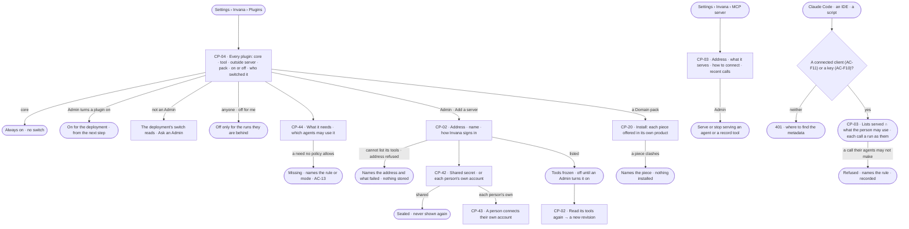
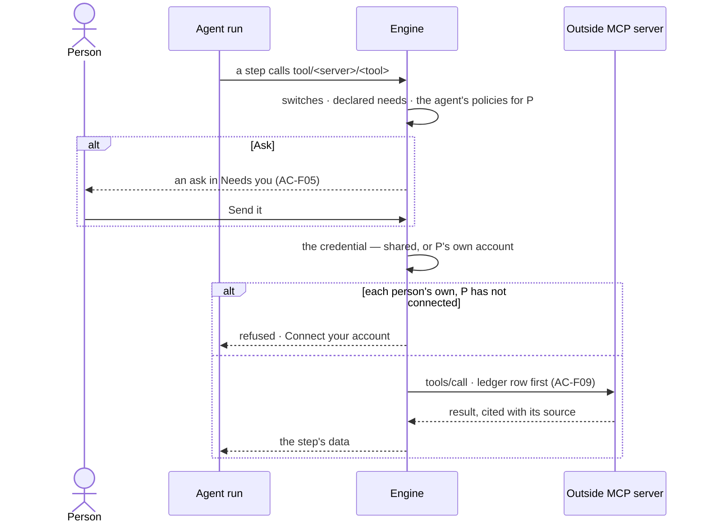

# Plugins and MCP

> Where the deployment meets the outside, in both directions: the plugins agents call — the core plugins that are the
> product, the tools Invana ships, every outside MCP server an Admin adds and the Domain packs — each switched on by an
> Admin and off for a person's own runs; the credentials Invana holds to reach an outside server, one shared secret or
> each person's own account; what every plugin declares it needs; and the deployment's one MCP server that Claude Code
> and other clients call as a person. The decision it helps make: *what may agents reach outside Invana, as whom, and
> what may the outside reach in here?*

## User journey

Journeys this feature is a step of: [J07 · Ready a deployment](../../../../journeys/J07-ready-a-deployment.md)

## Stories

| ID | Story | Status |
|---|---|---|
| CP-04 | [See every plugin and switch it on or off](stories/CP-04-see-every-plugin-and-switch-it-on-or-off/story.md) | idea |
| CP-44 | [See what a plugin needs and which agents may use it](stories/CP-44-see-what-a-plugin-needs-and-which-agents-may-use-it/story.md) | idea |
| CP-02 | [Add an outside MCP server and let agents call its tools](stories/CP-02-add-an-outside-mcp-server-and-let-agents-call-its-tools/story.md) | idea |
| CP-42 | [Choose how Invana signs in to an outside server](stories/CP-42-choose-how-invana-signs-in-to-an-outside-server/story.md) | idea |
| CP-43 | [Connect my own account to an outside server](stories/CP-43-connect-my-own-account-to-an-outside-server/story.md) | idea |
| CP-03 | [Let Claude Code and other clients use the deployment](stories/CP-03-let-claude-code-and-other-clients-use-the-deployment/story.md) | idea |
| CP-20 | [Install a Domain pack](stories/CP-20-install-a-domain-pack/story.md) | idea |

## Access

| Act | Role ([the role table](../../../access/features/AC-F02-access-policies/feature.md#the-role-table)) | Everyone else sees |
|---|---|---|
| Read every plugin, its functions and versions, what each needs, its switches and who set them | Every signed-in person — Operator, Modeller, Admin | — |
| Turn a plugin on or off for the deployment | Admin | The deployment's switch reads, naming who set it — *Ask an Admin — Priya or Lee* |
| Turn a plugin off, or back on, for the runs one is behind | Every signed-in person, for themselves | — |
| Add an outside MCP server · read its tools again | Admin | *Add a server* and *Read its tools again* are disabled, naming the Admins |
| Set how Invana signs in to an outside server · set or clear a shipped tool's secret | Admin, in a session, with the password again | Disabled, naming the Admins; a secret never reads back to anyone |
| Connect or disconnect one's own account to an outside server | Every person with an active account, in a session, with the password again | A service user, an agent and the system user have no account to connect; their runs on such a server are refused |
| Read and disconnect any person's outside account | Admin, in a session, with the password again | Another person's account is absent |
| Install or remove a Domain pack | Admin | *Install* and *Remove* are disabled, naming the Admins |
| Read the deployment's MCP server — address, what it serves, how to connect | Every signed-in person | — |
| Serve or stop serving an agent or a record tool over the MCP server | Admin | The switches read, naming the Admins |
| Read the MCP server's recent calls | Every signed-in person, their own calls · Admin, every call | Another person's calls are absent |
| Call the MCP server | A connected client as its person ([AC-F11](../../../access/features/AC-F11-connect-an-mcp-client/feature.md)) · a key as key ∩ owner ([AC-F10](../../../access/features/AC-F10-keys/feature.md)) | `401`, saying where to find the metadata |
| Say yes to an outside tool call | As [AC-F05](../../../access/features/AC-F05-asks-and-approvals/feature.md) | As AC-F05 |

## States

| State | What the person sees |
|---|---|
| First use | Plugins: the core plugins on; every tool plugin and pack off · outside servers: none, *Add a server* · outside accounts: *No accounts connected* · the MCP server: nothing served, *No calls yet*, with how to connect |
| Empty after a filter | *Nothing matches*, with the filter named and *Clear filters* |
| Loading | The section opens at once; rows fill in place |
| Has data | Plugins with both switches and who set them · each function with its version and needs · outside servers with their tools, revision and how Invana signs in · a person's connected accounts · what the MCP server serves and its recent calls |
| Failed | A server that cannot be reached or an address refused, named with what failed; a plugin not installed, naming its extra; an account whose sign-in expired, *Reconnect*; a call refused, naming the rule |
| Agent working or proposing | A run reaching an outside tool waits for a yes in Needs you (AC-F05) |
| No access | Every list reads; the deployment's switches, *Add a server*, credentials and serving are disabled, naming the Admins |

## Rules

| Rule | Detail |
|---|---|
| A plugin is a package | A versioned package of functions, skills and built-in workflows, of four kinds: **core** — the product, in the engine · **tool** — one that reaches outside, every one an MCP server · **outside server** — an MCP server an Admin adds, one plugin each · **pack** — a Domain pack |
| The default kit | Core: `graph.read` · `graph.write` · `graph.stitch` · `data` · `model` · `nl` · `plan` · `work` · `answer` · `board` · `thinking` · `ledger`. Tools: `web` · `mail`. Packs: Life sciences. Graph database connectors are [CP-F05](../CP-F05-graph-databases/feature.md#mechanisms)'s and channels [CP-F08](../CP-F08-the-inbox/feature.md#rules)'s, never plugins |
| No domain in the core | A domain arrives whole as a pack. The Life sciences pack carries the `science` tools — PubMed, UniProt, PubChem — and the genomic simulator with its starter, meaning and project types |
| Core is always on | A core plugin has no switch at either level |
| New starts off | A tool plugin, an outside server and an installed pack start off until an Admin turns them on |
| Two switches | The deployment's — Admin only, a hard off for everyone · a person's own — off narrows only the runs they are behind and never turns on what the deployment has off |
| Off means refused before it starts | Work that needs a plugin that is off is refused before it starts, naming who switched it off; a schedule skips its firing and raises an ops alert; a workflow that needs it is flagged and its runs refused until it is on |
| Switching takes effect at the next step | No restart; a step already running finishes |
| Every function declares what it needs | Each function's manifest names the verbs and resources it needs — an outside tool needs Run on its own `tool/<plugin>/<tool>`. It is usable when every need is within the agent's policies for the person behind the run and the graph database's mode allows it; the gate is [AC-F04](../../../access/features/AC-F04-what-an-agent-may-touch/feature.md#rules)'s. A function that needs nothing says so with an empty list; a manifest with no `needs` does not load |
| Outside tools start at Ask | Every outside call is Run on `tool/<plugin>/<tool>`; the built-in policies set every tool to Ask ([AC-F02](../../../access/features/AC-F02-access-policies/feature.md#mechanisms)), so a call waits for a yes in Needs you until an Admin writes a rule that allows it. Its ask reads as a send — *Send it* · *Not this time* |
| Every outside call is ledgered | Outbound, with what it carried, before its result is used ([AC-F09](../../../access/features/AC-F09-what-left-the-platform/feature.md)) |
| Outside answers are data | A tool's result is cited with its source and never followed as an instruction |
| Credentials are never an environment variable | An outside server signs in with nothing, a **shared secret** sealed under the install key, or **each person's own account** over OAuth; a shipped tool's settings — the mail server, the web search address — are shared secrets too. A secret is never read back, and setting one asks for the password again |
| Each person's own account | The agent calls the server as the person behind the run, with the account they connected; a run whose person has none is refused before the call, telling them to connect it. A schedule calls as its creator; a service user never connects one |
| Addresses are checked | An outside address that is not `https`, or resolves to a loopback, link-local or the deployment's own address, is refused, at add and at every call |
| An outside server's tools are frozen | The list an Admin saw when adding it; a later change on the server reaches no plan until an Admin reads its tools again, which is a new revision |
| A function keeps its version | Each function versions on its own; a run records the version it ran; after a breaking version the previous one serves re-runs |
| Outside work runs on workers | Tool steps run on workers, never in the engine serving Studio; with no worker free they wait, then fail saying no worker took them |
| One MCP server for the deployment | `https://<deployment>/mcp`. Its sign-in is the Access Plane's — a connected client ([AC-F11](../../../access/features/AC-F11-connect-an-mcp-client/feature.md)) or a key ([AC-F10](../../../access/features/AC-F10-keys/feature.md)); this feature owns what it serves |
| It serves what an Admin chose, as far as the person may go | Nothing is served at first. An Admin serves agents — each as `ask_<agent>` — and the record tools *Check records* and *Load records*. A caller lists only what is served and their agents may use, and every call is checked again by the one evaluator |
| Every call is a run | As the person behind the client or the key, through the agent the tool runs as, in Runs, History and the ledger; a refusal before a run is recorded, not run |
| The only write is a load | *Load records* is a load ([RC-F02](../../../../capabilities/records/features/RC-F02-bring-records-in/feature.md)) through the Loader — into a read + write graph database, checked against the model, rejected record by record, undone by a person |
| A caller reads what it started | Every call returns its run; the caller reads it with the same credential |
| A Domain pack brings a domain whole | A pack bundles a model starter, meaning, taxonomies, standards, rules, agents and skills, and project types with their report templates; each piece stays owned by its product and is offered there |
| Versions | The MCP and JSON Schema versions Invana speaks are pinned in [Mechanisms](#mechanisms) › *Standards* |
| Leans on | Access Policies (AC-F02) · declared needs and the gate (AC-F04) · asks (AC-F05) · History (AC-F06) · the ledger (AC-F09) · keys (AC-F10) · connected clients (AC-F11) · workers (CP-F03) · ops alerts (CP-F08) · functions and workflows (AG-F06) · loads (RC-F02) |

## Data touched

| Record | Read or write |
|---|---|
| Plugins, the deployment's switch and each person's own | Read · write |
| Outside servers — address, revision, frozen tools, how Invana signs in | Read · write |
| Shared secrets — sealed | Write · never read back |
| Outside accounts — each person's tokens, sealed | Write · read (the account's label and state only) |
| What the MCP server serves | Read · write |
| Runs opened over MCP, with the tool and the client or key | Write · read |
| Loads (RC-F02) | Write |
| Domain packs and what each installed | Read · write |
| History rows of every switch, add, credential change, connection and refusal (AC-F06) | Write |

## Engine

The low-level design: what this feature stores, serves and refuses. Conventions — naming, errors, lists, events — are
[system-design.md](../../../../system-design.md) §§ 6–8; this section only fills them in.

### Records

| Table | Columns | Notes |
|---|---|---|
| `control_plugins` | `name` (the key) · `kind` (`tool` · `mcp` · `pack`) · `enabled` (default `false`) · `switched_by_id?` · `switched_at?` · `installed_at?` · `installed_by_id?` | One row per switchable plugin; core plugins have none and are always on |
| `control_plugin_user_switches` | `plugin` · `user_id` · `off_at` | A person's own off; a row exists only while it is off. Unique (`plugin`, `user_id`) |
| `control_plugin_secrets` | `plugin` · `name` (a secret the manifest declares) · `value_sealed` · `set_by_id` · `set_at` | A shipped tool's setting. Unique (`plugin`, `name`) |
| `control_mcp_servers` | `name` (`^[a-z][a-z0-9_]{0,31}$`, the key, unique across plugins) · `url` · `revision` (from 1) · `tools` (the frozen list, each `key` · `version` · `read_only_hint` · `needs` · input and output schema) · `skipped` (each tool left out, with why) · `server` (`name` · `version` · `protocol` from its `initialize`) · `auth` (`none` · `shared` · `per_user`) · `secret_sealed?` · `oauth?` (`issuer` · `client_id` · `client_secret_sealed?` · `scopes[]`) · `frozen_at` · `added_by_id` | One outside server, one plugin of kind `mcp`. Previous revisions' tools stay readable for re-runs |
| `control_outside_accounts` | `server` · `user_id` · `label` (the account's name as the server gives it) · `access_token_sealed` · `refresh_token_sealed?` · `expires_at?` · `state` (`connected` · `expired`) · `connected_at` · `last_used_at?` | A person's own account on a `per_user` server. Unique (`server`, `user_id`); disconnecting removes the row |
| `control_mcp_served` | `kind` (`agent` · `tool`) · `ref` · `served` · `changed_by_id` · `changed_at` | Unique (`kind`, `ref`); what the deployment's MCP server offers |
| `control_mcp_sessions` | `session_id` (random) · `credential_kind` (`client` · `key`) · `credential_id` · `protocol` · `created_at` · `last_used_at` | One per `initialize`; a later call must carry a session its credential opened |

### Reads

| Record | Owner |
|---|---|
| The role table, the evaluator and the built-in policies | [AC-F02](../../../access/features/AC-F02-access-policies/feature.md#engine) |
| The gate — switches, declared needs and the caller chain at each step | [AC-F04](../../../access/features/AC-F04-what-an-agent-may-touch/feature.md#engine) |
| Signing in again for an act | [AC-F01](../../../access/features/AC-F01-sign-in-account-and-sessions/feature.md#mechanisms) |
| The person and service users, active or not | [AC-F03](../../../access/features/AC-F03-directory/feature.md#engine) |
| Asks for an outside call and their answers | [AC-F05](../../../access/features/AC-F05-asks-and-approvals/feature.md#engine) |
| History — every event this feature writes | [AC-F06](../../../access/features/AC-F06-history/feature.md#engine) |
| The ledger row of every outside call and every MCP call | [AC-F09](../../../access/features/AC-F09-what-left-the-platform/feature.md#engine) |
| A key on the MCP server | [AC-F10](../../../access/features/AC-F10-keys/feature.md#engine) |
| A connected client, its token and its rate limit | [AC-F11](../../../access/features/AC-F11-connect-an-mcp-client/feature.md#engine) |
| A function's manifest, the catalogue and a step's `key@version`; workflows a switch flags | [AG-F06](../../../../capabilities/agents/features/AG-F06-plans-and-workflows/feature.md#engine) |
| Runs opened over MCP | [CP-F10](../CP-F10-runs-and-how-the-agents-are-doing/feature.md#engine) |
| Agents that may be served, and their status | [AG-F01](../../../../capabilities/agents/features/AG-F01-build-an-agent/feature.md#engine) |
| Loads | [RC-F02](../../../../capabilities/records/features/RC-F02-bring-records-in/feature.md#engine) |
| A pack's pieces as each product offers them | Each product's `## Engine` |
| Workers that run tool steps | [CP-F03](../CP-F03-workers-and-the-queue/feature.md#engine) |
| Ops alerts a skipped schedule raises | [CP-F08](../CP-F08-the-inbox/feature.md#engine) |

### Routes

| Route, after `/api/v1/control` | Does | Story |
|---|---|---|
| `GET /plugins` | By the list contract — `?f.kind=` · `?f.enabled=` · `?q=` name or title. Each: `name` · `kind` · `version` · `title` · `extra` · `installed` · `enabled` · `switched_by` · `switched_at` · `my_switch` (`on` · `off`) · `switchable` · counts of functions, skills and workflows | CP-04 · CP-20 |
| `GET /plugins/{name}` | One plugin: the summary, each function's manifest with its `needs`, each workflow and skill, the secrets it declares (names, and whether each is set), and for a pack each piece with the product that offers it | CP-04 · CP-44 · CP-20 |
| `GET /plugins/{name}/agents?person=` | Each agent and whether it may use each function for that person — missing needs named ([AC-F04](../../../access/features/AC-F04-what-an-agent-may-touch/feature.md#routes)) | CP-44 |
| `PUT /plugins/{name}/switch` | `{enabled}` — the deployment's switch | CP-04 |
| `PUT /plugins/{name}/my-switch` | `{on}` — the caller's own switch | CP-04 |
| `PUT /plugins/{name}/secrets/{secret}` · `DELETE /plugins/{name}/secrets/{secret}` | Set `{value, password}` · clear `{password}` a shipped tool's secret | CP-42 |
| `POST /plugins/{name}/install` · `POST /plugins/{name}/remove` | Install or remove a Domain pack | CP-20 |
| `POST /mcp-servers` | Add `{name, url, auth, secret?, client_id?, client_secret?, password?}` — lists its tools and freezes them; `password` when a secret is given → `201` | CP-02 · CP-42 |
| `POST /mcp-servers/{name}/refresh` | Read its tools again — a new revision | CP-02 |
| `PUT /mcp-servers/{name}/auth` | `{auth, secret?, client_id?, client_secret?, password}` — change how Invana signs in; moving off `per_user` disconnects every account | CP-42 |
| `GET /outside-accounts` | The caller's accounts — `server` · `label` · `state` · `connected_at` · `last_used_at`; an Admin reads every person's with `?user=` | CP-43 |
| `POST /outside-accounts/{server}/connect` | `{password}` → the address to send the browser to, with PKCE and the server as the resource | CP-43 |
| `GET /outside-accounts/callback` | The server's redirect: exchanges the code, seals the tokens, returns to *Settings › You › Outside accounts* | CP-43 |
| `DELETE /outside-accounts/{server}?user=` | Disconnect `{password}` — one's own, or any person's as an Admin | CP-43 |
| `GET /mcp-server` | `url` · `transport` · `protocol_version` · how to connect (connected client and key) · `agents_served` · `tools_served` · `calls_today` | CP-03 |
| `GET /mcp-server/served` · `PUT /mcp-server/served/{kind}/{ref}` | What may be served, each with `served` · serve or stop serving one `{served}` | CP-03 |
| `GET /mcp-server/calls` | By the list contract, newest first — `run_id` · `at` · `person` · `client` or `key` · `tool` · `status` · `result`; the caller's own, or every call for an Admin | CP-03 |

| Route, at the deployment's root | Does | Story |
|---|---|---|
| `POST /mcp` | The MCP server — JSON-RPC over Streamable HTTP, JSON responses: `initialize` · `notifications/initialized` (`202`) · `ping` · `tools/list` · `tools/call` | CP-03 |
| `GET /mcp` · `DELETE /mcp` | `405` — no stream | CP-03 |

### Events

| Event | When |
|---|---|
| `control.plugins.switch` · `control.plugins.my_switch` | The deployment's switch · a person's own — `{enabled}` |
| `control.plugins.install` · `control.plugins.remove` | A Domain pack is installed or removed, with its pieces |
| `control.plugins.secret_set` · `control.plugins.secret_clear` | A shipped tool's secret is set or cleared — its name, never its value |
| `control.mcp_servers.add` · `control.mcp_servers.refresh` · `control.mcp_servers.auth` | An outside server is added · read again · changes how Invana signs in |
| `control.outside_accounts.connect` · `control.outside_accounts.disconnect` · `control.outside_accounts.expired` | A person connects · disconnects, or an Admin disconnects (`details.by`) · the server stops renewing it |
| `control.mcp_served.update` | An agent or record tool is served or stops being served |
| `control.mcp.refused` | A call to the MCP server refused before a run — the person, the client or key, the tool and the rule |

### Refusals

| Status | When | Sentence | Criterion |
|---|---|---|---|
| 403 | A deployment switch, an add, a refresh, an install or remove, a credential or secret change, or serving, by anyone but an Admin | *This needs an Admin — ask {admins}.* | CP-04.9 · CP-02.11 · CP-42.8 · CP-20.6 · CP-03.13 |
| 401 | A credential or secret change, or connecting or disconnecting an account, without the password, with a wrong one, or with a key | *Enter your password again to do this.* | CP-42.7 · CP-43.9 |
| 409 | Switching a core plugin | *{name} is part of Invana and is always on.* | CP-04.3 |
| 409 | Turning on a tool plugin whose extra is not installed | *{name} is not installed — install `invana[{extra}]`.* | CP-04.5 |
| 409 | Turning on, for oneself, a plugin the deployment has off | *{name} is off for the deployment — ask {admins}.* | CP-04.8 |
| 409 | Work that needs a plugin that is off — `switched_off`, with who and when | *{name} is off — switched off by {person} {when}.* | CP-04.6 · CP-04.7 |
| 409 | A server name taken by any plugin | *{name} is taken.* | CP-02.2 |
| 422 | A bad server name, or an address that is not `https` or resolves to a loopback, link-local or the deployment's own address | *{field}: {why}.* | CP-02.2 · CP-02.10 |
| 422 | A server that cannot be reached, refuses the credential or is not an MCP server | *{url}: {what failed}.* | CP-02.3 |
| 422 | A `shared` server with no secret, or a `per_user` server whose authorization server cannot be found and no client id is given | *{field}: {why}.* | CP-42.3 · CP-42.4 |
| 404 | An unknown plugin, server or account | *Not found.* | API only — Studio lists only what exists |
| 409 | A pack piece whose name is taken in its product | *{piece} clashes with {existing} in {product}.* | CP-20.4 |
| start refused | A function whose manifest has no `needs` key, or a need outside the resource grammar — the process does not start | *{plugin}: {function} does not declare its needs.* | CP-44.5 |
| step refused | A function needing a shipped tool's secret that is not set | *{plugin} needs {secret} — an Admin sets it.* | CP-42.6 |
| step refused | A call to a `per_user` server whose person has no connected account, or an expired one | *Connect your {server} account to let {agent} use it.* | CP-43.5 · CP-43.7 |
| step refused | A call to a `per_user` server for a service user | *{server} acts as each person — a service user has no account there.* | CP-43.8 |
| step failed | An outside server down at call time, or an address that now resolves somewhere refused | *{url} did not answer.* · *{url} resolves to {address}, which is refused.* | CP-02.9 · CP-02.10 |
| 401 | A call to the MCP server with no client token and no key | [AC-F11 › Refusals](../../../access/features/AC-F11-connect-an-mcp-client/feature.md#refusals) | CP-03.5 |
| 400 | A call with a session its credential did not open, or a protocol version other than the pinned one | *Unknown session.* · *This server speaks MCP {pinned}, not {asked}.* | CP-03.12 |
| 403 | A call whose agent the person may not use, or that no rule allows | [AC-F02 › Refusals](../../../access/features/AC-F02-access-policies/feature.md#refusals) | CP-03.6 |
| 409 | A call to a served agent that is paused, retired or a draft | *{agent} is {status}.* | CP-03.4 |
| run failed | *Load records* into a read-only graph database, or without Write on the kind | *{database} is read-only — {why}.* · AC-F02's sentence | CP-03.10 |

### CLI

| Command | Does |
|---|---|
| `invana plugins list` · `show <name>` | Every plugin with its version, kind, both switches and its functions · one as JSON |
| `invana plugins on · off <name> [--mine]` | The deployment's switch as an Admin, or the caller's own |
| `invana plugins secret set · clear <plugin> <secret>` | A shipped tool's secret, as an Admin; the value and the password from a prompt, never a flag |
| `invana plugins install · remove <pack>` | Install or remove a Domain pack, as an Admin |
| `invana plugins mcp add <url> --name <name> --auth none · shared · per-user` · `mcp refresh <name>` | Add an outside server · read its tools again, as an Admin; a secret from a prompt |

### Mechanisms

| Mechanism | How |
|---|---|
| A plugin's folder | `plugin.toml`; `tasks/<folder>/manifest.toml` and `run.py` per function; `flows/<key>.toml` per built-in workflow; `skills/<slug>/` (`skill.toml` · `instructions.md`) per skill. A pack adds `starter/` · `meaning/` · `taxonomies/` · `standards/` · `rules/` · `agents/` · `project_types/<key>/` · `simulators/` |
| `plugin.toml` | `name` · `kind` (`core` · `tool` · `pack`) · `title` · `engine` (the engine range) · `extra` · `secrets` · the ordered `tasks`, `flows` and `skills`. A tool or pack declares its own `version`; a core plugin's is the engine's. Read with `tomllib` |
| A function's needs | `manifest.toml` › `needs`: a list of `{verb, resource}` in the resource grammar of [AC-F02](../../../access/features/AC-F02-access-policies/feature.md#mechanisms) — `data/{database}/{kind}` from the step's arguments, `tool/<plugin>/<tool>` for an outside call. An outside server's tool needs Run on its own `tool/<server>/<tool>`, written when it is frozen |
| Loaded once, frozen | Plugins load once per process into a frozen registry. The process stops, naming the file, when a manifest does not validate, has no `needs` key, a key's last segment is not its folder, `run.py` has no `async def run(ctx, v)`, a key repeats, or `plugin.toml` lists other tasks, flows or skills than its folders hold. Switches are read at dispatch |
| Installed | From the engine's package metadata — `invana[tools-web]` · `invana[tools-mail]` · `invana[mcp]`; a pack is its own package. An extra with no third-party requirement is always installed. Not installed: listed from its manifest, naming the extra |
| Admission | Before a run is dispatched the coordinator checks every plugin its plan names against `enabled` and the person's own switch; one that is off refuses the run, naming who switched it off ([CP-F03](../CP-F03-workers-and-the-queue/feature.md)). Turning a plugin off flags every workflow that needs it and makes each schedule that needs it skip its next firing with an ops alert to its creator and the Admins |
| Secrets | Sealed under the install key ([system-design § 6](../../../../system-design.md#files-and-encryption)); the worker making the call unseals it for that call only. `ctx.secret(name)` refuses a name the plugin did not declare. Nothing is carried on a run, an event, a log line, a span or a ledger row |
| Tool plugins Invana ships | `web` — `web.search` (`query`, `limit` 10 → `results` (title · url · snippet) · `searched_at`; secret `web_search`, a SearXNG address) · `web.read_url` (`url` → `url` · `title` · `text` · `links` · `fetched_at`) · `web.download_file` (`url`, `max_mb` 50 → `url` · `files` · `rows` · `fetched_at`). `mail` — `mail.read` (`folder`, `limit`, `unseen_only` → `messages`; secret `imap`) · `mail.send` (`to`, `subject`, `body` → `message_id` · `sent_at`; secret `smtp`). Each runs as an MCP server on the workers; every row cites its address; a page robots.txt disallows is not read |
| The Life sciences pack | `science.pubmed.search` · `science.uniprot.get` · `science.pubchem.get`, each row with its `url`; the `genomic` simulator — one function, one built-in `simulate` workflow, reading only the loads it is given, its output evidence labelled *predicted* |
| A redelivered send is one send | `mail.send` derives its Message-ID from the step's idempotency key |
| Adding an outside server | Streamable HTTP at the pinned MCP version; the address checked, then `tools/list` once with the server's credential — for `per_user`, the adding Admin's own account, connected first; each tool whose name keys and whose schemas are valid JSON Schema is frozen at `1.0.0`; the rest go to `skipped`, named |
| Reading again | A new `revision`: a new tool starts at `1.0.0`; a tool whose input schema, description or annotations changed moves a major; an unchanged one keeps its version; a dropped one leaves the registry. A re-run on a previous version resolves it from the stored revision |
| An outside tool as a function | `<server>.<tool>` · `bound network` · `timeout_s` 60 · `retries` 0 · `resources cpu`; outputs `text` · `content` · `structured`; one step is one `tools/call` |
| The address check | The host is resolved at add and at every call; loopback, link-local (`169.254.0.0/16`, `fe80::/10`) and the deployment's own addresses are refused; the connection goes to the address that was checked. Private ranges are allowed — outside servers are often on the customer's network |
| Shared secret | Sent as `Authorization: Bearer <secret>`; sealed; replaced only by setting a new one with the password again |
| Each person's own account | Invana is an OAuth 2.1 client of the server: the server's protected-resource metadata (RFC 9728) names its authorization server, whose metadata (RFC 8414) names its endpoints; Invana registers itself (RFC 7591) or uses the client id an Admin gave. A person's connect is authorization code with `S256` PKCE and the server as the `resource` (RFC 8707); the tokens are sealed per person; an access token is renewed with its refresh token before use; a refused renewal sets `expired` and writes an Inbox row to the person |
| Who a call acts as | The person behind the run — for a schedule its creator. A delegated run calls as the person behind the first run |
| Ending an account | Disconnecting removes the row and its tokens; moving a server off `per_user` and deactivating a person ([AC-F03](../../../access/features/AC-F03-directory/feature.md#engine)) remove every account they cover, each with an Inbox row to its person |
| The MCP server — a session | `initialize` stores a random session id against the credential that opened it, with the pinned protocol; every later call must carry a session its credential opened |
| The MCP server — a call | The credential is checked on every call as AC-F10 or AC-F11 says; `tools/list` returns what is served and the person's agents may use; `tools/call` opens a run as the person through the agent the tool runs as — `ask_<agent>` that agent, *Check records* and *Load records* the Loader — run inline in the request and admitted like any run (CP-F04). The run records `triggered_by = mcp` and `params.mcp` `{tool, credential_kind, credential_id, client, result}`; `client` is the connected client's name or the key's name, never a name the caller sends |
| Served tools | `check_records` (*Check records*) — `database`, `kind`, `records` → `valid` · `rejected[{record, key, reason}]` · `warnings[]`, writing nothing · `load_records` (*Load records*) — `database`, `kind`, `records`, `source?` → the load's `load_id` · `content_hash` · `landed` · `rejected` ([RC-F02](../../../../capabilities/records/features/RC-F02-bring-records-in/feature.md#engine)) · `ask_<agent>` — `question` → the answer's text, `run`, `outcome`, `summary`; the name is `ask_` and the agent's snake-case name, at most 64 characters, two of one name told apart by the id's first six characters |
| A caller reads its run | Every call returns its run id; the caller reads it with the same credential at `GET /api/v1/control/runs/{id}` |
| Recent calls and calls today | Read from the runs the server opened: each carries the one-line `result` stored when it settled; *calls today* counts `triggered_by = mcp` runs since 00:00 UTC |
| How to connect | Built from the deployment's public address: `claude mcp add --transport http invana https://<deployment>/mcp` — the client signs in through AC-F11; for a script, the same with `--header "Authorization: Bearer $INVANA_KEY"` |
| Installing a pack | Checks every piece against the names its product already offers; any clash refuses the install and changes nothing. Installed, it starts off; each product offers its pieces from the frozen registry once it is on. A product record is made only when a person applies or uses a piece |
| Removing a pack | Its pieces stop being offered; every record a person made from one stays |
| Standards | Model Context Protocol `2026-07-28`, client and server, Streamable HTTP, and its authorization · OAuth 2.1 with RFC 7591, 8414, 8707, 9728 as a client · JSON Schema Draft 2020-12 for every function's inputs and outputs. One pin each: another version is refused, naming both; moving a pin is a spec change |

## System impact

| HLD section | Change | NFRs |
|---|---|---|
| § 6 Data and storage | Seven tables in Postgres; shared secrets and outside accounts' tokens sealed under the install key; the plugin registry is files, frozen per process | NFR-SEC-2 |
| § 7 Architecture and components | The plugin registry with declared needs; every tool plugin an MCP server on the workers; the deployment's one MCP server in the engine; Invana as an OAuth client of outside servers | — |
| § 8 APIs and events | `/api/v1/control/plugins` · `/mcp-servers` · `/outside-accounts` · `/mcp-server`, the root `/mcp`; `control.plugins.*` · `control.mcp*` · `control.outside_accounts.*` events | — |
| § 11 Failure modes and the outside boundary | An outside server down fails its step, never retried; an expired account refuses its person's calls until reconnected; addresses checked at every call | — |
| § 12 Qualities | Security: switches and declared needs before every step; outside tools Ask by default; no credential in an environment variable; every outside and MCP call ledgered | NFR-SEC-1 · NFR-SEC-4 · NFR-SEC-6 · NFR-SEC-7 |

The code changes are [migrations.md](../../../../migrations.md) M15 (outside credentials) and M16 (the deployment's MCP server).

## Decisions

| Decision | Detail |
|---|---|
| Plugins and the MCP server are Settings › Invana | *Plugins* lists every plugin and outside server; *MCP server* is its own entry; a person's outside accounts sit in *Settings › You*, beside keys and connected clients |
| An outside server is a plugin | One kind of list, one pair of switches, one resource name `tool/<server>/<tool>` for every tool, shipped or added |
| Per server, one way to sign in | An Admin chooses none, a shared secret or each person's own account for each outside server; a shipped tool's settings are shared secrets |
| Each person's own account is the person's | An agent reaches an outside account only as the person behind the run, and only once that person connected it |
| Credentials ask for the password again | Setting a secret, changing how a server signs in, and connecting or disconnecting an account change credentials ([AC-F01](../../../access/features/AC-F01-sign-in-account-and-sessions/feature.md#rules)) |
| A tool's read-only hint informs, never decides | The hint reads beside each tool to help an Admin write rules; whether a call waits is the agent's policies alone |
| Streamable HTTP only | An outside server is reached by address; Invana starts no third-party process on its own machine. The tools it ships run on its workers and are reached the same way |
| No retries for an outside tool | A blind retry of a send is a second send |
| Served tools | *Check records*, *Load records* and one `ask_<agent>` per served agent |
| An Admin serves; the policies decide who reaches it | Serving is the deployment's choice of what is offered; every call is still the person's, through their agents |
| A pack's pieces are offered, not copied | Installed, a pack's pieces are read from the registry by the product that owns each; removing a pack orphans nothing |
| Outside callers read the run | Every served call returns its run; a caller reads it on the runs route — no tool of its own |
| The engine writes the result line | Each call's one-line outcome is stored when its run settles; Recent calls only shows it |
| A changed tool keeps its previous version for re-runs | Reading a server's tools again never makes a re-run on the previous version unknown |

## Open questions

| Question | Who answers |
|---|---|
| May an Admin remove an outside server? Recommend: no — turning it off stops every call, and removing would orphan the versions old runs recorded | Ravi |

## Not building

| Item | Why not |
|---|---|
| Starting outside servers on Invana's machine (stdio) | No third-party processes beside the engine |
| A credential in an environment variable | Secrets are sealed in Postgres under the install key |
| MCP resources, prompts, sampling, elicitation | Plans call tools; the rest has no place in a plan |
| Following a server's changed tool list | The list is frozen until an Admin reads it again |
| Hot-loading a new or refreshed server | A process loads the revisions stored when it starts |
| A raw graph query as a served tool | Served agents answer with records cited |
| A general write path from outside | Writes have contracts; only a load writes, checked record by record |
| Workflows as served tools | Callers ask an agent, which may run a workflow |
| Authoring a Domain pack in Studio | A pack is a package built and versioned outside Invana |
| Third-party plugin packages inside the engine | A third party's tools arrive as an outside server an Admin adds (CP-02) |
| A tool interface of Invana's own | One interface — MCP — for every tool, shipped or added |
| Per-person accounts for the tools Invana ships | `web` and `mail` hold one shared setting each |
| A service user connecting an outside account | A service user never signs in, so never consents anywhere |
