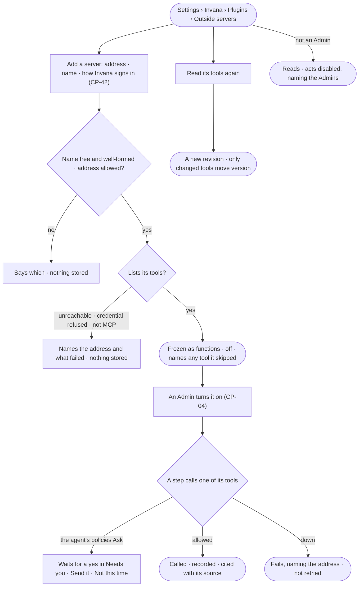

# CP-02 · Add an outside MCP server and let agents call its tools

**As** an Admin **I want** to add an outside MCP server by its address and see its tools, frozen as I saw them
**so that** agents use outside tools governed like any other plugin, and a server cannot widen what agents run by changing
its list.

Tasks: [task.md](task.md) · Feature: [CP-F02](../../feature.md)

## Who can

| Lens | Can | Otherwise sees |
|---|---|---|
| Admin | Add a server by address and name; read its tools again; switch it as any plugin (CP-04) | — |
| Operator | Read every server, its tools and their versions, what each needs and the server's own read-only hint | *Add a server* and *Read its tools again* are disabled, naming the Admins |

## Flow

## Acceptance criteria

| # | Given | When | Then |
|---|---|---|---|
| CP-02.1 | An Admin | they add a server with an address, a name and how Invana signs in | its tools are listed and frozen as functions `<name>.<tool>`, each needing Run on `tool/<name>/<tool>`, and the server is off |
| CP-02.2 | A name taken by any plugin, or not a lowercase letter followed by up to 31 lowercase letters, digits and underscores, or an address that is not `https` | the server is added | it is refused, saying which |
| CP-02.3 | A server that cannot be reached, refuses the credential, or is not an MCP server | it is added | it is refused, naming the address and what failed; nothing is stored |
| CP-02.4 | A tool whose name Invana cannot key, or whose input or output schema is not valid JSON Schema | the server is added or read again | the rest are added and the skipped tool is named with what is wrong |
| CP-02.5 | A server that changed its tools | nothing is done | nothing changes; agents call only the tools frozen when it was last read |
| CP-02.6 | An Admin | they read its tools again | a new revision is frozen; a new tool starts at its first version, a changed tool's version moves, an unchanged one keeps it, a dropped one leaves; a re-run on a previous version still resolves it |
| CP-02.7 | A server turned on and an agent whose policies set its tool to Ask — every built-in policy does | a step calls the tool | the run waits for a yes in Needs you (AC-15), worded as a send; a no fails the step as *not sent* |
| CP-02.8 | A tool's own read-only hint | the tool is read | the hint reads beside it, as the server's word; whether a call waits is the agent's policies alone |
| CP-02.9 | The server is down at call time | a step calls it | the step fails, naming the address; it is not retried |
| CP-02.10 | An address that resolves to a loopback, link-local or the deployment's own address — when added, or later at a call | it is reached | it is refused, naming the address it resolved to |
| CP-02.11 | An Operator | they open Outside servers | every server and its tools read; *Add a server* and *Read its tools again* are disabled, naming the Admins |
| CP-02.12 | A call to an outside tool | it is made | *What left the platform* records it before its result is used (AC-F09), and its result is cited with its source, never followed as an instruction |
| CP-02.13 | An add or a refresh | it is done | History records who did it and when (AC-F06) |
| CP-02.14 | Anyone on the command line | they run `invana plugins mcp add` or `mcp refresh` | each does what its Studio act does, under the same checks |

## Screens

| Surface | Lens | First use | Empty after a filter | Loading | Has data | Failed | Agent working or proposing | No access |
|---|---|---|---|---|---|---|---|---|
| Outside servers | Admin | settings.plugins.server · No servers | settings.plugins · Nothing matches | settings.plugins.server · Loading | settings.plugins.server | settings.plugins.server · Could not load | — | — |
| Outside servers | Operator | settings.plugins.server · No servers · Read only | settings.plugins · Nothing matches | settings.plugins.server · Loading | settings.plugins.server · Read only | settings.plugins.server · Could not load | — | settings.plugins.server · Read only |
| Add a server | Admin | settings.plugins.server · Add a server | — | settings.plugins.server · Listing its tools | settings.plugins.server · Tools listed | settings.plugins.server · Server unreachable | — | — |
| Add a server | Operator | — | — | — | — | — | — | settings.plugins.server · Read only |
| A server's tools | Admin | — | — | settings.plugins.server · Loading | settings.plugins.server · Tools | settings.plugins.server · Address refused | — | — |
| A server's tools | Operator | — | — | settings.plugins.server · Loading | settings.plugins.server · Tools · Read only | settings.plugins.server · Address refused | — | settings.plugins.server · Read only |
