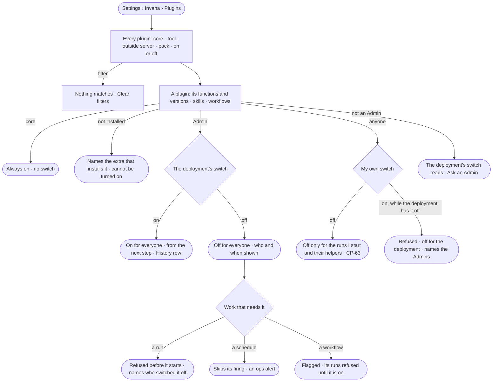

# CP-04 · See every plugin and switch it on or off

**As** an Admin **I want** every plugin the deployment carries, and to turn each one on only when it is ready — and each
person to turn one off for their own runs **so that** agents reach the web, mail or an outside server only when it was
meant, and nobody waits on a refusal that does not say why.

Tasks: [task.md](task.md) · Feature: [CP-F02](../../feature.md)

## Who can

Roles are [the role table](../../../../../access/features/AC-F02-access-policies/feature.md#the-role-table).

| Lens | Can | Otherwise sees |
|---|---|---|
| Admin | Read every plugin; turn one on or off for the deployment; turn one off or on for their own runs | — |
| Operator | Read every plugin, its functions, versions, skills and workflows, and both switches; turn a plugin off, or back on, for the runs they start; a Modeller the same | The deployment's switch reads, with who set it and when — *Ask an Admin — Priya or Lee* |

## Flow

## Acceptance criteria

| # | Given | When | Then |
|---|---|---|---|
| CP-04.1 | A signed-in person | they open *Plugins* | every plugin reads — core, tool, outside server, Team pack — with its version, the deployment's switch with who set it and when, and their own switch |
| CP-04.2 | A plugin | it opens | its functions read with their versions and what each does, and its skills and workflows |
| CP-04.3 | A core plugin | it is read or switched by any path | it reads *Always on* and has no switch; a switch through the API is refused, saying it is part of Invana |
| CP-04.4 | A new deployment, a newly added outside server or a newly installed pack | Plugins opens | every core plugin is on and every other plugin is off |
| CP-04.5 | A tool plugin whose extra is not installed | it is read | it says it is not installed, naming the extra; it cannot be turned on |
| CP-04.6 | A plugin the deployment has off | a run's plan needs it | the run is refused before it starts, naming who switched it off and when |
| CP-04.7 | A person who turned a plugin off for themselves | a run they started, or its helper, needs it | it is refused before it starts, saying they switched it off, with *Turn it on* |
| CP-04.8 | A plugin the deployment has off | a person turns it on for themselves | it is refused, saying it is off for the deployment and naming the Admins |
| CP-04.9 | An Operator | they reach the deployment's switch | it reads, with who set it, and *Ask an Admin*, naming the Admins; through the API it is refused |
| CP-04.10 | An Admin | they turn a plugin on or off | it holds for everyone from the next step, with no restart; a step already running finishes; History records who and when |
| CP-04.11 | A schedule whose work needs a plugin that is off | it fires | it skips the firing and raises an ops alert to the person who set it and the Admins |
| CP-04.12 | A workflow whose steps call a plugin that is off | the list of workflows reads | it is flagged, naming the plugin, and its runs are refused until it is on |
| CP-04.13 | A person's own switch | another person's run, a schedule or a picked-up task calls the plugin | it is unaffected |
| CP-04.14 | A plugin's functions | one is opened | its inputs and outputs read as their JSON Schema, and its recent calls — when, which run, its outcome — with the skills and workflows that use it |
| CP-04.15 | A run | it records a step | it records the function's version it ran |
| CP-04.16 | A tool step and no worker free | it waits past its allowance | it fails, saying no worker took it |
| CP-04.17 | A web page whose robots.txt disallows it | a web tool would read it | nothing is read, and the step says so with the address |
| CP-04.18 | Anyone on the command line | they run `invana plugins list`, `show`, `on` or `off` | each does what its Studio act does, under the same checks |

## Screens

| Surface | Lens | First use | Empty after a filter | Loading | Has data | Failed | Agent working or proposing | No access |
|---|---|---|---|---|---|---|---|---|
| Plugins | Admin | settings.plugins · New and off | settings.plugins · Nothing matches | settings.plugins · Loading | settings.plugins | settings.plugins · Could not load | — | — |
| Plugins | Operator | settings.plugins · New and off · Read only | settings.plugins · Nothing matches | settings.plugins · Loading | settings.plugins · My switch | settings.plugins · Could not load | — | settings.plugins · Read only |
| A plugin | Admin | settings.plugins · Plugin off | — | settings.plugins · Loading | settings.plugins · Plugin | settings.plugins · Not installed | — | — |
| A plugin | Operator | settings.plugins · Plugin off · Read only | — | settings.plugins · Loading | settings.plugins · Plugin · My switch | settings.plugins · Off for the deployment | — | settings.plugins · Read only |
