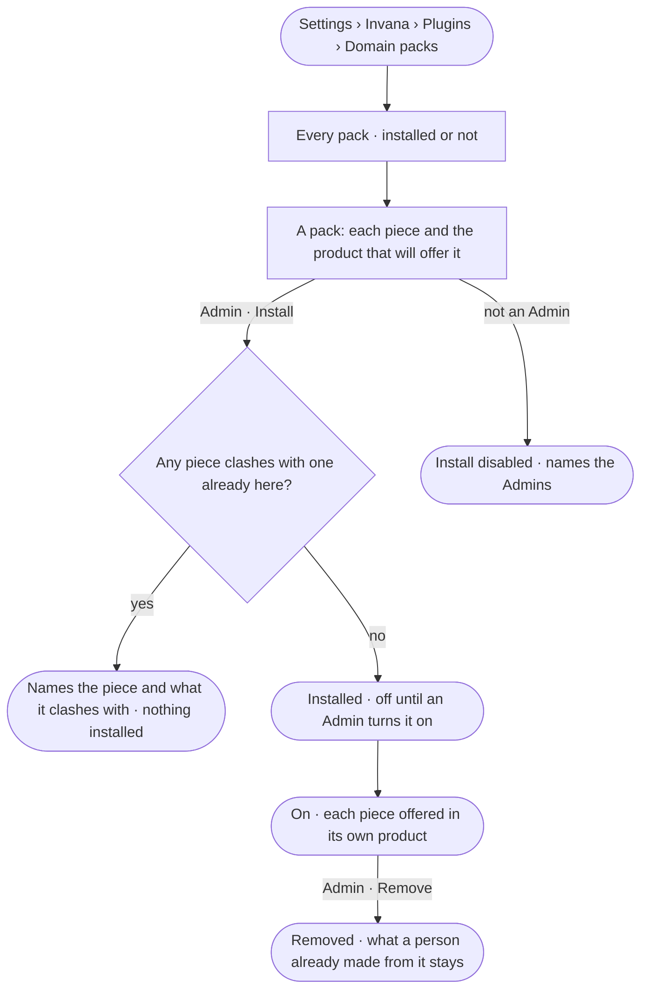

# CP-20 · Install a Domain pack

**As** an Admin **I want** to install a Domain pack that brings a domain's model starter, meaning, taxonomies,
standards, rules, agents, skills, tools and project types in one act **so that** a team starts in its domain from a
working whole, and the platform itself stays general-purpose.

Tasks: [task.md](task.md) · Feature: [CP-F02](../../feature.md)

## Who can

| Lens | Can | Otherwise sees |
|---|---|---|
| Admin | Read every pack and what it adds; install or remove a pack; switch it as any plugin (CP-04) | — |
| Operator | Read every pack, what it adds, whether it is installed and both switches | *Install* and *Remove* are disabled, naming the Admins |

## Flow

## Acceptance criteria

| # | Given | When | Then |
|---|---|---|---|
| CP-20.1 | A signed-in person | they open *Domain packs* | every pack Invana carries lists — Life sciences among them — each with its version and whether it is installed |
| CP-20.2 | A pack | it opens | each piece reads with the product that will offer it: model starter, meaning, broader kinds, standards and rules (Model) · agents and skills (Agents) · tools and simulators (Plugins) · project types and report templates (Projects) |
| CP-20.3 | An Admin | they install a pack with no clashing piece | it installs off; once turned on, the starter is offered in *New model*, the project types in *New project*, the agents and skills in the catalogue; History records who installed it |
| CP-20.4 | A pack with a piece whose name is already taken in its product | an Admin installs it | it is refused, naming the piece and what it clashes with; nothing is installed |
| CP-20.5 | An installed pack | an Admin removes it | its pieces stop being offered; a model, project or agent a person already made from them stays |
| CP-20.6 | An Operator | they open a pack | everything reads; *Install* and *Remove* are disabled, naming the Admins |

## Screens

| Surface | Lens | First use | Empty after a filter | Loading | Has data | Failed | Agent working or proposing | No access |
|---|---|---|---|---|---|---|---|---|
| Domain packs | Admin | settings.plugins · No pack installed | settings.plugins · Nothing matches | settings.plugins · Loading | settings.plugins · Packs | settings.plugins · Pack clashes | — | — |
| Domain packs | Operator | settings.plugins · No pack installed | settings.plugins · Nothing matches | settings.plugins · Loading | settings.plugins · Packs · Read only | settings.plugins · Could not load | — | settings.plugins · Packs · Read only |
