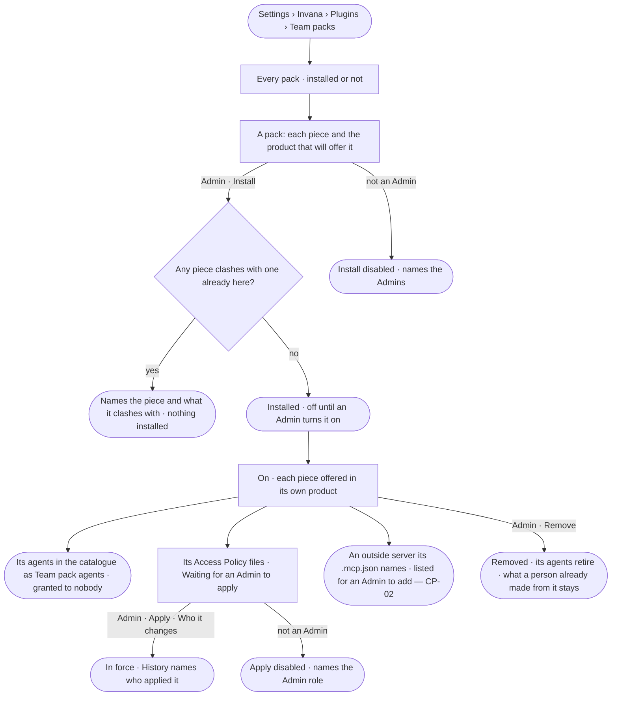

# CP-20 · Install a Team pack

**As** an Admin **I want** to install a Team pack that brings a team's agents, skills, model starter, meaning,
taxonomies, standards, rules, tools, Access Policy files and project types in one act — a Claude plugin with Invana's
fields under `metadata` — and apply its policies myself **so that** a team starts its work from a working whole,
installing it widens nobody's reach until I say so, and the platform itself stays general-purpose.

Tasks: [task.md](task.md) · Feature: [CP-F02](../../feature.md)

## Who can

[The role table](../../../../../access/features/AC-F02-access-policies/feature.md#the-role-table) — *Plugins and MCP —
the install switch* is the Admin's.

| Lens | Can | Otherwise sees |
|---|---|---|
| Admin | Read every pack and what it adds; install or remove a pack; switch it as any plugin (CP-04); apply its Access Policy files after *Who it changes* (AC-04); grant its agents (AC-22) | — |
| Modeller | Read every pack, what it adds, whether it is installed, both switches and its policy files waiting to apply | *Install*, *Remove* and *Apply* are disabled, naming the Admins |
| Operator | As Modeller | As Modeller |

## Flow

## Acceptance criteria

| # | Given | When | Then |
|---|---|---|---|
| CP-20.1 | A signed-in person | they open *Team packs* | every pack Invana carries lists — Life sciences and Software delivery among them — each with its version and whether it is installed |
| CP-20.2 | A pack | it opens | each piece reads with the product that will offer it: model starter, meaning, broader kinds, standards and rules (Model) · agents and skills (Agents) · Access Policy files (Access) · tools and simulators (Plugins) · project types and report templates (Projects) |
| CP-20.3 | An Admin | they install a pack with no clashing piece | it installs off; once turned on, the starter is offered in *New model*, the project types in *New project*, the agents and skills in the catalogue; History records who installed it |
| CP-20.4 | A pack with a piece whose name is already taken in its product | an Admin installs it | it is refused, naming the piece and what it clashes with; nothing is installed |
| CP-20.5 | An installed pack | an Admin removes it | its pieces stop being offered and its agents retire, keeping their names; a model, project or agent a person already made from them stays, and so does a policy an Admin applied |
| CP-20.6 | An Operator or a Modeller | they open a pack | everything reads; *Install* and *Remove* are disabled, naming the Admins |
| CP-20.7 | A pack turned on that carries Access Policy files | it lands | each policy reads *Waiting for an Admin to apply* in Access Policies and decides nothing; the pack reads *{n} policies to apply*; every Admin finds them in *Needs you* |
| CP-20.8 | A pack's policy waiting to apply | an Admin presses *Apply* | *Who it changes* shows first, then it is saved as AC-04 saves a policy and History names who applied it; an Operator's or a Modeller's *Apply* is disabled, naming the Admin role, and the engine refuses it the same |
| CP-20.9 | A pack turned on that carries agents | the catalogue opens | each agent lists as a *Team pack* agent, owned by the platform and made by the pack, granted to nobody until an Admin grants it; until its policies are applied it reaches nothing, and its sheet says so |
| CP-20.10 | A plugin folder with no `.claude-plugin/plugin.json`, with an Invana field outside `metadata`, or carrying `hooks/` or `commands/` | the engine starts | it does not start, naming the plugin, the file and why |
| CP-20.11 | A pack whose `.mcp.json` names an outside server | it is turned on | the server is listed for an Admin to add in Plugins (CP-02), never added or started; one started as a local process is named as refused, as Invana reaches servers by address |

## Screens

| Surface | Lens | First use | Empty after a filter | Loading | Has data | Failed | Agent working or proposing | No access |
|---|---|---|---|---|---|---|---|---|
| Team packs | Admin | settings.plugins · No pack installed | settings.plugins · Nothing matches | settings.plugins · Loading | settings.plugins · Packs | settings.plugins · Pack clashes | — | — |
| Team packs | Operator | settings.plugins · No pack installed | settings.plugins · Nothing matches | settings.plugins · Loading | settings.plugins · Packs · Read only | settings.plugins · Could not load | — | settings.plugins · Packs · Read only |
| A pack's policies to apply | Admin | — | — | settings.access · Loading | settings.plugins · Policies to apply | settings.access · Rule refused | — | — |
| A pack's policies to apply | Operator | — | — | — | settings.plugins · Policies to apply · Read only | — | — | settings.access · Waiting to apply |
| A pack's outside servers | Admin | — | — | — | settings.plugins · Servers to add | — | — | — |
| A pack's outside servers | Operator | — | — | — | settings.plugins · Servers to add · Read only | — | — | settings.plugins · Packs · Read only |
